# Iter Animi

**Simulador de casos académicos de Psicología Social.** Los docentes diseñan casos con escenas, decisiones y rúbrica; los
estudiantes los recorren como una novela visual interactiva, con tiempo e intentos controlados; y el sistema evalúa,
retroalimenta y presenta el seguimiento de cada sesión.

*Decidir con criterio. Aprender con sentido.*

Proyecto Nuclear II · Ingeniería de Software

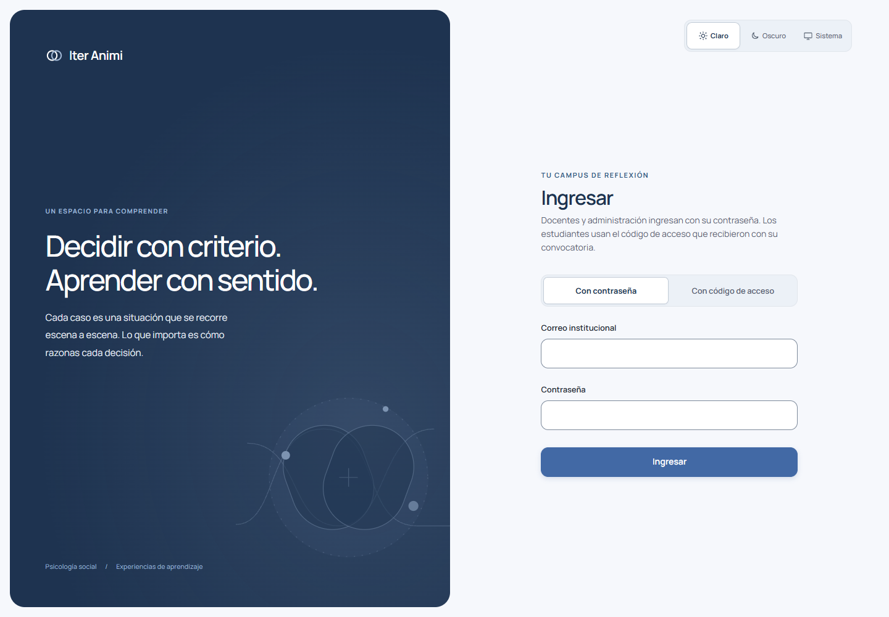

## Contenido

- [Qué resuelve](#qué-resuelve)
- [Funcionalidades por rol](#funcionalidades-por-rol)
- [Recorrido visual](#recorrido-visual)
- [Arquitectura](#arquitectura)
- [Puesta en marcha](#puesta-en-marcha)
- [Pruebas](#pruebas)
- [Despliegue](#despliegue)
- [Seguridad](#seguridad)
- [Documentación](#documentación)
- [Estado y limitaciones](#estado-y-limitaciones)
- [Equipo](#equipo)

## Qué resuelve

Los casos prácticos de Psicología Social suelen aplicarse en papel o en formularios genéricos: cuesta controlar el tiempo y el
acceso, la calificación con rúbrica se hace a mano y la retroalimentación llega tarde. Iter Animi reúne el proceso completo:

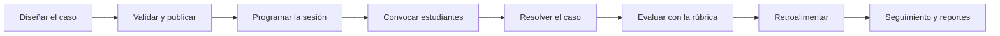

## Funcionalidades por rol

| Rol | Ingreso | Qué puede hacer |
|---|---|---|
| **Administración** | Correo y contraseña | Crear docentes y estudiantes, conceder el permiso de crear casos, activar o desactivar cuentas, gestionar aulas (espacios académicos) y revisar las entregas de correo. |
| **Docente** | Correo y contraseña | Crear casos en el editor o importarlos en CaseDSL, asignar personajes y reacciones, publicar, programar sesiones, convocar, evaluar, comentar intentos, consultar indicadores y exportar a CSV. |
| **Estudiante** | Correo y código de convocatoria | Consultar su sesión, resolver el caso en el simulador (se puede retomar dentro del tiempo del intento) y ver sus resultados, la retroalimentación y los avisos. |

La interfaz es adaptable a móvil y ofrece tema claro, oscuro o el del sistema.

## Recorrido visual

### Simulador

El estudiante lee la escena, elige y confirma cada decisión, con el tiempo y el avance a la vista.

| Tema claro | Tema oscuro |
|---|---|
| 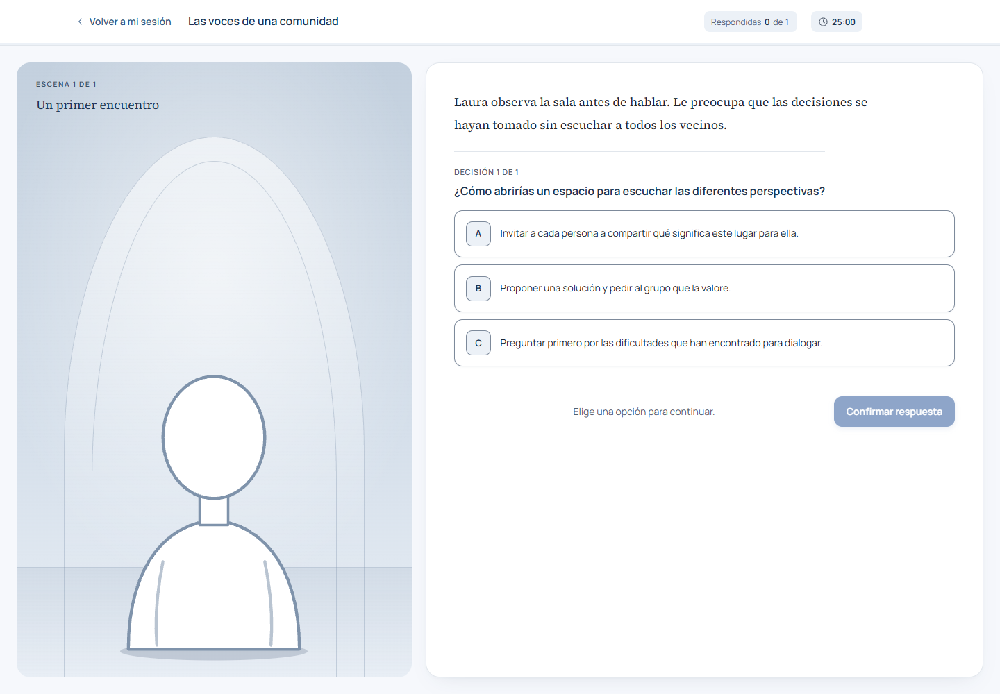 | 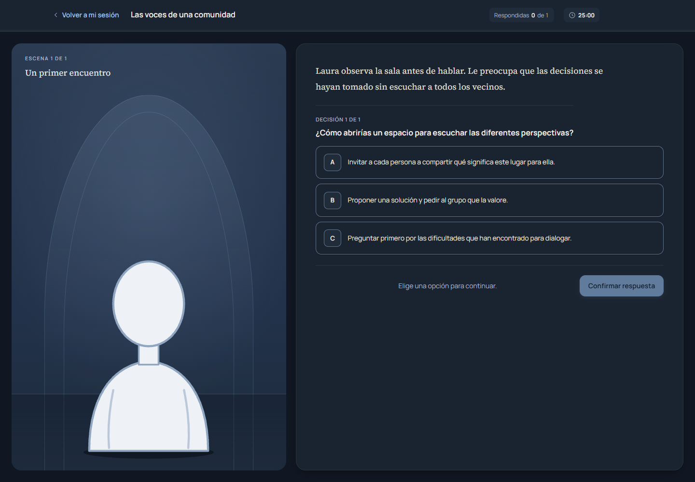 |

### Personajes y reacciones

El docente elige un personaje del sistema o sube el suyo; su expresión cambia según la decisión confirmada, sin indicar si es
correcta.

<p align="center">
  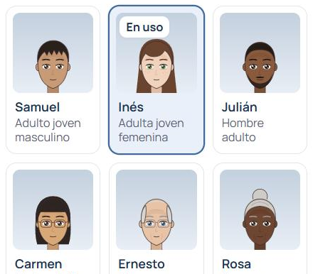
  &nbsp;
  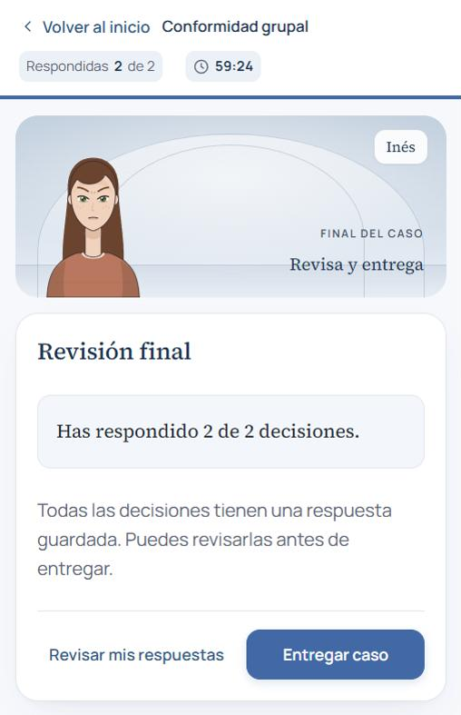
</p>

### Docente

| Panel | Editor de casos |
|---|---|
| 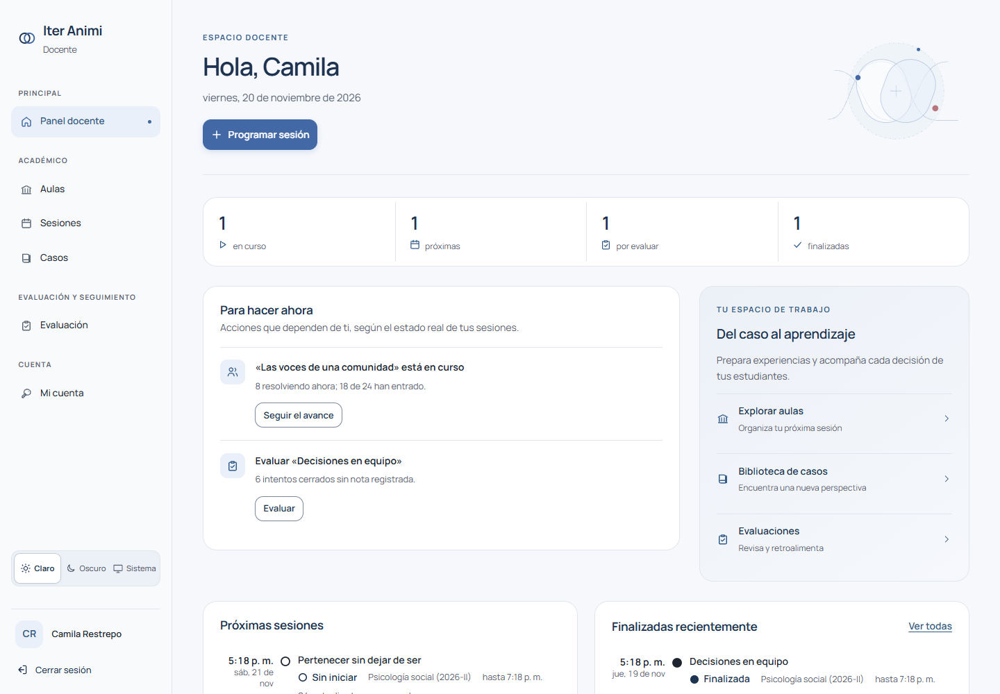 | 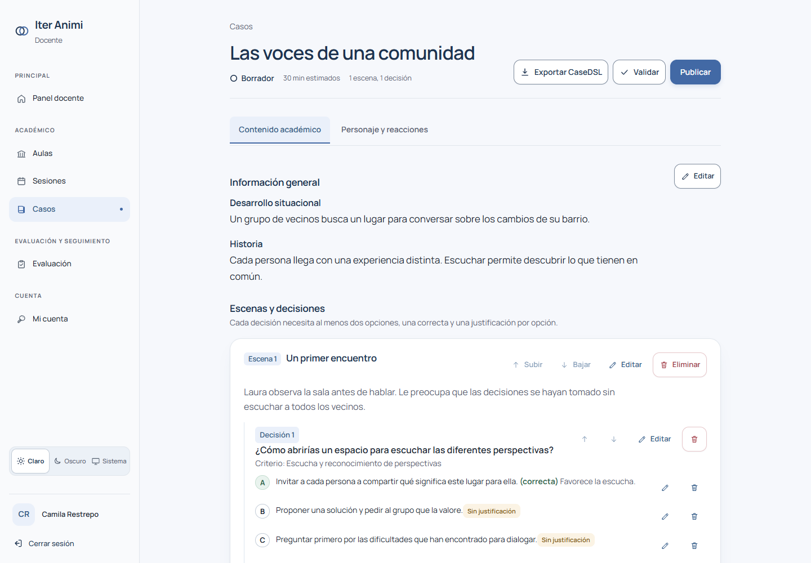 |
| **Evaluación** | **Seguimiento** |
| 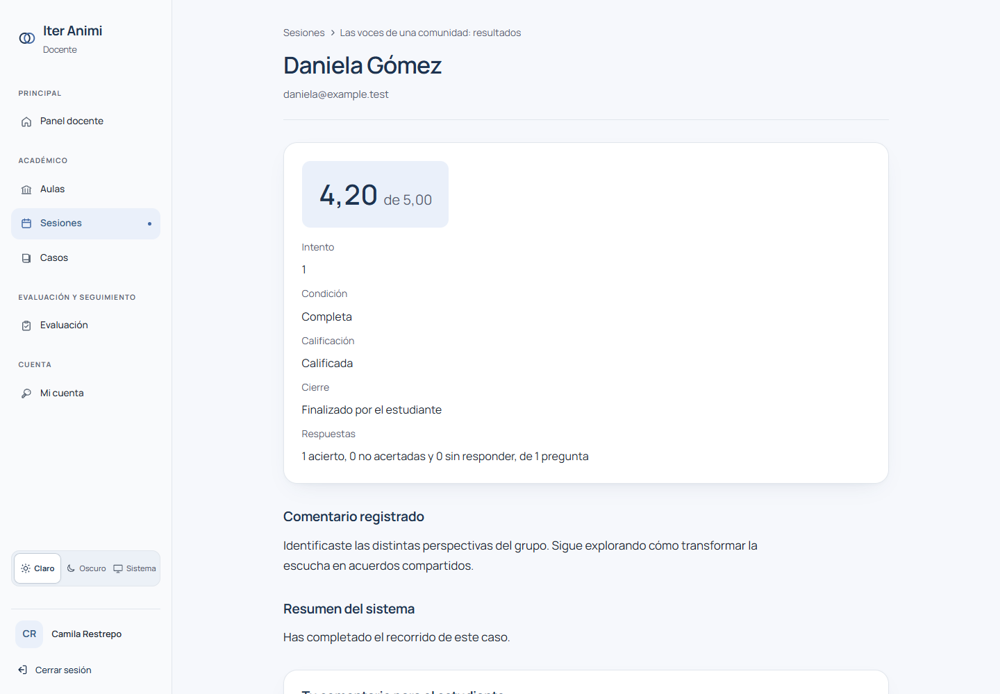 | 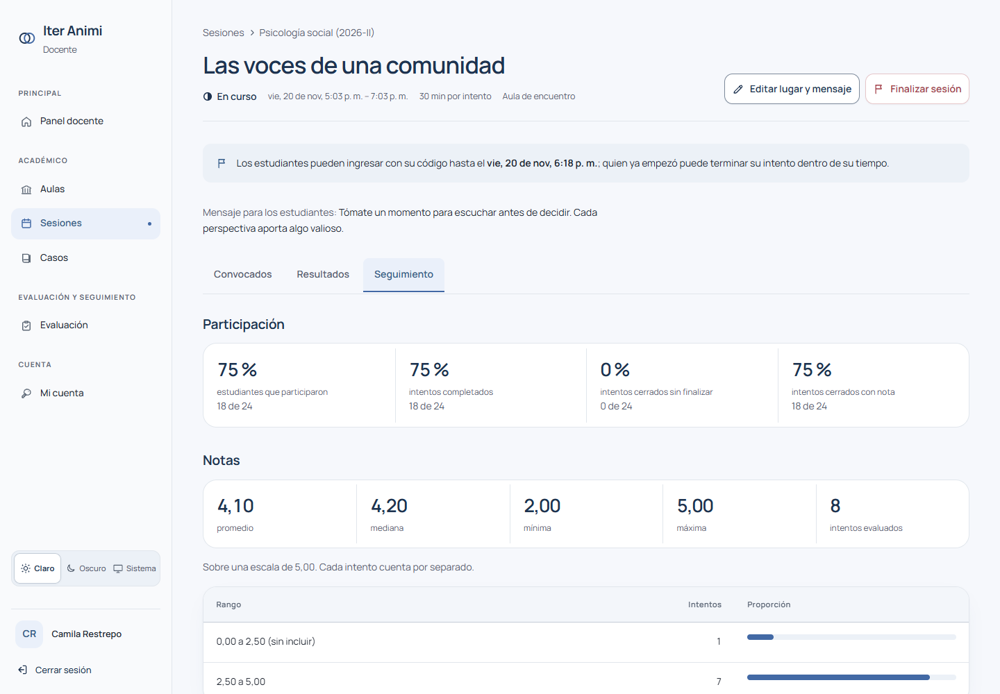 |

### Estudiante y administración

| Inicio del estudiante | Administración |
|---|---|
| 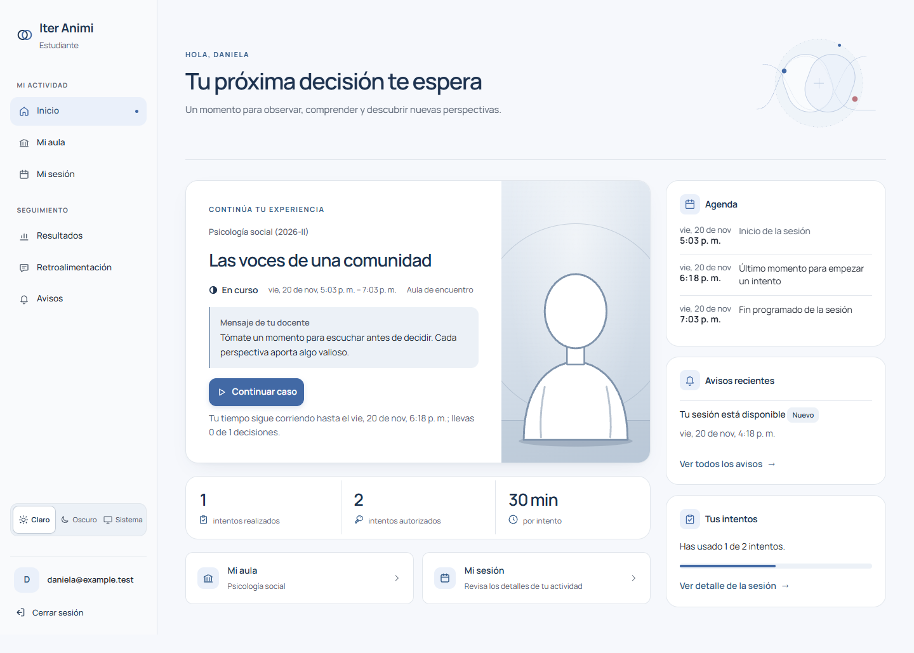 | 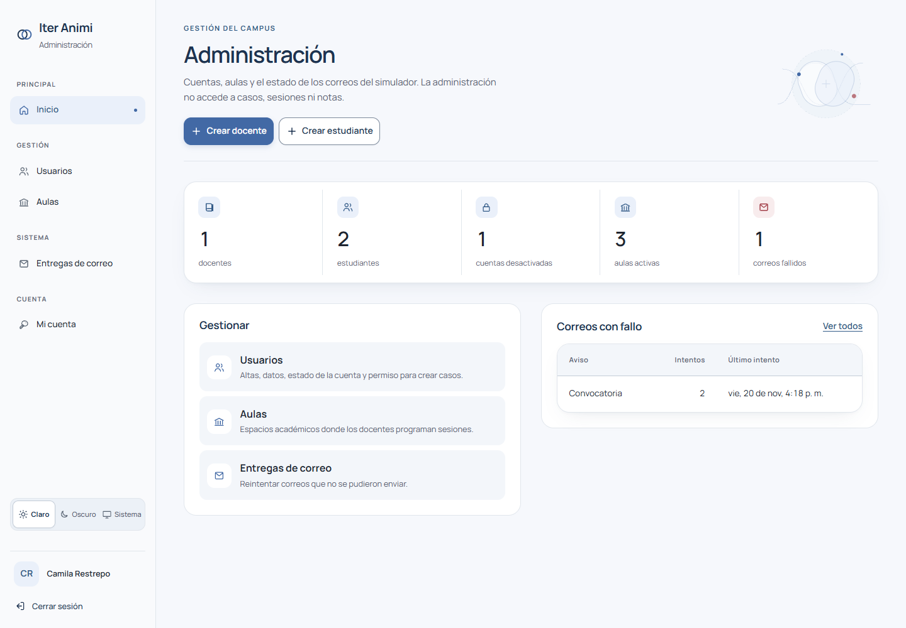 |

### En el móvil

<p align="center">
  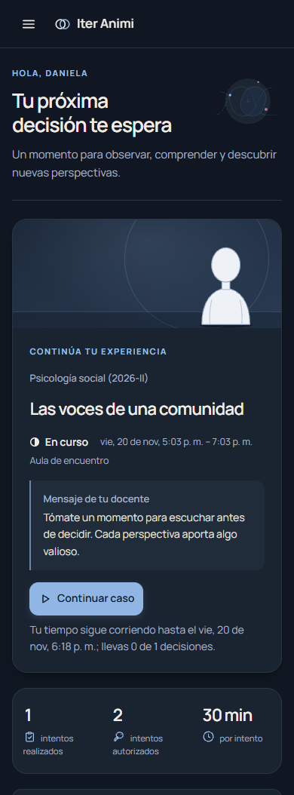
  &nbsp;&nbsp;
  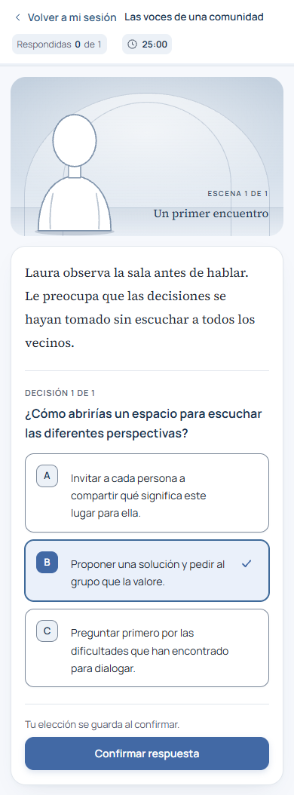
</p>

<sub>Todas las capturas usan datos de prueba.</sub>

## Arquitectura

Monorepo con una SPA y una API REST organizada como **monolito modular**. Tres procesos en segundo plano se ocupan de lo que
no depende de una petición HTTP.

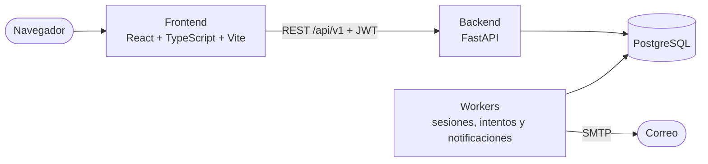

| Capa | Tecnologías |
|---|---|
| Frontend | React 19, TypeScript, Vite, React Router, TanStack Query, Vitest, oxlint |
| Backend | Python 3.12+, FastAPI, SQLAlchemy 2, Alembic, Pydantic, pytest |
| Datos | PostgreSQL 13+ (restricciones, disparadores y bloqueos en la propia base) |
| Seguridad | Argon2, JWT, AES-256-GCM |

### Módulos del backend

| # | Módulo | Paquete | Responsabilidad | Patrones |
|---|---|---|---|---|
| 1 | Autenticación y Usuarios | `auth` | Cuentas, roles, permisos e invalidación de tokens | |
| 2 | Gestión de Casos Académicos | `cases` | Casos, rúbrica, CaseDSL, validación y publicación | Builder, Chain of Responsibility, State |
| 3 | Sesiones y Convocatorias | `sessions` | Aulas, programación, códigos y acceso estudiantil | State |
| 4 | Participaciones | `participations` | Intentos, temporizador y respuestas | |
| 5 | Evaluación y Retroalimentación | `evaluations` | Calificación con rúbrica y comentarios | Strategy |
| 6 | Notificaciones y Eventos | `notifications` | Eventos, avisos internos y correo con reintentos | Observer, Adapter |
| 7 | Seguimiento y Reportes | `reports` | Indicadores, desempeño por criterio y CSV | |

El diseño detallado, el modelo de datos, los endpoints y las decisiones de cada módulo están en
[`backend/README.md`](backend/README.md).

### Estructura del repositorio

```text
├── backend/
│   ├── app/
│   │   ├── core/         configuración, base de datos, seguridad y errores
│   │   ├── modules/      los siete módulos
│   │   ├── workers/      cierre de sesiones, expiración de intentos y notificaciones
│   │   └── scripts/      creación del administrador inicial
│   ├── alembic/          migraciones
│   └── tests/            unitarias, integración y regresión
├── frontend/
│   ├── src/              portales, simulador, componentes y servicios
│   ├── public/           biblioteca de personajes y paquetes visuales
│   ├── deploy/           ejemplo de Nginx
│   └── docs/             diseño, matriz de requisitos y paquetes visuales
└── docs/                 reportes de prueba, evidencias, ejemplos y capturas
```

## Puesta en marcha

**Requisitos:** Python 3.12+, Node.js 20+ y PostgreSQL 13+. Los comandos son de PowerShell.

### 1. Base de datos

Con `psql` como superusuario:

```sql
CREATE ROLE simulador_user LOGIN PASSWORD 'una-clave-segura';
CREATE DATABASE simulador_psicologia OWNER simulador_user;
CREATE DATABASE simulador_psicologia_test OWNER simulador_user;  -- solo para pruebas
```

### 2. Backend

```powershell
cd backend
py -3 -m venv .venv
.venv\Scripts\activate
pip install -r requirements.txt
copy .env.example .env
```

Complete en `.env` al menos estas variables (el resto está comentado en
[`backend/.env.example`](backend/.env.example)):

| Variable | Valor |
|---|---|
| `DATABASE_URL`, `TEST_DATABASE_URL` | Las dos bases del paso anterior |
| `JWT_SECRET_KEY` | `python -c "import secrets; print(secrets.token_urlsafe(64))"` |
| `CONVOCATION_CODE_ENCRYPTION_KEY` | `python -c "import base64, os; print(base64.urlsafe_b64encode(os.urandom(32)).decode())"` |

> Conserve `CONVOCATION_CODE_ENCRYPTION_KEY`: si se pierde, los códigos ya emitidos no se pueden recuperar.

Aplique las migraciones, cree el administrador (la contraseña se pide por consola) e inicie la API:

```powershell
alembic upgrade head
python -m app.scripts.create_admin --nombre "Nombre Apellido" --correo admin@universidad.edu.co
uvicorn app.main:app --reload
```

API en <http://localhost:8000> y documentación interactiva en <http://localhost:8000/docs>.

### 3. Frontend

En otra terminal:

```powershell
cd frontend
npm install
npm run dev
```

Abra <http://localhost:5173>. En desarrollo, Vite reenvía `/api` al backend, así que no hace falta configurar nada más.

### 4. Workers

Cada uno en su terminal, desde `backend/` y con el entorno virtual activo. Sin `--intervalo` hacen una sola pasada, apta para
cron o el Programador de tareas.

```powershell
python -m app.workers.notifications --intervalo 30            # avisos internos y correos
python -m app.workers.participation_expiration --intervalo 60 # cierra los intentos vencidos
python -m app.workers.session_expiration --intervalo 300      # cierra las sesiones vencidas
```

El correo está desactivado por defecto (`NOTIFICATIONS_EMAIL_ENABLED=false`). En ese caso, el docente entrega el código desde
**Convocados → Ver código**.

### 5. Primer recorrido

1. **Administración:** cree un docente con permiso para crear casos, un estudiante y un aula.
2. **Docente:** importe [`caso_conformidad_grupal.casedsl.json`](docs/ejemplos/caso_conformidad_grupal.casedsl.json) en
   **Casos → Nuevo caso → Importar CaseDSL**, valídelo y publíquelo. Programe una sesión con ese estudiante y ábrala.
3. **Estudiante:** ingrese con el código de acceso, resuelva el caso y entréguelo.
4. **Docente:** evalúe el intento, escriba un comentario y finalice la sesión.
5. **Estudiante:** ingrese con el mismo código para ver los resultados y la retroalimentación.

El guion completo está en [`frontend/README.md`](frontend/README.md#guion-breve-de-sustentación-unos-10-minutos).

## Pruebas

| Ámbito | Desde | Comando | Requiere PostgreSQL |
|---|---|---|---|
| Backend, unitarias | `backend/` | `pytest tests/unit` | No |
| Backend, integración | `backend/` | `pytest tests/integration` | Sí |
| Backend, todo con cobertura | `backend/` | `pytest --cov=app` | Sí |
| Frontend, tipos, lint, pruebas y build | `frontend/` | `npm run check` | No |
| Frontend, contraste de los temas | `frontend/` | `npm run check:contrast` | No |

> Las pruebas con base de datos **crean y destruyen el esquema** de `TEST_DATABASE_URL`. Use una base exclusiva; la suite se
> niega a ejecutarse si no lo parece.

El backend tiene más de 1.900 pruebas, de las cuales más de 1.100 son unitarias y no necesitan base de datos. Los resultados y
la cobertura por módulo están en los [reportes](#documentación) y en [`docs/evidencias/`](docs/evidencias).

## Despliegue

Para ejecutar el sistema completo con Docker o preparar una demo gratuita en Render + Neon, consulte
[`docs/DESPLIEGUE.md`](docs/DESPLIEGUE.md). Incluye imágenes de frontend/backend, Compose con PostgreSQL
y los tres workers, y un Blueprint de Render con sus límites de correo y procesos en segundo plano.

1. Compile el frontend con `npm run build` y sirva `frontend/dist/` en el mismo origen que la API;
   [`frontend/deploy/nginx.conf`](frontend/deploy/nginx.conf) es un ejemplo. Con orígenes distintos, use `VITE_API_BASE_URL` al
   compilar y `CORS_ALLOWED_ORIGINS` en el backend.
2. Ejecute la API con `ENVIRONMENT=production` (desactiva la documentación interactiva) detrás de HTTPS.
3. Defina `SIMULATOR_ACCESS_URL` y las variables `SMTP_*` antes de activar el correo.
4. Mantenga los tres workers en ejecución.

Más detalle en [`frontend/README.md`](frontend/README.md#despliegue) y
[`backend/README.md`](backend/README.md#configuración-del-correo).

## Seguridad

- Contraseñas con Argon2 y tokens JWT que se invalidan al cambiar la contraseña.
- Los permisos se comprueban en el servidor, contra el estado actual de la cuenta, en cada petición.
- Códigos de convocatoria cifrados en reposo (AES-256-GCM) y ausentes de listados, registros y eventos.
- El acceso del estudiante se limita a una convocatoria, con control de intentos fallidos de ingreso.
- Ningún secreto se versiona: solo se incluyen los archivos `.env.example`.

## Documentación

| Documento | Contenido |
|---|---|
| [`backend/README.md`](backend/README.md) | Diseño, modelo de datos, API y decisiones de cada módulo |
| [`frontend/README.md`](frontend/README.md) | Estructura, rutas, despliegue y guion de sustentación |
| [Matriz de requisitos](frontend/docs/MATRIZ_REQUISITOS.md) | Casos de uso CU1–CU36, soporte y evidencia |
| [Diseño y temas](frontend/docs/DISENO_Y_TEMAS.md) | Tipografía, tokens y contraste |
| [Paquetes visuales](frontend/docs/PAQUETES_VISUALES.md) | Personajes, reacciones e instalación de paquetes |
| [Biblioteca de personajes](frontend/docs/BIBLIOTECA_PERSONAJES.md) | Personajes incluidos con el sistema |
| Reportes de pruebas | Módulos [1–4](docs/REPORTE_PRUEBAS_MODULOS_1_4.md), [5](docs/REPORTE_PRUEBAS_MODULO_5.md), [6](docs/REPORTE_PRUEBAS_MODULO_6.md) y [7](docs/REPORTE_PRUEBAS_MODULO_7.md) |
| [Ejemplos](docs/ejemplos) | Caso en CaseDSL y paquetes visuales |

## Estado y limitaciones

Los siete módulos del backend y los tres portales del frontend están implementados e integrados. Quedan abiertos:

- **Nota consolidada entre intentos:** falta definir la política académica; cada intento se muestra por separado.
- **Arte de los personajes:** los sprites del sistema son provisionales y la interfaz lo indica.
- **Personajes y reacciones:** se editan en el navegador del docente y llegan a los estudiantes al instalar el paquete visual
  en el despliegue; no se guardan en el backend.
- **Portal del estudiante:** muestra una convocatoria a la vez; el sistema no registra matrículas.
- **Reportes:** se exportan en CSV; no hay Excel ni PDF.

## Equipo

- Juan Miguel Restrepo
- Santiago Garibello Raigosa
- Angélica Ruiz
