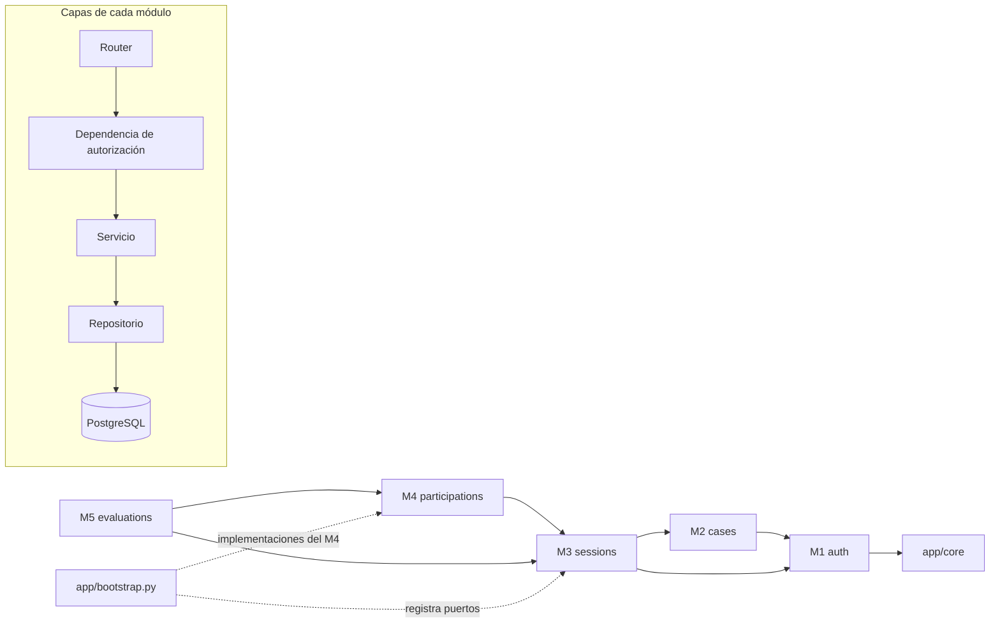
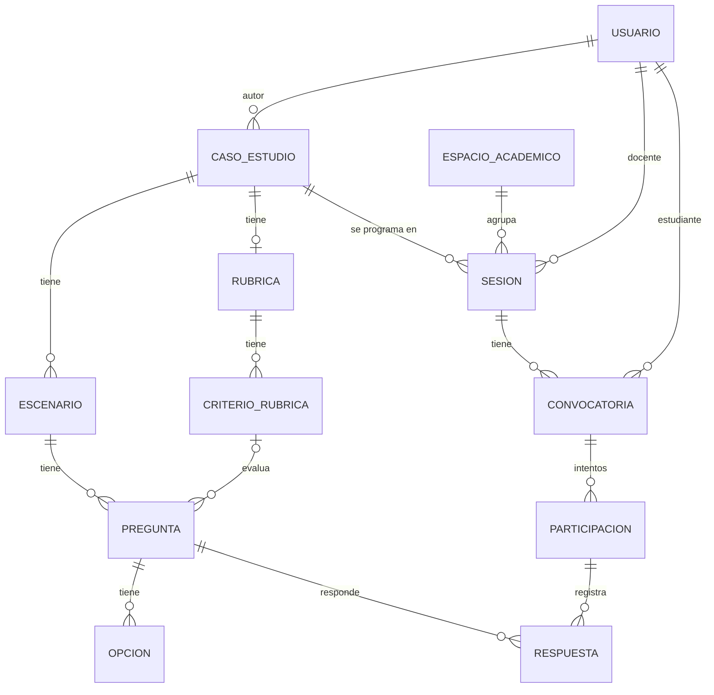
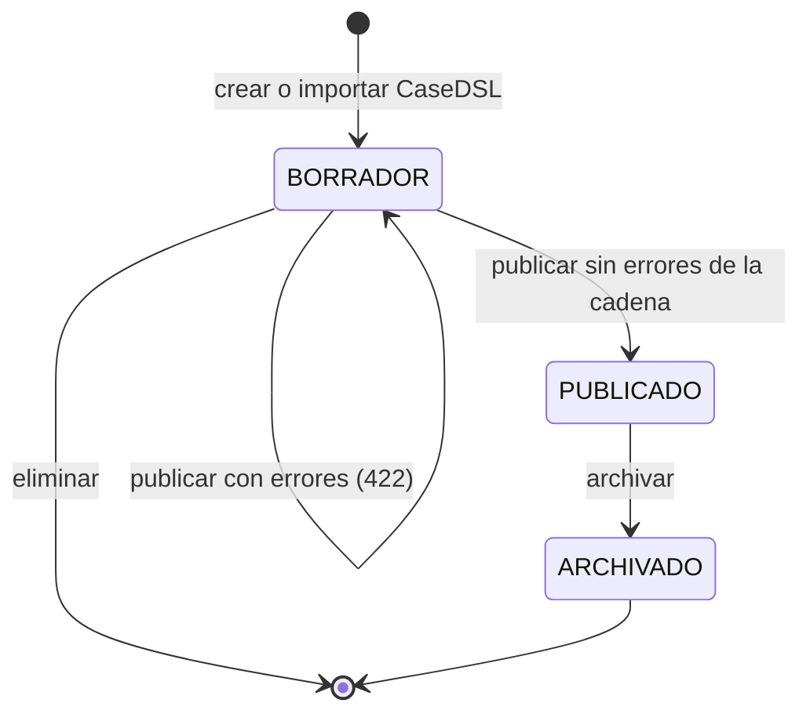
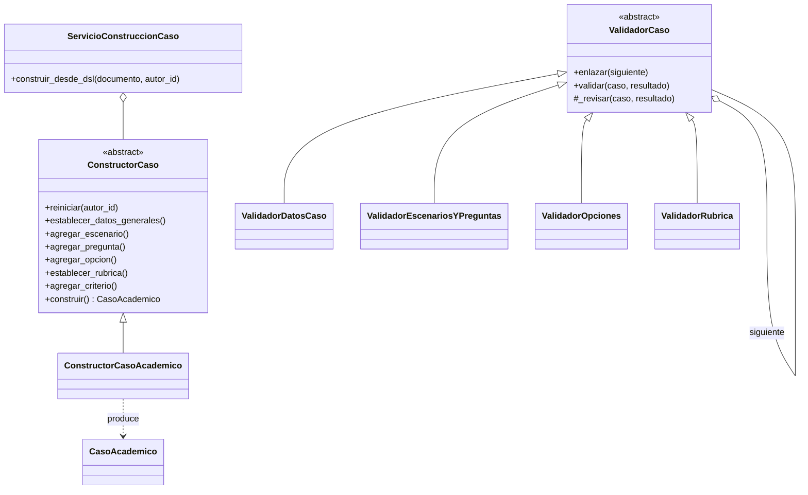
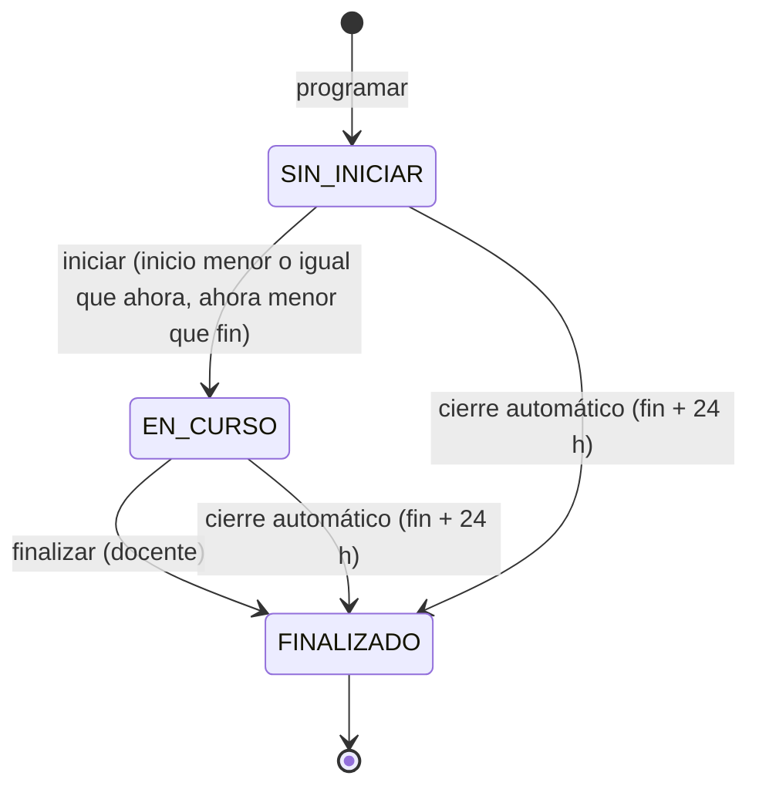
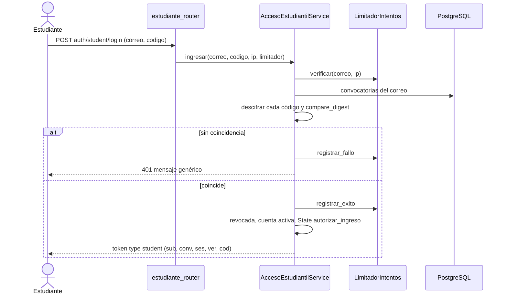
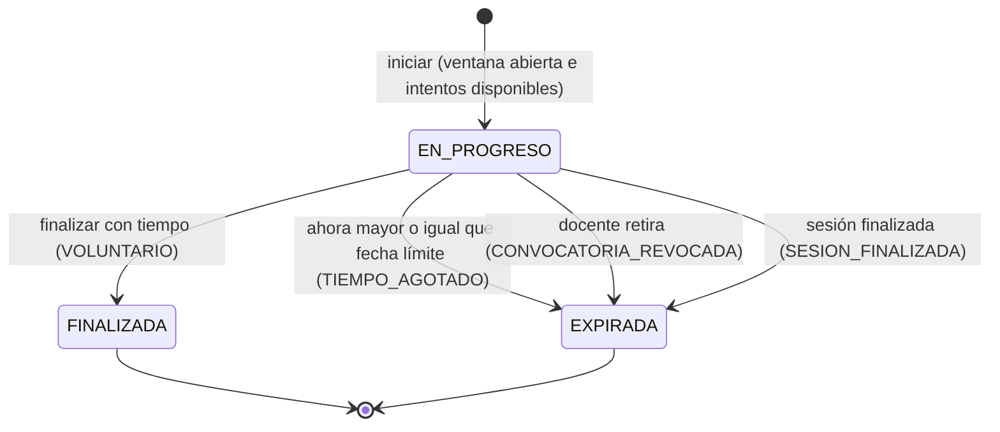
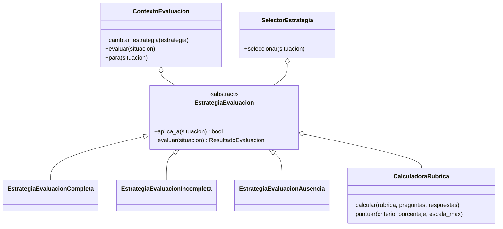
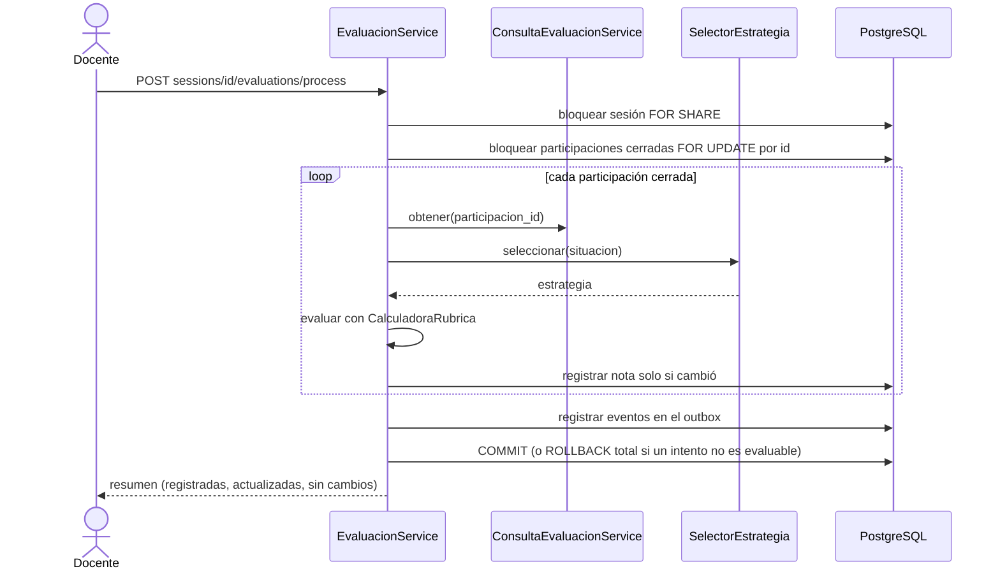

# GUÍA DE ESTUDIO Y SUSTENTACIÓN TÉCNICA: MÓDULOS 1 A 5 DE INTER NOS

**Proyecto Nuclear II — Simulador de casos académicos de Psicología Social "Inter Nos"**
**Material de estudio interno del equipo para la sustentación**
**Fuente:** código del repositorio local (rama `pruebas-unitarias-modulos-5-7`, commit `5eac5e6`), migraciones `0001` a `0010`, pruebas en `backend/tests/`, `docs/REPORTE_PRUEBAS_MODULOS_1_4.md`, `docs/REPORTE_PRUEBAS_MODULO_5.md` y `README.md`.

> **Cómo usar esta guía.** Si solo tienes 10 minutos, lee la sección 22 (repaso rápido). Si tienes una hora, lee la sección 2 (arquitectura común), las secciones de patrones (5, 8 y 12), el guion (sección 18) y las preguntas (sección 19). Todas las rutas de archivo son relativas a `backend/` salvo que se indique lo contrario. Los fragmentos marcados como **código real** están copiados del repositorio; cuando un fragmento está recortado se indica con `# (...)`. Los ejemplos de peticiones, fechas y notas usan **valores ficticios** sobre los esquemas y reglas reales.

---

## Índice

1. Introducción: Inter Nos y sus módulos 1 a 5
2. Arquitectura común a todos los módulos
3. Módulo 1: Autenticación y Usuarios
4. Módulo 2: Gestión de Casos Académicos
5. Patrones del Módulo 2: Builder, Chain of Responsibility y State
6. CaseDSL 1.0, decimales y niveles
7. Módulo 3: Sesiones y Convocatorias
8. Patrón State de la sesión y reglas de tiempo
9. Seguridad del Módulo 3: códigos, cifrado e ingreso estudiantil
10. Módulo 4: Participaciones y resolución de cuestionarios
11. Concurrencia, disparadores e integración entre los módulos 3 y 4
12. Módulo 5: Evaluación con el patrón Strategy
13. Algoritmo de calificación y política de niveles
14. Persistencia, retroalimentación, resultados del estudiante y eventos
15. Endpoints de los módulos 1 a 5
16. Pruebas de los módulos 1 a 5
17. Comparación entre los cinco módulos
18. Guion de exposición oral
19. Preguntas que podría hacer el docente
20. Fragmentos de código para estudiar
21. Diagramas para estudiar
22. REPASO RÁPIDO ANTES DE LA SUSTENTACIÓN
- Anexo A. Discrepancias entre documentación y código
- Anexo B. Inventario de clases y funciones analizadas

---

## 1. Introducción: Inter Nos y sus módulos 1 a 5

### 1.1 Qué es Inter Nos

Inter Nos es el backend de un simulador académico para Psicología Social. Un docente diseña **casos de estudio** (una historia, escenarios, preguntas de opción y una rúbrica), los programa en **sesiones** con fecha y hora, **convoca** a sus estudiantes, y los estudiantes resuelven el caso dentro de un tiempo máximo. Después el sistema **califica** cada intento con la rúbrica y entrega **retroalimentación** construida con las justificaciones que escribió el docente.

Técnicamente es un **monolito modular** en FastAPI + PostgreSQL (SQLAlchemy 2, Alembic, Pydantic). Todas las rutas cuelgan de `/api/v1` (`API_V1_PREFIX` en `app/core/config.py`).

### 1.2 Los cinco módulos de esta guía

| Módulo | Paquete | Qué resuelve | Patrones y técnicas clave |
|---|---|---|---|
| 1. Autenticación y Usuarios | `app/modules/auth` | Cuentas, roles, login con contraseña, JWT, permisos reutilizables | Argon2, JWT con `version_token`, dependencias de FastAPI, bloqueo `FOR UPDATE` de administradores |
| 2. Casos Académicos | `app/modules/cases` | Diseño, validación, publicación y archivo de casos | **Builder**, **Chain of Responsibility**, **State**, CaseDSL 1.0, restricciones `DEFERRABLE` |
| 3. Sesiones y Convocatorias | `app/modules/sessions` | Programar sesiones, convocar estudiantes, códigos de acceso, ingreso estudiantil, cierre automático | **State** (de la sesión), AES-256-GCM, HMAC, limitador de intentos, `SKIP LOCKED`, `pg_advisory_xact_lock` |
| 4. Participaciones | `app/modules/participations` | Intentos, temporizador, respuestas, finalización y expiración | Políticas puras, puertos sin dependencia circular, `INSERT … ON CONFLICT`, índice único parcial, disparadores |
| 5. Evaluación y Retroalimentación | `app/modules/evaluations` | Calificar intentos cerrados, retroalimentación, consulta segura de resultados | **Strategy**, `Decimal` con `ROUND_HALF_UP`, token de solo lectura |

Los módulos 6 (Notificaciones) y 7 (Reportes) tienen su propia guía (`docs/GUIA_ESTUDIO_SUSTENTACION_MODULOS_6_Y_7.md`). Aquí solo se mencionan cuando tocan a los módulos 1–5, por ejemplo porque los eventos de los módulos 3 y 5 hoy se guardan en el *outbox* del Módulo 6.

### 1.3 El recorrido completo en una historia

1. El **administrador** (creado solo por script) registra a una docente y le concede el permiso `puede_crear_casos` (Módulo 1). También registra a los estudiantes, que no tienen contraseña.
2. La **docente** arma un caso: datos generales, escenarios, preguntas, opciones y rúbrica. Lo valida y lo publica (Módulo 2).
3. Programa una **sesión** con ese caso en un espacio académico, de 08:00 a 10:00, con 40 minutos por intento, y convoca a 30 estudiantes por correo. Cada convocatoria recibe un código de 12 caracteres, guardado cifrado (Módulo 3).
4. A las 08:00 la docente **inicia** la sesión. Un estudiante ingresa con su correo y su código y recibe un token de tipo `student`. Puede ingresar hasta las 09:00 (mitad de la ventana).
5. El estudiante **inicia un intento**. El servidor fija `inicio` y la fecha límite es `inicio + 40 min`. Responde, cambia respuestas y finaliza; o se le agota el tiempo y el intento queda EXPIRADO (Módulo 4).
6. La docente **finaliza** la sesión. Los intentos que seguían abiertos pasan a EXPIRADA con motivo `SESION_FINALIZADA` en la misma transacción.
7. La docente **procesa la evaluación**. Cada intento se califica con la estrategia que le corresponde (completa, incompleta o ausencia) y se registra `nota_final` (Módulo 5).
8. El estudiante entra con un **token de resultados** de solo lectura y ve su nota y la retroalimentación por pregunta.

### 1.4 Ideas que se repiten en todos los módulos

Si en la sustentación te preguntan "¿qué tienen en común?", estas son las ideas:

- **Capas estrictas:** `router → dependencia de autorización → servicio → repositorio → PostgreSQL`. Los routers no tienen SQL ni reglas de negocio.
- **Errores de aplicación sin HTTP:** los servicios lanzan excepciones de `app/core/exceptions.py` y un manejador global las convierte en JSON.
- **El estado actual de la base manda:** los permisos y tokens se revalidan contra la base en cada petición; el token no es la fuente de verdad.
- **Doble garantía:** las reglas se validan en Python (mensaje claro) y PostgreSQL las vuelve a imponer con `CHECK`, `UNIQUE`, FK y disparadores (garantía final ante concurrencia o SQL directo).
- **Bloqueos explícitos y en orden fijo** para que dos peticiones simultáneas no rompan una regla.
- **Un reloj único del servidor** (`app/core/clock.py`), nunca la hora del cliente.
- **Recursos ajenos responden 404**, igual que los inexistentes, para no revelar que existen.

---

## 2. Arquitectura común a todos los módulos

### 2.1 Estructura de un módulo

Cada módulo repite la misma organización de carpetas:

```text
app/modules/<modulo>/
├── models/        # ORM de SQLAlchemy (tablas, CHECK, índices)
├── schemas/       # Pydantic: entrada y salida de la API (extra="forbid" en la entrada)
├── repositories/  # Único acceso a sus tablas; no confirma transacciones
├── services/      # Reglas de negocio y transacciones
├── routers/       # Endpoints REST, sin SQL ni lógica
└── dependencies/  # Autorización y construcción de servicios para FastAPI
```

Algunos módulos añaden carpetas propias: `builders/`, `validators/`, `states/` y `dsl/` en el Módulo 2; `states/` y `security/` en el 3; `policies/` en el 4; `strategies/`, `security/` y `dominio.py` en el 5.

### 2.2 El núcleo compartido (`app/core/`)

| Archivo | Responsabilidad | Detalle que conviene saber |
|---|---|---|
| `config.py` | `Settings` (pydantic-settings), cargado desde el entorno o `.env` | `JWT_SECRET_KEY` obligatorio con mínimo 32 caracteres; `JWT_ALGORITHM` solo admite `HS256`, `HS384` o `HS512` (nunca `none`); `CONVOCATION_CODE_ENCRYPTION_KEY` debe decodificar exactamente 32 bytes, o la app no arranca |
| `database.py` | Motor, `SessionLocal`, `Base` y `get_db` | Convención de nombres de restricciones (`uq_%(table_name)s_…`, `ck_…`) para que los errores se puedan traducir por nombre; cada conexión se abre con `timezone=UTC`; `OFFSET_MAXIMO = 2**63 - 1` |
| `security.py` | Argon2 y JWT, sin conocer el modelo de usuario | `encode_token` / `decode_token` genéricos con el claim `type`; `decode_access_token` para el personal |
| `exceptions.py` | `AppError` y subclases (400, 401, 403, 404, 409, 422) y sus manejadores | `AuthenticationError` añade `WWW-Authenticate: Bearer`; un `DataError` de PostgreSQL responde 422 sin exponer la consulta |
| `clock.py` | `Reloj`, `RelojSistema`, `get_reloj` | Siempre UTC; las pruebas lo sustituyen con `dependency_overrides` |
| `outbox.py` | Puerto del *outbox* (Módulo 6) | Los módulos 3 y 5 lo usan dentro de sus transacciones |

`app/main.py` crea la aplicación con `create_app()`: llama a `configurar_integraciones()` (de `app/bootstrap.py`), registra los manejadores de error e incluye los routers de los siete módulos con el prefijo `/api/v1`. Swagger (`/docs`) se desactiva si `ENVIRONMENT=production`.

### 2.3 Las excepciones de aplicación

| Clase | HTTP | Uso típico |
|---|---|---|
| `BusinessRuleError` | 400 | Regla de datos: criterio de otro caso, contraseña actual incorrecta, reorden incompleto |
| `AuthenticationError` | 401 | Token ausente, inválido, expirado o revocado; credenciales incorrectas |
| `PermissionDeniedError` | 403 | Rol insuficiente, cuenta desactivada, ingreso fuera de la ventana |
| `NotFoundError` | 404 | Recurso inexistente **o ajeno** |
| `ConflictError` | 409 | Operación incompatible con el estado actual (publicar un caso publicado, tiempo agotado, duplicados) |
| `UnprocessableEntityError` | 422 | Caso no publicable (con la lista de errores) o rúbrica no evaluable |
| `DemasiadosIntentosError` | 429 | Limitador del ingreso estudiantil, con `Retry-After` |

`AppError` acepta un diccionario `extra` que se añade al JSON. Así `POST /cases/{id}/publish` devuelve `{detail, valido, errores}` y una rúbrica no evaluable devuelve un `codigo`.

### 2.4 El patrón de transacción `_transaction()`

Todos los servicios con escritura tienen un administrador de contexto `_transaction()`. Hace `commit()` al final del bloque; ante cualquier excepción hace `rollback()` (y así libera los bloqueos), y traduce las violaciones de integridad (`IntegrityError`) al error de aplicación correspondiente **por el nombre de la restricción**. Por ejemplo, en el Módulo 1 `uq_usuario_correo` se convierte en 409 "Ya existe un usuario registrado con ese correo." Esta es la respuesta a "¿qué pasa si dos peticiones crean el mismo correo a la vez?": la comprobación previa da el mensaje en el caso normal y la restricción `UNIQUE` es la garantía final.

En los módulos 3 y 5, `_transaction()` además registra los eventos pendientes en el *outbox* **antes** del `commit` (ver sección 14.5).

### 2.5 La raíz de composición (`app/bootstrap.py`)

`configurar_integraciones()` conecta los puertos entre módulos sin que haya importaciones circulares:

- registra en el Módulo 3 (`sessions/integracion.py`) las implementaciones del Módulo 4: `CierreParticipacionesSQL` (cerrar intentos al revocar una convocatoria o finalizar una sesión) y `ReingresoConParticipacionActiva` (política de reingreso);
- configura el *outbox* con `RegistroEventosSQL` (Módulo 6).

Se invoca en `create_app()` y al arrancar cada worker, para que las mismas reglas se cumplan en peticiones HTTP y en procesos programados.

### 2.6 Workers (procesos sin HTTP)

| Comando | Servicio que ejecuta | Qué hace |
|---|---|---|
| `python -m app.workers.session_expiration` | `CierreSesionesService.cerrar_vencidas` | Finaliza sesiones con `ahora ≥ fin + SESSION_AUTO_CLOSE_HOURS` (24 h por defecto) |
| `python -m app.workers.participation_expiration` | `ExpiracionParticipacionesService.expirar_vencidas` | Expira intentos EN_PROGRESO cuyo tiempo terminó |

Ambos aceptan `--intervalo N` para repetirse en bucle; sin él hacen una sola pasada (para cron o el Programador de tareas). Procesan lotes de 500 (`TAMANO_LOTE`), una transacción por fila y `FOR UPDATE SKIP LOCKED`.

---

## 3. Módulo 1: Autenticación y Usuarios

### 3.1 Qué problema resuelve

Controla **quién es quién** y **qué puede hacer**. Define tres roles (`RolUsuario`: `ADMINISTRADOR`, `DOCENTE`, `ESTUDIANTE`), el inicio de sesión con contraseña para el personal, los tokens JWT y las dependencias de autorización que reutilizan los demás módulos.

### 3.2 La tabla `usuario`

`app/modules/auth/models/usuario.py`, migraciones `0001` y `0002`:

| Columna | Tipo | Regla |
|---|---|---|
| `id` | UUID | `gen_random_uuid()` |
| `nombre_completo` | VARCHAR(150) | `CHECK (length(btrim(nombre_completo)) > 0)` |
| `correo` | VARCHAR(150) | `UNIQUE` + `CHECK (correo = lower(btrim(correo)))` |
| `clave_hash` | VARCHAR(255) NULL | `CHECK (rol = 'ESTUDIANTE' OR clave_hash IS NOT NULL)` |
| `rol` | ENUM `rol_usuario` | Con índice |
| `codigo_institucional` | VARCHAR(30) NULL | `UNIQUE` (los NULL se permiten) |
| `puede_crear_casos` | BOOLEAN | `CHECK (puede_crear_casos = false OR rol = 'DOCENTE')` |
| `activo` | BOOLEAN | `true` por defecto |
| `creado_en` | TIMESTAMPTZ | `now()` |
| `version_token` | INTEGER | `CHECK (version_token >= 0)`; se incrementa al cambiar la contraseña |

**¿Por qué `clave_hash` admite NULL?** Porque los estudiantes no tienen contraseña: entran con correo y código de convocatoria (Módulo 3). En lugar de inventar contraseñas, un `CHECK` exige la clave solo a administradores y docentes.

**¿Por qué el correo normalizado en un CHECK?** Para que `UNIQUE(correo)` no distinga mayúsculas: la base solo acepta el correo en minúsculas y sin espacios, así que "Ana@U.edu" y "ana@u.edu" no pueden coexistir.

### 3.3 Contraseñas con Argon2

`app/core/security.py` usa `argon2.PasswordHasher`:

- `hash_password` y `verify_password`;
- `password_needs_rehash`: si los parámetros de Argon2 cambian, `AuthService.login` vuelve a calcular el hash en el siguiente ingreso correcto;
- contraseñas de **8 a 128 caracteres** (el tope evita el coste de hashear entradas gigantes).

**Defensa contra la enumeración de usuarios:** `_DUMMY_HASH` es el hash de una cadena aleatoria. Si el correo no existe, `verify_password` se ejecuta igualmente contra ese hash, así que el tiempo de respuesta no revela qué correos están registrados (fragmento F1).

### 3.4 El login del personal (`AuthService.login`)

1. Busca el usuario por correo normalizado.
2. Verifica la contraseña **siempre** (con el hash ficticio si no hay usuario).
3. Si el usuario no existe, la clave es incorrecta o el rol no es `ADMINISTRADOR`/`DOCENTE` (`PASSWORD_LOGIN_ROLES`): 401 con el mismo mensaje, "Correo o contraseña incorrectos.".
4. Solo si la contraseña es correcta informa que la cuenta está desactivada (403).
5. Actualiza el hash si hace falta y emite el token.

Así, un estudiante que intenta entrar con contraseña recibe el mismo 401 genérico.

### 3.5 Tokens JWT

`create_access_token` firma un JWT con los claims `sub`, `rol`, `ver`, `type = "access"`, `iat` y `exp`. `decode_token` exige todos los claims (`options={"require": [...]}`), un algoritmo de la lista permitida y el `type` esperado. Se rechazan tokens expirados, con otra firma, con `alg: none` o mal formados. `entero_estricto` rechaza un `ver` booleano (en Python `bool` es subclase de `int`).

**Tres tipos de token en el sistema:**

| `type` | Lo emite | Sirve para | Decodificador |
|---|---|---|---|
| `access` | `AuthService.login` (M1) | Rutas de administrador y docente | `decode_access_token` |
| `student` | `AccesoEstudiantilService.ingresar` (M3) | Resolver un cuestionario de UNA convocatoria | `decodificar_token_estudiante` |
| `student_results` | `AccesoResultadosService.ingresar_resultados` (M5) | Ver resultados, solo lectura | `decodificar_token_resultados` |

Cada decodificador acepta solo su tipo, así que un token de un propósito nunca sirve para otro.

### 3.6 Revocación inmediata con `version_token`

El claim `rol` es **informativo**. En cada petición, `AuthService.get_user_from_token` consulta el usuario en la base y exige que exista, que esté activo y que `version_token` coincida con el claim `ver` (fragmento F2). Consecuencias:

- **Desactivar** una cuenta corta el acceso de inmediato, aunque el token no haya expirado.
- **Cambiar la contraseña** ejecuta `usuario.version_token = Usuario.version_token + 1` (incremento atómico en SQL) y todos los tokens anteriores, en cualquier dispositivo, incluido el de la petición, responden 401.
- **Retirar el permiso** de crear casos tiene efecto en la siguiente petición.

Se eligió frente a una lista negra de tokens porque no necesita tablas nuevas ni limpieza periódica, y la consulta del usuario ya se hacía en cada petición.

### 3.7 Autorización reutilizable (`dependencies/auth.py`)

- `get_current_user`: exige un Bearer válido y resuelve el usuario actual.
- `require_roles(*roles)`: fábrica de dependencias que lanza 403 si el rol no está permitido (fragmento F4).
- Atajos: `require_admin`, `require_docente`, `require_password_user` (administrador o docente) y `require_case_creator` (docente con `puede_crear_casos`).
- Alias tipados con `Annotated`: `CurrentUser`, `AdminUser`, `DocenteUser`, `PasswordUser`, `CaseCreator`.

Los demás módulos los usan directamente: el Módulo 2 define `Lector = DocenteUser` y `Editor = CaseCreator`; el 3, el 5 y el 7 usan `DocenteUser`.

### 3.8 Gestión de cuentas (`UsuarioService`)

| Operación | Regla |
|---|---|
| `create_docente` | Lo usa `POST /users/teachers`; el rol lo fija el servidor |
| `create_estudiante` | Añadido con el Módulo 3; `clave_hash = None`; `EstudianteCreate` rechaza el campo `clave` |
| `create_admin` | Solo lo usa el script `python -m app.scripts.create_admin` (contraseña por consola o `INITIAL_ADMIN_PASSWORD`, nunca como argumento) |
| `update` | Un administrador no puede modificar los datos de **otro** administrador (403) |
| `set_status` | Nadie puede desactivarse a sí mismo; debe quedar al menos un administrador activo |
| `set_case_permission` | Solo a docentes (400 en otro caso, y además el `CHECK` de la base) |

**No existe ningún endpoint que cambie el `rol`.** Los esquemas usan `extra="forbid"`, así que enviar `rol` responde 422. Es la vía clásica de escalación de privilegios: si no existe, no hay nada que proteger.

### 3.9 Concurrencia: nunca quedarse sin administradores

Problema: dos administradores A y B se desactivan mutuamente a la vez. Cada transacción ve "hay 2 activos" y ambas desactivan: quedan cero.

Solución (`set_status`, fragmento F3): antes de desactivar a un administrador, `lock_active_admins()` bloquea las filas de los administradores activos con `SELECT … FOR UPDATE ORDER BY id` (el orden fijo evita interbloqueos) y luego `count_active_admins()` exige que quede más de uno. La segunda transacción espera, vuelve a contar y falla con "El sistema debe conservar al menos un administrador activo.". `tests/test_concurrency.py` lo verifica, y una prueba de control muestra que sin el bloqueo la carrera sí ocurre.

### 3.10 Endpoints del Módulo 1

| Método | Ruta | Acceso | Descripción |
|---|---|---|---|
| POST | `/auth/login` | Público | `{correo, clave}` → `{access_token, token_type, expires_in}` |
| GET | `/auth/me` | Admin / Docente | Perfil propio |
| PATCH | `/auth/password` | Admin / Docente | Cambia la clave e invalida todos los tokens |
| POST | `/users/teachers` | Admin | Crear docente (201) |
| POST | `/users/students` | Admin | Crear estudiante sin contraseña (añadido con el Módulo 3) |
| GET | `/users` | Admin | Listar con filtros `rol`, `activo`, `skip`, `limit` (≤ 100) |
| GET / PATCH | `/users/{id}` | Admin | Consultar / actualizar nombre, correo y código |
| PATCH | `/users/{id}/status` | Admin | `{activo}` |
| PATCH | `/users/{id}/case-permission` | Admin | `{puede_crear_casos}` (solo docentes) |
| GET | `/health` | Público | Disponibilidad |

El router de usuarios declara `dependencies=[Depends(require_admin)]` a nivel de router: ninguna ruta de `/users` puede olvidarse de exigir administrador. Ninguna respuesta incluye `clave_hash`.

---

## 4. Módulo 2: Gestión de Casos Académicos

### 4.1 Qué problema resuelve

Permite a los docentes con permiso diseñar casos como **borradores**, **validarlos** y **publicarlos**. Solo administra el contenido académico: no programa sesiones ni califica.

### 4.2 Modelo relacional (migraciones `0003`, `0004` y `0008`)

```text
caso_estudio 1──* escenario 1──* pregunta 1──* opcion
     │                              │
     └─1 rubrica 1──* criterio_rubrica ◄── pregunta.criterio_id (SET NULL)
```

| Tabla | Integridad destacada |
|---|---|
| `caso_estudio` | FK `autor_id` → `usuario` ON DELETE RESTRICT; `tiempo_estimado_min BETWEEN 1 AND 240` (o nulo en borrador); fuera de BORRADOR los datos generales son obligatorios (`ck_caso_estudio_publicado_con_datos_generales`); índice `(autor_id, estado)` |
| `escenario` | `UNIQUE (caso_id, orden) DEFERRABLE`; `orden >= 1`; CASCADE desde el caso |
| `pregunta` | `UNIQUE (escenario_id, orden) DEFERRABLE`; FK a criterio **ON DELETE SET NULL**; disparador `trg_pregunta_criterio_mismo_caso` |
| `opcion` | `UNIQUE (pregunta_id, orden) DEFERRABLE`; la `0008` añade `UNIQUE (id, pregunta_id)` para la FK compuesta del Módulo 4 |
| `rubrica` | `UNIQUE (caso_id)` (una por caso); `escala_max NUMERIC(4,2) > 0` |
| `criterio_rubrica` | `0 < peso <= 100`, `NUMERIC(5,2)`; `jsonb_typeof(niveles) = 'array'` |

Tres decisiones que suelen preguntar:

- **Restricciones de orden `DEFERRABLE`:** al reordenar se comprueban en el `COMMIT`, así que intercambiar 1↔2 no viola la unicidad a mitad de la transacción. Tras eliminar, los hermanos se renumeran 1..n (`_compactar`).
- **Disparador `trg_pregunta_criterio_mismo_caso`:** impide asociar una pregunta a un criterio de la rúbrica de **otro** caso. Necesita consultar tres tablas, por eso no puede ser un `CHECK`. El servicio lo verifica antes (400 legible) y el disparador es la garantía final.
- **La base no impone la completitud:** un borrador puede guardarse sin escenarios, una pregunta sin criterio o una opción sin justificación. La completitud la exige la cadena de validación al publicar.

### 4.3 Reglas del dominio en tres capas

| Regla | API (Pydantic) | Publicación (cadena) | PostgreSQL |
|---|---|---|---|
| Tiempo 1–240 min | `ge=1, le=240` | `CASO_TIEMPO_REQUERIDO` / `CASO_TIEMPO_FUERA_DE_RANGO` | `ck_caso_estudio_tiempo_en_rango` |
| Peso en (0, 100], 2 decimales | `gt=0, le=100`, `decimal_places=2` | `CRITERIO_PESO_INVALIDO`; suma = 100 | `ck_criterio_rubrica_peso_en_rango` |
| Una rúbrica por caso | — | — | `uq_rubrica_caso_id` |
| Criterio de la misma rúbrica | verificación en servicio (400) | `PREGUNTA_CRITERIO_AJENO` | `trg_pregunta_criterio_mismo_caso` |

El límite de 240 minutos está en una sola constante, `TIEMPO_MAXIMO_MIN` en `models/caso.py`, que usan el CHECK, los esquemas y el validador.

### 4.4 Control de acceso

| Acción | Requisito |
|---|---|
| Crear, editar, eliminar, publicar, archivar | `Editor` (= `CaseCreator`) y ser el autor |
| Consultar, listar, validar, exportar DSL | `Lector` (= `DocenteUser`) y ser el autor |
| Administrador o estudiante | 403 en todo el módulo |
| Caso de otro docente | 404, indistinguible de uno inexistente (`CasoRepository.get_owned`) |

`autor_id` sale siempre del usuario autenticado (`CasoService.crear_borrador`). Un docente que pierde el permiso conserva la lectura de sus casos, pero no puede modificarlos.

### 4.5 Servicios y concurrencia

`ServicioCasoBase` (`services/base.py`) concentra lo común:

- `_caso_lectura`: carga un caso propio o lanza 404.
- `_caso_bloqueado`: lo mismo con `SELECT … FOR UPDATE`.
- `_caso_editable`: bloquea, pide al State que confirme que el contenido es editable y actualiza `actualizado_en`.
- `_reordenar` y `_compactar`: aplican el nuevo orden.
- `_transaction` y `_traducir`: traducen `uq_escenario_caso_orden`, `uq_rubrica_caso_id`, `ck_pregunta_criterio_mismo_caso`, etc.

**Toda escritura sobre un caso o su contenido bloquea primero la fila del caso.** Una edición y una publicación simultáneas se ejecutan en serie, y dos publicaciones simultáneas producen un 200 y un 409. Una prueba de control demuestra que sin el bloqueo un caso publicado llegaría a modificarse.

Los servicios del módulo son `CasoService`, `EscenarioService`, `PreguntaService`, `OpcionService` y `RubricaService`.

### 4.6 Endpoints del Módulo 2 (resumen)

| Método | Ruta | Éxito |
|---|---|---|
| POST | `/cases` (borrador) · `/cases/full` (CaseDSL, Builder) | 201 |
| GET | `/cases?estado=&skip=&limit=` · `/cases/{id}` | 200 |
| PATCH / DELETE | `/cases/{id}` (solo borrador) | 200 / 204 |
| POST | `/cases/{id}/validate` · `/publish` · `/archive` | 200 (publish: 422 con errores) |
| GET | `/cases/{id}/dsl` | 200 |
| CRUD | `/cases/{id}/scenarios`, `…/questions`, `…/options`, `/cases/{id}/rubric`, `…/rubric/criteria` | 201 / 200 / 204 |
| PUT | `…/scenarios/order`, `…/questions/order`, `…/options/order` | 200 |

**409 frente a 400:** el módulo responde 409 cuando la operación choca con el **estado** del caso (editar uno publicado) y 400 cuando falla una **regla de datos** (criterio de otro caso, reorden incompleto).

---

## 5. Patrones del Módulo 2: Builder, Chain of Responsibility y State

### 5.A Builder (`builders/`)

**Concepto.** Builder (GoF, creacional) separa la *construcción* de un objeto complejo de su *representación*: un Director fija la secuencia de pasos y un Constructor concreto sabe ejecutarlos. Sirve cuando el producto tiene muchas partes que deben ensamblarse en un orden válido.

**En Inter Nos.** Un caso completo es un agregado con escenarios, preguntas, opciones, rúbrica y criterios, y las preguntas referencian criterios que se declaran aparte. `POST /cases/full` recibe un documento CaseDSL y lo construye con el Builder.

| Participante GoF | Clase real | Responsabilidad |
|---|---|---|
| Builder (abstracción) | `ConstructorCaso` (ABC) | Declara los pasos: `reiniciar`, `establecer_datos_generales`, `agregar_escenario`, `agregar_pregunta`, `agregar_opcion`, `establecer_rubrica`, `agregar_criterio`, `construir` |
| Constructor concreto | `ConstructorCasoAcademico` | Exige la secuencia (datos generales antes del contenido, rúbrica antes de los criterios), numera órdenes, guarda las referencias a criterios por clave y las resuelve al construir, fija siempre `BORRADOR` |
| Director | `ServicioConstruccionCaso` | `construir_desde_dsl(documento, autor_id)` recorre el documento e invoca los pasos |
| Producto | `CasoAcademico` | Dataclass inmutable con la raíz `CasoEstudio` y todo su contenido enlazado |

**Lo que el constructor hace "de verdad"** (no es un simple envoltorio del ORM):

- `agregar_pregunta` acepta una clave de criterio que todavía puede no existir y la guarda en `_pendientes`;
- `construir()` resuelve esas claves; si una no existe lanza `ErrorConstruccionCaso` (422); `agregar_criterio` rechaza claves repetidas;
- al terminar llama a `reiniciar`, para que el producto no se modifique por accidente con pasos posteriores (fragmento F7);
- no usa la sesión de base de datos: produce entidades transitorias.

**Persistencia atómica.** `CasoService.crear_completo` persiste el producto con un solo `add` en cascada dentro de `_transaction()`. Si cualquier INSERT falla, el rollback no deja escenarios ni rúbricas a medias; las pruebas lo verifican con un fallo simulado y con una violación real de `UNIQUE`.

**Qué no pasa por el Builder:** la edición individual (endpoints de escenarios, preguntas, opciones y rúbrica) modifica componentes de un borrador existente directamente.

**Justificación para defender.** Sin Builder, `crear_completo` sería una función larga que mezcla el recorrido del JSON, la numeración, la resolución de referencias y la persistencia. El Director recibe la abstracción `ConstructorCaso`, así que otro constructor (por ejemplo, uno de vista previa) podría reutilizar la misma secuencia; `test_patrones.py` lo comprueba con un constructor alternativo.

### 5.B Chain of Responsibility (`validators/`)

**Concepto.** Chain of Responsibility (GoF, de comportamiento) pasa una solicitud por una cadena de manejadores; cada uno decide qué hacer y la reenvía al siguiente. Desacopla a quien pide la validación de quién valida cada aspecto.

**En Inter Nos** se usa la **variante acumulativa**: cada eslabón revisa su aspecto, registra sus inconsistencias en un `ResultadoValidacion` compartido y **siempre** delega en el siguiente. Así el docente recibe todos los errores en una sola respuesta, no solo el primero.

```text
ValidadorDatosCaso → ValidadorEscenariosYPreguntas → ValidadorOpciones → ValidadorRubrica
```

| Participante | Clase real |
|---|---|
| Manejador abstracto | `ValidadorCaso` (ABC): `enlazar(siguiente)`, `validar(caso, resultado)` (plantilla) y `_revisar` abstracto |
| Manejadores concretos | `ValidadorDatosCaso`, `ValidadorEscenariosYPreguntas`, `ValidadorOpciones`, `ValidadorRubrica` |
| Ensamblaje | `construir_cadena_publicacion()`; atajo `validar_caso(caso)` |
| Resultado compartido | `ResultadoValidacion` (lista de `ErrorValidacion`; `valido` es `not errores`) |

Cada `ErrorValidacion` lleva `codigo`, `componente`, `componente_id`, `campo`, `ruta` (por ejemplo `escenarios[1].preguntas[0].opciones[2].justificacion`) y `mensaje`, para que un frontend señale exactamente qué corregir.

**Reglas que valida cada eslabón:**

| Eslabón | Códigos |
|---|---|
| Datos | `CASO_NOMBRE_VACIO`, `CASO_DESARROLLO_SITUACIONAL_VACIO`, `CASO_HISTORIA_VACIA`, `CASO_TIEMPO_REQUERIDO`, `CASO_TIEMPO_FUERA_DE_RANGO` |
| Escenarios y preguntas | `CASO_SIN_ESCENARIOS`, `ESCENARIO_SIN_PREGUNTAS`, `ESCENARIO_TITULO_VACIO`, `ESCENARIO_CONTEXTO_VACIO`, `PREGUNTA_ENUNCIADO_VACIO`, `ESCENARIO_ORDEN_INVALIDO`, `PREGUNTA_ORDEN_INVALIDO` |
| Opciones | `PREGUNTA_OPCIONES_INSUFICIENTES` (mínimo 2), `PREGUNTA_SIN_OPCION_CORRECTA`, `OPCION_TEXTO_VACIO`, `OPCION_SIN_JUSTIFICACION` |
| Rúbrica | `CASO_SIN_RUBRICA`, `RUBRICA_SIN_CRITERIOS`, `RUBRICA_ESCALA_INVALIDA`, `CRITERIO_DESCRIPCION_VACIA`, `CRITERIO_PESO_INVALIDO`, `RUBRICA_PESOS_NO_SUMAN_100`, `CRITERIO_NIVELES_INSUFICIENTES` (mínimo 2), `CRITERIO_NIVELES_FORMATO_INVALIDO`, `NIVEL_NOMBRE_DUPLICADO`, `PREGUNTA_SIN_CRITERIO`, `PREGUNTA_CRITERIO_AJENO` |

Se admiten varias opciones correctas (incluso todas) y criterios sin preguntas. La cadena **no modifica nada** y es la misma para `/validate` (consulta) y `/publish`.

**Justificación.** Agregar una regla nueva es crear un eslabón o ampliar uno, sin tocar a los demás ni al servicio. Comparado con un único método `validar()` de 200 líneas, cada eslabón se prueba por separado (`test_patrones.py` verifica el orden, que delega aunque haya errores y que no modifica el caso).

### 5.C State del caso (`states/estados.py`)

**Concepto.** State (GoF, de comportamiento) permite que un objeto cambie su comportamiento cuando cambia su estado interno: cada estado es una clase y el contexto delega en el estado actual. Sustituye cadenas de `if estado == …` repartidas por los servicios.

**Ciclo de vida:**

```text
BORRADOR --publicar (si la cadena no devuelve errores)--> PUBLICADO --archivar--> ARCHIVADO
```

| Estado | Editar contenido | Eliminar | Publicar | Archivar | `admite_programacion()` |
|---|---|---|---|---|---|
| `EstadoBorrador` | Sí | Sí | Sí, si la cadena no da errores | No (409) | No |
| `EstadoPublicado` | No (409) | No (409) | No (409) | Sí | **Sí** |
| `EstadoArchivado` | No (409) | No (409) | No (409) | No (409) | No |

| Participante | Clase real |
|---|---|
| Estado abstracto | `EstadoCaso` (ABC): por defecto **todo se rechaza** con `TransicionNoPermitidaError` (409) |
| Estados concretos | `EstadoBorrador`, `EstadoPublicado`, `EstadoArchivado` |
| Contexto | `CicloVidaCaso`: elige la clase con el diccionario `_ESTADOS[caso.estado]` y delega; `cambiar_a` persiste el nuevo valor en `caso.estado` |

**Colaboración State + Chain al publicar** (fragmento F6):

1. `CasoService.publicar` bloquea el caso (`FOR UPDATE`) y carga su contenido.
2. Llama a `CicloVidaCaso(caso).publicar(lambda: validar_caso(caso))`: le pasa **una función** que ejecuta la cadena.
3. Solo `EstadoBorrador.publicar` invoca esa función. Los demás estados responden 409 sin validar, así que State no duplica la validación.
4. Si hay errores lanza `CasoNoPublicableError` (422 con la lista) y el caso sigue en BORRADOR (la transacción se revierte).
5. Si no, `cambiar_a(EstadoPublicado())` y el servicio confirma.

**Decisiones de transición:** `BORRADOR → ARCHIVADO` no existe (un borrador se elimina); `ARCHIVADO` es final; un caso publicado no se edita (una "nueva versión" sería un borrador nuevo, por ejemplo exportando e importando la DSL).

**Integración con el Módulo 3.** `admite_programacion()` es lo que consulta el Módulo 3 al programar una sesión: solo un caso PUBLICADO es seleccionable. Así el Módulo 3 no repite la regla del estado.

---

## 6. CaseDSL 1.0, decimales y niveles

### 6.1 Qué es CaseDSL

Una representación declarativa del caso en JSON (camelCase), usada para **importar** (`POST /cases/full`) y **exportar** (`GET /cases/{id}/dsl`). Esquema en `dsl/schema.py` (`CaseDSLDocument`, `CasoInfoDsl`, `EscenarioDsl`, `PreguntaDsl`, `OpcionDsl`, `RubricaDsl`, `CriterioDsl`, `NivelDsl`) y exportador en `dsl/exporter.py` (`exportar_caso`).

```json
{
  "dslVersion": "1.0",
  "caso": {"nombre": "…", "desarrolloSituacional": "…", "historia": "…", "tiempoEstimadoMin": 45},
  "escenarios": [{"titulo": "…", "contexto": "…", "preguntas": [
    {"enunciado": "…", "criterio": "ANALISIS", "opciones": [
      {"texto": "…", "esCorrecta": true, "justificacion": "…"}]}]}],
  "rubrica": {"escalaMax": "5.00", "criterios": [
    {"clave": "ANALISIS", "descripcion": "…", "peso": "60.00", "niveles": [
      {"nombre": "Insuficiente", "valor": "1.00", "minAciertosPct": "0.00"}]}]}
}
```

### 6.2 Reglas de la DSL

- El orden de los arreglos es el orden académico.
- Las preguntas referencian criterios por `clave`. La base no guarda claves, así que al exportar se generan como `C1..Cn` (los criterios se ordenan por `descripcion` e `id`).
- Al importar se ignoran `id` y `caso.estado`: el caso **siempre nace en BORRADOR**.
- **Dos validaciones distintas:** el esquema Pydantic valida la **estructura** (tipos, versión, claves únicas, referencias existentes, con `_referencias_de_criterios`) y responde 422 sin persistir; la cadena valida la **completitud** para publicar. Un documento estructuralmente válido puede describir un borrador incompleto.
- **Una sola fuente de verdad:** la DSL no se almacena; se genera desde PostgreSQL en cada exportación. Las pruebas verifican la ida y vuelta (importar → exportar → reimportar).

### 6.3 Decimales

- `peso` y `escala_max` son `NUMERIC` en PostgreSQL y `Decimal` en Python. La suma de pesos se compara con `Decimal("100.00")`: 33.33 + 33.33 + 33.34 da exactamente 100 (con `float` podría no darlo).
- La API devuelve los decimales como texto con dos decimales (`"40.00"`) para que el cliente no pierda precisión.
- `NivelesJSONB` (un `TypeDecorator`) guarda los niveles como números en JSONB y los reconstruye como `Decimal` al leer.

### 6.4 Niveles: qué valida el Módulo 2 y qué se aplazó al 5

Un nivel tiene `nombre` y `valor` obligatorios, y `min_aciertos_pct` (`minAciertosPct` en la DSL) opcional, entre 0 y 100. Al publicar se exigen al menos 2 niveles por criterio, con nombres únicos.

Las reglas que dependen de **cómo se califica** se aplazaron al Módulo 5: umbrales repetidos, nivel base de 0 %, valor dentro de la escala y monotonía. El Módulo 5 las exige solo al calificar (sección 13.4). El README documenta las reglas retiradas en la revisión del Módulo 2 (`CASO_TIEMPO_INSUFICIENTE`, `CRITERIO_SIN_PREGUNTAS`, `PREGUNTA_SIN_OPCION_INCORRECTA`, `OPCION_TEXTO_DUPLICADO`, entre otras) y por qué.

---

## 7. Módulo 3: Sesiones y Convocatorias

### 7.1 Qué problema resuelve

Convierte un caso publicado en una **actividad con fecha y hora**: programa sesiones, convoca estudiantes con un código individual, autentica a los estudiantes y cierra automáticamente las sesiones vencidas. No registra respuestas, no califica y no envía correos.

### 7.2 Modelo relacional (migraciones `0005`, `0006` y `0007`)

| Tabla | Integridad destacada |
|---|---|
| `espacio_academico` | Nombre y periodo no vacíos; índice único `(lower(nombre), lower(periodo))`; `activo` por defecto |
| `sesion` | `inicio < fin` (ambas `TIMESTAMPTZ`); `tiempo_max_min` entre 1 y 240; FK a caso, espacio y docente con **RESTRICT**; índices `(estado, fin)` para el cierre automático y `(docente_id, inicio)`; disparador `trg_sesion_programable` |
| `convocatoria` | `UNIQUE (sesion_id, estudiante_id)`; `codigo_autorizacion VARCHAR(100)` con `CHECK` de formato cifrado `v1.<base64url>`; `intentos_autorizados >= 1`; `revocada_en TIMESTAMPTZ NULL` (revocación lógica); FK con RESTRICT; disparador `trg_convocatoria_estudiante` |

- **`trg_sesion_programable`** (al insertar o al cambiar caso, docente o tiempo): exige caso PUBLICADO, `tiempo_max_min ≤ tiempo_estimado_min` del caso y responsable con rol DOCENTE. Bloquea la fila del caso con `FOR SHARE`, para que un archivado concurrente no se cuele.
- **`trg_convocatoria_estudiante`**: solo se convoca a usuarios ESTUDIANTE.
- **Archivar un caso no cambia las sesiones existentes**; las FK con RESTRICT impiden borrar un caso con sesiones.

### 7.3 Reglas de programación (`SesionService.programar`)

- **Caso:** existe, es del docente (reutiliza `CasoRepository.get_owned` del Módulo 2) y está PUBLICADO según `CicloVidaCaso.admite_programacion()`. BORRADOR o ARCHIVADO → 409.
- **Espacio:** existe y está activo.
- **Docente responsable:** siempre el autenticado (`docente_id=docente.id`); los esquemas rechazan `docente_id`.
- **Tiempo:** `tiempo_max_min ≤ tiempo_estimado_min`, entre 1 y 240.
- **Fechas:** `inicio < fin`, con zona horaria obligatoria (sin zona → 422) y normalizadas a UTC; la hora de fin debe ser futura.
- **Atomicidad:** la sesión y todas sus convocatorias se crean en una sola transacción. Si falla una convocatoria, no queda nada.

### 7.4 Convocatorias

- El docente convoca por **correo institucional** (no conoce los UUID). Debe ser una cuenta ESTUDIANTE activa. `_convocar` valida todo el lote antes de insertar: si un correo no es de estudiante, está inactivo o ya está convocado, el lote entero se rechaza.
- **Retirar** (`DELETE …/convocations/{cid}`) es una **revocación lógica**: fija `revocada_en`. La fila se conserva para las participaciones y el historial. En la misma transacción, el intento EN_PROGRESO del estudiante pasa a EXPIRADA (`CONVOCATORIA_REVOCADA`).
- **Volver a convocar** a un retirado reactiva **la misma** fila con un código nuevo y conserva su id y sus intentos (evento `CONVOCATORIA_REACTIVADA`).
- **Intentos:** el docente solo puede **aumentarlos**, con un motivo obligatorio. El valor inicial es 1.
- **Regenerar el código** exige un motivo; el código anterior deja de servir y los tokens emitidos con él quedan revocados.
- **No se convoca tarde:** si `ahora > limite_ingreso`, convocar responde 409, porque el estudiante ya no podría ingresar.
- `GET /sessions/{id}/convocations/{cid}/code` entrega el código solo al docente responsable, con `Cache-Control: no-store`. Se puede desactivar con `CONVOCATION_CODE_RETRIEVAL_ENABLED=false`.

### 7.5 Cierre automático (`CierreSesionesService.cerrar_vencidas`)

Una sesión SIN_INICIAR o EN_CURSO se finaliza cuando `ahora ≥ fin + SESSION_AUTO_CLOSE_HOURS` (24 h por defecto). El servicio:

1. busca candidatas con el índice `(estado, fin)` (`ids_vencidas`, lote de 500);
2. procesa cada una en **su propia transacción** con `SELECT … FOR UPDATE SKIP LOCKED` (`get_for_update_skip_locked`): si otra ejecución la tiene bloqueada, la salta;
3. pide la transición al State (`cerrar_por_vencimiento`), que **no hace nada** si ya está FINALIZADA (idempotente);
4. en la misma transacción cierra los intentos abiertos (`cerrar_por_fin_de_sesion`) y registra el evento `SESION_FINALIZADA` con `origen=cierre_automatico`.

Resultado: dos workers simultáneos nunca finalizan dos veces la misma sesión.

### 7.6 Endpoints del Módulo 3

| Método | Ruta | Acceso |
|---|---|---|
| POST / GET | `/academic-spaces` | Admin (crear) / Admin o Docente (listar; los docentes solo ven activos) |
| GET / PATCH | `/academic-spaces/{id}`, `/academic-spaces/{id}/status` | Admin o Docente (leer) / Admin (modificar) |
| POST / GET | `/sessions`, `/sessions?estado=` | Docente |
| GET / PATCH | `/sessions/{id}` | Docente responsable (incluye `limite_ingreso` y `total_convocatorias`) |
| POST | `/sessions/{id}/start`, `/sessions/{id}/finish` | Docente responsable |
| POST / GET | `/sessions/{id}/convocations` (`?incluir_revocadas=true`) | Docente responsable (sin códigos) |
| GET / DELETE | `/sessions/{id}/convocations/{cid}` | Docente responsable |
| PATCH | `…/convocations/{cid}/attempts` | `{intentos_autorizados, motivo}` |
| POST | `…/convocations/{cid}/regenerate-code` | `{motivo}`; devuelve el nuevo código |
| GET | `…/convocations/{cid}/code` | Código en claro, `no-store` |
| POST | `/auth/student/login` | Público, con limitador |
| GET | `/student/sessions/{id}` | Token `student` |

Administradores y estudiantes no acceden a las sesiones de los docentes; una sesión ajena responde 404.

---

## 8. Patrón State de la sesión y reglas de tiempo

### 8.1 Máquina de estados

Es independiente del State de casos del Módulo 2, aunque sigue la misma estructura (`EstadoSesion` abstracto que rechaza todo por defecto, estados concretos y el contexto `CicloVidaSesion`). `EstadoSinIniciar` y `EstadoEnCurso` heredan de `_EstadoAbierto`, que concentra lo común a los estados no finalizados.

```text
SIN_INICIAR --iniciar (docente, inicio <= ahora < fin)--> EN_CURSO
EN_CURSO    --finalizar (docente)------------------------> FINALIZADO
SIN_INICIAR | EN_CURSO --cierre automático (ahora >= fin + plazo)--> FINALIZADO
```

| Operación | `EstadoSinIniciar` | `EstadoEnCurso` | `EstadoFinalizado` |
|---|---|---|---|
| Modificar programación | Todo | Solo `lugar` y `mensaje` (`CAMPOS_INFORMATIVOS`) | 409 |
| Retirar, intentos, regenerar código | Sí | Sí | 409 |
| Nuevas convocatorias | Si `ahora ≤ limite_ingreso` | Si `ahora ≤ limite_ingreso` | 409 |
| Iniciar | Si `inicio ≤ ahora < fin` | 409 | 409 |
| Finalizar (docente) | 409 | Sí | 409 |
| Cierre automático | Sí | Sí | No hace nada |
| Ingreso nuevo de estudiante (`autorizar_ingreso`) | 403 "aún no iniciada" | Si `inicio ≤ ahora ≤ limite_ingreso` | 403 "finalizada" |
| Tokens ya emitidos (`mantiene_accesos`) | No | **Sí** | No |

No existe ninguna transición de salida de FINALIZADO. Una sesión SIN_INICIAR no se puede finalizar a mano: solo la finaliza el cierre automático.

**Inicio manual:** la sesión no se inicia sola. El docente debe pulsar "iniciar" dentro de la ventana; los estudiantes ingresan cuando el docente la abre.

### 8.2 El límite de ingreso

`Sesion.limite_ingreso` es una propiedad calculada (fragmento F8):

```text
limite_ingreso = inicio + (fin - inicio) / 2
```

Ejemplo: sesión de 08:00 a 10:00 → `limite_ingreso` = 09:00. Un estudiante puede ingresar a las 09:00:00 exactas ("el instante exacto del límite está permitido"), pero no a las 09:00:01. Se calcula solo con el reloj del servidor.

### 8.3 Cuatro conceptos de tiempo que no hay que confundir

| Concepto | Qué lo determina | Quién lo controla |
|---|---|---|
| Estado administrativo | `sesion.estado` | El docente (iniciar, finalizar) y el cierre automático (`fin + 24 h`) |
| Ventana de ingreso | EN_CURSO **y** `inicio ≤ ahora ≤ limite_ingreso` | Módulo 3 |
| Duración de una participación | `participacion.inicio + sesion.tiempo_max_min` | Módulo 4 |
| Expiración del token | `STUDENT_TOKEN_EXPIRE_MINUTES` (300 por defecto) | Seguridad, no reglas académicas |

Una sesión que sigue EN_CURSO después de `fin` (esperando el cierre automático) **no admite ingresos nuevos**: el login responde 403 "La ventana programada de la sesión terminó…". Pero un token ya emitido sigue autenticando mientras la sesión esté EN_CURSO, para que el estudiante pueda terminar el intento que inició a tiempo.

### 8.4 Bloqueo de la sesión

Toda operación que cambia una sesión o sus convocatorias bloquea antes la fila (`_sesion_bloqueada`, `SELECT … FOR UPDATE`). Así dos inicios simultáneos producen un 200 y un 409, y una convocatoria nunca se cuela en una sesión que se está finalizando.

---

## 9. Seguridad del Módulo 3: códigos, cifrado e ingreso estudiantil

### 9.1 Generación del código

`security/codigos.py`:

- `generar_codigo()` usa `secrets.choice` (CSPRNG del sistema operativo), nunca `random`.
- 12 símbolos (`LONGITUD_CODIGO = 12`) del alfabeto Base32 de Crockford (`ALFABETO_CODIGO = "0123456789ABCDEFGHJKMNPQRSTVWXYZ"`, sin I, L, O, U): 32^12 = 2^60 ≈ 1,15 · 10^18 combinaciones (**60 bits de entropía**).
- El código no se repite entre las convocatorias de **un mismo estudiante** (`_codigo_unico`, hasta `INTENTOS_GENERACION_CODIGO` intentos). Basta con eso porque el ingreso identifica la convocatoria por el par (correo, código).
- Se acepta en minúsculas, con espacios o con guiones (el esquema lo normaliza).

### 9.2 Cifrado en reposo con AES-256-GCM

`security/cifrado.py` (fragmento F9):

| Elemento | Valor |
|---|---|
| Algoritmo | AES-256-GCM (`AESGCM` de la biblioteca `cryptography`, PyCA). Cifrado autenticado (AEAD); no hay criptografía propia |
| Clave | `CONVOCATION_CODE_ENCRYPTION_KEY`, 32 bytes en Base64 URL-safe; solo en el entorno, nunca en la base ni en Git |
| Nonce | 96 bits aleatorios (`os.urandom(12)`) en cada cifrado: el mismo código cifrado dos veces da textos distintos |
| AAD (datos asociados) | El id de la convocatoria: el texto cifrado copiado a otra fila no se descifra |
| Formato | `v1.<base64url(nonce ‖ cifrado ‖ etiqueta)>`; el prefijo `v1` prepara una futura rotación de clave |
| Integridad | Si alguien altera el valor, `descifrar_codigo` lanza `CodigoCifradoInvalidoError`: el ingreso falla (401) y el endpoint del docente responde 409 "regenérelo" |

**¿Por qué cifrado reversible y no un hash?** El código debe poder entregarse: lo consulta el docente y lo envía por correo el Módulo 6. Con un hash, el código solo se vería en el instante de generarlo y reenviarlo exigiría regenerarlo. La contrapartida: si se pierde la clave, hay que regenerar los códigos. El README compara ambas opciones.

**Consecuencia sobre la unicidad:** como el texto cifrado es aleatorio, `UNIQUE (codigo_autorizacion)` dejó de tener sentido y se eliminó en la `0006`. La unicidad por estudiante se garantiza con un **bloqueo consultivo**: antes de generar o regenerar, `bloquear_codigos_de_estudiantes` ejecuta `pg_advisory_xact_lock` por estudiante, en orden de id para evitar interbloqueos. Leer sus códigos y escribir el nuevo queda atómico incluso con convocatorias simultáneas en sesiones distintas. Una prueba de control demuestra que, sin el bloqueo, dos transacciones asignaban el mismo código.

### 9.3 Ingreso estudiantil (`AccesoEstudiantilService.ingresar`)

`POST /auth/student/login` con `{correo, codigo}`:

1. **Limitador:** `limitador.verificar(correo, ip)` bloquea con 429 y `Retry-After` tras 5 fallos por correo o 30 por IP en 15 minutos (configurables). El bloqueo se aplica **aunque el código sea correcto**; si no, no impediría la adivinación.
2. **Búsqueda sin igualdad:** como el cifrado es aleatorio, no se puede hacer `WHERE codigo = …`. `_buscar_por_codigo` carga las convocatorias del correo (pocas por estudiante), descifra cada código y compara con `hmac.compare_digest` (tiempo constante). Recorre **todas**, sin detenerse en la primera coincidencia (fragmento F10).
3. **Respuesta genérica:** correo inexistente, usuario no estudiante, código incorrecto o código de otro estudiante dan **el mismo 401**, "Correo o código de acceso incorrectos.".
4. **Motivos concretos (403), solo con credenciales correctas:** convocatoria revocada, cuenta desactivada, sesión no iniciada, finalizada, ventana programada terminada o plazo de ingreso vencido.
5. **Reingreso:** si la ventana ya cerró pero la sesión sigue EN_CURSO, consulta la `PoliticaReingreso` (el Módulo 4 registra `ReingresoConParticipacionActiva`; por defecto es `SinReingreso`).
6. **Token** `type = "student"` con los claims `sub` (estudiante), `conv`, `ses`, `ver` (la `version_token`) y `cod`.

**El claim `cod`** es `huella_codigo(codigo_almacenado)`: un HMAC-SHA256, con la clave JWT, **del valor cifrado**, truncado a 32 caracteres. Al regenerar el código cambia el cifrado, la huella deja de coincidir y los tokens anteriores quedan revocados sin descifrar nada en cada petición.

**Defecto real corregido (DEF-01):** `hmac.compare_digest` lanzaba `TypeError` con texto no ASCII. El ingreso respondía 500 y el intento no se contaba en el limitador. Ahora se comparan bytes (`claro.encode()` con `codigo.encode()`): responde 401 y el sexto intento responde 429.

### 9.4 Cada petición estudiantil se revalida (`resolver`)

`AccesoEstudiantilDep` (dependencia `acceso_estudiantil_a_sesion`) llama a `AccesoEstudiantilService.resolver`, que comprueba contra la base de datos:

- la firma y el tipo `student`;
- que la convocatoria exista, esté **activa** y pertenezca al estudiante y a la sesión del token;
- que la huella `cod` coincida con el código vigente;
- que la cuenta esté activa, sea ESTUDIANTE y conserve su `version_token`;
- que la sesión mantenga los accesos (EN_CURSO);
- que la sesión de la ruta sea la del token (si no, 403).

Devuelve `AccesoEstudiantil(estudiante, convocatoria, sesion)`, el objeto que usa el Módulo 4. Retirar la convocatoria, regenerar el código, desactivar la cuenta o salir de EN_CURSO deja sin efecto los tokens anteriores de inmediato.

### 9.5 El limitador de intentos (`LimitadorIntentos`)

- Ventana deslizante en memoria, con un `threading.Lock`, por correo y por IP.
- Un ingreso correcto limpia los fallos de ese correo.
- **Defecto real corregido (DEF-05):** guardaba una entrada por cada correo o IP aunque sus fallos hubieran caducado, y la memoria crecía sin límite. Ahora elimina las claves vacías y limpia las caducadas como máximo una vez por ventana.
- **Limitación conocida:** el estado vive en el proceso. Con varios workers de Uvicorn o varias réplicas cada uno lleva su propia cuenta; en producción distribuida habría que sustituirlo por un almacén compartido (por ejemplo, Redis) con la misma interfaz.

### 9.6 Dónde nunca aparece el código

En listados, detalles de sesión, logs (`regenerar_codigo` registra el motivo, "nunca el código"), excepciones ni eventos. Solo lo descifran el ingreso estudiantil (para comparar), el endpoint del docente responsable y el envío de correos del Módulo 6.

---

## 10. Módulo 4: Participaciones y resolución de cuestionarios

### 10.1 Qué problema resuelve

Un estudiante con acceso estudiantil inicia un intento, ve el cuestionario **sin las respuestas correctas**, guarda y cambia respuestas y finaliza; si se le agota el tiempo, el intento expira. **El backend es la fuente de verdad** de respuestas, tiempos, estados e intentos: nada se toma del cliente. No calcula notas.

### 10.2 Modelo de datos (migraciones `0008`, `0009` y `0010`)

| Tabla | Integridad destacada |
|---|---|
| `participacion` | FK a convocatoria con RESTRICT; `UNIQUE (convocatoria_id, numero_intento)`; **índice único parcial** `uq_participacion_activa_por_convocatoria` sobre `convocatoria_id WHERE estado = 'EN_PROGRESO'`; `numero_intento ≥ 1`; `(estado = 'EN_PROGRESO') = (fin IS NULL)`; `fin ≥ inicio`; motivo coherente con el estado; `ck_participacion_evaluacion_tras_cierre` (0010): nota y retroalimentación solo en intentos cerrados |
| `respuesta` | `UNIQUE (participacion_id, pregunta_id)`; **FK compuesta** `(opcion_id, pregunta_id) → opcion(id, pregunta_id)` (la opción pertenece a la pregunta); `actualizada_en ≥ respondida_en` |

El índice único parcial garantiza en la base que haya **como máximo un intento abierto por convocatoria**, algo que un `UNIQUE` normal no puede expresar.

**`motivo_cierre` (columna añadida):** `VOLUNTARIO`, `TIEMPO_AGOTADO`, `CONVOCATORIA_REVOCADA` o `SESION_FINALIZADA`. El Módulo 5 necesita la causa, y no se puede deducir de `estado` y `fin`: una EXPIRADA puede deberse a tres causas distintas.

**`nota_final` y `retroalimentacion_general`** quedan nulas en el Módulo 4: no se guarda una nota ficticia de cero. Las escribe el Módulo 5.

### 10.3 Estados de una participación

| Estado | Motivo | Cuándo |
|---|---|---|
| `EN_PROGRESO` | — | Desde el inicio (máximo uno por convocatoria) |
| `FINALIZADA` | `VOLUNTARIO` | El estudiante finalizó con tiempo (aunque no respondiera todo) |
| `EXPIRADA` | `TIEMPO_AGOTADO` | `ahora ≥ inicio + tiempo_max_min` |
| `EXPIRADA` | `CONVOCATORIA_REVOCADA` | El docente retiró al estudiante durante el intento |
| `EXPIRADA` | `SESION_FINALIZADA` | El docente o el cierre automático finalizó la sesión |

Los estados cerrados son finales. **No se usa el patrón State**: las reglas son pocas y lineales, y están como funciones puras en `policies/temporizador.py`. Esta es una buena respuesta a "¿por qué aquí no usaron State?": aplicar un patrón donde no aporta sería sobreingeniería.

### 10.4 El temporizador individual (`policies/temporizador.py`)

```text
fecha_limite = participacion.inicio + sesion.tiempo_max_min
```

Funciones puras (fragmento F11): `fecha_limite`, `tiempo_restante_segundos` (redondeo hacia arriba con `math.ceil`), `vencida` (`ahora >= fecha_limite`), `expirar_por_tiempo`, `finalizar_voluntariamente`, `cerrar_administrativamente` y `_cerrar` (idempotente: un intento cerrado no cambia).

- `inicio` lo asigna el servidor (`inicio=ahora`) y nunca cambia (lo garantiza también un disparador). Recargar la página, volver a ingresar o cerrar el navegador no reinicia ni detiene el contador.
- No depende de la expiración del JWT, ni de `sesion.fin`, ni del cierre automático.
- **Regla exacta:** con `ahora ≥ fecha_limite` no se acepta ningún cambio.
- **Fecha de cierre por tiempo:** `fin = fecha_limite`, el instante real en que se agotó, no el de la detección.
- **Prevalece el tiempo:** si el estudiante pide finalizar o llega un cierre administrativo después de la fecha límite, el intento queda `EXPIRADA / TIEMPO_AGOTADO`, nunca `FINALIZADA`.
- **Después de `sesion.fin`:** quien inició antes del límite de ingreso puede continuar hasta agotar su tiempo mientras la sesión siga EN_CURSO. Ejemplo: sesión de 08:00 a 10:00, inicio a las 08:55, 90 minutos → el intento llega hasta las 10:25. Desde las 09:00 nadie puede iniciar un intento nuevo.

### 10.5 Detección del vencimiento: tres caminos

1. **Al consultar** (`_vigente`): si el intento venció, se cierra y se **confirma** antes de responder.
2. **Al modificar** (`_en_intento_abierto`): se expira, se confirma y **después** se responde 409 "El tiempo de la participación terminó; ya no se aceptan cambios.". Así el intento queda EXPIRADA aunque nadie más lo detecte.
3. **Worker** (`ExpiracionParticipacionesService.expirar_vencidas`): cierra en segundo plano los vencidos aunque el estudiante no vuelva, una transacción por intento, con `FOR UPDATE SKIP LOCKED` y revalidando tras el bloqueo.

### 10.6 Control de intentos (`ParticipacionService.iniciar_o_recuperar`)

Fragmento F13:

- **Intentos utilizados** = todas las participaciones de la convocatoria (abiertas y cerradas). El conteo nunca se reinicia, ni siquiera al revocar y reactivar.
- Si hay un intento EN_PROGRESO con tiempo, se **recupera** (200) sin consumir otro ni reiniciar el tiempo, también fuera de la ventana de ingreso.
- Si no lo hay, se crea uno nuevo (201) solo si la ventana está abierta (`acceso.asegurar_inicio_participacion(ahora)`, que reutiliza el State del Módulo 3) y `usados < intentos_autorizados`. Su número es `usados + 1`.
- **Fase previa:** `_expirar_activa_vencida` cierra y confirma un intento vencido antes de decidir, aunque luego no se pueda iniciar otro.
- **Concurrencia:** la convocatoria se bloquea **en exclusiva**, así que dos clics simultáneos en "iniciar" producen un 201 y un 200 con el mismo intento.

### 10.7 Respuestas

- `PUT /student/participations/{id}/answers/{question_id}` con `{"opcion_id": …}` es **idempotente**: `RespuestaRepository.guardar` hace `INSERT … ON CONFLICT DO UPDATE` sobre `uq_respuesta_participacion_pregunta` (fragmento F12). `respondida_en` conserva la primera respuesta y `actualizada_en` solo cambia si la opción cambia de verdad (`is_distinct_from`).
- La pregunta debe ser del caso de la sesión (404 si no) y la opción debe ser de la pregunta (400).
- `DELETE` deja la pregunta sin responder; también es idempotente.
- Las respuestas nunca se borran al cerrar el intento.

### 10.8 Cuestionario seguro

`ParticipacionService.cuestionario` construye `CuestionarioRead` **campo a campo**, sin `from_attributes`: caso (nombre, desarrollo, historia), escenarios, preguntas con `opcion_seleccionada_id` y opciones con solo `id`, `orden` y `texto`. Nunca incluye `es_correcta`, `justificacion`, criterios, rúbrica, pesos, niveles, notas ni la CaseDSL. Las pruebas verifican la ausencia de esos campos y textos en todos los endpoints del estudiante. Las respuestas llevan `Cache-Control: no-store`.

¿Por qué construirlo a mano? Porque con `from_attributes` un campo nuevo del modelo podría filtrarse por accidente. Una proyección explícita solo muestra lo que se escribió.

### 10.9 Lo que el Módulo 4 entrega al 5

| Situación | Representación |
|---|---|
| Completa | `FINALIZADA / VOLUNTARIO` (puede tener preguntas sin responder) |
| Incompleta | `EXPIRADA` con su motivo y las respuestas que alcanzó a guardar |
| Ausencia | Convocatoria activa **sin ninguna** participación (no se crea una ficticia) |

`ConsultaEvaluacionService` (solo lectura) ofrece `obtener(participacion_id)`, `cerradas_de_sesion(sesion_id)` y `ausencias(sesion_id)`.

### 10.10 Endpoints del Módulo 4 (token estudiantil)

| Método | Ruta | Éxito |
|---|---|---|
| POST | `/student/sessions/{session_id}/participations` | 201 (nuevo) / 200 (recuperado) |
| GET | `/student/participations` | 200 |
| GET | `/student/participations/{id}` | 200 (estado, fecha límite, tiempo restante, intentos, progreso) |
| GET | `/student/participations/{id}/questionnaire` | 200 |
| PUT / DELETE | `/student/participations/{id}/answers/{question_id}` | 200 / 204 |
| GET | `/student/participations/{id}/answers` | 200 |
| POST | `/student/participations/{id}/finish` | 200 (idempotente; no exige responder todo) |

Errores: 400 (opción ajena a la pregunta), 401 (token inválido o revocado), 403 (ventana cerrada para un intento nuevo, token de otra sesión), 404 (intento de otra convocatoria o pregunta ajena), 409 (intento cerrado, tiempo agotado, intentos agotados), 422 (campos extra como `estado` o `respondida_en`).

---

## 11. Concurrencia, disparadores e integración entre los módulos 3 y 4

### 11.1 Orden único de bloqueo

`sesion → convocatoria → participacion`. Respetarlo siempre evita interbloqueos.

| Quién | Sesión | Convocatoria | Participación |
|---|---|---|---|
| Docente (Módulo 3: retirar, finalizar) | `FOR UPDATE` (exclusivo) | — | `FOR UPDATE` (en `CierreParticipacionesSQL`) |
| Estudiante (Módulo 4) | `FOR SHARE` (compartido, `with_for_update(read=True)`) | Compartido o exclusivo (inicio) | `FOR UPDATE` |
| Worker de expiración | — | — | `FOR UPDATE SKIP LOCKED` |

Con la sesión en modo compartido, **muchos estudiantes operan a la vez**, pero un cierre de sesión (exclusivo) espera a que terminen o se adelanta, sin interbloqueos.

**La hora se lee después de los bloqueos.** `ServicioParticipacionesBase._bloquear` devuelve un `Contexto` cuyo `ahora` se obtiene **tras** bloquear. Una respuesta que llegó a las 08:39:59 pero esperó un bloqueo hasta las 08:40:01 (con fecha límite 08:40) se rechaza con 409 y el intento queda EXPIRADA. Una respuesta que espera tras una revocación o un fin de sesión se rechaza al revalidar convocatoria y sesión.

### 11.2 Disparadores del Módulo 4 (refuerzo en PostgreSQL)

| Disparador | Qué impide |
|---|---|
| `trg_participacion_insercion` | Insertar un intento si la convocatoria está revocada, la sesión no está EN_CURSO o `numero_intento > intentos_autorizados` (bloquea la convocatoria con `FOR SHARE`) |
| `trg_participacion_inmutable` | Borrar participaciones; cambiar `id`, `inicio`, `numero_intento` o `convocatoria_id`; cambiar estado, fin o motivo de un intento cerrado. Solo se pueden escribir `nota_final` y `retroalimentacion_general` |
| `trg_respuesta_valida` | Insertar, cambiar o borrar respuestas de un intento no EN_PROGRESO, o de una pregunta ajena al caso de la sesión; mover una respuesta de participación o de pregunta. Bloquea la participación con `FOR SHARE` para esperar un cierre concurrente |

Cada disparador lanza la excepción con un nombre de restricción (`ck_participacion_intentos_autorizados`, `ck_respuesta_participacion_en_progreso`, …) que `_traducir` convierte en el error de aplicación adecuado.

**¿Por qué no se valida el tiempo con un disparador?** Porque usaría `now()` de PostgreSQL y no el reloj de la aplicación (el que las pruebas controlan). Lo aplican los servicios y el worker.

**¿Por qué la `0010` y no editar la `0009`?** Porque la `0009` pudo haberse aplicado ya en alguna base. Los ajustes van en una migración nueva (el mismo criterio que con la `0004` en el Módulo 2).

### 11.3 Puertos sin dependencia circular

El Módulo 3 no puede importar el 4 (el 4 ya importa el 3). La solución es **inyección de dependencias con puertos** (`sessions/integracion.py`):

| Puerto (Módulo 3) | Implementación por defecto | Implementación real (Módulo 4) |
|---|---|---|
| `CierreParticipaciones` (Protocol): `cerrar_por_revocacion`, `cerrar_por_fin_de_sesion` | `_SinParticipaciones` (no hace nada) | `CierreParticipacionesSQL` |
| `PoliticaReingreso` (Protocol): `permite_reingreso` | `SinReingreso` (siempre `False`) | `ReingresoConParticipacionActiva` |

`app/bootstrap.py` llama a `integracion.configurar(...)` con las implementaciones reales. El código del propio módulo lo aclara: "Es inyección de dependencias con un único destinatario por puerto, no Observer.".

**Detalle importante:** el cierre de intentos se hace **dentro de la misma transacción** que revoca la convocatoria o finaliza la sesión, no con un evento posterior. Si fuera un evento, podría existir un instante con la sesión FINALIZADA y un intento todavía EN_PROGRESO.

### 11.4 Reingreso cuando vence el token

Si el JWT del estudiante expira durante un intento y la ventana de ingreso ya cerró, el login normal lo rechazaría. `ReingresoConParticipacionActiva.permite_reingreso` lo permite solo si **esa** convocatoria tiene un intento EN_PROGRESO con tiempo. El login la consulta solo con credenciales válidas, convocatoria y cuenta activas y sesión EN_CURSO. El token así emitido **sirve para continuar, nunca para iniciar otro intento**, porque `asegurar_inicio_participacion` sigue exigiendo la ventana.

### 11.5 Limitaciones documentadas

- El worker procesa hasta 500 intentos por pasada; con más, se completan en pasadas siguientes.
- Un intento que vence entre dos pasadas sigue figurando EN_PROGRESO en la base hasta la siguiente pasada o la siguiente petición, pero ninguna operación lo trata como vigente, porque todas comprueban la fecha límite antes de actuar.
- Reconvocar reutiliza la misma convocatoria: los intentos anteriores siguen contando y el docente debe aumentar `intentos_autorizados` si quiere concederle otro.

---

## 12. Módulo 5: Evaluación con el patrón Strategy

### 12.1 Qué problema resuelve

Califica las participaciones **cerradas**, registra `participacion.nota_final`, construye la retroalimentación a partir del contenido que escribió el docente y permite consultar los resultados de forma segura. **No crea tablas ni migraciones:** usa `nota_final` y `retroalimentacion_general`, que la migración `0010` ya deja escribir solo en intentos cerrados.

### 12.2 Estructura

```text
app/modules/evaluations/
├── dominio.py              # Estructuras inmutables, enums y errores (sin SQLAlchemy)
├── strategies/             # base.py, completa.py, incompleta.py, ausencia.py, contexto.py
├── services/               # calculadora_rubrica, evaluacion_service, retroalimentacion_service,
│                           # consulta_resultados_service, acceso_resultados_service, mapeo
├── security/               # Token "student_results"
├── repositories/           # Bloqueos y escritura de nota y retroalimentación
├── schemas/, dependencies/, routers/ (docente_router.py, estudiante_router.py)
└── eventos.py              # Puerto de eventos (registrados en el outbox del Módulo 6)
```

**Dominio puro.** `dominio.py` define dataclasses inmutables (`SituacionAcademica`, `RubricaEvaluable`, `CriterioEvaluable`, `Nivel`, `PreguntaEvaluable`, `OpcionEvaluable`, `CorreccionPregunta`, `ResultadoCriterio`, `DesgloseRubrica`, `ResultadoEvaluacion`) y enums (`CondicionAcademica`, `EstadoCalificacion`, `ResultadoPregunta`, `PoliticaCriterio`). `services/mapeo.py` traduce las entidades ORM a esas estructuras. Así las estrategias y la calculadora se prueban sin base de datos.

### 12.3 El patrón Strategy

**Concepto.** Strategy (GoF, de comportamiento) define una familia de algoritmos, encapsula cada uno y los hace intercambiables. El contexto delega en la estrategia sin saber cuál es.

**En Inter Nos.** Hay tres situaciones académicas que se tratan de forma distinta: el estudiante terminó, se le cerró el intento o no se presentó. Cada una es una estrategia.

```text
EstrategiaEvaluacion (ABC) ── usa ──> CalculadoraRubrica
├── EstrategiaEvaluacionCompleta
├── EstrategiaEvaluacionIncompleta
└── EstrategiaEvaluacionAusencia

ContextoEvaluacion ──> EstrategiaEvaluacion   (intercambiable: cambiar_estrategia)
SelectorEstrategia ──> elige la estrategia de cada situación
```

| Participante GoF | Clase real | Responsabilidad |
|---|---|---|
| Strategy (abstracción) | `EstrategiaEvaluacion` | `aplica_a(situacion)` y `evaluar(situacion)` abstractos; `_calcular` y `_resultado` comunes |
| Estrategias concretas | `EstrategiaEvaluacionCompleta`, `EstrategiaEvaluacionIncompleta`, `EstrategiaEvaluacionAusencia` | Qué situaciones admiten, qué verifican, si la nota se registra y qué observaciones se dan |
| Contexto | `ContextoEvaluacion` | Guarda la estrategia, `cambiar_estrategia`, `evaluar` delega; `para(situacion)` la elige con el selector |
| Selección | `SelectorEstrategia` | Elige explícitamente (fragmento F14) |

**Selección explícita:** sin participación → Ausencia; `FINALIZADA` → Completa; `EXPIRADA` → Incompleta; `EN_PROGRESO` → ninguna (409 "La participación sigue en progreso…"). Si más de una estrategia aplicara a la vez, `seleccionar` lanza `RuntimeError` **en lugar de elegir una al azar**.

**Sin duplicar la matemática.** La fórmula vive solo en `CalculadoraRubrica`. El selector crea **una sola instancia** y se la pasa a las tres estrategias por composición. Cada estrategia decide el *tratamiento académico*; la calculadora decide el *número*.

| Estrategia | Cuándo | Tratamiento |
|---|---|---|
| Completa | `FINALIZADA` (motivo `VOLUNTARIO`; si no, 409) | Corrige **todas** las preguntas; las no respondidas cuentan como no acertadas. Siempre se califica, aunque no haya respuestas, porque el cierre fue decisión del estudiante |
| Incompleta | `EXPIRADA` con `TIEMPO_AGOTADO`, `CONVOCATORIA_REVOCADA` o `SESION_FINALIZADA` | Solo cuentan las respuestas guardadas; misma rúbrica; sin penalización adicional; se explica la causa (`EXPLICACION_CAUSA`) |
| Ausencia | Convocatoria activa sin intentos | No crea participaciones ni calcula nada. Condición `AUSENCIA`, `SIN_CALIFICAR`, nota `None`. **Nunca equivale a cero aciertos** |

**Cierres administrativos** (`CIERRES_ADMINISTRATIVOS = {CONVOCATORIA_REVOCADA, SESION_FINALIZADA}`, fragmento F16): no se asume abandono. Con al menos una respuesta guardada se califica el rendimiento demostrado. Sin ninguna, no hay evidencia y el intento queda `SIN_CALIFICAR`, en lugar de un cero que el estudiante no pudo evitar. `TIEMPO_AGOTADO` es el único cierre atribuible al estudiante (dispuso de todo su tiempo) y siempre se califica.

**Justificación para defender.** Sin Strategy, `EvaluacionService` tendría un `if estado == FINALIZADA … elif EXPIRADA and motivo in … elif sin participación …` que mezcla reglas académicas con persistencia. Con Strategy, cambiar la política (por ejemplo, que la política académica exija un cero para las ausencias) se limita a una clase. El README lo dice expresamente: "el cambio se limita a la estrategia correspondiente".

---

## 13. Algoritmo de calificación y política de niveles

### 13.1 Pasos de `CalculadoraRubrica.calcular`

Es una función pura de (rúbrica, preguntas, respuestas guardadas). Trabaja con `decimal.localcontext(_CONTEXTO)`: un contexto propio de precisión 28, independiente de la configuración global, que además convierte en error una operación inválida o una división por cero.

0. **Validar la rúbrica** (`validar_rubrica`): existe, `0 < escala_max ≤ 99.99` (`NOTA_MAXIMA_ALMACENABLE`, por el `NUMERIC(4,2)` de `nota_final`), tiene criterios, cada peso en (0, 100] y los pesos suman exactamente 100.
1. **Corregir** (`corregir`): cada pregunta es `ACIERTO` si la opción elegida tiene `es_correcta = true` (con varias correctas, cualquiera sirve; no es multiselección), `ERROR` si es incorrecta y `SIN_RESPUESTA` si no hay respuesta. Verifica que cada pregunta tenga un criterio de la rúbrica y al menos una opción correcta, y que cada respuesta sea de una pregunta del caso con una opción de esa pregunta.
2. **Agrupar por criterio:** `porcentaje = aciertos × 100 / total` (valor exacto, sin redondear).
3. **Puntuar cada criterio** (`puntuar`, fragmento F15).
4. **Ponderar** (`_ponderar`) y redondear una sola vez.

```text
nota_exacta    = Σ (puntaje_criterio × peso_criterio) / Σ (peso de los criterios evaluables)
peso_efectivo  = peso × 100 / Σ (peso de los criterios evaluables)
puntaje lineal = escala_max × porcentaje / 100
nota_final     = nota_exacta redondeada a 2 decimales con ROUND_HALF_UP
```

Se divide **una sola vez al final**, así la renormalización no arrastra errores. Solo se redondea la nota final (y las cifras que se muestran): `redondear` usa `quantize(Decimal("0.01"), rounding=ROUND_HALF_UP)`, de modo que 2.345 → 2.35.

### 13.2 Política por criterio

| Niveles del criterio | Política | Puntaje | Nivel cualitativo |
|---|---|---|---|
| Todos tienen `min_aciertos_pct` | `NIVELES` | `valor` del nivel de **mayor umbral que no supere** el porcentaje | Ese nivel |
| Alguno carece de umbral, o no hay niveles | `LINEAL` | `escala_max × porcentaje / 100` | Sin asignar (con advertencia) |
| Criterio sin preguntas | `SIN_EVIDENCIA` | Excluido y pesos renormalizados | — |

- `min_aciertos_pct` es el porcentaje de aciertos **de las preguntas de ese criterio**, no del caso completo.
- **La comparación es exacta:** 2 de 3 (66,666… %) no alcanza un umbral de 66,67 %.
- **No se inventan umbrales:** con umbrales incompletos no se reparte el rango uniformemente; se usa el cálculo lineal y el desglose lo indica.
- Las dos políticas dan puntajes en la misma escala `[0, escala_max]`, así que pueden combinarse en una rúbrica.
- Si **ningún** criterio tiene preguntas: 422 `RUBRICA_SIN_EVIDENCIA`.

### 13.3 Ejemplo resuelto (datos ficticios)

Rúbrica con `escala_max = 5.00`:

- **Criterio A**, peso 60, niveles Bajo 1.00 / 0 %, Medio 3.00 / 50 %, Alto 5.00 / 80 % (todos con umbral → `NIVELES`). Tiene 3 preguntas y el estudiante acierta 2: porcentaje 66,666… %. El mayor umbral que no lo supera es 50 % → **Medio, 3.00**.
- **Criterio B**, peso 40, con niveles sin umbral → `LINEAL`. Tiene 2 preguntas y acierta 1: 50 % → 5.00 × 50 / 100 = **2.50**.

```text
nota_exacta = (3.00 × 60 + 2.50 × 40) / (60 + 40) = (180 + 100) / 100 = 2.80
nota_final  = 2.80
```

**Variante con renormalización:** si A pesara 50, B 30 y existiera un criterio C de peso 20 **sin preguntas**, C queda `SIN_EVIDENCIA` y se excluye:

```text
nota_exacta = (3.00 × 50 + 2.50 × 30) / (50 + 30) = 225 / 80 = 2.8125  →  nota_final = 2.81
```

Pesos efectivos: A = 50 × 100 / 80 = 62,5 %; B = 37,5 %. El estudiante no se penaliza por un criterio del que no hubo evidencia.

### 13.4 Reglas de niveles que exige la calificación

Con la política `NIVELES`, `validar_niveles` exige, **solo al calificar**, las reglas que el Módulo 2 aplazó:

| Código | Regla |
|---|---|
| `NIVELES_UMBRAL_DUPLICADO` | Umbrales distintos |
| `NIVELES_SIN_NIVEL_BASE` | Un nivel con 0 % (así siempre hay un nivel alcanzado) |
| `NIVELES_UMBRAL_INVALIDO` | Umbrales entre 0 y 100 |
| `NIVELES_VALOR_FUERA_DE_ESCALA` | Valores entre 0 y `escala_max` |
| `NIVELES_NO_MONOTONOS` | Un umbral mayor no puede valer menos |

Si un caso no cumple, el proceso responde **422** con el `codigo` (`EvaluacionNoPosibleError`) y **no escribe ninguna nota**. Las reglas de publicación del Módulo 2 y la CaseDSL no cambian.

---

## 14. Persistencia, retroalimentación, resultados del estudiante y eventos

### 14.1 `EvaluacionService`

| Método | Qué hace |
|---|---|
| `evaluar(participacion_id)` | Toma los datos de `ConsultaEvaluacionService.obtener` (Módulo 4), los mapea al dominio, elige la estrategia y evalúa. **No escribe** |
| `evaluar_ausencias(sesion)` | Reutiliza `ConsultaEvaluacionService.ausencias` (no cuenta convocatorias revocadas) |
| `procesar_sesion(sesion_id, docente)` | Evalúa **todas** las participaciones cerradas en **una** transacción |
| `recalcular(participacion_id, docente)` | Recalcula y registra un intento cerrado |
| `actualizar_retroalimentacion(...)` | Escribe la retroalimentación general del docente |

### 14.2 Garantías de la escritura

- **Solo se escribe `nota_final`** (y, a pedido del docente, `retroalimentacion_general`). Respuestas, intento, fechas, estado y motivo nunca se tocan; `trg_participacion_inmutable` lo impide también en la base.
- **Todo o nada:** si una participación no se puede evaluar (por ejemplo, niveles inválidos), se revierte todo y no queda ninguna nota parcial. El error indica la `participacion_id`.
- **Bloqueos:** `procesar_sesion` bloquea la sesión con `FOR SHARE` (`with_for_update(read=True, of=Sesion)`) y las participaciones cerradas con `FOR UPDATE`, en orden de id. Dos procesos concurrentes se serializan sin interbloqueos y sin duplicar registros.
- **Idempotente y determinista:** con los mismos datos la nota es la misma. `_aplicar` compara la nota anterior con la nueva; si no cambia, no escribe ni genera eventos.
- **Recalificación controlada:** solo el docente responsable y solo sobre intentos cerrados (409 si sigue EN_PROGRESO). Sirve, por ejemplo, para corregir una nota alterada fuera de la aplicación; el listado la marca con `requiere_procesamiento`. Nunca sobrescribe la retroalimentación del docente.
- **Varios intentos:** el listado muestra todos con su nota. **No se elige una nota definitiva** (mejor, último, promedio) porque no hay una política académica aprobada.

### 14.3 Retroalimentación

- **Por pregunta** (`RetroalimentacionService.por_pregunta`): escenario, enunciado, opción elegida con su justificación, resultado (`ACIERTO`, `ERROR` o `SIN_RESPUESTA`), opciones correctas con sus justificaciones y criterio. Todo sale del contenido del Módulo 2; no se generan explicaciones nuevas ni se usa IA.
- **General automática** (`general`): observaciones de la estrategia, aciertos, errores, sin responder, porcentaje y nivel por criterio, y nota. Se deriva siempre de datos inmutables y **no se persiste**.
- **General del docente** (`retroalimentacion_general`): `PATCH /participations/{id}/feedback`, máximo 5000 caracteres; vacío o `null` la elimina. Como el cálculo automático nunca escribe esta columna, una recalificación no puede sobrescribirla.

### 14.4 Acceso de los estudiantes a sus resultados

El token `student` deja de servir cuando la sesión termina (`mantiene_accesos` solo es verdadero en EN_CURSO), y no se reutiliza. El Módulo 5 añade un acceso propio de **solo lectura**:

1. `POST /auth/student/results-login` con el mismo correo y código. `AccesoResultadosService` **hereda** de `AccesoEstudiantilService`, así que reutiliza la búsqueda por código descifrado y el mismo limitador (mismos contadores por correo e IP). Exige la sesión `FINALIZADO`, la convocatoria activa y la cuenta activa.
2. Emite un JWT `type = "student_results"` (`STUDENT_RESULTS_TOKEN_EXPIRE_MINUTES`, 60 por defecto), limitado a esa convocatoria.
3. `resolver_resultados` revalida en cada petición: convocatoria activa, misma huella del código, `version_token`, cuenta activa y sesión FINALIZADO.

| Garantía | Cómo |
|---|---|
| No crea intentos, no responde, no entra a rutas docentes | Cada decodificador acepta solo su tipo |
| No ve resultados de otros | El alcance es la convocatoria del token; un intento ajeno responde 404 |
| No ve las respuestas correctas mientras puede participar | El ingreso exige FINALIZADO, que el Módulo 3 nunca revierte |
| Detalle solo con evaluación registrada | `GET /student/results/{id}` responde 409 mientras la nota registrada no coincida con la calculada |
| Sin caché | `Cache-Control: no-store` |

El estudiante nunca envía `nota_final`: ningún esquema de entrada la acepta (`extra="forbid"`).

### 14.5 Eventos y su relación con el Módulo 6

`eventos.py` define cuatro eventos, que solo llevan identificadores (nunca la nota ni el texto):

| Evento | Cuándo |
|---|---|
| `CALIFICACION_REGISTRADA` | Una nota pasa de `null` a un valor |
| `CALIFICACION_ACTUALIZADA` | Una nota cambia de valor |
| `RETROALIMENTACION_REGISTRADA` | El docente cambia su retroalimentación |
| `RESULTADOS_DISPONIBLES` | Un proceso registra o cambia notas con la sesión ya FINALIZADO |

**Cómo se emiten hoy (código actual).** Igual que en el Módulo 3, el servicio acumula los eventos en `_pendientes` y, en `_transaction()`, los registra en el *outbox* con `outbox.registro().registrar(...)` **dentro de la misma transacción, antes del `commit`**. Si la transacción falla, se descartan junto con la nota. Después del commit, además, se entregan al publicador nulo `PublicadorEventosEvaluacion` (que solo los registra en el log). Por eso no puede existir una nota sin su evento ni un evento de una nota que no se guardó. El Anexo A explica por qué algunos textos todavía dicen "después del commit".

Si el docente evalúa **antes** de finalizar la sesión y luego no hay cambios, `RESULTADOS_DISPONIBLES` no se emite (repetirlo sería un duplicado); en ese caso la señal es `SESION_FINALIZADA` del Módulo 3.

### 14.6 Endpoints del Módulo 5

| Método | Ruta | Quién | Función |
|---|---|---|---|
| POST | `/sessions/{id}/evaluations/process` | Docente responsable | Evaluar los intentos cerrados (422 si la rúbrica no es evaluable) |
| GET | `/sessions/{id}/evaluations` | Docente responsable | Todos los intentos y las ausencias, con resumen |
| GET | `/sessions/{id}/absences` | Docente responsable | Ausencias |
| GET | `/participations/{id}/evaluation` | Docente responsable | Nota registrada y calculada, desglose y retroalimentación |
| POST | `/participations/{id}/evaluation/recalculate` | Docente responsable | Recalcular y registrar |
| PATCH | `/participations/{id}/feedback` | Docente responsable | Retroalimentación del docente |
| POST | `/auth/student/results-login` | Estudiante | Token de solo lectura |
| GET | `/student/results` · `/student/results/{participation_id}` | Token de resultados | Mis intentos · detalle completo |

Una sesión o participación de otro docente responde 404. Un estudiante o administrador con token `access` recibe 403; cualquier otro token, 401.

### 14.7 Limitaciones documentadas

- La evaluación por sesión consulta cada intento por separado con `ConsultaEvaluacionService.obtener` (varias consultas por intento): suficiente para grupos académicos, no optimizado para miles de intentos.
- No se registra quién evaluó ni cuándo (requeriría una migración).
- Un intento `SIN_CALIFICAR` cuenta como evaluado en el resumen aunque no se haya procesado, porque su resultado es determinista y no escribe nada.

---

## 15. Endpoints de los módulos 1 a 5

Resumen por tipo de credencial. El detalle de cada módulo está en las secciones 3.10, 4.6, 7.6, 10.10 y 14.6.

| Credencial | Rutas |
|---|---|
| Ninguna | `POST /auth/login`, `POST /auth/student/login`, `POST /auth/student/results-login`, `GET /health` |
| Token `access` de administrador | `/users/**`, escritura de `/academic-spaces/**` |
| Token `access` de administrador o docente | `/auth/me`, `/auth/password`, lectura de `/academic-spaces/**` |
| Token `access` de docente | `/cases/**` (escritura con `puede_crear_casos`), `/sessions/**`, rutas de evaluación de `/sessions/{id}/…` y `/participations/{id}/…` |
| Token `student` | `GET /student/sessions/{id}`, `/student/sessions/{id}/participations`, `/student/participations/**` |
| Token `student_results` | `/student/results/**` |

Códigos HTTP comunes: 200, 201, 204, 400 (regla de negocio), 401, 403, 404 (inexistente o ajeno), 409 (conflicto con el estado), 422 (validación o publicación/evaluación imposible), 429 (limitador). Los errores tienen la forma `{"detail": "..."}` y nunca exponen detalles de la base de datos.

---

## 16. Pruebas de los módulos 1 a 5

> Las cifras son las **documentadas** en los reportes; no se volvieron a ejecutar para esta guía.

### 16.1 Módulos 1 a 4 (`docs/REPORTE_PRUEBAS_MODULOS_1_4.md`, 1 de noviembre de 2026)

| Resumen | Valor |
|---|---|
| Pruebas ejecutadas | **1343** (680 unitarias, 205 de integración, 458 de regresión preexistentes) |
| Aprobadas / falladas / omitidas | 1343 / 0 / 0 |
| Cobertura de `app/` (líneas y ramas) | **99,82 %** |
| Defectos reales encontrados | **5**, todos corregidos (DEF-01 a DEF-05) |
| Mutaciones controladas detectadas | **22 de 22** |

Cobertura por módulo: `auth` 99,53 %, `cases` 99,93 %, `sessions` 99,68 %, `participations` 100 %.

| Archivo | Tipo | Pruebas |
|---|---|---:|
| `tests/unit/test_modulo_1.py` | Unitaria | 143 |
| `tests/unit/test_modulo_2.py` | Unitaria | 160 |
| `tests/unit/test_modulo_3.py` | Unitaria | 173 |
| `tests/unit/test_modulo_4.py` | Unitaria | 97 |
| `tests/unit/test_patrones.py` | Unitaria | 81 |
| `tests/unit/test_nucleo.py` | Unitaria | 26 |
| `tests/integration/test_modulo_1_api.py` … `test_modulo_4_api.py` | Integración | 65 / 60 / 41 / 33 |
| `tests/integration/test_flujo_completo.py` | Integración | 6 |
| `tests/test_*.py` (22 archivos) | Regresión | 458 |

### 16.2 Módulo 5 (`docs/REPORTE_PRUEBAS_MODULO_5.md`, 3 de noviembre de 2026)

| Resumen | Valor |
|---|---|
| Pruebas nuevas | **137**: 98 unitarias (`tests/unit/test_modulo_5.py`), 35 de integración (`tests/integration/test_modulo_5_api.py`), 4 de regresión (`tests/test_evaluations_regression.py`) |
| Total tras el Módulo 5 | **1480**, todas aprobadas |
| Cobertura de `app/` | **99,56 %** |
| Cobertura de `app/modules/evaluations/` | **98,53 %** |

Las 7 líneas sin cubrir del Módulo 5 son ramas defensivas (nota fuera de escala tras validar niveles, una participación que desaparece entre la autorización y el bloqueo, entre otras). Las reglas académicas se fijan con aserciones de valores concretos (por ejemplo, 2.20, 3.80 y 3.33).

**Después de ese reporte**, el commit `5eac5e6` añadió `tests/unit/test_modulo_5_servicios.py` (pruebas aisladas de la orquestación de los servicios) y actualizó `tests/unit/test_patrones.py` para incluir Strategy. Esas pruebas **no** están en las cifras anteriores; si te preguntan por el total actual, aclara que las cifras citadas son las del reporte.

### 16.3 Cómo están organizadas las pruebas

| Ubicación | Qué verifica | ¿PostgreSQL? |
|---|---|---|
| `tests/unit/` | Una regla o clase aislada, con dobles | **No**: `tests/unit/conftest.py` hace fallar cualquier conexión. Se comprobó ejecutándolas contra un puerto sin servidor |
| `tests/integration/` | API + servicios + persistencia, por módulo, y flujos completos | Sí |
| `tests/test_*.py` | Regresión: API, migraciones, disparadores y concurrencia | Sí |

- **No se usa SQLite.** Disparadores, `FOR UPDATE SKIP LOCKED`, bloqueos consultivos, restricciones diferibles, JSONB e índices parciales no se reproducen fielmente en él.
- **El esquema se crea con las migraciones reales** (`alembic downgrade base` + `upgrade head`), así que también se prueban las migraciones y los disparadores.
- **El reloj se sustituye** por uno controlable: no hay esperas reales y se prueban límites exactos (el segundo de la fecha límite, el instante del límite de ingreso).
- **`tests/db_guard.py`** aborta antes de tocar nada si la base no parece de pruebas: nombre `test_…` o `…_test`, host local (salvo `ALLOW_REMOTE_TEST_DATABASE`), distinta de `DATABASE_URL`, `ENVIRONMENT` distinto de `production` y marca `COMMENT ON DATABASE` (o base vacía).
- **Concurrencia real:** `tests/test_concurrency.py` usa hilos con conexiones independientes; varias pruebas de control quitan el bloqueo y muestran que la carrera sí ocurre.

### 16.4 Los cinco defectos reales (y cómo contarlos)

| ID | Defecto | Corrección |
|---|---|---|
| DEF-01 | `hmac.compare_digest` con texto no ASCII → 500 y el fallo no contaba en el limitador | Comparar bytes; 401 y 429 al sexto intento |
| DEF-02 | `skip` enorme → PostgreSQL rechaza el `OFFSET` | `OFFSET_MAXIMO` y `Query(le=OFFSET_MAXIMO)`; 422 |
| DEF-03 | Byte NUL en un texto → `DataError` | Manejador global de `DataError`; 422 genérico, solo se registra el tipo |
| DEF-04 | Fecha extrema → `OverflowError` al pasar a UTC | Capturarlo en `_a_utc`; 422 |
| DEF-05 | El limitador acumulaba memoria por claves caducadas | Limpiar claves vacías y caducadas |

Cuatro de cinco convertían un 500 en el error de cliente correcto. Es un buen ejemplo de que las pruebas encontraron problemas reales, no solo confirmaron lo que ya funcionaba.

---

## 17. Comparación entre los cinco módulos

| Aspecto | M1 Usuarios | M2 Casos | M3 Sesiones | M4 Participaciones | M5 Evaluación |
|---|---|---|---|---|---|
| Actor principal | Administrador | Docente con permiso | Docente / estudiante | Estudiante | Docente / estudiante |
| Patrón GoF | — | Builder, Chain of Responsibility, State | State | Ninguno a propósito (políticas puras) | Strategy |
| Otros patrones | Dependencias reutilizables | Repository | Null Object, puertos | Puertos y adaptadores, Policy | Repository, dominio puro |
| Tablas propias | `usuario` | 6 tablas de contenido | `espacio_academico`, `sesion`, `convocatoria` | `participacion`, `respuesta` | Ninguna |
| Migraciones | 0001, 0002 | 0003, 0004 | 0005, 0006, 0007 | 0008, 0009, 0010 | Ninguna |
| Garantía de concurrencia | `FOR UPDATE` de administradores | `FOR UPDATE` del caso | `FOR UPDATE`, `SKIP LOCKED`, `pg_advisory_xact_lock` | Orden de bloqueo, `FOR SHARE`, índice parcial | `FOR SHARE` + `FOR UPDATE` en orden de id |
| Seguridad clave | Argon2, JWT con `version_token`, sin cambio de rol | Autoría (404 a ajenos) | AES-256-GCM, HMAC, limitador, respuestas genéricas | Cuestionario sin respuestas correctas, `no-store` | Token `student_results` de solo lectura |
| Disparadores | — | `trg_pregunta_criterio_mismo_caso` | `trg_sesion_programable`, `trg_convocatoria_estudiante` | 3 disparadores | Usa los del M4 |
| Tiempo | — | — | Reloj del servidor, ventana de ingreso | Temporizador individual | — |
| Pruebas unitarias / integración (reportes) | 143 / 65 | 160 / 60 | 173 / 41 | 97 / 33 | 98 / 35 |

---

## 18. Guion de exposición oral

Pensado para **dos expositores**, unos 7 minutos cada uno. Si el equipo tiene más integrantes, cada bloque marcado con ▶ puede ser de una persona distinta.

### Expositor 1: Módulos 1, 2 y 3 (gestión)

▶ **Apertura (40 s).** "Inter Nos es el backend de un simulador de casos de Psicología Social. Es un monolito modular en FastAPI y PostgreSQL. Cada módulo tiene las mismas capas: router, dependencia de autorización, servicio, repositorio. Los routers no tienen SQL ni reglas, y los servicios lanzan errores de aplicación que un manejador global convierte en JSON."

▶ **Módulo 1 (2 min).** "Hay tres roles. El personal entra con contraseña, guardada con Argon2. Si el correo no existe, igual se verifica contra un hash ficticio, para que el tiempo de respuesta no revele qué correos hay." *(Mostrar F1.)* "El token JWT trae `ver`, la versión del usuario. En cada petición consultamos la base: si la cuenta se desactivó o cambió la contraseña, el token deja de servir al instante." *(Mostrar F2.)* "No existe ningún endpoint que cambie el rol, y para no quedarnos sin administradores bloqueamos sus filas con `FOR UPDATE` antes de desactivar a uno." *(F3.)*

▶ **Módulo 2 (2,5 min).** "Un caso tiene escenarios, preguntas, opciones y rúbrica. Usamos tres patrones. **Builder** construye un caso completo desde nuestro formato CaseDSL; el constructor resuelve las referencias a criterios al final y todo se guarda en una transacción." *(F7.)* "**Chain of Responsibility** valida antes de publicar: cuatro eslabones que acumulan todos los errores con su ruta exacta, no solo el primero." *(F5.)* "**State** controla el ciclo borrador, publicado, archivado: el servicio no tiene ningún `if estado`. Al publicar, el estado recibe una función que ejecuta la cadena, y solo el borrador la llama." *(F6.)* "Además PostgreSQL vuelve a imponer las reglas: un disparador impide usar el criterio de otro caso."

▶ **Módulo 3 (2,5 min).** "La sesión tiene su propio State: sin iniciar, en curso, finalizada. El docente la inicia; los estudiantes pueden ingresar hasta la mitad de la ventana." *(F8.)* "Cada convocatoria tiene un código de 12 caracteres con 60 bits de entropía, generado con `secrets` y guardado cifrado con AES-256-GCM. El id de la convocatoria va como dato asociado, así que copiar el cifrado a otra fila no sirve." *(F9.)* "Al ingresar no podemos buscar por igualdad, porque el cifrado es aleatorio: desciframos los códigos de ese correo y comparamos en tiempo constante. Cualquier error da el mismo 401, y un limitador bloquea tras cinco fallos." *(F10.)* "Un worker cierra las sesiones vencidas con `SKIP LOCKED`, y es idempotente."

### Expositor 2: Módulos 4 y 5 (ejecución y evaluación) y cierre

▶ **Módulo 4 (3 min).** "Aquí el backend es la fuente de verdad del tiempo. La fecha límite es el inicio que fija el servidor más el tiempo máximo; recargar la página no lo reinicia." *(F11.)* "No usamos State aquí a propósito: las reglas son pocas y las dejamos como funciones puras. Un índice único parcial garantiza un solo intento abierto por convocatoria; si el estudiante pulsa dos veces 'iniciar', obtiene un 201 y un 200 con el mismo intento." *(F13.)* "Guardar una respuesta es un `INSERT … ON CONFLICT`, así que los reintentos no duplican nada." *(F12.)* "Bloqueamos siempre en el orden sesión, convocatoria, participación, y leemos la hora **después** de los bloqueos. Tres disparadores impiden, incluso por SQL directo, modificar un intento cerrado. Y el cuestionario se construye campo a campo, sin `es_correcta` ni justificaciones."

▶ **Módulo 5 (3 min).** "La evaluación usa **Strategy**: completa, incompleta y ausencia. Un selector elige la estrategia según el estado del intento, y si dos aplicaran a la vez falla en lugar de elegir al azar." *(F14.)* "La matemática está una sola vez, en `CalculadoraRubrica`, con `Decimal`. Si un criterio define umbrales en todos sus niveles se elige el nivel de mayor umbral alcanzado; si no, se calcula de forma lineal." *(F15.)* "Una ausencia nunca vale cero: queda sin calificar. Y si la sesión se cerró administrativamente y el estudiante no alcanzó a responder, tampoco le ponemos un cero." *(F16.)* "Procesar es una sola transacción: si un intento no se puede evaluar, no se guarda ninguna nota. Es idempotente. El estudiante ve su resultado con un token de solo lectura, distinto del de resolución."

▶ **Cierre (40 s).** "Lo validamos con más de 1300 pruebas en los módulos 1 a 4 y 137 más en el 5, contra PostgreSQL real, con 99,82 % y 99,56 % de cobertura según los reportes. Las pruebas encontraron cinco defectos reales, que corregimos. La idea que une todo: las reglas se validan en Python, PostgreSQL las vuelve a imponer, y el estado actual de la base siempre manda."

---

## 19. Preguntas que podría hacer el docente

Las marcadas con **(D)** son difíciles o buscan una limitación; conviene reconocerla con honestidad.

### Módulo 1

**1. ¿Por qué Argon2 y no SHA-256 para las contraseñas?**
SHA-256 es rápido, y eso facilita los ataques de fuerza bruta. Argon2 es una función de derivación de claves diseñada para ser costosa en tiempo y memoria, con sal incluida en el hash. Además `password_needs_rehash` permite subir sus parámetros y actualizar los hashes en el siguiente login.

**2. ¿Qué es `_DUMMY_HASH` y para qué sirve?**
Es el hash de una cadena aleatoria. Si el correo no existe, `verify_password` verifica contra él, así el login tarda lo mismo exista o no el correo y no se puede enumerar usuarios por el tiempo de respuesta. El mensaje de error también es el mismo.

**3. Si desactivo a un docente, ¿su token sigue funcionando hasta que expire?**
No. `get_user_from_token` consulta el usuario en cada petición y exige `activo`. El efecto es inmediato.

**4. ¿Cómo invalidan todos los tokens al cambiar la contraseña sin una lista negra?**
Con `version_token`. El token lleva `ver`; al cambiar la clave se hace `version_token = version_token + 1` en SQL y cualquier token con la versión anterior responde 401. No hace falta una tabla de tokens revocados ni limpieza periódica.

**5. ¿Cómo evitan la escalación de privilegios?**
No existe ningún endpoint que cambie el `rol`; los esquemas rechazan campos extra (422); los administradores solo se crean por script; un administrador no puede editar a otro.

**6. (D) Dos administradores se desactivan mutuamente a la vez. ¿Qué pasa?**
`set_status` bloquea las filas de los administradores activos con `FOR UPDATE ORDER BY id` y cuenta. La segunda transacción espera, vuelve a contar y falla con 400. `tests/test_concurrency.py` lo prueba, con una prueba de control sin el bloqueo.

**7. ¿Por qué el estudiante no tiene contraseña?**
Porque entra con su correo y el código de cada convocatoria. Un `CHECK` exige `clave_hash` solo para administradores y docentes, en lugar de inventarles una.

### Módulo 2

**8. ¿Qué aporta el Builder si SQLAlchemy ya permite crear objetos anidados?**
El constructor hace trabajo propio: exige el orden de los pasos, numera órdenes, permite referenciar un criterio por clave antes de declararlo y lo resuelve al construir (rechazando claves inexistentes o repetidas), fija BORRADOR y no toca la base. El Director separa la secuencia del documento de la construcción.

**9. ¿Por qué la cadena no se detiene en el primer error?**
Es la variante acumulativa: el docente recibe todos los problemas en una respuesta, con `codigo`, `componente_id` y `ruta`, en vez de corregir de uno en uno.

**10. ¿Dónde está la regla "no se puede editar un caso publicado"?**
En el State: `EstadoCaso` rechaza todo por defecto y solo `EstadoBorrador` habilita `asegurar_contenido_editable`. `_caso_editable` lo llama siempre, así que ningún servicio tiene un `if estado == …`.

**11. ¿Por qué State no valida el caso?**
Para no duplicar responsabilidades: recibe una función `validar` y solo `EstadoBorrador` la invoca. Los demás estados responden 409 sin validar.

**12. ¿Para qué sirven las restricciones `DEFERRABLE`?**
Para reordenar: intercambiar el orden 1 y 2 viola temporalmente `UNIQUE (caso_id, orden)`. Al diferirla, se comprueba en el `COMMIT`, cuando el orden ya es válido.

**13. ¿Por qué un disparador y no un CHECK para el criterio de la pregunta?**
Un CHECK solo ve la fila; la regla necesita consultar `criterio_rubrica`, `rubrica` y `escenario`. El servicio lo comprueba antes para dar un 400 claro; el disparador es la garantía final.

**14. ¿Por qué 404 y no 403 para el caso de otro docente?**
Para no revelar que existe. Un 403 confirmaría que hay un caso con ese id.

**15. (D) ¿Por qué no validan en la publicación que los niveles sean monótonos o que el valor no supere la escala?**
Porque son reglas de calificación y se aplazaron al Módulo 5, para no cambiar CaseDSL ni las reglas de publicación sin acuerdo. Hoy se exigen al calificar: un caso que no las cumple se publica pero responde 422 al evaluar. El README reconoce que podrían adelantarse a la publicación.

### Módulo 3

**16. ¿Por qué cifran el código en vez de guardar un hash?**
Porque el código hay que entregarlo: lo consulta el docente y lo envía el Módulo 6, y se puede reenviar. Con un hash solo se vería al generarlo. Se usa AES-256-GCM con la clave fuera de la base, así que una copia robada de la base no revela los códigos.

**17. ¿Para qué el id de la convocatoria como AAD?**
Para ligar el cifrado a su fila. Si alguien copia el valor cifrado de una convocatoria a otra, la etiqueta de autenticación no coincide y el descifrado falla.

**18. ¿Cómo encuentran la convocatoria si el cifrado es aleatorio?**
Cargan las convocatorias del correo indicado (pocas), descifran cada código y comparan con `hmac.compare_digest`, en tiempo constante, recorriéndolas todas.

**19. ¿Cómo garantizan que un estudiante no tenga dos códigos iguales si quitaron el UNIQUE?**
Con `pg_advisory_xact_lock` por estudiante antes de generar: la lectura de sus códigos y la escritura del nuevo son atómicas. Una prueba de control sin el bloqueo asignaba el mismo código.

**20. ¿Qué pasa con un token si el docente regenera el código?**
Deja de valer. El claim `cod` es un HMAC del código cifrado; al regenerar cambia el cifrado y la huella ya no coincide.

**21. ¿Por qué el límite de ingreso es la mitad de la ventana?**
Es la regla definida para el proyecto: `inicio + (fin - inicio) / 2`, con el instante exacto permitido. Garantiza que quien ingresa tenga tiempo real dentro de la sesión. No expulsa a quien ya ingresó.

**22. (D) El limitador vive en memoria. ¿Qué pasa con varios servidores?**
Cada proceso lleva su propia cuenta, así que un atacante podría repartir intentos. Está documentado como limitación; la interfaz permite sustituirlo por un almacén compartido como Redis. Con 60 bits de entropía, adivinar sigue siendo inviable.

**23. ¿Cómo evitan que dos workers cierren la misma sesión?**
Cada sesión se procesa en su transacción con `FOR UPDATE SKIP LOCKED`; si otro la tiene, la salta. Tras el bloqueo, el State no hace nada si ya está FINALIZADA.

### Módulo 4

**24. ¿Por qué no usaron State en las participaciones?**
Porque las reglas son pocas y lineales: un estado abierto y dos cerrados finales. Se resolvieron con funciones puras en `temporizador.py`, fáciles de probar sin base. Aplicar State ahí sería sobreingeniería.

**25. ¿Qué pasa si el estudiante recarga la página o cierra el navegador?**
Nada cambia: `inicio` lo fija el servidor y un disparador impide modificarlo. El tiempo restante se recalcula en cada respuesta.

**26. ¿Cómo evitan que un estudiante tenga dos intentos abiertos?**
El servicio bloquea la convocatoria en exclusiva y recupera el intento abierto si existe. Además un índice único parcial `WHERE estado = 'EN_PROGRESO'` lo impide en la base.

**27. (D) Una respuesta llega un segundo antes de la fecha límite pero espera un bloqueo y se procesa un segundo después. ¿Se acepta?**
No. La hora se lee después de los bloqueos (`Contexto.ahora`). Se rechaza con 409 y el intento queda EXPIRADA por tiempo. Es una decisión consciente: la fuente de verdad es el momento en que realmente se ejecuta.

**28. ¿Qué pasa con el intento si el docente retira al estudiante o finaliza la sesión?**
En la misma transacción el intento pasa a EXPIRADA con `CONVOCATORIA_REVOCADA` o `SESION_FINALIZADA`. Si el tiempo ya se había agotado, prevalece `TIEMPO_AGOTADO`. Las respuestas se conservan.

**29. ¿Cómo hace el Módulo 3 para cerrar intentos sin importar el Módulo 4?**
Con puertos (`CierreParticipaciones`, `PoliticaReingreso`) declarados en `sessions/integracion.py` con implementaciones nulas; `app/bootstrap.py` registra las del Módulo 4. Es inyección de dependencias, no Observer.

**30. ¿Cómo evitan que el estudiante vea las respuestas correctas?**
El cuestionario se construye campo a campo con esquemas propios, sin `from_attributes`: opciones con solo `id`, `orden` y `texto`. Las pruebas verifican que no aparezcan `es_correcta`, justificaciones, criterios ni pesos en ningún endpoint del estudiante.

### Módulo 5

**31. ¿Por qué Strategy y no un `if` por estado?**
Porque cada situación tiene reglas académicas propias (qué se corrige, si se registra la nota, qué se explica). Con Strategy cada política está en su clase y cambiar una no toca a las otras ni a la persistencia. La matemática es común y está en `CalculadoraRubrica`.

**32. ¿Una ausencia vale cero?**
No. Queda `AUSENCIA`, `SIN_CALIFICAR` y nota `null`, para no confundirla con un intento con cero aciertos. Si la política académica exige un cero, el cambio se limita a `EstrategiaEvaluacionAusencia`.

**33. ¿Por qué `Decimal` y no `float`?**
Porque `float` no representa exactamente valores como 0.1 y la suma de pesos o la nota podrían salir 99.99999. Con `Decimal`, un contexto propio y un solo redondeo final `ROUND_HALF_UP`, el resultado es exacto y determinista.

**34. Con niveles Bajo 0 %, Medio 50 %, Alto 80 %, ¿qué nivel saca alguien con 75 %? ¿Y con 80 % exacto?**
Con 75 %, Medio (el mayor umbral que no supera el porcentaje). Con 80 % exacto, Alto: la comparación es `umbral <= porcentaje`, sin redondear.

**35. ¿Qué pasa si un criterio no tiene preguntas?**
Se marca `SIN_EVIDENCIA`, se excluye y los pesos de los demás se renormalizan. Si ningún criterio tiene preguntas, 422 `RUBRICA_SIN_EVIDENCIA`.

**36. (D) Hay tres intentos. ¿Cuál es la nota definitiva?**
No se elige: se muestran todas. No hay una política académica aprobada (mejor, último, promedio) y está documentado como decisión pendiente.

**37. ¿Qué pasa si al procesar una sesión un intento no se puede evaluar?**
Todo el proceso es una transacción: se revierte, no queda ninguna nota parcial y el error 422 indica el código y la participación.

**38. ¿Puede el estudiante ver su nota mientras la sesión sigue abierta?**
No. El ingreso de resultados exige la sesión FINALIZADO, que el Módulo 3 nunca revierte, y el token de resolución deja de servir al terminar la sesión.

### Generales

**39. ¿Por qué validan en Python y otra vez en PostgreSQL?**
Python da un mensaje claro en el caso normal; la base es la garantía final ante peticiones concurrentes o modificaciones por SQL directo. Por ejemplo, el disparador de inmutabilidad impide alterar un intento cerrado aunque se haga desde `psql`.

**40. ¿Por qué no usaron SQLite en las pruebas?**
Porque no reproduce fielmente disparadores, `SKIP LOCKED`, bloqueos consultivos, restricciones diferibles, JSONB ni índices parciales, y esas son justamente las garantías que hay que probar.

**41. (D) ¿Cómo saben que las pruebas detectan errores y no solo ejecutan código?**
Además de la cobertura, se alteraron a mano 22 reglas críticas una por una y las pruebas unitarias detectaron las 22. Es una muestra dirigida, no un análisis de mutación exhaustivo, y así lo dice el reporte.

---

## 20. Fragmentos de código para estudiar

Todos son **código real** copiado del repositorio. `# (...)` marca un recorte.

### F1. Verificación de contraseña con hash ficticio (M1)

```python
# Código real: app/core/security.py
_password_hasher = PasswordHasher()

# Hash de una cadena aleatoria. Se verifica contra él cuando el usuario no existe
# o no tiene contraseña, para que el tiempo de respuesta no revele qué correos existen.
_DUMMY_HASH = _password_hasher.hash(uuid.uuid4().hex)
# (...)
def verify_password(plain_password: str, password_hash: str | None) -> bool:
    try:
        valid = _password_hasher.verify(password_hash or _DUMMY_HASH, plain_password)
    except (VerificationError, InvalidHashError):
        return False
    return valid and password_hash is not None
```

**Qué mirar:** `password_hash or _DUMMY_HASH` hace que siempre se ejecute un `verify` costoso; `and password_hash is not None` garantiza que el hash ficticio nunca dé acceso. **Qué decir:** "el login tarda lo mismo exista o no el correo".

### F2. Resolución del usuario desde el token (M1)

```python
# Código real: app/modules/auth/services/auth_service.py
    def get_user_from_token(self, token: str) -> Usuario:
        # (...)
        try:
            claims = security.decode_access_token(token)
        except security.InvalidTokenError as exc:
            raise AuthenticationError(INVALID_TOKEN_MESSAGE) from exc

        usuario = self._usuarios.get_by_id(claims.user_id)
        if usuario is None or not usuario.activo or usuario.version_token != claims.token_version:
            raise AuthenticationError(INVALID_TOKEN_MESSAGE)
        return usuario
```

**Qué mirar:** la autorización no confía en el token; consulta la base y compara `version_token`. **Qué decir:** "desactivar o cambiar la contraseña tiene efecto inmediato".

### F3. Nunca quedarse sin administradores (M1)

```python
# Código real: app/modules/auth/services/usuario_service.py
    def set_status(self, actor: Usuario, usuario_id: uuid.UUID, activo: bool) -> Usuario:
        usuario = self.get(usuario_id)
        if usuario.activo == activo:
            return usuario

        if not activo and usuario.id == actor.id:
            raise BusinessRuleError("No puede desactivar su propia cuenta.")

        # Si se lanza la regla de negocio, el rollback libera los bloqueos tomados.
        with self._transaction():
            if not activo and usuario.es_administrador:
                # Bloqueo para que dos desactivaciones concurrentes no dejen el sistema sin administradores.
                self._usuarios.lock_active_admins()
                if self._usuarios.count_active_admins() <= 1:
                    raise BusinessRuleError("El sistema debe conservar al menos un administrador activo.")
            usuario.activo = activo
        return usuario
```

**Qué mirar:** el bloqueo (`FOR UPDATE ORDER BY id` en `lock_active_admins`) va **antes** de contar, dentro de la transacción.

### F4. Autorización reutilizable (M1)

```python
# Código real: app/modules/auth/dependencies/auth.py
def require_roles(*roles: RolUsuario) -> Callable[[Usuario], Usuario]:
    """Fábrica de dependencias que exige que el usuario tenga alguno de los roles indicados."""
    allowed = frozenset(roles)

    def dependency(usuario: CurrentUser) -> Usuario:
        if usuario.rol not in allowed:
            raise PermissionDeniedError()
        return usuario

    return dependency
# (...)
def require_case_creator(docente: Annotated[Usuario, Depends(require_docente)]) -> Usuario:
    """Exige un docente activo con el permiso `puede_crear_casos`. Pensada para el módulo 2."""
    if not docente.puede_crear_casos:
        raise PermissionDeniedError("No tiene permiso para crear casos académicos.")
    return docente
```

**Qué mirar:** una fábrica que devuelve una dependencia (clausura); `require_case_creator` encadena `require_docente`, que a su vez encadena `get_current_user`.

### F5. Chain of Responsibility acumulativa (M2)

```python
# Código real: app/modules/cases/validators/cadena.py
class ValidadorCaso(ABC):
    """Eslabón de la cadena."""

    def __init__(self) -> None:
        self._siguiente: ValidadorCaso | None = None

    def enlazar(self, siguiente: "ValidadorCaso") -> "ValidadorCaso":
        """Fija el siguiente eslabón y lo devuelve, para encadenar: a.enlazar(b).enlazar(c)."""
        self._siguiente = siguiente
        return siguiente

    def validar(self, caso: CasoEstudio, resultado: ResultadoValidacion) -> ResultadoValidacion:
        self._revisar(caso, resultado)
        if self._siguiente is not None:
            self._siguiente.validar(caso, resultado)
        return resultado
# (...)
def construir_cadena_publicacion() -> ValidadorCaso:
    """Ensambla la cadena: datos -> escenarios y preguntas -> opciones -> rúbrica."""
    cabeza = ValidadorDatosCaso()
    cabeza.enlazar(ValidadorEscenariosYPreguntas()).enlazar(ValidadorOpciones()).enlazar(ValidadorRubrica())
    return cabeza
```

**Qué mirar:** `validar` **siempre** delega (no hay `return` anticipado si hubo errores); `enlazar` devuelve el siguiente para encadenar en una línea.

### F6. State y Chain colaborando al publicar (M2)

```python
# Código real: app/modules/cases/states/estados.py
class EstadoBorrador(EstadoCaso):
    # (...)
    def publicar(self, contexto: "CicloVidaCaso", validar: Callable[[], ResultadoValidacion]) -> None:
        resultado = validar()
        if not resultado.valido:
            # El caso permanece en BORRADOR.
            raise CasoNoPublicableError(resultado)
        contexto.cambiar_a(EstadoPublicado())

# Código real: app/modules/cases/services/caso_service.py
    def publicar(self, autor: Usuario, caso_id: uuid.UUID) -> CasoEstudio:
        # (...)
        with self._transaction():
            caso = self._caso_bloqueado(caso_id, autor, cargar_contenido=True)
            CicloVidaCaso(caso).publicar(lambda: validar_caso(caso))
        return self._caso_lectura(caso_id, autor, cargar_contenido=True)
```

**Qué mirar:** el servicio no pregunta por el estado; le pasa una función (`lambda`) que solo el borrador ejecuta. **Qué decir:** "un caso publicado responde 409 sin validar; un borrador con errores responde 422 y sigue en borrador".

### F7. El Builder resuelve referencias al construir (M2)

```python
# Código real: app/modules/cases/builders/constructor.py
    def construir(self) -> CasoAcademico:
        caso = self._requiere_caso()
        for pregunta, clave in self._pendientes:
            criterio = self._criterios.get(clave)
            if criterio is None:
                raise ErrorConstruccionCaso(f"La pregunta '{pregunta.enunciado[:40]}' referencia el criterio '{clave}', que no existe.")
            pregunta.criterio = criterio
        producto = CasoAcademico(caso)
        # El constructor queda limpio: un producto no puede modificarse por accidente con pasos posteriores.
        self.reiniciar(self._autor_id)  # type: ignore[arg-type]
        return producto
```

**Qué mirar:** `_pendientes` guarda las preguntas que referencian criterios por clave; la resolución tardía es lo que justifica el Builder.

### F8. Ventana de ingreso en el State de la sesión (M3)

```python
# Código real: app/modules/sessions/models/sesion.py
    def limite_ingreso(self) -> datetime:
        """Último instante (incluido) en que un estudiante puede ingresar: la mitad de la ventana."""
        return self.inicio + (self.fin - self.inicio) / 2

# Código real: app/modules/sessions/states/estados.py
class EstadoEnCurso(_EstadoAbierto):
    # (...)
    def autorizar_ingreso(self, contexto: "CicloVidaSesion", ahora: datetime) -> None:
        sesion = contexto.sesion
        if ahora < sesion.inicio:
            raise IngresoNoPermitidoError("La sesión aún no ha comenzado.")
        if ahora >= sesion.fin:
            # Aunque el cierre automático todavía no la haya finalizado.
            raise IngresoNoPermitidoError("La ventana programada de la sesión terminó; no admite nuevos ingresos.")
        # El instante exacto del límite está permitido.
        if ahora > sesion.limite_ingreso:
            raise IngresoNoPermitidoError("El plazo de ingreso a la sesión terminó (mitad de la ventana programada).")

    def mantiene_accesos(self) -> bool:
        return True
```

**Qué mirar:** `>` (y no `>=`) en el límite de ingreso: el instante exacto se permite. El Módulo 4 reutiliza este mismo método con `asegurar_inicio_participacion`.

### F9. Cifrado AES-256-GCM con AAD (M3)

```python
# Código real: app/modules/sessions/security/cifrado.py
def cifrar_codigo(codigo: str, convocatoria_id: uuid.UUID) -> str:
    nonce = os.urandom(_TAM_NONCE)
    cifrado = _cifrador().encrypt(nonce, codigo.encode(), convocatoria_id.bytes)
    return f"{VERSION}.{base64.urlsafe_b64encode(nonce + cifrado).decode().rstrip('=')}"


def descifrar_codigo(valor: str, convocatoria_id: uuid.UUID) -> str:
    try:
        version, cuerpo = valor.split(".", 1)
        if version != VERSION:
            raise CodigoCifradoInvalidoError()
        datos = base64.urlsafe_b64decode(cuerpo + "=" * (-len(cuerpo) % 4))
        claro = _cifrador().decrypt(datos[:_TAM_NONCE], datos[_TAM_NONCE:], convocatoria_id.bytes)
        return claro.decode()
    except (InvalidTag, ValueError, binascii.Error, UnicodeDecodeError) as exc:
        raise CodigoCifradoInvalidoError() from exc
```

**Qué mirar:** el tercer argumento de `encrypt`/`decrypt` es el AAD (`convocatoria_id.bytes`); un nonce nuevo por cifrado; el prefijo `v1`.

### F10. Búsqueda por código descifrado en tiempo constante (M3)

```python
# Código real: app/modules/sessions/services/acceso_service.py
    def _buscar_por_codigo(self, correo: str, codigo: str) -> Convocatoria | None:
        # (...)
        encontrada = None
        for convocatoria in self._convocatorias.de_estudiante_por_correo(correo):
            if convocatoria.estudiante.rol != RolUsuario.ESTUDIANTE:
                continue
            try:
                claro = descifrar_codigo(convocatoria.codigo_autorizacion, convocatoria.id)
            except CodigoCifradoInvalidoError:
                logger.error("codigo cifrado invalido convocatoria=%s", convocatoria.id)
                continue
            if hmac.compare_digest(claro.encode(), codigo.encode()):  # bytes: el código recibido puede no ser ASCII
                encontrada = convocatoria
        return encontrada
```

**Qué mirar:** no hay `break` (se recorren todas); `compare_digest` sobre bytes es la corrección de DEF-01; el log registra el id, nunca el código.

### F11. Temporizador como funciones puras (M4)

```python
# Código real: app/modules/participations/policies/temporizador.py
def fecha_limite(participacion: Participacion, tiempo_max_min: int) -> datetime:
    return participacion.inicio + timedelta(minutes=tiempo_max_min)


def tiempo_restante_segundos(participacion: Participacion, tiempo_max_min: int, ahora: datetime) -> int:
    """Segundos restantes (redondeo hacia arriba); 0 si está cerrada o vencida."""
    if not participacion.activa:
        return 0
    return max(0, math.ceil((fecha_limite(participacion, tiempo_max_min) - ahora).total_seconds()))


def vencida(participacion: Participacion, tiempo_max_min: int, ahora: datetime) -> bool:
    return ahora >= fecha_limite(participacion, tiempo_max_min)
# (...)
def finalizar_voluntariamente(participacion: Participacion, tiempo_max_min: int, ahora: datetime) -> None:
    """FINALIZADA si aún tenía tiempo; si el tiempo ya venció, queda EXPIRADA (nunca FINALIZADA)."""
    if vencida(participacion, tiempo_max_min, ahora):
        expirar_por_tiempo(participacion, tiempo_max_min)
    else:
        _cerrar(participacion, EstadoParticipacionEnum.FINALIZADA, MotivoCierreEnum.VOLUNTARIO, ahora)
```

**Qué mirar:** `ahora` llega como parámetro (no hay `datetime.now()`), así que se prueba sin base ni reloj real; `>=` en `vencida`.

### F12. Respuesta idempotente con `ON CONFLICT` (M4)

```python
# Código real: app/modules/participations/repositories/__init__.py
        stmt = insert(Respuesta).values(
            participacion_id=participacion_id,
            pregunta_id=pregunta_id,
            opcion_id=opcion_id,
            respondida_en=ahora,
            actualizada_en=ahora,
        )
        stmt = stmt.on_conflict_do_update(
            constraint="uq_respuesta_participacion_pregunta",
            set_={"opcion_id": stmt.excluded.opcion_id, "actualizada_en": stmt.excluded.actualizada_en},
            where=Respuesta.opcion_id.is_distinct_from(stmt.excluded.opcion_id),
        )
        self._session.execute(stmt)
```

**Qué mirar:** `respondida_en` no está en `set_` (se conserva la primera); el `where` evita tocar `actualizada_en` si la opción no cambió.

### F13. Iniciar o recuperar un intento (M4)

```python
# Código real: app/modules/participations/services/participacion_service.py
        with self._transaction():
            ctx = self._bloquear(acceso, convocatoria_exclusiva=True)
            ahora = ctx.ahora
            activa = self._participaciones.bloquear_activa(ctx.convocatoria.id)
            if activa is not None:
                return self._leer(activa, ctx.sesion, ctx.convocatoria, ahora), False

            # Mismas reglas que un ingreso nuevo: sesión EN_CURSO e inicio <= ahora <= límite de ingreso.
            acceso.asegurar_inicio_participacion(ahora)
            usados = self._participaciones.intentos_utilizados(ctx.convocatoria.id)
            if usados >= ctx.convocatoria.intentos_autorizados:
                raise ConflictError(
                    f"Se agotaron los intentos autorizados ({usados} de {ctx.convocatoria.intentos_autorizados})."
                )
            participacion = Participacion(
                convocatoria_id=ctx.convocatoria.id,
                numero_intento=usados + 1,
                inicio=ahora,  # reloj del servidor; nunca del cliente
                estado=EstadoParticipacionEnum.EN_PROGRESO,
            )
```

**Qué mirar:** la convocatoria se bloquea en exclusiva; `ahora` es el del contexto (tras los bloqueos); se reutiliza la regla del Módulo 3 en lugar de repetirla.

### F14. Selección explícita de la estrategia (M5)

```python
# Código real: app/modules/evaluations/strategies/contexto.py
class SelectorEstrategia:
    def __init__(self, estrategias: Sequence[EstrategiaEvaluacion] | None = None) -> None:
        if estrategias is None:
            calculadora = CalculadoraRubrica()  # una sola instancia compartida por las tres
            estrategias = (
                EstrategiaEvaluacionAusencia(calculadora),
                EstrategiaEvaluacionCompleta(calculadora),
                EstrategiaEvaluacionIncompleta(calculadora),
            )
        self._estrategias = tuple(estrategias)

    def seleccionar(self, situacion: SituacionAcademica) -> EstrategiaEvaluacion:
        candidatas = [e for e in self._estrategias if e.aplica_a(situacion)]
        if not candidatas:
            raise ConflictError(PARTICIPACION_NO_EVALUABLE)
        if len(candidatas) > 1:  # configuración ambigua: nunca se elige al azar
            raise RuntimeError("Más de una estrategia de evaluación aplica a la misma situación.")
        return candidatas[0]
```

**Qué mirar:** cada estrategia decide si aplica (`aplica_a`); ninguna candidata → 409 (intento en progreso); más de una → error de programación.

### F15. Puntaje por niveles o lineal (M5)

```python
# Código real: app/modules/evaluations/services/calculadora_rubrica.py
        niveles = criterio.niveles
        if niveles and all(n.min_aciertos_pct is not None for n in niveles):
            nivel = cls.seleccionar_nivel(criterio, porcentaje, escala_max)
            return PoliticaCriterio.NIVELES, nivel.valor, nivel.nombre, None
        advertencia = (
            "El criterio no define umbrales en todos sus niveles: se calcula de forma lineal y sin nivel cualitativo."
            if niveles
            else "El criterio no define niveles: se calcula de forma lineal."
        )
        return PoliticaCriterio.LINEAL, escala_max * porcentaje / CIEN, None, advertencia
    # (...)
    @classmethod
    def seleccionar_nivel(cls, criterio: CriterioEvaluable, porcentaje: Decimal, escala_max: Decimal) -> Nivel:
        """Nivel de MAYOR umbral que no supera el porcentaje obtenido (comparación exacta)."""
        ordenados = cls.validar_niveles(criterio, escala_max)
        alcanzados = [n for n in ordenados if n.min_aciertos_pct <= porcentaje]  # type: ignore[operator]
        return alcanzados[-1]  # siempre existe: el nivel base tiene umbral 0
```

**Qué mirar:** `all(...)` decide la política; `alcanzados[-1]` es el mayor umbral alcanzado, y siempre existe porque `validar_niveles` exige el nivel base de 0 %.

### F16. Cierres administrativos sin evidencia (M5)

```python
# Código real: app/modules/evaluations/strategies/incompleta.py
CIERRES_ADMINISTRATIVOS = frozenset({MotivoCierreEnum.CONVOCATORIA_REVOCADA, MotivoCierreEnum.SESION_FINALIZADA})
# (...)
    @staticmethod
    def permite_calificar(situacion: SituacionAcademica) -> bool:
        return bool(situacion.respuestas) or situacion.motivo_cierre not in CIERRES_ADMINISTRATIVOS
```

**Qué mirar:** una línea resume la política: se califica si hay respuestas **o** si el cierre fue por tiempo. El Módulo 7 reutiliza `CIERRES_ADMINISTRATIVOS`.

---

## 21. Diagramas para estudiar

Los diagramas están en Mermaid: se ven dibujados en el `.md` (VS Code, GitHub). En las versiones Word y PDF aparecen como código.

### D1. Arquitectura en capas y dependencias entre módulos



### D2. Modelo de datos de los módulos 1 a 4 (simplificado)



### D3. State del caso (M2)



### D4. Builder y Chain of Responsibility (M2)



### D5. State de la sesión (M3)



### D6. Ingreso estudiantil (M3)



### D7. Estados de una participación (M4)



### D8. Strategy de evaluación (M5)



### D9. Procesar la evaluación de una sesión (M5)



---

## 22. REPASO RÁPIDO ANTES DE LA SUSTENTACIÓN

**Arquitectura**
- Monolito modular FastAPI + PostgreSQL. Capas: router → dependencia → servicio → repositorio.
- Errores de aplicación (400/401/403/404/409/422/429) traducidos por un manejador global.
- `_transaction()`: commit o rollback, y traducción de restricciones por nombre.
- Reloj único UTC (`app/core/clock.py`); `app/bootstrap.py` conecta los puertos.

**Módulo 1**
- Argon2 + `_DUMMY_HASH` (sin enumeración de usuarios).
- JWT `access` con `ver`; la base manda en cada petición; `version_token + 1` al cambiar la clave.
- Ningún endpoint cambia el rol; administradores solo por script; `FOR UPDATE` para conservar al menos uno activo.

**Módulo 2**
- **Builder**: `ConstructorCaso` / `ConstructorCasoAcademico` / `ServicioConstruccionCaso` / `CasoAcademico`; resolución tardía de criterios.
- **Chain**: Datos → Escenarios y preguntas → Opciones → Rúbrica; acumulativa, con `ruta`.
- **State**: BORRADOR → PUBLICADO → ARCHIVADO; `admite_programacion()` para el Módulo 3.
- `DEFERRABLE`, `trg_pregunta_criterio_mismo_caso`, `Decimal`, CaseDSL que no se almacena.

**Módulo 3**
- **State** de la sesión: SIN_INICIAR → EN_CURSO → FINALIZADO; cierre automático a `fin + 24 h` con `SKIP LOCKED`.
- `limite_ingreso = inicio + (fin - inicio) / 2`, instante exacto permitido.
- Código: 12 símbolos Crockford, 60 bits, `secrets`; AES-256-GCM con AAD = id de la convocatoria; `pg_advisory_xact_lock` por estudiante.
- Login: limitador (5 por correo, 30 por IP, 15 min), mismo 401, `compare_digest`; token `student` con `cod` = HMAC del cifrado.

**Módulo 4**
- `fecha_limite = inicio + tiempo_max_min`; `vencida` si `ahora >= fecha_limite`; `fin = fecha_limite` al expirar.
- Sin State (funciones puras). Índice único parcial; `ON CONFLICT`; 201 o 200 al iniciar.
- Orden de bloqueo sesión → convocatoria → participación; hora tras los bloqueos.
- 3 disparadores; cuestionario sin respuestas correctas; puertos `CierreParticipaciones` y `PoliticaReingreso`.

**Módulo 5**
- **Strategy**: Completa / Incompleta / Ausencia + `ContextoEvaluacion` + `SelectorEstrategia`; matemática única en `CalculadoraRubrica`.
- `NIVELES` (mayor umbral alcanzado, comparación exacta) o `LINEAL`; `SIN_EVIDENCIA` renormaliza.
- `Decimal`, precisión 28, un solo `ROUND_HALF_UP` final. Ausencia = `null`, nunca cero.
- Una transacción por proceso, idempotente; token `student_results` de solo lectura.

**Cifras (reportes)**
- M1–M4: 1343 pruebas, 99,82 %, 5 defectos corregidos, 22/22 mutaciones.
- M5: 137 nuevas, 1480 en total, 99,56 % global y 98,53 % del módulo.

**Tres frases para cerrar cualquier respuesta**
1. "Lo validamos en Python y PostgreSQL lo vuelve a imponer."
2. "El estado actual de la base manda, no el token ni el cliente."
3. "Lo probamos contra PostgreSQL real, incluida la concurrencia."

---

## Anexo A. Discrepancias entre documentación y código

Se priorizó el **código actual**. Estas diferencias conviene conocerlas por si el docente lee el README o los reportes.

| # | Dónde | Qué dice | Qué hace el código actual |
|---|---|---|---|
| A1 | README, "Módulo 3 → Eventos para el módulo 6", y docstring de `evaluations/services/evaluacion_service.py` | Los servicios publican los eventos "después del commit" | `_transaction()` en `sessions/services/base.py` y en `EvaluacionService` registra los eventos en el *outbox* **dentro** de la transacción, antes del `commit`; después del commit solo se entregan al publicador nulo (log). La sección "Módulo 6" del README sí lo describe así |
| A2 | README, "Módulo 3 → Eventos" | Lista 8 eventos de sesión y convocatoria | `sessions/eventos.py` define 9: también `CONVOCATORIA_REACTIVADA`, que emite `_convocar` al reconvocar a un estudiante retirado |
| A3 | `docs/REPORTE_PRUEBAS_MODULOS_1_4.md`, sección H | "Observer: no implementado" y "Strategy: no implementada" | Era cierto el 1 de noviembre de 2026. Hoy Strategy existe (Módulo 5) y Observer también (Módulo 6). El commit `5eac5e6` actualizó `tests/unit/test_patrones.py` para incluirlos |
| A4 | README, sección "Estructura" (inicio del documento) | El árbol solo muestra `modules/auth/` | Hay siete módulos; cada uno tiene su propia sección de estructura más adelante en el README |
| A5 | `docs/REPORTE_PRUEBAS_MODULOS_1_4.md`, tabla de alcance | "Módulo 1. Usuarios y espacios" | Los espacios académicos están en `app/modules/sessions`; el reporte lo aclara en su observación |
| A6 | `docs/REPORTE_PRUEBAS_MODULO_5.md` | Head de migraciones `0010` y prueba de regresión "sin migraciones nuevas (head 0010)" | Hoy el head es `0011_notificaciones_eventos` (Módulo 6). `tests/test_evaluations_regression.py` ya se ajustó: comprueba que la `0011` sigue directamente a la `0010` |
| A7 | Cifras de pruebas | 1343 (M1–M4) y 1480 (tras el M5) | Son cifras históricas de cada reporte. El commit `5eac5e6` añadió pruebas unitarias de servicios (`test_modulo_5_servicios.py` y otras) que no están en esas cifras; no se volvieron a ejecutar para esta guía |

---

## Anexo B. Inventario de clases y funciones analizadas

**Núcleo (`app/core/`, `app/main.py`, `app/bootstrap.py`)**
`Settings`, `get_settings`, `Settings.docs_enabled`; `Base`, `NAMING_CONVENTION`, `OFFSET_MAXIMO`, `engine`, `SessionLocal`, `get_db`; `InvalidTokenError`, `AccessTokenClaims`, `hash_password`, `verify_password`, `password_needs_rehash`, `encode_token`, `decode_token`, `entero_estricto`, `create_access_token`, `decode_access_token`, `_DUMMY_HASH`; `AppError`, `BusinessRuleError`, `AuthenticationError`, `PermissionDeniedError`, `NotFoundError`, `ConflictError`, `UnprocessableEntityError`, `register_exception_handlers`; `Reloj`, `RelojSistema`, `get_reloj`; `create_app`, `configurar_integraciones`.

**Módulo 1 (`auth`)**
`RolUsuario`, `Usuario` (`es_administrador`, `es_docente`); `UsuarioRepository` (`get_by_id`, `get_by_id_for_update`, `get_by_correo`, `exists_by_correo`, `exists_by_codigo_institucional`, `list`, `count_active_admins`, `lock_active_admins`, `add`); `AuthService` (`login`, `get_user_from_token`, `change_password`), `PASSWORD_LOGIN_ROLES`; `UsuarioService` (`create_docente`, `create_estudiante`, `create_admin`, `get`, `list`, `update`, `set_status`, `set_case_permission`, `_ensure_not_other_admin`, `_ensure_unique`, `_transaction`, `_translate_integrity_error`); `get_current_user`, `require_roles`, `require_admin`, `require_docente`, `require_password_user`, `require_case_creator`, `CurrentUser`, `AdminUser`, `DocenteUser`, `PasswordUser`, `CaseCreator`; routers `auth_router.py` y `users_router.py` (`create_teacher`, `create_student`).

**Módulo 2 (`cases`)**
`EstadoCasoEnum`, `CasoEstudio`, `Escenario`, `Pregunta`, `Opcion`, `Rubrica`, `CriterioRubrica`, `NivelesJSONB`, `TIEMPO_MAXIMO_MIN`; `CasoRepository` (`get_owned`, `list_by_author`, `add`, `delete`), `ContenidoCasoRepository` (`aplicar_orden` y consultas de componentes); `ServicioCasoBase` (`_caso_lectura`, `_caso_bloqueado`, `_caso_editable`, `_reordenar`, `_compactar`, `_transaction`), `CasoService` (`crear_borrador`, `crear_completo`, `listar`, `obtener`, `exportar_dsl`, `validar`, `actualizar`, `eliminar`, `publicar`, `archivar`), `EscenarioService`, `PreguntaService`, `OpcionService`, `RubricaService`; Builder: `ConstructorCaso`, `ConstructorCasoAcademico`, `ServicioConstruccionCaso`, `CasoAcademico`, `ReferenciaEscenario`, `ReferenciaPregunta`, `ErrorConstruccionCaso`; Chain: `ValidadorCaso`, `ValidadorDatosCaso`, `ValidadorEscenariosYPreguntas`, `ValidadorOpciones`, `ValidadorRubrica`, `construir_cadena_publicacion`, `validar_caso`, `ResultadoValidacion`, `ErrorValidacion`; State: `EstadoCaso`, `EstadoBorrador`, `EstadoPublicado`, `EstadoArchivado`, `CicloVidaCaso`, `TransicionNoPermitidaError`, `CasoNoPublicableError`; DSL: `CaseDSLDocument`, `exportar_caso`, `InconsistenciaDslError`; dependencias `Lector`, `Editor`.

**Módulo 3 (`sessions`)**
`EstadoSesionEnum`, `EspacioAcademico`, `Sesion` (`limite_ingreso`), `Convocatoria` (`activa`), `LONGITUD_CODIGO`, `ALFABETO_CODIGO`; `EspacioRepository`, `SesionRepository` (`get_owned`, `get_for_update_skip_locked`, `ids_vencidas`, `contar_convocatorias`), `ConvocatoriaRepository` (`bloquear_codigos_de_estudiantes`, `cifrados_de_estudiante`, `de_estudiante_por_correo`), `EstudianteRepository`; `ServicioSesionesBase` (`_sesion_lectura`, `_sesion_bloqueada`, `_emitir`, `_transaction`), `EspacioService`, `SesionService` (`programar`, `actualizar`, `iniciar`, `finalizar`, `listar`, `obtener`), `ConvocatoriaService` (`agregar`, `listar`, `obtener`, `retirar`, `modificar_intentos`, `regenerar_codigo`, `obtener_codigo`), `_ConvocatoriasMixin` (`_convocar`, `_codigo_unico`, `_codigo_en_claro`), `CierreSesionesService` (`cerrar_vencidas`, `plazo_cierre`); `AccesoEstudiantilService` (`ingresar`, `resolver`, `_buscar_por_codigo`, `_autorizar_ingreso_o_reingreso`), `AccesoEstudiantil` (`asegurar_inicio_participacion`, `puede_iniciar_participacion`), `PoliticaReingreso`, `SinReingreso`; State: `EstadoSesion`, `_EstadoAbierto`, `EstadoSinIniciar`, `EstadoEnCurso`, `EstadoFinalizado`, `CicloVidaSesion`, `TransicionSesionNoPermitidaError`, `IngresoNoPermitidoError`, `CAMPOS_INFORMATIVOS`; seguridad: `generar_codigo`, `huella_codigo`, `cifrar_codigo`, `descifrar_codigo`, `CodigoCifradoInvalidoError`, `crear_token_estudiante`, `decodificar_token_estudiante`, `ClaimsEstudiante`, `LimitadorIntentos`, `DemasiadosIntentosError`, `get_limitador`; integración: `CierreParticipaciones`, `_SinParticipaciones`, `configurar`, `cierre_participaciones`, `politica_reingreso`; `acceso_estudiantil_a_sesion`, `AccesoEstudiantilDep`; constantes de eventos de `eventos.py`.

**Módulo 4 (`participations`)**
`EstadoParticipacionEnum`, `MotivoCierreEnum`, `Participacion` (`activa`), `Respuesta`; `ParticipacionRepository` (`bloquear_sesion_compartida`, `bloquear_convocatoria`, `bloquear_participacion`, `bloquear_activa`, `activa`, `bloquear_activas_de_sesion`, `bloquear_para_expirar`, `intentos_utilizados`, `tiempo_max_de`, `ids_vencidas`, `caso_con_contenido`), `RespuestaRepository` (`guardar`, `eliminar`, `pregunta_del_caso`, `opcion_de_pregunta`, `total_preguntas`, `contar`, `de_participacion`); `Contexto`, `ServicioParticipacionesBase` (`_bloquear`, `_progreso`, `_leer`, `_transaction`), `ParticipacionService` (`iniciar_o_recuperar`, `_expirar_activa_vencida`, `listar`, `obtener`, `cuestionario`, `finalizar`, `_vigente`), `RespuestaService` (`guardar`, `eliminar`, `listar`, `_en_intento_abierto`), `ExpiracionParticipacionesService` (`expirar_vencidas`), `ConsultaEvaluacionService` (`obtener`, `cerradas_de_sesion`, `ausencias`), `ParticipacionParaEvaluacion`; políticas: `fecha_limite`, `tiempo_restante_segundos`, `vencida`, `expirar_por_tiempo`, `finalizar_voluntariamente`, `cerrar_administrativamente`, `_cerrar`, `CierreParticipacionesSQL`, `ReingresoConParticipacionActiva`; esquema `CuestionarioRead`; router `start_participation`; disparadores `fn_participacion_insercion`, `fn_participacion_inmutable`, `fn_respuesta_valida`.

**Módulo 5 (`evaluations`)**
Dominio: `CondicionAcademica`, `EstadoCalificacion`, `ResultadoPregunta`, `PoliticaCriterio`, `EvaluacionNoPosibleError`, `Nivel`, `CriterioEvaluable`, `RubricaEvaluable`, `OpcionEvaluable`, `PreguntaEvaluable`, `SituacionAcademica`, `CorreccionPregunta`, `ResultadoCriterio`, `DesgloseRubrica`, `ResultadoEvaluacion`, `redondear`, `CERO`, `CIEN`, `NOTA_MAXIMA_ALMACENABLE`; Strategy: `EstrategiaEvaluacion`, `EstrategiaEvaluacionCompleta`, `EstrategiaEvaluacionIncompleta` (`permite_calificar`, `EXPLICACION_CAUSA`, `CIERRES_ADMINISTRATIVOS`), `EstrategiaEvaluacionAusencia`, `ContextoEvaluacion`, `SelectorEstrategia`; `CalculadoraRubrica` (`calcular`, `validar_rubrica`, `corregir`, `_ponderar`, `puntuar`, `validar_niveles`, `seleccionar_nivel`); `EvaluacionService` (`evaluar`, `evaluar_ausencias`, `sesion_autorizada`, `participacion_autorizada`, `procesar_sesion`, `recalcular`, `actualizar_retroalimentacion`, `_aplicar`, `_transaction`), `EvaluacionCalculada`, `ResumenProceso`; `RetroalimentacionService` (`por_pregunta`, `general`), `ConsultaResultadosService`, `AccesoResultadosService` (`ingresar_resultados`, `resolver_resultados`), `AccesoResultados`, `TokenResultados`; `crear_token_resultados`, `decodificar_token_resultados`, `ClaimsResultados`; `EvaluacionRepository` (`sesion_del_docente`, `bloquear_cerradas_de_sesion`, `bloquear_participacion`, `registrar_nota`, `registrar_retroalimentacion`); `mapeo` (`situacion_de_participacion`, `situacion_de_ausencia`); constantes de eventos de `eventos.py`.

**Migraciones revisadas:** `0001_crear_tabla_usuario`, `0002_version_token_usuario`, `0003_modulo_casos_academicos` (`fn_pregunta_criterio_mismo_caso`), `0004_tiempo_estimado_max_240`, `0005_sesiones_convocatorias` (`fn_sesion_programable`, `fn_convocatoria_estudiante`), `0006_cifrado_codigos_convocatoria`, `0007_revocacion_logica_convocatoria`, `0008_opcion_unicidad_pregunta`, `0009_participaciones_respuestas`, `0010_evaluacion_tras_cierre`.
