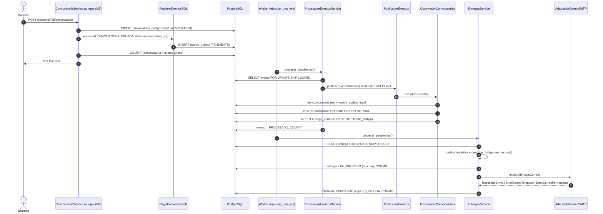
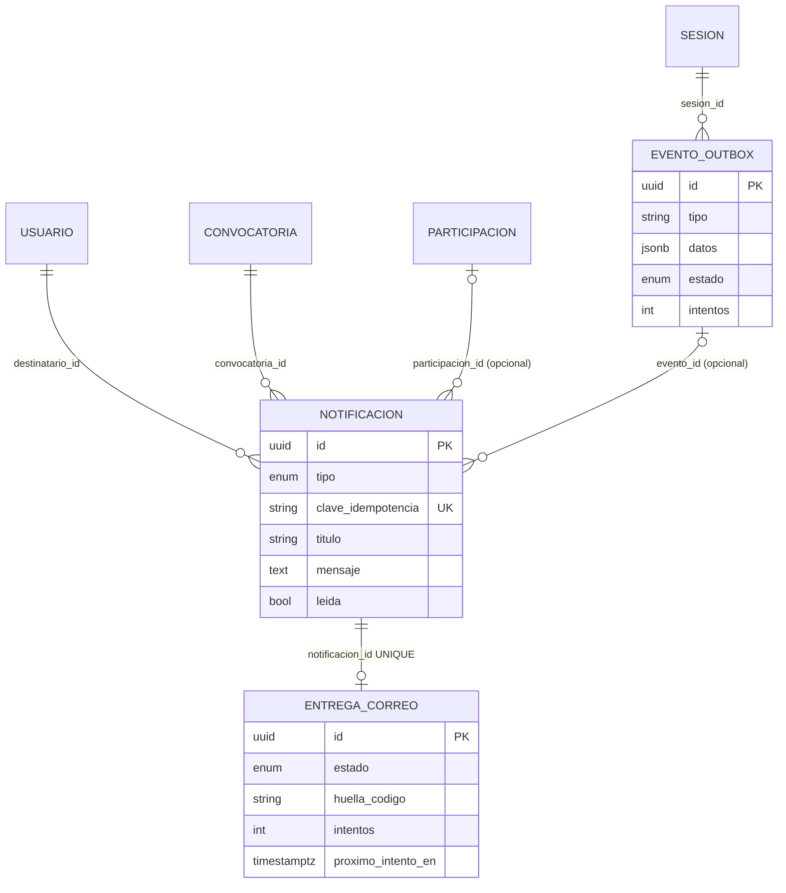
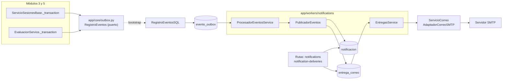
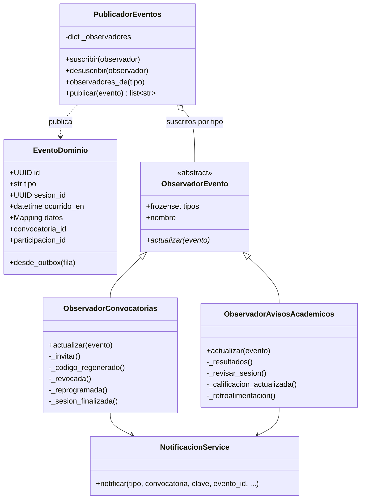
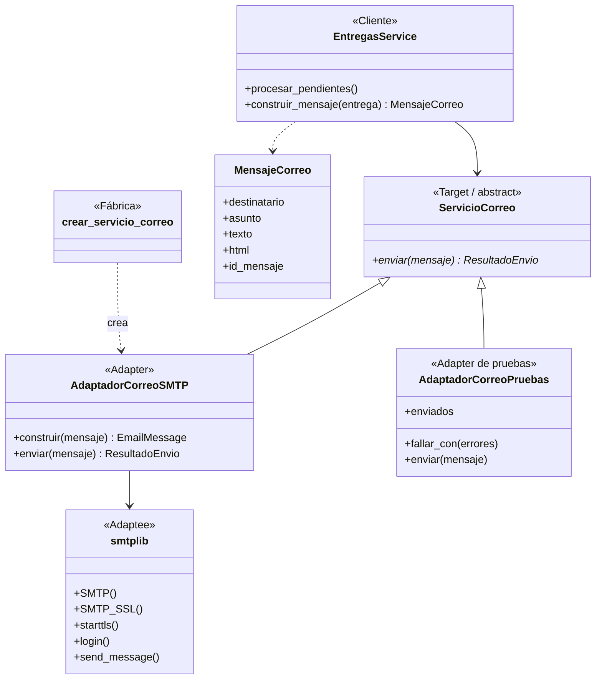
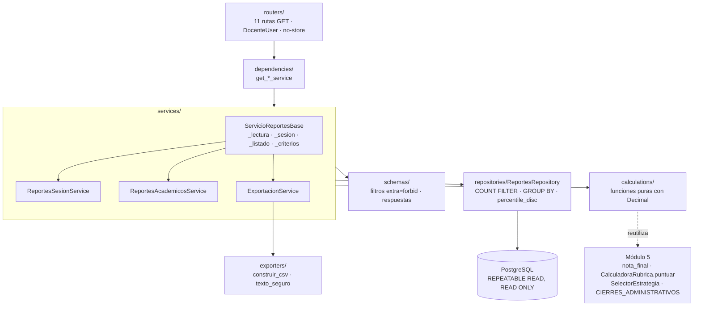
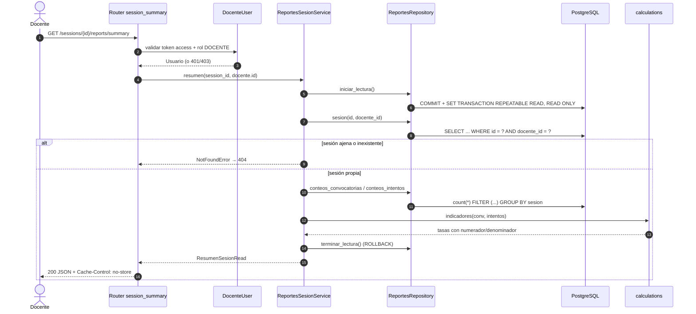

# GUÍA DE ESTUDIO Y SUSTENTACIÓN TÉCNICA: MÓDULOS 6 Y 7 DE INTER NOS

**Proyecto Nuclear II — Simulador de casos académicos de Psicología Social "Inter Nos"**
**Material de estudio interno del equipo para la sustentación**
**Fuente:** código del repositorio local (rama `pruebas-unitarias-modulos-5-7`, commit `5eac5e6`), migración `0011_notificaciones_eventos`, pruebas en `backend/tests/`, `docs/REPORTE_PRUEBAS_MODULO_6.md`, `docs/REPORTE_PRUEBAS_MODULO_7.md` y `README.md`.

> **Cómo usar esta guía.** Si solo tienes 10 minutos, lee la sección 24 (repaso rápido). Si tienes una hora, lee las secciones 2 a 4 (Módulo 6), 10 a 13 (Módulo 7), el guion (sección 20) y las preguntas (sección 21). Todas las rutas de archivo son relativas a `backend/` salvo que se indique lo contrario. Los fragmentos de código marcados como **código real** están copiados del repositorio; cuando un fragmento está recortado se indica con `# (...)`. Los ejemplos de peticiones y respuestas usan **valores ficticios** sobre los esquemas reales.

---

## Índice

1. Introducción: Inter Nos y sus siete módulos
2. Módulo 6: explicación funcional
3. Patrón Observer
4. Patrón Adapter
5. Transactional Outbox y procesamiento de eventos
6. Base de datos del Módulo 6
7. Seguridad del Módulo 6
8. Endpoints del Módulo 6
9. Pruebas del Módulo 6
10. Módulo 7: explicación funcional
11. Arquitectura y código del Módulo 7
12. Estadísticas del Módulo 7
13. Reutilización del Módulo 5
14. PostgreSQL y consistencia de los reportes
15. Exportación CSV
16. Seguridad del Módulo 7
17. Endpoints del Módulo 7
18. Pruebas del Módulo 7
19. Comparación entre ambos módulos
20. Guion de exposición oral
21. Preguntas que podría hacer el docente
22. Fragmentos de código para estudiar
23. Diagramas para estudiar
24. REPASO RÁPIDO ANTES DE LA SUSTENTACIÓN
- Anexo A. Discrepancias entre documentación y código
- Anexo B. Inventario de clases y funciones analizadas

---

## 1. Introducción: Inter Nos y sus siete módulos

### 1.1 Qué es Inter Nos

Inter Nos es un **simulador de casos académicos de Psicología Social**. Un docente redacta un caso (escenarios, preguntas de opción múltiple y una rúbrica), lo programa en una sesión, convoca a sus estudiantes y estos lo resuelven dentro de una ventana de tiempo. Después, el sistema califica cada intento con la rúbrica, el docente agrega retroalimentación y los estudiantes consultan sus resultados.

### 1.2 Qué problema académico resuelve

En una clase de Psicología Social los casos prácticos suelen resolverse en papel o en formularios genéricos que no controlan la ventana de tiempo, los intentos ni la coherencia de la calificación con una rúbrica. Inter Nos ofrece:

- un caso estructurado y versionado (no editable después de publicarse);
- un acceso controlado del estudiante (correo institucional + código de autorización);
- un temporizador individual y control de intentos;
- una calificación reproducible basada en la rúbrica;
- comunicación automática con los estudiantes (Módulo 6) y
- seguimiento y reportes para el docente (Módulo 7).

### 1.3 Función general del backend

El backend es un **monolito modular** en **FastAPI + PostgreSQL** (SQLAlchemy 2, Alembic y Pydantic). Cada módulo vive en `app/modules/<nombre>/` y se organiza en capas: `routers → dependencias de autorización → servicios → repositorios → PostgreSQL`. Los routers no contienen SQL ni reglas de negocio; los servicios lanzan excepciones de `app/core/exceptions.py` que un manejador global traduce a JSON. Todas las rutas se publican bajo el prefijo `/api/v1` (`app/main.py`).

### 1.4 Los siete módulos

| # | Módulo | Carpeta | Responsabilidad (resumen) |
|---|---|---|---|
| 1 | Autenticación y Usuarios | `app/modules/auth/` | Usuarios, roles (ADMINISTRADOR, DOCENTE, ESTUDIANTE), Argon2 y JWT |
| 2 | Gestión de Casos Académicos | `app/modules/cases/` | Casos, escenarios, preguntas, opciones y rúbricas; publicación y archivo |
| 3 | Sesiones y Convocatorias | `app/modules/sessions/` | Programar sesiones, convocar estudiantes, códigos cifrados, acceso estudiantil |
| 4 | Participaciones | `app/modules/participations/` | Intentos, temporizador, respuestas, cierre por tiempo o por fin de sesión |
| 5 | Evaluación y Retroalimentación | `app/modules/evaluations/` | Calificación con la rúbrica (`nota_final`), retroalimentación y resultados |
| **6** | **Notificaciones y Eventos** | `app/modules/notifications/` | Avisos internos y correos a partir de hechos académicos (Observer + Adapter + Outbox) |
| **7** | **Seguimiento y Reportes** | `app/modules/reports/` | Consultas de solo lectura, estadísticas y exportación CSV para el docente |

### 1.5 Por qué importan los módulos 6 y 7

Los cinco primeros módulos **producen** información académica: casos, sesiones, convocatorias, intentos y notas. Pero sin el Módulo 6 el estudiante no se entera de que fue convocado ni de cuál es su código, y sin el Módulo 7 el docente no tiene una vista consolidada de lo que pasó en su sesión. Son los módulos que **cierran el ciclo de uso**:

```text
Docente crea caso (M2) → programa sesión y convoca (M3) ──► M6 envía invitación con código
Estudiante ingresa y resuelve (M4) ──► M7 muestra el avance en tiempo real
Docente califica / agrega retroalimentación (M5) ──► M6 avisa "resultados disponibles"
                                                   └► M7 calcula estadísticas y exporta CSV
```

### 1.6 Relación con los módulos previos

- **Módulo 6** *escucha* los hechos de los módulos 3 y 5 (convocatoria creada, código regenerado, sesión finalizada, calificación registrada, etc.). Reutiliza el cifrado de códigos del Módulo 3 y la regla de reingreso del Módulo 4. Es el único que envía correos.
- **Módulo 7** *lee* lo que guardaron los módulos 2 a 5. No escribe nada: ni notas, ni estados, ni convocatorias. Reutiliza contratos del Módulo 5 (`nota_final`, `CalculadoraRubrica.puntuar`, `SelectorEstrategia`, `CIERRES_ADMINISTRATIVOS`, `redondear`).

---

## 2. Módulo 6: explicación funcional

### 2.1 Qué problema resuelve

Cuando un docente convoca a 40 estudiantes, cada uno debe recibir **su** código de autorización por correo, sin ver los datos de los demás. Si después regenera el código de uno de ellos, el correo anterior queda obsoleto. Si cambia la hora de la sesión, los convocados deben enterarse. Cuando las notas quedan disponibles, los estudiantes deben recibir un aviso, pero **sin** que el aviso revele la nota antes de tiempo.

Además hay una exigencia técnica fuerte: **una convocatoria nunca debe fallar porque el servidor de correo esté caído**, y **ningún aviso debe nacer de una operación que se revirtió**. El Módulo 6 resuelve las dos cosas.

### 2.2 Funcionalidades

| Funcionalidad | Dónde está |
|---|---|
| Registrar hechos académicos en la misma transacción que la operación | `app/core/outbox.py`, `events/RegistroEventosSQL` |
| Distribuir cada hecho a los observadores interesados | `publishers/PublicadorEventos` |
| Decidir qué aviso corresponde (invitación, código nuevo, revocación, reprogramación, resultados, retroalimentación) | `observers/convocatorias.py`, `observers/avisos_academicos.py` |
| Crear el aviso interno y, si aplica, una entrega de correo pendiente | `services/notificacion_service.py` |
| Enviar los correos con reintentos y revalidación | `services/entregas_service.py` + `adapters/` |
| Consultar y marcar como leídas las notificaciones propias | `routers/` (`/notifications`) |
| Supervisar y reintentar entregas fallidas (administrador) | `routers/` (`/notification-deliveries`) |
| Ejecutar todo fuera de las peticiones HTTP | `app/workers/notifications/` |

### 2.3 Quién se beneficia

- **Estudiantes:** reciben su invitación con código, avisos de cambio, de retiro, de resultados y de retroalimentación.
- **Docentes:** no tienen que copiar y enviar códigos a mano; sus operaciones nunca fallan por el correo. También tienen su propia bandeja (`/notifications` con token `access`).
- **Administradores:** ven el estado de las entregas de correo (sin direcciones ni contenido) y pueden reintentar las fallidas.

### 2.4 Qué situaciones generan eventos

El Módulo 6 **no inventa un catálogo propio**: reutiliza los nombres que ya publicaban los módulos 3 (`app/modules/sessions/eventos.py`) y 5 (`app/modules/evaluations/eventos.py`). El catálogo con observadores está en `app/modules/notifications/events/__init__.py`.

| Evento | Origen | Cuándo ocurre | Observador | Aviso | ¿Correo? |
|---|---|---|---|---|---|
| `CONVOCATORIA_CREADA` | M3 | El docente convoca a un estudiante | Convocatorias | `CONVOCATORIA` | Sí, **con código** |
| `CONVOCATORIA_REACTIVADA` | M3 | Se vuelve a convocar a un estudiante retirado | Convocatorias | `CONVOCATORIA` | Sí, con el código vigente |
| `CODIGO_REGENERADO` | M3 | El docente regenera el código | Convocatorias | `CODIGO_REGENERADO` | Sí, con el código **nuevo** |
| `CONVOCATORIA_RETIRADA` | M3 | El docente revoca la convocatoria | Convocatorias | `REVOCACION` | Sí, sin código (solo "cuando corresponda") |
| `SESION_MODIFICADA` | M3 | Cambia caso, inicio, fin, tiempo, lugar o mensaje | Convocatorias | `REPROGRAMACION` | Solo si ya recibió la invitación |
| `SESION_FINALIZADA` | M3 | La sesión termina | **Ambos** | Cancela invitaciones / `RESULTADOS_DISPONIBLES` y `RETROALIMENTACION` | Resultados: sí |
| `CALIFICACION_REGISTRADA` | M5 | Primera nota de un intento | Avisos académicos | `RESULTADOS_DISPONIBLES` | Sí |
| `CALIFICACION_ACTUALIZADA` | M5 | Cambia una nota ya registrada | Avisos académicos | `CALIFICACION_ACTUALIZADA` | Sí |
| `RETROALIMENTACION_REGISTRADA` | M5 | El docente escribe retroalimentación | Avisos académicos | `RETROALIMENTACION` | **No** (solo interna) |
| `RESULTADOS_DISPONIBLES` | M5 | Revisión de resultados de la sesión | Avisos académicos | `RESULTADOS_DISPONIBLES` | Sí |
| `SESION_PROGRAMADA`, `SESION_INICIADA`, `INTENTOS_MODIFICADOS` | M3 | — | Ninguno | — | Se marcan PROCESADOS sin efectos |

### 2.5 Cómo se producen las notificaciones internas

Una **notificación interna** es una fila de la tabla `notificacion`: un aviso para **un** destinatario con título y mensaje seguros. La crea `NotificacionService.notificar(...)` (llamado por un observador):

1. Lee los datos vigentes de la sesión y del estudiante (`datos_aviso`).
2. Genera título y mensaje con `templates.aviso_interno(tipo, datos, tz, cambios=...)`. **Nunca** incluye el código ni la nota.
3. Inserta la fila con `INSERT ... ON CONFLICT (clave_idempotencia) DO NOTHING` (`NotificacionRepository.insertar_notificacion`). Si la clave ya existía, devuelve `None` y no se crea nada (idempotencia).
4. Si el tipo se comunica por correo (`TIPOS_CON_CORREO`), crea una `entrega_correo` en estado `PENDIENTE`.

Ejemplo de aviso interno real (plantilla `T.CONVOCATORIA`):

> **Título:** "Convocatoria: Conformidad en el aula"
> **Mensaje:** "Has sido convocado a la sesión del caso «Conformidad en el aula» el 03/11/2026 a las 03:00 (UTC-05:00). El código de autorización se envía únicamente a tu correo institucional."

### 2.6 Cómo se envían los correos electrónicos

El correo **no** se guarda en la base de datos. Se genera en el momento del envío, con los datos vigentes:

1. El worker reclama una entrega `PENDIENTE` (`reclamar_entrega`, `FOR UPDATE SKIP LOCKED`).
2. **Revalida** contra el estado real (`EntregasService.motivo_invalidez`). Si ya no corresponde, la marca `CANCELADA` con un motivo legible.
3. Construye un `MensajeCorreo` (`construir_mensaje`). Si el aviso lleva código, lo **descifra en memoria** con `descifrar_codigo` del Módulo 3.
4. Marca la entrega `EN_PROCESO` con una reserva (lease) de `NOTIFICATIONS_LEASE_SECONDS` y **confirma** antes de tocar la red.
5. Llama `ServicioCorreo.enviar(mensaje)`: el adaptador configurado (SMTP en producción) envía.
6. Registra el resultado: `ENVIADA`, `PENDIENTE` (reintento con espera progresiva) o `FALLIDA`.

### 2.7 Cómo se entregan los códigos de convocatoria

Solo dos tipos de correo llevan código: `CONVOCATORIA` y `CODIGO_REGENERADO` (`templates.TIPOS_CON_CODIGO`). El código se lee **cifrado** desde `convocatoria.codigo_autorizacion`, se descifra con AES-256-GCM justo antes de construir el mensaje y se descarta. Al crear la entrega se guarda solo la **huella** (HMAC) del código cifrado, para detectar al enviar si fue regenerado.

Ejemplo de contenido del correo de convocatoria (filas que arma `templates.correo`): caso, fecha, hora de inicio y fin con zona horaria, tiempo máximo, lugar, mensaje del docente, correo institucional, **código de autorización** y **URL de acceso** (`SIMULATOR_ACCESS_URL`). Asunto: `Inter Nos: Convocatoria a una sesión académica — <nombre del caso>`.

### 2.8 Cómo se notifican los cambios de programación

`SESION_MODIFICADA` trae en `datos["campos"]` la lista de campos modificados. `ObservadorConvocatorias._reprogramada`:

- ignora el evento si no cambió ningún campo relevante (`CAMPOS_PROGRAMACION = {"caso_id", "inicio", "fin", "tiempo_max_min", "lugar", "mensaje"}`) o si la sesión ya finalizó;
- por cada convocatoria activa, **cancela** cualquier aviso de reprogramación anterior aún pendiente ("Reprogramación superada por un cambio posterior.");
- crea siempre el aviso interno ("Cambió: lugar o modalidad. Programación vigente: ...");
- crea correo **solo si** al estudiante ya le salió una invitación con código (`algun_codigo_enviado`). Si su invitación aún no salió, saldrá con los datos nuevos y un correo de "cambio" sería redundante.

### 2.9 Cómo se notifican los resultados académicos

Regla del Módulo 5: un estudiante solo puede ver resultados con la sesión **FINALIZADA**, la convocatoria **activa** y **al menos una nota registrada**. `ObservadorAvisosAcademicos` cubre los dos órdenes posibles:

- **Caso A:** se califica y después finaliza la sesión → lo detecta `SESION_FINALIZADA` (`_revisar_sesion`).
- **Caso B:** finaliza la sesión y después se califica → lo detecta `CALIFICACION_REGISTRADA` (`_visible` + `_resultados`).

La clave de idempotencia `resultados:<id de convocatoria>` hace que el aviso salga **una sola vez** aunque los dos caminos se disparen. Si después el docente cambia una nota, `CALIFICACION_ACTUALIZADA` genera un aviso "Evaluación actualizada" solo si los resultados ya se habían anunciado. El aviso **nunca** incluye la nota.

### 2.10 Cómo se notifican los cambios de retroalimentación

`RETROALIMENTACION_REGISTRADA` produce un aviso **solo interno** (sin correo). Si la sesión aún no finalizó, no se avisa: se avisará al finalizar (`_revisar_sesion` recorre las participaciones con `retroalimentacion_general`). La clave `retro:<participación>:<huella del texto>` (SHA-256 del texto, 16 caracteres) evita duplicados; si el docente cambia el texto, la huella cambia y se genera un aviso nuevo. Si el docente borra la retroalimentación, no se avisa. El aviso **no copia** el texto del docente.

### 2.11 Qué sucede cuando falla el servidor de correo

Nada se pierde y nada académico se bloquea:

| Situación | Qué hace el sistema |
|---|---|
| SMTP caído al convocar | La convocatoria se confirma igual: el correo no forma parte de la transacción académica |
| Error **temporal** (desconexión, tiempo agotado, código 4xx) | La entrega vuelve a `PENDIENTE` con espera `base × 2^(intento−1)` (60, 120, 240, 480 s con los valores por defecto, tope 3600 s) |
| Error **permanente** (5xx, destinatario rechazado, autenticación, certificado TLS inválido) | La entrega queda `FALLIDA`; un administrador puede reintentarla |
| Se agotan `NOTIFICATIONS_MAX_ATTEMPTS` (5) | `FALLIDA` |
| El worker cae en mitad del envío | La reserva `EN_PROCESO` vence y otra ejecución la retoma |
| Envío desactivado (`NOTIFICATIONS_EMAIL_ENABLED=false`, valor por defecto) | Los avisos internos se crean; las entregas esperan `PENDIENTE` y se revalidan cuando se active |

Evidencia documentada (reporte del Módulo 6): con un puerto SMTP cerrado las entregas quedaron `PENDIENTE`, `intentos = 1`, error `Fallo de red o de protocolo SMTP (ConnectionRefusedError).`; al volver el servidor y pasar la espera quedaron `ENVIADA` con `intentos = 2`.

### 2.12 Ejemplo completo narrado (sin leer código)

> La docente Laura convoca a Ana, Bruno y Carla a la sesión "Conformidad en el aula" (inicio 8:00, fin 10:00). En la **misma transacción** en que se guardan las tres convocatorias se guardan tres eventos `CONVOCATORIA_CREADA` en `evento_outbox`. La API responde 201 aunque el servidor de correo esté apagado.
>
> Un minuto después corre el worker. Toma el primer evento, se lo entrega al publicador y este lo pasa a `ObservadorConvocatorias`. El observador comprueba que la convocatoria de Ana sigue activa y que su código aún permite ingresar; crea un aviso interno "Convocatoria: Conformidad en el aula" y una entrega de correo pendiente. Lo mismo para Bruno y Carla.
>
> Antes de enviar, Laura regenera el código de Bruno. Llega `CODIGO_REGENERADO`: el observador cancela la entrega pendiente de Bruno (llevaría el código viejo) y crea otra con el código nuevo. En la segunda fase el worker envía a Ana y a Carla su invitación, y a Bruno solo el correo con el código nuevo. Cada correo tiene un único destinatario.

---

## 3. Patrón Observer

### 3.A Explicación conceptual

**Observer** (GoF, patrón de comportamiento) define una relación uno-a-muchos: cuando un objeto (el **sujeto**) registra un cambio, todos los objetos interesados (los **observadores**) son notificados automáticamente, sin que el sujeto conozca sus clases concretas.

| Concepto | Significado |
|---|---|
| **Sujeto o publicador** | Mantiene la lista de observadores y les distribuye los eventos |
| **Observador** | Objeto que implementa una interfaz común (`actualizar(evento)`) y reacciona |
| **Suscripción** | Registrar a un observador en el sujeto (`suscribir`) para ciertos tipos de evento |
| **Evento** | El hecho que ocurrió, con los datos mínimos para reaccionar |
| **Notificación a observadores** | El sujeto recorre sus suscriptores y llama `actualizar` a cada uno |
| **Desacoplamiento** | El que produce el hecho no conoce a quienes reaccionan; se pueden añadir o quitar reacciones sin tocar al productor |

**Cuándo conviene:** cuando un hecho debe provocar varias reacciones independientes, que pueden crecer con el tiempo, y no queremos que el productor dependa de cada una.

### 3.B Observer en Inter Nos

| Rol GoF | Clase real | Archivo |
|---|---|---|
| Evento | `EventoDominio` | `app/modules/notifications/events/__init__.py` |
| Observador abstracto | `ObservadorEvento` | `app/modules/notifications/observers/base.py` |
| Sujeto | `PublicadorEventos` | `app/modules/notifications/publishers/__init__.py` |
| Observador concreto | `ObservadorConvocatorias` | `app/modules/notifications/observers/convocatorias.py` |
| Observador concreto | `ObservadorAvisosAcademicos` | `app/modules/notifications/observers/avisos_academicos.py` |
| Composición (quién arma el Observer) | `crear_publicador(session, ahora, reloj)` | `app/modules/notifications/services/procesador_eventos.py` |

#### `EventoDominio`

1. **Ruta:** `app/modules/notifications/events/__init__.py`.
2. **Responsabilidad:** representar un hecho ocurrido, tal como lo reciben los observadores. Es un `dataclass(frozen=True, slots=True)`: inmutable.
3. **Campos y métodos:** `id`, `tipo`, `sesion_id`, `ocurrido_en`, `datos` (mapa de textos); `uuid_de(clave)`, propiedades `convocatoria_id` y `participacion_id`, y el constructor alternativo `desde_outbox(fila)`.
4. **Parámetros importantes:** `datos` solo lleva ids y textos no sensibles. `uuid_de` devuelve `None` si el valor falta o no es un UUID válido (no lanza excepción).
5. **Retorno:** `desde_outbox` devuelve un `EventoDominio` construido a partir de una fila `EventoOutbox` (usa `registrado_en` como `ocurrido_en`).
6. **Relación:** lo produce `ProcesadorEventosService`; lo consumen `PublicadorEventos` y los observadores.
7. **Ejemplo:** `EventoDominio(id=..., tipo="CONVOCATORIA_CREADA", sesion_id=S, ocurrido_en=..., datos={"convocatoria_id": "c1..."})`; `evento.convocatoria_id` → `UUID("c1...")`.

**Por qué existe:** separa el formato de almacenamiento (fila de `evento_outbox`) del formato que entienden los observadores, y garantiza que el evento no se modifique mientras se distribuye.

En el mismo archivo está `RegistroEventosSQL.registrar(db, tipo, sesion_id, datos)`: implementa el puerto del outbox; **rechaza** el evento si `datos` contiene alguna clave de `CLAVES_PROHIBIDAS = {"codigo", "codigo_autorizacion", "clave", "password", "token", "nota", "nota_final"}` (lanza `ValueError` y la operación académica se revierte) y hace el `INSERT` en la transacción en curso.

#### `ObservadorEvento`

1. **Ruta:** `app/modules/notifications/observers/base.py`.
2. **Responsabilidad:** contrato común (clase abstracta `ABC`) de todos los observadores.
3. **Miembros:** atributo de clase `tipos: frozenset[str]` (a qué eventos se suscribe), propiedad `nombre` (nombre de la clase) y método abstracto `actualizar(evento)`.
4. **Parámetros:** `actualizar` recibe un `EventoDominio`.
5. **Retorno:** `None`.
6. **Relación:** `PublicadorEventos` solo conoce este tipo. Su docstring fija dos reglas: `actualizar` corre **dentro de la transacción** del procesador (lo que crea se confirma junto con la marca de evento procesado, o no se confirma nada) y debe ser **idempotente**.
7. **Ejemplo:** cualquier observador nuevo (p. ej., uno para un futuro módulo) solo debe declarar `tipos` e implementar `actualizar`.

**Por qué existe:** es lo que permite al sujeto tratar a todos los observadores por igual (polimorfismo).

#### `PublicadorEventos`

1. **Ruta:** `app/modules/notifications/publishers/__init__.py`.
2. **Responsabilidad:** sujeto del patrón. Guarda un diccionario `tipo → lista de observadores` (`defaultdict(list)`).
3. **Métodos:** `suscribir(observador)`, `desuscribir(observador)`, `observadores_de(tipo)`, `publicar(evento)`.
4. **Parámetros:** `suscribir` lee `observador.tipos` y lo agrega a cada lista **sin duplicarlo**.
5. **Retorno:** `publicar` devuelve `list[str]` con los nombres de los observadores que recibieron el evento (lista vacía si nadie lo escucha).
6. **Relación:** lo crea `crear_publicador`; lo usa `ProcesadorEventosService._procesar_uno`.
7. **Ejemplo:** `SESION_FINALIZADA` está en los `tipos` de **los dos** observadores: `publicar` llama a ambos, en orden de suscripción, y devuelve `["ObservadorConvocatorias", "ObservadorAvisosAcademicos"]`.

Decisiones visibles en su docstring: un tipo sin observadores **no es un error**; si un observador lanza una excepción, **se propaga** para que el procesador revierta todo el evento y lo reintente.

#### `ObservadorConvocatorias`

1. **Ruta:** `app/modules/notifications/observers/convocatorias.py`.
2. **Responsabilidad:** invitaciones, códigos, revocaciones, reprogramaciones y cancelación de envíos al finalizar la sesión (RF-20, RF-21).
3. **Métodos:** `actualizar` (despacha con un diccionario `tipo → manejador`), `_vigente`, `_invitar`, `_codigo_regenerado`, `_revocada`, `_reprogramada`, `_sesion_finalizada`.
4. **Parámetros del constructor:** `servicio: NotificacionService`, `ahora: datetime`, `vigencia=motivo_codigo_inutil` (la regla de vigencia es inyectable para pruebas).
5. **Retorno:** `None` (efectos en la base de datos).
6. **Relación:** usa `NotificacionService.notificar` y `NotificacionRepository` (`convocatoria`, `cancelar_entregas`, `algun_codigo_enviado`, `participaciones`, `convocatorias_activas`, `convocatorias_de_sesion`).
7. **Ejemplo:** ante `CONVOCATORIA_CREADA`, `_invitar` busca la convocatoria **en su estado real** (no el del evento), comprueba que su código siga sirviendo y llama `notificar(T.CONVOCATORIA, convocatoria, clave="CONVOCATORIA_CREADA:<id del evento>", evento_id=...)`.

Reglas destacables:

- `_vigente` consulta el estado **actual**: si el evento lleva horas pendiente y la convocatoria ya fue revocada, no se invita.
- `_revocada` no avisa si la convocatoria fue **reactivada** después, y solo avisa "cuando corresponda": si al estudiante ya le salió un correo con código o llegó a participar. Si su invitación no había salido, basta con cancelarla.
- `_sesion_finalizada` cancela las invitaciones, códigos y reprogramaciones aún pendientes de **todas** las convocatorias (también revocadas).

#### `ObservadorAvisosAcademicos`

1. **Ruta:** `app/modules/notifications/observers/avisos_academicos.py`.
2. **Responsabilidad:** resultados disponibles, calificación actualizada y retroalimentación (RF-27), respetando la visibilidad del Módulo 5.
3. **Métodos:** `actualizar`, `_visible`, `_resultados`, `_revisar_sesion`, `_calificacion_actualizada`, `_retroalimentacion`; funciones auxiliares `clave_resultados(convocatoria)` y `clave_retroalimentacion(participacion)`.
4. **Parámetros del constructor:** `servicio: NotificacionService`.
5. **Retorno:** `_resultados` devuelve `bool` (si creó el aviso); el resto, `None`.
6. **Relación:** igual que el anterior, a través de `NotificacionService` y su repositorio.
7. **Ejemplo:** `CALIFICACION_REGISTRADA` con la sesión EN_CURSO → `_visible` devuelve `None` y no pasa nada; cuando llegue `SESION_FINALIZADA`, `_revisar_sesion` creará el aviso con la clave `resultados:<convocatoria>`.

`_resultados` exige que al menos un intento tenga `nota_final` no nula: un intento `SIN_CALIFICAR` no basta.

### 3.C Recorrido del código: creación de una convocatoria

| Paso | Qué ocurre | Código real |
|---|---|---|
| 1. Origen | `POST /api/v1/sessions/{session_id}/convocations` (`add_convocations`) llama `ConvocatoriaService.agregar(docente, session_id, correos)` | `app/modules/sessions/routers/sesiones_router.py`, `app/modules/sessions/services/sesion_service.py` |
| 2. Emisión | Por cada estudiante, `_convocar` cifra el código (`cifrar_codigo`) y llama `self._emitir(eventos.evento_convocatoria(CONVOCATORIA_CREADA, sesion.id, convocatoria.id))`; el evento queda en `self._pendientes` | `sesion_service.py` |
| 3. Registro | `ServicioSesionesBase._transaction()`, justo antes del `commit`, recorre `_pendientes` y llama `outbox.registro().registrar(...)`; `RegistroEventosSQL.registrar` hace el `INSERT INTO evento_outbox` **en la misma transacción** | `app/modules/sessions/services/base.py`, `app/core/outbox.py`, `events/__init__.py` |
| 4. Recuperación | El worker (`ejecutar_una_vez`) crea `ProcesadorEventosService` y `procesar_pendientes()`; `_procesar_uno` llama `NotificacionRepository.reclamar_evento(ahora)` (`SELECT ... FOR UPDATE SKIP LOCKED`, orden de llegada) y lo convierte con `EventoDominio.desde_outbox` | `app/workers/notifications/runner.py`, `services/procesador_eventos.py`, `repositories/__init__.py` |
| 5. Publicación | Dentro de `session.begin_nested()` (SAVEPOINT) se arma el Observer con `crear_publicador` y se llama `publicar(evento)` | `procesador_eventos.py` |
| 6. Selección | `observadores_de("CONVOCATORIA_CREADA")` → solo `ObservadorConvocatorias` | `publishers/__init__.py` |
| 7. Reacción | `ObservadorConvocatorias.actualizar` → `_invitar` → `_vigente` (estado real + `motivo_codigo_inutil`) → `NotificacionService.notificar(T.CONVOCATORIA, ...)` | `observers/convocatorias.py`, `services/vigencia.py` |
| 8. Persistencia | `insertar_notificacion` (`ON CONFLICT DO NOTHING`) e `insertar_entrega(notificacion_id, huella_codigo(...))`; luego `fila.estado = PROCESADO`, `procesado_en = ahora` y `commit` | `services/notificacion_service.py`, `repositories/__init__.py` |
| 9. Preparación del correo | En la segunda fase, `EntregasService` reclama la entrega, revalida y construye el `MensajeCorreo` con el código descifrado en memoria | `services/entregas_service.py` |

**Qué queda en PostgreSQL tras el paso 8:** una fila en `evento_outbox` (`PROCESADO`), una en `notificacion` (`tipo = CONVOCATORIA`, `clave_idempotencia = "CONVOCATORIA_CREADA:<id evento>"`, `leida = false`) y una en `entrega_correo` (`PENDIENTE`, `huella_codigo = <HMAC>`, `intentos = 0`). **En ninguna aparece el código en claro.**

### 3.D Justificación del patrón

**¿Por qué Observer?** Un mismo hecho académico puede provocar varias reacciones independientes (cancelar invitaciones y anunciar resultados ante `SESION_FINALIZADA`), y el catálogo de reacciones crece. Observer permite que los módulos 3 y 5 solo "registren lo que pasó", y que el Módulo 6 decida quién reacciona.

**¿Qué pasaría si los servicios académicos enviaran directamente las notificaciones?** `ConvocatoriaService` tendría que importar plantillas, SMTP, reglas de vigencia y reintentos. Una caída de SMTP haría fallar o dejar a medias la convocatoria; los módulos 3 y 5 quedarían acoplados al 6 (y a un proveedor de correo), y probar una convocatoria exigiría un servidor de correo.

**¿Cómo reduce el acoplamiento?** Los módulos 3 y 5 solo dependen de `app/core/outbox.py` (un `Protocol` de una línea, sin importar el Módulo 6). La implementación real se conecta en `app/bootstrap.py`. El publicador solo depende de la interfaz `ObservadorEvento`.

**¿Qué facilita al añadir nuevos tipos de notificación?** Crear una subclase de `ObservadorEvento` con sus `tipos` y suscribirla en `crear_publicador`. No se toca ningún servicio académico ni el publicador.

**¿Diferencia entre Observer y "llamar una función"?** Una llamada directa fija **quién** reacciona en el código del productor. En Observer el productor no conoce a los receptores: el sujeto los resuelve en tiempo de ejecución según la suscripción, puede haber cero, uno o varios por tipo, y se agregan o quitan sin modificar al productor.

> **Explicación oral (≈1 minuto).** "Para notificar usamos el patrón Observer. Los módulos de sesiones y de evaluación no saben nada de correos: cuando ocurre algo importante, como crear una convocatoria o finalizar una sesión, solo registran un evento. En nuestro módulo, la clase `PublicadorEventos` es el sujeto: mantiene, por cada tipo de evento, la lista de observadores suscritos. Tenemos dos observadores concretos que heredan de `ObservadorEvento`: `ObservadorConvocatorias`, que se encarga de invitaciones, códigos, revocaciones y reprogramaciones, y `ObservadorAvisosAcademicos`, que avisa resultados y retroalimentación. Un mismo evento puede llegar a los dos: `SESION_FINALIZADA` hace que uno cancele las invitaciones que no salieron y el otro anuncie los resultados. La ventaja es el desacoplamiento: si mañana necesitamos otra reacción, escribimos un observador nuevo y lo suscribimos, sin tocar los módulos académicos."

---

## 4. Patrón Adapter

### 4.A Concepto

**Adapter** (GoF, patrón estructural) permite que una clase con una interfaz incompatible trabaje con un cliente que espera otra interfaz. El **adaptador** implementa la interfaz que el cliente espera (**Target**) y por dentro traduce cada llamada a la interfaz del componente externo (**Adaptee**).

- **Adaptar una interfaz** significa traducir formatos y errores: nuestro sistema habla de `MensajeCorreo` y `enviar()`; `smtplib` habla de `EmailMessage`, `starttls()`, `login()`, `send_message()` y excepciones `SMTP*`.
- **Evita depender del proveedor:** el cliente solo conoce el Target. Cambiar de proveedor es escribir otro adaptador.

### 4.B Implementación en Inter Nos

| Rol | Componente | Archivo |
|---|---|---|
| Target | `ServicioCorreo` (ABC) | `app/modules/notifications/adapters/base.py` |
| Mensaje propio | `MensajeCorreo`, `ResultadoEnvio` | `adapters/base.py` |
| Errores del contrato | `ErrorCorreo`, `ErrorCorreoTemporal`, `ErrorCorreoPermanente`, `MensajeInvalidoError`, `ConfiguracionCorreoError` | `adapters/base.py` |
| Adapter | `AdaptadorCorreoSMTP` | `adapters/smtp_adapter.py` |
| Adapter de pruebas | `AdaptadorCorreoPruebas` | `adapters/fake_adapter.py` |
| Fábrica | `crear_servicio_correo(settings)` | `adapters/__init__.py` |
| Cliente | `EntregasService` | `services/entregas_service.py` |
| Adaptee | `smtplib`, `email.message.EmailMessage` (biblioteca estándar) | — |

#### `ServicioCorreo`

- **Propósito:** interfaz objetivo. Un único método abstracto `enviar(mensaje: MensajeCorreo) -> ResultadoEnvio`, que envía o lanza `ErrorCorreoTemporal` / `ErrorCorreoPermanente`.
- **Dependencias:** ninguna externa.
- **Comportamiento:** define también **la clasificación de errores**: el atributo `temporal` de `ErrorCorreo` es lo que el cliente usa para decidir si reintenta. Los mensajes de error son "seguros" (`mensaje_seguro`): nunca incluyen credenciales, códigos ni el cuerpo.
- **Ejemplo de uso:** `EntregasService._procesar_una` hace `self._correo.enviar(mensaje)` sin saber si es SMTP o el adaptador de pruebas.

#### `MensajeCorreo`

- **Propósito:** formato propio del sistema para un correo: `destinatario`, `asunto`, `texto`, `html` opcional, `id_mensaje` (Message-ID estable) y `encabezados`.
- **Comportamiento:** es inmutable y **se valida al construirse** (`__post_init__`): un único destinatario con formato válido (`validar_direccion`, con `EmailStr` de Pydantic), sin `\r`, `\n` ni `\x00` en destinatario, asunto, encabezados ni Message-ID (impide la **inyección de encabezados**), asunto no vacío de máximo 200 caracteres y texto no vacío. Si algo falla lanza `MensajeInvalidoError` (que es un error **permanente**).
- **Ejemplo:** `MensajeCorreo(destinatario="ana@universidad.edu.co\r\nBcc: x@y.com", ...)` → `MensajeInvalidoError("Dirección de correo inválida.")`.

#### `AdaptadorCorreoSMTP`

- **Propósito:** traducir `MensajeCorreo` a SMTP. Es **el único archivo del sistema que importa `smtplib`**.
- **Parámetros del constructor (solo nombrados):** `host`, `puerto`, `remitente`, `nombre_remitente="Inter Nos"`, `usuario`, `clave`, `starttls=True`, `ssl_implicito=False`, `timeout=10`, `contexto_tls`, `fabrica_smtp` (inyectable en pruebas).
- **Métodos:** `construir(mensaje) -> EmailMessage` (From, To, Subject, Date, Message-ID, texto y alternativa HTML), `_conectar()` (`smtplib.SMTP` o `smtplib.SMTP_SSL`), `enviar(mensaje)` y `__repr__` (no muestra la contraseña).
- **Dependencias:** `smtplib`, `ssl`, `socket`, `email.message`, `email.headerregistry.Address`, `email.utils.formatdate`.
- **Comportamiento de `enviar`:** abre la conexión con `timeout`; si corresponde hace `starttls(context=ssl.create_default_context())` (verifica certificado y nombre de host); si hay usuario hace `login`; envía con `send_message(..., to_addrs=[destinatario])`. Traduce cada excepción de `smtplib` a un error del contrato (ver tabla en 4.C).

#### `AdaptadorCorreoPruebas`

- **Propósito:** implementar el mismo contrato **sin red**: guarda los mensajes en `self.enviados`.
- **Métodos:** `enviar`, `fallar_con(*errores)` (programa los próximos fallos en orden) y `para(destinatario)` (filtra mensajes enviados a una dirección).
- **Ejemplo de uso en pruebas:** `correo.fallar_con(ErrorCorreoTemporal("..."))` y verificar que la entrega vuelve a `PENDIENTE` con espera progresiva.

#### `crear_servicio_correo(settings=None)`

- **Propósito:** elegir el adaptador según la configuración (`app/core/config.py`).
- **Retorno:** `None` si `NOTIFICATIONS_EMAIL_ENABLED` es `false` (por defecto); si no, un `AdaptadorCorreoSMTP`.
- **Validaciones (falla de forma explícita, sin mostrar secretos, con `ConfiguracionCorreoError`):** faltan `SMTP_HOST`, `SMTP_FROM_EMAIL` o `SIMULATOR_ACCESS_URL`; hay usuario sin contraseña; remitente inválido; URL no absoluta o `http` fuera de localhost (`validar_url_acceso`); envío sin TLS hacia un host no local; credenciales sin TLS.
- **Detalle de seguridad:** la contraseña llega como `SecretStr` y solo se lee con `get_secret_value()` al construir el adaptador.

### 4.C Flujo de envío

1. **Creación del mensaje:** `EntregasService.construir_mensaje(entrega)` reúne datos vigentes (`datos_aviso`), descifra el código si el tipo lo requiere, genera asunto/texto/HTML con `templates.correo(...)` (todo valor de usuario se escapa con `html.escape`) y crea `MensajeCorreo(..., id_mensaje=f"<entrega-{entrega.id}@{dominio}>")`.
2. **Selección del adaptador:** `ejecutar_una_vez()` llama `crear_servicio_correo()` (o recibe uno inyectado) y lo pasa a `EntregasService(session, adaptador, reloj)`. Si es `None`, `procesar_pendientes` no envía nada.
3. **Conexión SMTP:** `AdaptadorCorreoSMTP._conectar()` abre `smtplib.SMTP(host, puerto, timeout=...)` o `SMTP_SSL(..., context=...)`; luego `starttls` y `login` si corresponden.
4. **Envío:** `smtp.send_message(correo, from_addr=remitente, to_addrs=[destinatario])`.
5. **Registro del resultado:** `EntregasService._finalizar(entrega_id, error, resumen)` vuelve a bloquear la fila (`entrega_bloqueada`, `FOR UPDATE`) y la deja `ENVIADA` (`enviada_en = ahora`), `PENDIENTE` o `FALLIDA`.
6. **Ante un error**, la traducción del adaptador:

| Excepción de `smtplib` / red | Error del contrato | Mensaje seguro guardado |
|---|---|---|
| `SMTPAuthenticationError` | Permanente | "SMTP rechazó la autenticación (código N)." |
| `SMTPRecipientsRefused` | Permanente | "SMTP rechazó el destinatario." |
| `SMTPResponseException` 5xx / 4xx | Permanente / Temporal | "SMTP respondió con el código N." |
| `SMTPServerDisconnected`, `SMTPConnectError` | Temporal | "No se pudo mantener la conexión SMTP (...)." |
| `ssl.SSLCertVerificationError` | Permanente | "El certificado TLS del servidor SMTP no es válido." |
| `TimeoutError`, `socket.timeout` | Temporal | "Tiempo de espera agotado con el servidor SMTP." |
| Otro `OSError` / `SMTPException` | Temporal | "Fallo de red o de protocolo SMTP (...)." |

7. **Reintentos:** en `_finalizar`, si el error es temporal y `entrega.intentos < NOTIFICATIONS_MAX_ATTEMPTS`, vuelve a `PENDIENTE` con `proximo_intento_en = ahora + espera_reintento(intentos)`; en otro caso, `FALLIDA`. Un administrador puede reintentar una `FALLIDA` (`POST /notification-deliveries/{id}/retry`): vuelve a `PENDIENTE` con `intentos = 0` y **se revalida** antes de enviar.

**¿Qué es SMTP y qué papel cumple `smtplib`?** SMTP (*Simple Mail Transfer Protocol*) es el protocolo con el que un cliente entrega un correo a un servidor de correo: abre una conexión TCP (habitualmente 587 con STARTTLS o 465 con TLS implícito), se identifica, opcionalmente se autentica, indica remitente y destinatarios y transmite el mensaje MIME. El servidor responde con códigos numéricos (2xx éxito, 4xx fallo transitorio, 5xx rechazo definitivo). `smtplib` es el cliente SMTP de la biblioteca estándar de Python; `email.message.EmailMessage` construye el mensaje MIME. El adaptador usa la clase de respuesta (4xx/5xx) para decidir si un error es temporal o permanente.

### 4.D Justificación

- **¿Por qué Adapter?** Para que la lógica de entregas (reintentos, revalidación, estados) no dependa de `smtplib` ni de un proveedor. `EntregasService` solo conoce `ServicioCorreo`.
- **¿Por qué no enviar correos desde los servicios?** Porque mezclaría la operación académica con la red (lenta y falible), obligaría a manejar reintentos dentro de una petición HTTP y acoplaría los módulos 3 y 5 a un proveedor.
- **¿Y si cambiamos SMTP por otro proveedor (API HTTP)?** Se escribe un nuevo adaptador que herede de `ServicioCorreo` y traduzca sus errores a `ErrorCorreoTemporal`/`ErrorCorreoPermanente`, y se elige en `crear_servicio_correo`. No cambian `EntregasService`, los observadores ni los módulos académicos (así lo declara el docstring de `adapters/base.py`).
- **¿Ventaja de `AdaptadorCorreoPruebas`?** Las 131 pruebas unitarias del módulo (reporte M6) se ejecutan sin red; permite simular fallos temporales y permanentes en un orden exacto y verificar qué mensajes se habrían enviado y a quién.
- **¿Diferencia entre Adapter y Observer?** Observer es **de comportamiento**: decide *quién reacciona* ante un hecho (uno a muchos). Adapter es **estructural**: decide *cómo hablar* con un componente externo de interfaz distinta (traducción uno a uno). En el flujo, Observer actúa en la fase 1 (evento → aviso + entrega) y Adapter en la fase 2 (entrega → correo).

> **Explicación oral (≈1 minuto).** "El segundo patrón es Adapter. Nuestro sistema tiene su propio lenguaje para un correo: la clase `MensajeCorreo`, que se valida al crearse para evitar inyección de encabezados, y la interfaz `ServicioCorreo`, con un solo método `enviar`. Pero el mundo real habla SMTP, con `smtplib`, `starttls`, `login` y sus propias excepciones. `AdaptadorCorreoSMTP` es el traductor: convierte nuestro mensaje en un `EmailMessage`, abre la conexión con TLS verificado y transforma cada error de `smtplib` en uno de los nuestros, temporal o permanente, para que el servicio decida si reintenta. Es el único archivo que importa `smtplib`. Gracias a esto, en las pruebas usamos `AdaptadorCorreoPruebas`, que guarda los mensajes en memoria y puede simular fallos, y si mañana la universidad usa un proveedor con API HTTP, solo escribimos otro adaptador."

---

## 5. Transactional Outbox y procesamiento de eventos

> **Importante:** Transactional Outbox **no** es uno de los patrones GoF del proyecto. Es una **solución arquitectónica complementaria** para comunicar de forma confiable una base de datos con un efecto externo (aquí, el correo). Los patrones GoF del Módulo 6 son Observer y Adapter.

### 5.1 Componentes

| Componente | Archivo | Papel |
|---|---|---|
| Puerto `RegistroEventos` (`Protocol`), `_SinRegistro`, `configurar`, `registro` | `app/core/outbox.py` | Interfaz sin dependencias entre módulos. Por defecto **no registra nada** |
| `configurar_integraciones()` | `app/bootstrap.py` | Raíz de composición: `outbox.configurar(RegistroEventosSQL())`. Se invoca en `create_app` y al arrancar cada worker |
| `RegistroEventosSQL` | `app/modules/notifications/events/__init__.py` | `INSERT` en `evento_outbox` dentro de la transacción en curso; rechaza claves sensibles |
| `_transaction()` | `sessions/services/base.py` y `evaluations/services/evaluacion_service.py` | Registran los eventos pendientes **antes del commit** |
| Tabla `evento_outbox` | migración `0011` | Cola durable de eventos |
| `ProcesadorEventosService` | `services/procesador_eventos.py` | Reclama eventos y los publica con Observer |
| `EntregasService` | `services/entregas_service.py` | Reclama entregas y envía con Adapter |
| Worker | `app/workers/notifications/runner.py` y `__main__.py` | `ejecutar_una_vez()` y `ejecutar_periodicamente(intervalo)`; CLI `python -m app.workers.notifications [--intervalo N]` |

### 5.2 Registro dentro de la transacción

En `ServicioSesionesBase._transaction()` (Módulo 3):

```python
# Código real: app/modules/sessions/services/base.py
@contextmanager
def _transaction(self) -> Iterator[None]:
    try:
        yield
        # Módulo 6 (outbox): los eventos se guardan en ESTA transacción, junto con la operación.
        for evento in self._pendientes:
            outbox.registro().registrar(self._session, evento.tipo, evento.sesion_id, evento.datos)
        self._session.commit()
    except IntegrityError as exc:
        self._session.rollback()
        self._pendientes.clear()
        raise _traducir(exc) from exc
    except BaseException:
        self._session.rollback()
        self._pendientes.clear()
        raise
    pendientes, self._pendientes = self._pendientes, []
    for evento in pendientes:
        self._eventos.publicar(evento)
```

El `INSERT` del evento y los cambios académicos se confirman con **un solo `commit`**. Si algo falla, el `rollback` revierte ambos y se vacían los pendientes. Después del commit se sigue llamando al publicador posterior (`PublicadorNulo`, que solo deja un registro en el log): se conservó por compatibilidad. `EvaluacionService._transaction()` (Módulo 5) hace lo mismo.

### 5.3 Sin Outbox frente a con Outbox

| | Sin Outbox (publicar después del commit) | Con Outbox (implementación real) |
|---|---|---|
| Orden | 1) commit de la convocatoria; 2) publicar/enviar | 1) convocatoria + evento en el mismo commit; 2) un worker procesa después |
| Si el proceso cae entre 1 y 2 | La convocatoria existe pero **el aviso se pierde** | El evento ya está guardado `PENDIENTE`; el worker lo procesa al volver |
| Si la operación se revierte | Podría haberse enviado un aviso de algo que no existe | No hay evento: se revirtió con la operación |
| Si SMTP está caído | La petición falla o tarda | La petición responde normal; el correo espera |

El README documenta esta decisión: los README de los módulos 3 y 5 preveían reemplazar sus publicadores posteriores al commit, pero se eligió el outbox porque "un publicador posterior al commit pierde el evento si el proceso cae entre el commit y la publicación".

**Ejemplo narrado.** El docente convoca a 30 estudiantes a las 7:59 y, justo después del commit, el servidor se reinicia por una actualización. Sin outbox, las 30 convocatorias existirían pero nadie recibiría su código. Con outbox, los 30 eventos `CONVOCATORIA_CREADA` quedaron en `evento_outbox` dentro del mismo commit; cuando el worker vuelve a correr, los encuentra `PENDIENTE` y los procesa.

### 5.4 Procesamiento posterior: dos fases por pasada

`ejecutar_una_vez()` (runner) hace, en dos sesiones de base de datos separadas:

1. **Fase de eventos:** `ProcesadorEventosService(session, reloj).procesar_pendientes()` (lote de hasta `TAMANO_LOTE = 200`).
2. **Fase de entregas:** `EntregasService(session, adaptador, reloj).procesar_pendientes()` (lote de hasta 100).

Cada **evento** se procesa en **su propia transacción**: `SELECT ... FOR UPDATE SKIP LOCKED` → `SAVEPOINT` (`begin_nested`) → publicar a los observadores → marcar `PROCESADO` → `COMMIT`.

### 5.5 Idempotencia (cómo se evitan duplicados)

| Mecanismo | Dónde | Qué impide |
|---|---|---|
| `clave_idempotencia` UNIQUE + `ON CONFLICT DO NOTHING` | `notificacion`, `insertar_notificacion` | Reprocesar un evento no duplica el aviso |
| `notificacion_id` UNIQUE en `entrega_correo` | `insertar_entrega` | Como máximo un correo por aviso |
| Claves semánticas `resultados:<convocatoria>` y `retro:<participación>:<huella>` | `avisos_academicos.py` | El mismo hecho llegado por dos caminos (casos A y B) se avisa una vez |
| Marca `PROCESADO` en la misma transacción que los avisos | `_procesar_uno` | Un evento procesado no se vuelve a tomar |
| `Message-ID` estable `<entrega-<id>@dominio>` | `construir_mensaje` | Permite reconocer un reenvío tras un fallo ambiguo |

Prueba: `test_worker_repetido_es_idempotente` ejecuta el worker dos veces y comprueba que no cambian las filas de `notificacion`, `entrega_correo` ni los mensajes enviados.

### 5.6 Bloqueos de PostgreSQL

- `SELECT ... FOR UPDATE` bloquea la fila elegida hasta el fin de la transacción.
- `SKIP LOCKED` hace que otro worker **salte** las filas bloqueadas en lugar de esperar. Resultado: varios workers en paralelo nunca toman el mismo evento ni la misma entrega. Probado en `test_workers_concurrentes_no_duplican` (tres workers simultáneos: la suma de eventos procesados es igual al total y salen exactamente 3 correos a 3 destinatarios distintos).
- En entregas, el bloqueo **no** se mantiene durante la conexión de red: `_procesar_una` confirma el estado `EN_PROCESO` (con una reserva de `NOTIFICATIONS_LEASE_SECONDS`, 300 s) antes de llamar al adaptador, y `_finalizar` vuelve a bloquear la fila para registrar el resultado solo si sigue `EN_PROCESO`.
- Si un worker cae con una entrega `EN_PROCESO`, `reclamar_entrega` la retoma cuando vence la reserva (`test_reserva_vencida_tras_caida_se_retoma`).

### 5.7 Errores y reintentos en eventos

`ProcesadorEventosService._registrar_fallo`: si un observador lanza una excepción, se revierte el SAVEPOINT (no queda ningún aviso a medias), se incrementa `intentos`, se guarda `ultimo_error = "<TipoDeExcepción> al procesar el evento."` (nunca el mensaje, que podría llevar datos) y se reprograma con `espera_reintento(intentos)`. Al llegar a `NOTIFICATIONS_MAX_ATTEMPTS` el evento queda `FALLIDO` para diagnóstico. Prueba: `test_eventos_pendientes_sobreviven_a_un_fallo_y_se_reintentan`.

```python
# Código real: services/procesador_eventos.py
def espera_reintento(intentos: int) -> timedelta:
    """Espera progresiva (exponencial) con tope: base, 2·base, 4·base, ..."""
    settings = get_settings()
    segundos = settings.NOTIFICATIONS_RETRY_BASE_SECONDS * 2 ** max(intentos - 1, 0)
    return timedelta(seconds=min(segundos, settings.NOTIFICATIONS_RETRY_MAX_SECONDS))
```

### 5.8 Por qué se eligió esta arquitectura

1. **Atomicidad:** la operación académica y su evento se confirman o se revierten juntos.
2. **Disponibilidad:** un SMTP caído nunca hace fallar una convocatoria.
3. **Durabilidad:** un reinicio del worker no pierde nada; lo no confirmado sigue `PENDIENTE`.
4. **Sin infraestructura adicional:** usa la misma PostgreSQL (no se agregó un *broker* de mensajes al repositorio).
5. **Escalabilidad horizontal simple:** varias instancias del worker gracias a `SKIP LOCKED`.

**Limitación reconocida:** SMTP no garantiza "exactamente una vez". Si el worker cae después de que el servidor aceptó el mensaje y antes de marcar `ENVIADA`, la reserva vence y el mensaje puede repetirse; el `Message-ID` estable permite reconocerlo.

### 5.9 Diagrama de secuencia (implementación real)



---

## 6. Base de datos del Módulo 6

### 6.1 Migración `0011_notificaciones_eventos`

- **Archivo:** `alembic/versions/0011_notificaciones_eventos.py`. `revision = "0011_notificaciones_eventos"`, `down_revision = "0010_evaluacion_tras_cierre"`.
- **Crea** tres tipos ENUM (`estado_evento_outbox`, `tipo_notificacion`, `estado_entrega_correo`), tres tablas e índices.
- Es **autocontenida** (no importa código de la aplicación) y **reversible** (`downgrade` elimina índices y tablas en orden inverso). La regresión `tests/test_notifications_regression.py` comprueba bajar a `0010` y volver a subir sin perder datos académicos.
- **Todas las FK usan `RESTRICT`**: no hay borrado en cascada.

### 6.2 Tabla `evento_outbox`

1. **Qué almacena:** hechos de dominio confirmados por los módulos 3 y 5.
2. **Campos:** `id` (UUID, `gen_random_uuid()`), `tipo` (VARCHAR 60), `sesion_id`, `datos` (JSONB, por defecto `{}`; solo ids y textos no sensibles), `registrado_en` (`now()` de la transacción), `estado`, `intentos`, `proximo_intento_en`, `procesado_en`, `ultimo_error` (VARCHAR 300).
3. **Relaciones / FK:** `sesion_id → sesion.id` (RESTRICT).
4. **Estados:** `PENDIENTE`, `PROCESADO`, `FALLIDO`.
5. **Restricciones:** `CHECK (intentos >= 0)`; `CHECK ((estado = 'PROCESADO') = (procesado_en IS NOT NULL))`. Índice parcial `ix_evento_outbox_pendientes` sobre `registrado_en` `WHERE estado = 'PENDIENTE'` (la cola del worker) e índice por `sesion_id`.
6. **Participación en el flujo:** entrada de la fase 1; el worker la recorre en orden de llegada.

### 6.3 Tabla `notificacion`

1. **Qué almacena:** el aviso interno para **un** destinatario (lo que ve en la plataforma).
2. **Campos:** `id`, `destinatario_id`, `tipo`, `convocatoria_id` (obligatoria), `participacion_id` (opcional), `evento_id` (opcional), `clave_idempotencia` (VARCHAR 120), `titulo` (VARCHAR 200), `mensaje` (TEXT), `creada_en`, `leida`, `leida_en`.
3. **FK:** `destinatario_id → usuario.id`, `convocatoria_id → convocatoria.id`, `participacion_id → participacion.id`, `evento_id → evento_outbox.id` (todas RESTRICT).
4. **Tipos (`tipo_notificacion`):** `CONVOCATORIA`, `CODIGO_REGENERADO`, `REPROGRAMACION`, `REVOCACION`, `RESULTADOS_DISPONIBLES`, `CALIFICACION_ACTUALIZADA`, `RETROALIMENTACION`.
5. **Restricciones:** `UNIQUE (clave_idempotencia)`; `CHECK ((leida) = (leida_en IS NOT NULL))`; `CHECK (length(btrim(titulo)) > 0)`; `CHECK (tipo NOT IN ('CALIFICACION_ACTUALIZADA','RETROALIMENTACION') OR participacion_id IS NOT NULL)`. Índices: `(destinatario_id, creada_en)`, parcial de no leídas `WHERE NOT leida` y por `convocatoria_id`.
6. **Participación en el flujo:** la crean los observadores; la consultan los endpoints `/notifications`. La convocatoria es obligatoria porque acota lo que ve cada token estudiantil.

### 6.4 Tabla `entrega_correo`

1. **Qué almacena:** el **intento de comunicar** una notificación por correo, con su estado y reintentos. **No guarda el contenido del correo.**
2. **Campos:** `id`, `notificacion_id`, `estado`, `huella_codigo` (VARCHAR 64; HMAC del código **cifrado** vigente), `intentos`, `creada_en`, `ultimo_intento_en`, `proximo_intento_en` (NULL = disponible ya; en `EN_PROCESO` es el vencimiento de la reserva), `enviada_en`, `ultimo_error` (VARCHAR 300).
3. **FK:** `notificacion_id → notificacion.id` (RESTRICT) y **UNIQUE**: un correo por aviso.
4. **Estados:** `PENDIENTE → EN_PROCESO → ENVIADA`; `EN_PROCESO → PENDIENTE` (error temporal); `→ FALLIDA` (error permanente o intentos agotados); `PENDIENTE → CANCELADA` (ya no es válida).
5. **Restricciones:** `CHECK (intentos >= 0)`; `CHECK ((estado = 'ENVIADA') = (enviada_en IS NOT NULL))`. Índice parcial `ix_entrega_correo_pendientes` sobre `proximo_intento_en` `WHERE estado IN ('PENDIENTE','EN_PROCESO')`.
6. **Participación en el flujo:** salida de la fase 1 y entrada de la fase 2.

### 6.5 Una notificación interna NO es un correo enviado

| | `notificacion` | `entrega_correo` |
|---|---|---|
| Qué es | Un aviso que el destinatario ve en la plataforma | El intento de enviarlo por correo |
| ¿Siempre existe? | Sí, para todo aviso | Solo si el tipo admite correo (la retroalimentación es solo interna) y si el observador lo pide (`correo=False` en reprogramaciones sin invitación previa) |
| ¿Implica que el estudiante recibió un correo? | **No** | Solo si `estado = ENVIADA` |
| Contenido | Título y mensaje seguros (sin código ni nota) | Ningún contenido: el correo se genera al enviar |

Ejemplo: con `NOTIFICATIONS_EMAIL_ENABLED=false`, una convocatoria produce la notificación y una entrega `PENDIENTE` que puede pasar días sin salir; incluso puede terminar `CANCELADA` si el plazo de ingreso vence.

### 6.6 Diagrama de relaciones simplificado



---

## 7. Seguridad del Módulo 6

### 7.1 Protección de los códigos de convocatoria (reutiliza el Módulo 3)

| Mecanismo | Archivo (Módulo 3) | Detalle |
|---|---|---|
| Generación | `app/modules/sessions/security/codigos.py` (`generar_codigo`) | `secrets` (CSPRNG), 12 símbolos de Base32 de Crockford = 60 bits de entropía |
| Cifrado en reposo | `app/modules/sessions/security/cifrado.py` (`cifrar_codigo`, `descifrar_codigo`) | AES-256-GCM (`cryptography`), nonce aleatorio de 96 bits, **AAD = id de la convocatoria** (copiar el texto cifrado a otra fila hace fallar el descifrado), formato `v1.<base64url>` |
| Clave | `CONVOCATION_CODE_ENCRYPTION_KEY` | 32 bytes en Base64 URL-safe, solo en el entorno; validada en `config.py` |
| Huella | `huella_codigo(codigo_almacenado)` en `codigos.py` | HMAC-SHA256 del valor **cifrado**, con `JWT_SECRET_KEY`, 32 hex |

El Módulo 6 no cambió la criptografía: solo llama `descifrar_codigo(convocatoria.codigo_autorizacion, convocatoria.id)` dentro de `construir_mensaje`, en memoria, justo antes de enviar.

### 7.2 Por qué no se almacenan códigos descifrados en el Outbox

`evento_outbox.datos` es JSONB legible por cualquiera con acceso a la base, y los eventos se conservan como historial. Si el código viajara en el evento, quedaría en claro en una tabla más, en copias de seguridad y quizá en logs. Por eso:

- los módulos 3 y 5 solo envían ids (`convocatoria_id`, `participacion_id`);
- `RegistroEventosSQL` **rechaza** cualquier evento con claves `codigo`, `codigo_autorizacion`, `clave`, `password`, `token`, `nota` o `nota_final` (defensa en profundidad), lo que revierte la operación;
- `notificacion` guarda mensajes que dicen explícitamente que el código "se envía únicamente a tu correo institucional";
- `entrega_correo` solo guarda la huella HMAC.

La prueba de integración `test_convocatorias_registran_eventos_y_entregan_el_codigo_vigente` busca cada código en todo el contenido de las tres tablas (reporte M6).

### 7.3 Vigencia del código, revocación, regeneración y límite de ingreso

Regla única en `app/modules/notifications/services/vigencia.py`, función `motivo_codigo_inutil(db, convocatoria, ahora)`, que aplican **el observador y el envío**:

| Condición | Resultado |
|---|---|
| Convocatoria no activa (revocada) | "Convocatoria revocada antes del envío." |
| Sesión FINALIZADA | "La sesión finalizó antes del envío." |
| `ahora <= sesion.limite_ingreso` y `ahora < sesion.fin` | `None` → **vigente** (antes del inicio la invitación vale para el futuro) |
| Sesión EN_CURSO y `ReingresoConParticipacionActiva(db).permite_reingreso(...)` (Módulo 4) | `None` → vigente solo para quien tiene un intento EN_PROGRESO con tiempo |
| Cualquier otro caso | "El plazo de ingreso terminó: la invitación ya no permite participar." |

`sesion.limite_ingreso` (Módulo 3) es `inicio + (fin − inicio) / 2`, la mitad de la ventana. Ejemplo: sesión de 8:00 a 10:00 → un ingreso nuevo cabe hasta las 9:00 inclusive.

Además, `EntregasService.motivo_invalidez` revalida al enviar:

- **Revocación:** un aviso de retiro solo sale si la convocatoria sigue revocada; cualquier otro aviso exige la convocatoria activa.
- **Regeneración:** si `entrega.huella_codigo` ya no coincide con la huella del código cifrado actual → "Código regenerado: entrega obsoleta." (además, el observador cancela las entregas pendientes con código al recibir `CODIGO_REGENERADO`).
- **Sesión:** invitaciones y reprogramaciones exigen la sesión no finalizada; resultados exigen la sesión finalizada.

### 7.4 Riesgos y soluciones

| Riesgo | Solución en el código |
|---|---|
| Enviar un código viejo después de regenerarlo | `cancelar_entregas` en `_codigo_regenerado` + comparación de `huella_codigo` al enviar |
| Enviar una invitación cuando ya no permite participar | `motivo_codigo_inutil` (límite de ingreso del M3, reingreso del M4) |
| Avisar un retiro a quien nunca recibió el código | `_revocada` solo avisa si `algun_codigo_enviado` o hay participaciones |
| Anticipar una nota antes del cierre | `_visible` exige sesión FINALIZADA; plantillas sin nota |
| Inyección de encabezados (`\r\nBcc:`) | Validación de `MensajeCorreo` |
| HTML malicioso en el nombre del caso o del estudiante | `html.escape` en `templates` |
| Un correo con varios destinatarios revela a otros convocados | `MensajeCorreo` tiene un único `destinatario`; `to_addrs=[destinatario]` |
| Filtrar datos en errores guardados | `mensaje_seguro` (tipo y código SMTP, sin cuerpo ni respuesta completa); `ultimo_error` del evento solo con el nombre de la excepción |

### 7.5 Protección de las credenciales SMTP

- `SMTP_PASSWORD` es `SecretStr` (no aparece en `repr`, logs ni errores).
- `AdaptadorCorreoSMTP.__repr__` no muestra la contraseña.
- `crear_servicio_correo` **se niega** a enviar credenciales sin TLS y a enviar sin TLS a un host no local; no existe opción para desactivar la verificación del certificado (`ssl.create_default_context()`).
- `test_administracion_de_entregas_no_expone_secretos` busca la contraseña SMTP, la clave AES, `JWT_SECRET_KEY`, los JWT y los códigos en respuestas, logs y tablas (reporte M6).

### 7.6 Permisos sobre las notificaciones

`dependencies/actor_notificaciones` decide el actor según el tipo del token:

| Token (`type`) | Quién | Ve |
|---|---|---|
| `access` | Docente o administrador | Sus propias notificaciones (`convocatoria_id = None`) |
| `student` | Estudiante con sesión EN_CURSO | Las suyas **de la convocatoria del token** |
| `student_results` | Estudiante con sesión FINALIZADA | Las suyas de la convocatoria del token |

El tipo se lee con `jwt.decode(..., verify_signature=False)` **solo para elegir el validador**; después el validador elegido (`AccesoService.resolver`, `AccesoResultadosService.resolver_resultados` o `AuthService.get_user_from_token`) verifica firma, expiración y estado actual. Las consultas filtran siempre por `destinatario_id` (y por `convocatoria_id` en estudiantes): una notificación ajena responde **404**, indistinguible de una inexistente. **Ninguna ruta crea notificaciones ni envía correos.** La administración de entregas exige `require_admin`; `EntregaRead` no expone dirección, asunto ni cuerpo.

---

## 8. Endpoints del Módulo 6

Todas bajo `/api/v1` (`app/modules/notifications/routers/__init__.py`).

| Método | Ruta | Descripción | Autorizado | Parámetros | Respuesta | Errores | Servicio |
|---|---|---|---|---|---|---|---|
| GET | `/notifications` | Mis notificaciones (más recientes primero) | Token `access`, `student` o `student_results` válido | `no_leidas` (bool, por defecto `false`), `skip` (≥0), `limit` (1–100, por defecto 20) | `NotificacionList` + `Cache-Control: no-store` | 401, 422 | `NotificacionService.listar` |
| GET | `/notifications/unread-count` | Cantidad sin leer | Igual | — | `NoLeidasRead` (`{"no_leidas": n}`) | 401 | `NotificacionService.contar_no_leidas` |
| GET | `/notifications/{notification_id}` | Una notificación propia | Igual | `notification_id` (UUID) | `NotificacionRead` | 401, 404 (inexistente o ajena), 422 | `NotificacionService.obtener` |
| PATCH | `/notifications/{notification_id}/read` | Marcar como leída (idempotente: conserva la primera fecha) | Igual | `notification_id` | `NotificacionRead` | 401, 404, 422 | `NotificacionService.marcar_leida` |
| GET | `/notification-deliveries` | Estado de las entregas de correo | Administrador | `estado` (`EstadoEntregaEnum`), `skip`, `limit` | `EntregaList` | 401, 403, 422 | `EntregasService.listar` |
| POST | `/notification-deliveries/{delivery_id}/retry` | Reintentar una entrega FALLIDA (se revalida antes de enviar) | Administrador | `delivery_id` | `EntregaRead` | 401, 403, 404, 409 ("Solo se pueden reintentar entregas FALLIDAS."), 422 | `EntregasService.reintentar` |

**Cómo encontrarlos en Swagger UI.** Con `ENVIRONMENT` distinto de `production`, la app publica `/docs` y `/openapi.json` (`app/main.py`). Abrir `http://127.0.0.1:8000/docs`, pulsar **Authorize** y pegar el token Bearer. Las rutas aparecen agrupadas por las etiquetas **"Notificaciones"** y **"Entregas de correo"**.

**Ejemplo 1 — Bandeja del estudiante** (valores ficticios; esquema `NotificacionList`):

```http
GET /api/v1/notifications?no_leidas=true&limit=20
Authorization: Bearer <token student>

200 OK
Cache-Control: no-store
{
  "items": [
    {
      "id": "5b1c7e2a-0d4f-4c1e-9a77-2f3e6d8b1a90",
      "tipo": "CONVOCATORIA",
      "titulo": "Convocatoria: Conformidad en el aula",
      "mensaje": "Has sido convocado a la sesión del caso «Conformidad en el aula» el 03/11/2026 a las 03:00 (UTC-05:00). El código de autorización se envía únicamente a tu correo institucional.",
      "convocatoria_id": "c0a8012e-7d3b-4b8e-8f4a-1e2d3c4b5a69",
      "participacion_id": null,
      "creada_en": "2026-11-02T14:00:05Z",
      "leida": false,
      "leida_en": null
    }
  ],
  "total": 1,
  "skip": 0,
  "limit": 20
}
```

Obsérvese que el mensaje **no** contiene el código.

**Ejemplo 2 — Marcar como leída (idempotente):**

```http
PATCH /api/v1/notifications/5b1c7e2a-0d4f-4c1e-9a77-2f3e6d8b1a90/read
Authorization: Bearer <token student>

200 OK
{ "id": "5b1c7e2a-...", "tipo": "CONVOCATORIA", "titulo": "Convocatoria: Conformidad en el aula",
  "mensaje": "...", "convocatoria_id": "c0a8012e-...", "participacion_id": null,
  "creada_en": "2026-11-02T14:00:05Z", "leida": true, "leida_en": "2026-11-03T13:05:12Z" }
```

Repetir la petición devuelve el mismo `leida_en`. Con el id de una notificación de otro estudiante: `404 {"detail": "Notificación no encontrada."}`.

**Ejemplo 3 — Administración de entregas** (esquema `EntregaList`):

```http
GET /api/v1/notification-deliveries?estado=FALLIDA
Authorization: Bearer <token access de administrador>

200 OK
{ "items": [ { "id": "e7f1...", "notificacion_id": "5b1c...", "tipo": "CONVOCATORIA",
               "destinatario_id": "9d2a...", "estado": "FALLIDA", "intentos": 5,
               "creada_en": "...", "ultimo_intento_en": "...", "proximo_intento_en": null,
               "enviada_en": null, "ultimo_error": "Tiempo de espera agotado con el servidor SMTP." } ],
  "total": 1, "skip": 0, "limit": 20 }
```

No hay dirección de correo, asunto ni cuerpo. Un docente recibe 403; un token estudiantil, 401.

---

## 9. Pruebas del Módulo 6

> **Cifras:** corresponden a la ejecución documentada en `docs/REPORTE_PRUEBAS_MODULO_6.md` (7 de noviembre de 2026). No se volvieron a ejecutar para esta guía.

| Resumen documentado | Valor |
|---|---|
| Pruebas nuevas del módulo | **182**: 131 unitarias, 45 de integración, 2 de extremo a extremo con SMTP real (Mailpit) y 4 de regresión |
| Total del proyecto tras el módulo | 1662 aprobadas / 0 falladas / 0 omitidas (con Mailpit) |
| Cobertura de `app/` | 99,09 % |
| Cobertura del módulo 6 | 97,27 % |

Después del reporte, el commit `5eac5e6` añadió `tests/unit/test_modulo_6_servicios.py` (26 funciones `test_`) y amplió `tests/unit/test_patrones.py`; el mensaje del commit habla de 92 pruebas unitarias nuevas para los módulos 5, 6 y 7. **Esas pruebas no forman parte de las cifras del reporte.**

### 9.1 Qué demuestra cada categoría

| Categoría | Archivo | Qué demuestra |
|---|---|---|
| **Unitarias** (sin PostgreSQL ni SMTP) | `tests/unit/test_modulo_6.py` | Que cada pieza cumple su contrato de forma aislada: el publicador, los observadores con dobles, el outbox y sus datos prohibidos, `MensajeCorreo`, los adaptadores, las plantillas, la revalidación |
| **Integración** (PostgreSQL real) | `tests/integration/test_modulo_6_api.py` | Que el flujo completo funciona con transacciones, bloqueos y restricciones reales: outbox en la transacción, rollback sin eventos, idempotencia, workers concurrentes, permisos |
| **Extremo a extremo** | `tests/integration/test_modulo_6_smtp_mailpit.py` | Que un correo sale de verdad por SMTP y llega a un servidor (Mailpit local) con el contenido correcto |
| **Regresión** | `tests/test_notifications_regression.py` | Que el módulo no rompió nada: migración reversible, publicador del M3 intacto, sin M6 configurado no se registra nada, cerrar un intento no genera avisos |

### 9.2 Cómo se comprueba cada aspecto

- **Observer:** registro y distribución, varios observadores por tipo, eventos sin observadores, desuscripción y **propagación de fallos** (unitarias). En integración, `test_eventos_pendientes_sobreviven_a_un_fallo_y_se_reintentan` reemplaza la fábrica del publicador por una que falla: ningún aviso queda creado, el evento registra `"RuntimeError al procesar el evento."` y, al restaurarla y avanzar el reloj, todo se procesa.
- **Adapter:** contrato común, traducción a MIME, STARTTLS verificado y TLS implícito con un SMTP simulado (`fabrica_smtp`), errores temporales y permanentes sin secretos, configuración inválida.
- **Simulación de envíos:** `AdaptadorCorreoPruebas` guarda los mensajes en `enviados` y `fallar_con(...)` programa fallos.
- **Reintentos:** `test_error_temporal_reintenta_con_espera_progresiva` y `test_intentos_agotados_quedan_fallidos` (avanza el reloj exactamente la espera progresiva).
- **Duplicación:** `test_worker_repetido_es_idempotente`, `test_workers_concurrentes_no_duplican`, `test_recalificacion_identica_no_duplica_y_un_cambio_avisa`, casos A y B (`test_caso_a_evaluar_y_luego_finalizar`, `test_caso_b_finalizar_y_luego_evaluar`).
- **Códigos vigentes:** `test_codigo_regenerado_antes_del_envio_solo_envia_el_nuevo`, `test_codigo_regenerado_despues_de_crear_la_entrega`, `test_invitacion_con_plazo_de_ingreso_vencido_se_cancela`, `test_codigo_regenerado_tras_el_plazo_solo_llega_a_quien_puede_reingresar`, `test_cambio_concurrente_se_detecta_al_enviar`.
- **Permisos:** `test_docente_no_ve_notificaciones_de_estudiantes`, `test_notificaciones_exigen_autenticacion`, `test_administracion_de_entregas_rechaza_a_no_administradores` (anónimo 401, docente 403, estudiante con `access` 403, token estudiantil 401, token de resultados 401).
- **Mailpit y envío real:** Mailpit (`axllent/mailpit:v1.20.0`) es un servidor SMTP de pruebas que captura los mensajes y los muestra por una API y una interfaz web en `127.0.0.1:8025`. La prueba activa temporalmente `NOTIFICATIONS_EMAIL_ENABLED` **solo hacia `127.0.0.1`**, crea convocatorias, ejecuta el worker real con `AdaptadorCorreoSMTP` y consulta la API de Mailpit. Resultado documentado: 3 eventos procesados, 3 correos, cada uno con **un único destinatario**, con asunto, programación, URL y código vigente y `Message-ID = entrega-<id>@dominio`; entregas `ENVIADA` con `intentos = 1` y el código ausente de la base. Se omite si no se definen `MAILPIT_SMTP_PORT` y `MAILPIT_API_URL`, y se niega a usar hosts no locales: ningún correo sale a Internet.

### 9.3 Defecto real encontrado durante la revisión

Las invitaciones solo comprobaban que la sesión no hubiera finalizado: se habría enviado un código después del límite de ingreso. Se corrigió con la regla única `services/vigencia.py`. Es un buen ejemplo para la sustentación de que las pruebas encontraron un error de negocio, no solo de sintaxis.

### 9.4 Limitaciones de la medición (reportadas)

- STARTTLS y TLS implícito se verificaron con un SMTP simulado, no contra un servidor institucional real.
- La concurrencia se probó con tres workers, no con carga sostenida.
- "Exactamente una vez" no se mide: SMTP no lo garantiza.
- Las 20 líneas sin cubrir son el bucle infinito `ejecutar_periodicamente`, ramas defensivas y algunas ramas del adaptador.

---

## 10. Módulo 7: explicación funcional

### 10.1 Qué problema resuelve

Durante y después de una sesión, el docente necesita responder preguntas como: ¿cuántos de mis convocados ya entraron?, ¿cuántos intentos expiraron por tiempo?, ¿quién no se presentó?, ¿cómo le fue al grupo?, ¿qué criterio de la rúbrica fue más difícil?, ¿qué pregunta casi nadie acertó? El Módulo 7 responde todo eso **sin modificar ningún dato**: es un módulo de **solo lectura** (`app/modules/reports/__init__.py`). No agrega tablas, migraciones, dependencias ni patrones de diseño.

### 10.2 Qué información permite consultar

| Reporte | Qué muestra | Servicio y método |
|---|---|---|
| Resumen de la sesión | Datos de la sesión, convocatorias (activas, revocadas, pendientes, ausentes), intentos por estado y motivo, cuatro indicadores | `ReportesSesionService.resumen` |
| Estudiantes de la sesión (paginado) | Cada convocado con su condición, intentos utilizados y la nota de cada intento | `ReportesSesionService.estudiantes` |
| Historial de un estudiante | Cada intento por separado: duración, condición, respondidas, aciertos, errores, nota, situación | `ReportesSesionService.desempeno_estudiante` |
| Calificaciones | Evaluados, mínimo, máximo, promedio, mediana, % de la escala y distribución; total y por estado | `ReportesSesionService.notas` |
| Por criterio | Aciertos, errores, sin responder, % de aciertos y puntaje promedio por criterio de la rúbrica | `ReportesSesionService.criterios` |
| Por pregunta | Aciertos, errores, sin responder, % de aciertos por pregunta | `ReportesSesionService.preguntas` |
| Mis sesiones | Listado paginado con indicadores | `ReportesAcademicosService.mis_sesiones` |
| Espacio académico | Sesiones del docente en el espacio, totales, casos utilizados y promedio normalizado | `ReportesAcademicosService.espacio` |
| Historial del caso | Sesiones del docente con ese caso, estadísticas y criterios agregados | `ReportesAcademicosService.caso` |
| Exportaciones CSV | Resumen, estudiantes, intentos, criterios, preguntas; sesiones del espacio | `ExportacionService` |

### 10.3 Cómo ayuda al docente

- **Seguimiento operativo en vivo:** el resumen está disponible en cualquier estado de la sesión; mientras está EN_CURSO muestra quién está "pendiente" (no "ausente").
- **Diagnóstico pedagógico:** los reportes por criterio y por pregunta señalan qué contenidos fallan.
- **Trazabilidad:** cada tasa trae su numerador y denominador; cualquier cifra puede comprobarse.
- **Intercambio:** CSV para abrir en una hoja de cálculo o entregar a coordinación.

### 10.4 Estadísticas que calcula

Tasa de participación, de finalización, de expiración y de calificación; mínimo, máximo, promedio, mediana, promedio como porcentaje de la escala y distribución en cinco tramos; aciertos, errores, sin responder y porcentaje por criterio y por pregunta; puntaje promedio por criterio; promedio normalizado en el espacio académico. (Fórmulas en la sección 12.)

### 10.5 Ejemplo de una sesión académica (datos ficticios)

Sesión "Conformidad en el aula", de 8:00 a 10:00 (límite de ingreso 9:00), escala de la rúbrica 5,00, **EN_CURSO** a las 9:30.

| Estudiante | Convocatoria | Intentos | Detalle |
|---|---|---|---|
| Ana | Activa (2 intentos autorizados) | 2 | #1 FINALIZADA, nota 3.40; #2 FINALIZADA, nota 4.20 |
| Bruno | Activa | 1 | EXPIRADA por `TIEMPO_AGOTADO`, con respuestas, nota 2.00 |
| Carla | Activa | 1 | EN_PROGRESO |
| Diego | Activa | 0 | No ha ingresado |
| Elena | **Revocada** | 1 | EXPIRADA por `CONVOCATORIA_REVOCADA`, sin respuestas, sin nota |

Lo que el Módulo 7 informaría (aplicando el código real):

- **Convocatorias:** `activas = 4`, `revocadas = 1`, `activas_con_intento = 3`, `activas_sin_intento = 1`, `revocadas_con_intento = 1`, `pendientes = 1` (Diego), `ausentes = 0` (la sesión no ha finalizado).
- **Intentos:** `total = 5`, `en_progreso = 1`, `finalizados = 2`, `expirados = 2`, `calificados = 3`, `sin_calificar = 1` (Elena: cierre administrativo sin respuestas), `pendientes_de_calificacion = 0`.
- **Indicadores:** participación 3/4 = **75.00 %**; finalización 2/5 = **40.00 %**; expiración 2/5 = **40.00 %**; calificación 3/4 = **75.00 %**.
- **Notas (por intento):** evaluados 3; mínimo 2.00; máximo 4.20; promedio (3.40 + 4.20 + 2.00) / 3 = **3.20**; mediana **3.40**; 64.00 % de la escala; `estudiantes_con_nota = 2` (Ana y Bruno); `intentos_sin_nota = 1`.
- **Condición de cada convocado:** Ana, Bruno y Carla `PARTICIPO`; Diego `PENDIENTE`; Elena `REVOCADA`.

Si a las 10:00 la sesión finaliza, el intento de Carla se cierra (Módulo 4) y Diego pasa a `AUSENTE`.

### 10.6 Seguimiento por sesión y por estudiante

- **Por sesión** (`/sessions/{id}/reports/summary`): conteos agregados en PostgreSQL con `COUNT(*) FILTER`; la ausencia solo se declara con la sesión FINALIZADA.
- **Por estudiante** (`/students` y `/students/{student_id}`): el listado trae cada convocado con sus intentos breves; el detalle trae cada intento con duración (`fin − inicio`), preguntas respondidas y sin responder, aciertos y errores (ocultos con `null` mientras el intento está EN_PROGRESO), nota y situación. **No se consolida una nota por estudiante**: Ana aparece con dos intentos y dos notas.

### 10.7 Análisis por caso y por espacio académico

- **Caso** (`/cases/{id}/reports`): solo para el **autor** del caso (en cualquier estado, también ARCHIVADO), y aun así solo agrega **sus** sesiones. Como un caso tiene una sola rúbrica, las notas de todas sus sesiones están en la misma escala y se pueden promediar directamente.
- **Espacio académico** (`/academic-spaces/{id}/reports`): un espacio puede mezclar casos con escalas distintas. Por eso solo combina notas **normalizadas** (`nota × 100 / escala` de cada rúbrica, `promedio_normalizado`), y cada caso utilizado muestra además su promedio en su propia escala (`casos_utilizados`).

### 10.8 Archivos CSV

Seis exportaciones: cinco de la sesión (`tipo = resumen | estudiantes | intentos | criterios | preguntas`) y una del espacio (`tipo = sesiones`). Usan los mismos permisos, filtros y cálculos que el JSON; se generan en memoria con un máximo de 5 000 filas y protección contra inyección de fórmulas (sección 15).

---

## 11. Arquitectura y código del Módulo 7

### 11.1 Capas

```text
app/modules/reports/
├── calculations/   # Funciones puras (sin SQLAlchemy ni FastAPI): tasas, estadísticas con Decimal, clasificaciones
├── repositories/   # ReportesRepository: proyecciones y agregaciones SQL; solo SELECT
├── services/
│   ├── base.py                 # ServicioReportesBase: transacción de lectura, autorización, piezas comunes
│   ├── reportes_sesion.py      # ReportesSesionService
│   ├── reportes_academicos.py  # ReportesAcademicosService
│   └── exportacion_service.py  # ExportacionService + ArchivoExportado
├── exporters/      # CSV: celda, texto_seguro, construir_csv, nombre_archivo, cabeceras_descarga
├── schemas/        # Filtros (extra="forbid") y respuestas Pydantic construidas campo a campo
├── dependencies/   # Fábricas de servicios para FastAPI
└── routers/        # 11 rutas GET; sin cálculos ni SQL
```

**Flujo:** `router → DocenteUser → servicio (instantánea de lectura + propiedad) → repositorio (agregación SQL) → cálculos puros → esquema`.

### 11.2 `calculations/` (funciones puras)

| Nombre | Qué hace | Recibe → Devuelve | Ejemplo |
|---|---|---|---|
| `porcentaje(numerador, denominador)` | `numerador × 100 / denominador`, redondeado a 2 decimales | int/Decimal → `Decimal \| None` (`None` si denominador 0; `ValueError` si negativos) | `porcentaje(1, 3)` → `Decimal("33.33")` |
| `Indicador` | Tasa auditable con `numerador`, `denominador` y propiedad `porcentaje` | dataclass | `Indicador(3, 4).porcentaje` → `75.00` |
| `ConteosConvocatorias` | `activas`, `revocadas`, `activas_con_intento`, `revocadas_con_intento`; propiedad `activas_sin_intento` | dataclass | — |
| `ConteosIntentos` | Conteos **por intento**; propiedades `total` (en progreso + finalizados + expirados) y `cerrados` | dataclass | — |
| `indicadores(convocatorias, intentos)` | Las cuatro tasas | → `Indicadores` | ver sección 12 |
| `condicion_convocado(revocada, intentos, estado_sesion)` | PARTICIPO / PENDIENTE / AUSENTE / REVOCADA | → `CondicionConvocado` | Diego, sesión EN_CURSO → `PENDIENTE` |
| `calificable(estado, motivo, respondidas)` | Misma decisión que las estrategias del M5 | → `bool` | EXPIRADA + `CONVOCATORIA_REVOCADA` + 0 respuestas → `False` |
| `situacion_intento(estado, motivo, nota, respondidas)` | EN_PROGRESO / CALIFICADO / PENDIENTE_CALIFICACION / SIN_CALIFICAR | → `SituacionIntento` | nota 0.00 → `CALIFICADO` |
| `duracion_segundos(inicio, fin)` | `fin − inicio` | → `int \| None` | intento sin cerrar → `None` |
| `mediana(valores)` | Mediana exacta | `Sequence[Decimal]` → `Decimal \| None` | `[1, 2, 3, 4]` → `2.5` |
| `indice_tramo(nota, escala)` | `min(floor(nota × 5 / escala), 4)` | → `int` | `indice_tramo(2.20, 5)` → 2 |
| `tramos(cantidades, escala)` / `distribucion(notas, escala)` | Cinco tramos de igual amplitud | → `tuple[TramoDistribucion, ...]` | — |
| `AgregadoNotas` / `agregar_notas(notas, escala)` | Resumen calculable en SQL (o su equivalente en Python) | → `AgregadoNotas` | — |
| `estadisticas_agregadas(agregado, escala)` / `estadisticas_notas(notas, escala)` | Promedio, mediana, % de escala, distribución; redondeo único | → `EstadisticasNotas` | notas 5.00, 2.20, 1.00 → promedio 2.73 |
| `normalizar(nota, escala)` | `nota × 100 / escala` | → `Decimal` | `normalizar(7.5, 10)` → 75 |
| `asegurar_escala_unica(escalas)` | Impide promediar escalas distintas sin normalizar | → `Decimal \| None` o `ValueError` | — |
| `estadisticas_criterios(criterios, escala, preguntas_por_criterio, filas, considerados)` | Agrega la corrección por criterio y usa `CalculadoraRubrica.puntuar` | → `list[EstadisticaCriterio]` | ver 12.7 |
| `estadistica_pregunta(intentos, respondidas, aciertos, corregible)` | Corrección por pregunta | → `EstadisticaPregunta` | ver 12.8 |
| `validar_rango(desde, hasta)` | Fechas con zona y `desde < hasta` | → `None` o `RangoFechasInvalido` (422) | — |

Usan un contexto decimal propio, `_CONTEXTO = decimal.Context(prec=28, rounding=ROUND_HALF_EVEN, traps=[InvalidOperation, DivisionByZero])`, para las operaciones intermedias, y redondean el resultado mostrado **una sola vez** con `redondear` del Módulo 5 (`quantize(Decimal("0.01"), ROUND_HALF_UP)`).

### 11.3 `repositories/` (`ReportesRepository`)

| Método | Qué consulta | Técnica SQL |
|---|---|---|
| `iniciar_lectura()` / `terminar_lectura()` | Abre/cierra la transacción de reportes | `COMMIT` previo; `SET TRANSACTION ISOLATION LEVEL REPEATABLE READ, READ ONLY`; `ROLLBACK` al final |
| `sesion(sesion_id, docente_id)` | Sesión con caso, espacio, docente y `escala_max` | `JOIN`s + `WHERE Sesion.id = ? AND Sesion.docente_id = ?` |
| `contar_sesiones`, `pagina_sesiones`, `sesiones_por_estado` | Sesiones del docente con filtros | `FiltroSesiones.condiciones()`, `GROUP BY estado` |
| `conteos_convocatorias(sesiones)` | Convocatorias por sesión | `count(*) FILTER (...)` + `EXISTS` sobre participación |
| `conteos_intentos(sesiones, ahora, agrupar=True)` | Intentos por estado, motivo, calificados, sin calificar, pendientes, vencidos | Diez `count(*) FILTER` en una sola consulta |
| `pagina_estudiantes`, `contar_estudiantes`, `estudiantes_para_exportar`, `ids_convocatorias` | Convocados con conteos | Subconsulta agregada por convocatoria + `LEFT JOIN`; filtros; `ILIKE` con escape |
| `convocatoria_de_estudiante` | La convocatoria de un estudiante en la sesión | Proyección (sin el código cifrado) |
| `intentos_breves(convocatoria_ids)` | Intentos de una página de convocados | **Una** consulta con `IN` (sin N+1) |
| `intentos_detallados(...)` | Un intento por fila con respondidas y aciertos | `LEFT JOIN respuesta`/`opcion`, `count(...) FILTER (es_correcta)` |
| `agregado_notas(sesiones, escala, por_estado=False)` | Estadísticas de notas registradas | `count`, `min`, `max`, `sum`, `percentile_disc(0.5)` asc/desc; tramos con `least(floor(nota*5/escala), 4)` y `GROUP BY` |
| `estudiantes_con_nota` | Estudiantes distintos con ≥1 nota | `count(DISTINCT estudiante_id)` |
| `promedio_normalizado(sesiones)` | Promedio de `nota × 100 / escala` | `avg(...)` con `JOIN rubrica` |
| `casos_utilizados(sesiones)` | Casos del espacio con sesiones, evaluaciones y promedio | `GROUP BY caso, rubrica` |
| `rubrica`, `preguntas_del_caso`, `total_preguntas` | Contenido del caso | `selectinload`, `EXISTS` (¿pregunta corregible?) |
| `correccion_por_criterio`, `correccion_por_pregunta` | Corrección de los intentos cerrados | Intento × pregunta del caso `LEFT JOIN` respuesta, `GROUP BY` |
| `espacio`, `docente_tiene_sesiones_en_espacio`, `caso_del_autor` | Visibilidad de espacio y caso | Proyecciones y `EXISTS` |

Dos estructuras de filtro: `FiltroSesiones` (siempre incluye `Sesion.docente_id == docente_id` en `condiciones()`) y `FiltroEstudiantes` (`convocatoria`, `condicion`, `estado_participacion`, `con_nota`, `intento_activo`, `buscar`). `_patron(texto)` escapa `%`, `_` y `\` para que la búsqueda sea literal.

### 11.4 `services/`

**`ServicioReportesBase`** (`services/base.py`):

- `__init__(session, reloj=None)`: crea `ReportesRepository`.
- `_lectura()` (context manager): `iniciar_lectura()` y, en `finally`, `terminar_lectura()`.
- `_sesion(sesion_id, docente_id)`: devuelve la fila o lanza `NotFoundError("Sesión no encontrada.")`.
- `_espacio_visible(espacio_id, docente_id)`: visible si está activo o si el docente tiene sesiones en él; si no, 404.
- `_listado(filtro, skip, limit)`: página de sesiones y sus métricas **en tres consultas**, sin importar el tamaño de la página.
- `_criterios(caso_id, sesiones)`: arma el reporte por criterio (reutilizado por sesión y por caso).
- Funciones auxiliares: `dos` (redondeo), `indicador`, `estadisticas`, `sesion_resumen`, `por_estado`, `totales`.

**`ReportesSesionService`** (`services/reportes_sesion.py`): `resumen`, `estudiantes`, `desempeno_estudiante`, `notas`, `criterios`, `preguntas`. Cada método público abre `with self._lectura():`. Funciones del archivo: `condicion_academica` (COMPLETA/INCOMPLETA con `SelectorEstrategia` del M5, sin calcular la nota), `info_sesion` (incluye `limite_ingreso = inicio + (fin − inicio) / 2`), `intento_detalle` (oculta aciertos y errores si EN_PROGRESO) y `construir_estudiantes` (una consulta para la página y otra para todos sus intentos).

**`ReportesAcademicosService`** (`services/reportes_academicos.py`): `mis_sesiones`, `espacio`, `caso`.

**`ExportacionService`** (`services/exportacion_service.py`): `exportar_sesion(sesion_id, docente_id, tipo, filtro)` despacha a `_resumen`, `_estudiantes`, `_intentos`, `_criterios_csv` o `_preguntas`; `exportar_espacio(espacio_id, filtro)`. Devuelve `ArchivoExportado(nombre, contenido)`.

### 11.5 `schemas/`, `dependencies/` y `routers/`

- **Filtros** (`_Filtros` con `ConfigDict(extra="forbid")`): `FiltrosSesiones`, `FiltrosSesionesEspacio`, `FiltrosSesionesCaso`, `FiltrosEstudiantes`, `ExportacionSesion`, `ExportacionEspacio`. `RangoFechas` exige fechas con zona (`AwareDatetime`), las normaliza a UTC y rechaza `desde >= hasta`. `limit` ≤ 100.
- **Respuestas:** `ResumenSesionRead`, `EstudiantesReporteList`, `DesempenoEstudianteRead`, `NotasSesionRead`, `CriteriosSesionRead`, `PreguntasSesionRead`, `SesionesReporteList`, `EspacioReporteRead`, `CasoReporteRead`, etc. Se construyen **campo a campo** (sin `from_attributes`): es imposible serializar por accidente `codigo_autorizacion` o `clave_hash`. Decimales como texto con dos cifras (`"3.40"`); sin datos, `null`.
- **Dependencias:** `get_reportes_sesion_service`, `get_reportes_academicos_service`, `get_exportacion_service` (reciben `DbSession` y `RelojDep`).
- **Routers:** solo validan, exigen `DocenteUser`, añaden `Cache-Control: no-store` y delegan.

### 11.6 De la petición HTTP a la respuesta: `GET /sessions/{id}/reports/summary`

1. **FastAPI** valida `session_id` como UUID (422 si no).
2. **`DocenteUser`** (`require_docente`, Módulo 1): token `access` de un docente activo. Administrador o estudiante con `access` → 403; `student`/`student_results` o sin token → 401.
3. **`get_reportes_sesion_service`** crea `ReportesSesionService(db, reloj)`.
4. **Router `session_summary`** fija `Cache-Control: no-store` y llama `service.resumen(session_id, docente.id)`.
5. **`resumen`** abre `_lectura()`: `COMMIT` de la transacción implícita de la autenticación y `SET TRANSACTION ISOLATION LEVEL REPEATABLE READ, READ ONLY`.
6. **`_sesion`** → `repo.sesion(sesion_id, docente_id)`: si la sesión no es del docente, `NotFoundError` → **404**.
7. **`_conteos`** → `conteos_convocatorias([id])` y `conteos_intentos([id], ahora)`: dos consultas agregadas.
8. **`calc.indicadores(conv, intentos)`**: cálculo puro de las tasas.
9. Se arma `ResumenSesionRead` (con `ausentes` solo si la sesión está FINALIZADA).
10. **`terminar_lectura()`** hace `ROLLBACK` (no hay nada que confirmar) y FastAPI serializa la respuesta.

Según la medición documentada, este endpoint ejecuta **5 consultas** tanto con 5 como con 200 estudiantes (incluye autenticación y apertura de la transacción).

---

## 12. Estadísticas del Módulo 7

> **Regla de oro:** las tasas de participación hablan de **estudiantes (convocatorias)**; las de finalización, expiración y calificación hablan de **intentos**. Un estudiante con tres intentos es **un** participante y **tres** intentos.

Todas las tasas se devuelven como `{numerador, denominador, porcentaje}` (`IndicadorRead`); con denominador 0, `porcentaje` es `null`. Fórmula común: `porcentaje(n, d) = redondear(n × 100 / d)`.

### 12.1 Tasa de participación

1. **Propósito:** ¿qué proporción de los convocados vigentes inició al menos un intento?
2. **Fórmula real** (`calculations.indicadores`): `Indicador(convocatorias.activas_con_intento, convocatorias.activas)`.
3. **Numerador:** convocatorias **activas** con al menos una participación (`count(*) FILTER (revocada_en IS NULL AND EXISTS participación)`).
4. **Denominador:** convocatorias **activas** (excluye las revocadas).
5. **Ejemplo:** 4 activas, 3 con intento → 3 × 100 / 4 = **75.00 %**. Ana cuenta una vez aunque tenga dos intentos.
6. **Casos límite:** sin convocatorias → `{0, 0, null}`. Una revocada con intento (Elena) no entra ni en el numerador ni en el denominador; se informa aparte en `revocadas_con_intento`.

### 12.2 Tasa de finalización

1. **Propósito:** proporción de intentos cerrados **voluntariamente** por el estudiante.
2. **Fórmula:** `Indicador(intentos.finalizados, intentos.total)`.
3. **Numerador:** intentos `FINALIZADA`.
4. **Denominador:** `total = en_progreso + finalizados + expirados` (intentos registrados, **incluye los EN_PROGRESO**).
5. **Ejemplo:** 2 finalizados de 5 → **40.00 %**.
6. **Casos límite:** durante la sesión, finalización + expiración puede sumar **menos de 100 %** porque hay intentos en curso (en el ejemplo, 40 + 40 = 80 %; el 20 % restante es el intento de Carla). Sin intentos → `null`.

### 12.3 Tasa de expiración

1. **Propósito:** proporción de intentos cerrados por el sistema (tiempo agotado, convocatoria revocada o fin de sesión).
2. **Fórmula:** `Indicador(intentos.expirados, intentos.total)`.
3. **Numerador:** intentos `EXPIRADA` (desglosados en `expirados_por_tiempo`, `expirados_por_revocacion`, `expirados_por_fin_de_sesion`).
4. **Denominador:** el mismo `total`.
5. **Ejemplo:** 2 de 5 → **40.00 %** (Bruno por tiempo, Elena por revocación).
6. **Casos límite:** un intento EN_PROGRESO cuyo tiempo ya se agotó **no** es todavía expirado: se cuenta en `vencidos_sin_cerrar` (`inicio + tiempo_max_min <= ahora`). El reporte no lo cierra porque es de solo lectura; lo cierra el worker del Módulo 4 o la siguiente petición del estudiante.

### 12.4 Tasa de calificación

1. **Propósito:** ¿qué proporción de los intentos cerrados ya tiene nota?
2. **Fórmula:** `Indicador(intentos.calificados, intentos.cerrados)`.
3. **Numerador:** intentos con `nota_final` no nula (`count(nota_final)`).
4. **Denominador:** `cerrados = finalizados + expirados`.
5. **Ejemplo:** 3 calificados de 4 cerrados → **75.00 %**. El intento restante es de Elena, `SIN_CALIFICAR`.
6. **Casos límite:** se distinguen `sin_calificar` (la política del M5 no lo califica: cierre administrativo sin respuestas) y `pendientes_de_calificacion` (el M5 lo calificaría pero aún no se procesó). Siempre se cumple `calificados + pendientes + sin_calificar = finalizados + expirados` (lo verifica `test_integridad_de_agregados_con_escrituras_concurrentes`).

### 12.5 Promedio de calificaciones

1. **Propósito:** nota media de los **intentos evaluados**.
2. **Fórmula** (`estadisticas_agregadas`): `promedio = redondear(suma / evaluados)`, calculado con `Decimal`; `suma` y `evaluados` vienen de SQL (`sum(nota)`, `count(*)` con `nota_final IS NOT NULL` y estado distinto de EN_PROGRESO).
3. **Numerador:** suma de las notas registradas.
4. **Denominador:** número de intentos con nota (`evaluados`).
5. **Ejemplo:** 3.40, 4.20 y 2.00 → 9.60 / 3 = **3.20**. Ejemplo verificado en el reporte: 5.00, 2.20 y 1.00 → 2.7333… → **2.73**.
6. **Casos límite:** **una nota nula no es un cero**. Prueba documentada: notas 2.20 y 2.60 más un intento `SIN_CALIFICAR` → promedio **2.40**, no 1.60. Sin notas → `evaluados = 0` y todas las estadísticas `null`. **Promedio como % de la escala:** `redondear(promedio_exacto × 100 / escala_max)` (2.7333 × 100 / 5 = **54.67**). Si alguna nota supera la escala, `ValueError` (no se combinan escalas incompatibles).

### 12.6 Mediana

1. **Propósito:** valor central, menos sensible a notas extremas que el promedio.
2. **Fórmula:** en SQL, `percentile_disc(0.5) WITHIN GROUP (ORDER BY nota ASC)` da el central inferior y con `DESC` el central superior; `_media_de_centrales` devuelve uno de ellos si son iguales o `(inferior + superior) / 2` si no. Equivalente en Python: `mediana(valores)` con los índices `(n − 1) // 2` y `n // 2`.
3. **"Numerador/denominador":** no aplica; es un estadístico de posición.
4. **Ejemplo:** 1.00, 2.20, 5.00 → **2.20**. Con cuatro notas 1, 2, 3, 4 → (2 + 3) / 2 = **2.50**.
5. **Por qué así:** `percentile_disc` devuelve valores existentes (tipo `numeric`), sin pasar por coma flotante como haría `percentile_cont`.
6. **Casos límite:** sin notas → `null`; se redondea una sola vez al final.

### 12.7 Estadísticas por criterio

1. **Propósito:** qué criterios de la rúbrica domina el grupo.
2. **Fórmulas reales** (`estadisticas_criterios`):
   - `posibles = total_preguntas_del_criterio × intentos_considerados`
   - `porcentaje_aciertos = porcentaje(aciertos, posibles)`
   - `errores = respondidas − aciertos`
   - `sin_responder = posibles − respondidas`
   - `puntaje_promedio = redondear(promedio, sobre los intentos CALIFICADOS, de CalculadoraRubrica.puntuar(criterio, aciertos_del_intento × 100 / preguntas_del_criterio, escala_max)[1])`
3. **Numerador:** aciertos del criterio sumados en todos los intentos considerados.
4. **Denominador:** preguntas del criterio × **intentos cerrados** (FINALIZADOS + EXPIRADOS). Cada intento corrige **todas** las preguntas del caso, como el Módulo 5: una pregunta sin respuesta cuenta como no acertada.
5. **Ejemplo:** criterio "Influencia normativa" con 2 preguntas y 4 intentos cerrados → 8 posibles; aciertos 1 + 2 + 1 + 0 = 4; respondidas 6 → **50.00 %**, 2 errores, 2 sin responder. Si el criterio no define niveles (cálculo lineal), `puntuar` da `escala × pct / 100`: intentos calificados con 50 %, 100 % y 50 % → 2.50, 5.00, 2.50 → **3.33**.
6. **Casos límite:** **criterio sin preguntas** → `evaluable = false`, porcentaje y puntaje `null`, advertencia "Sin preguntas asociadas: no evaluable (SIN_EVIDENCIA en el módulo 5).". Niveles no interpretables → puntaje `null` con advertencia "Puntaje no disponible: ...". Sin escala → puntaje `null`. Preguntas sin criterio se informan en `preguntas_sin_criterio`.

### 12.8 Estadísticas por pregunta

1. **Propósito:** detectar preguntas difíciles o mal formuladas.
2. **Fórmula real** (`estadistica_pregunta`): `porcentaje_aciertos = porcentaje(aciertos, intentos)`; `errores = respondidas − aciertos`; `sin_responder = intentos − respondidas`.
3. **Numerador:** intentos cerrados cuya opción elegida tiene `es_correcta = true` (regla del M5: con varias correctas, sirve cualquiera).
4. **Denominador:** intentos cerrados considerados.
5. **Ejemplo:** 4 intentos, 3 respondieron, 2 acertaron → **50.00 %**, 1 error, 1 sin responder.
6. **Casos límite:** una pregunta sin ninguna opción correcta → `corregible = false`, aciertos/errores/porcentaje `null`. Conteos incoherentes (`respondidas > intentos`) → `ValueError`.

### 12.9 Distribución de notas

`indice_tramo(nota, escala) = min(floor(nota × 5 / escala), 4)` (PostgreSQL usa la misma expresión). Cinco tramos `[0, 20 %)`, `[20 %, 40 %)`, …, `[80 %, 100 %]`; un límite pertenece al tramo superior y la nota máxima al último. Con escala 5: 2.20 → tramo `[2.00, 3.00)`; 5.00 → tramo `[4.00, 5.00]` (`incluye_hasta = true`). **No se supone una escala de 5,0**: sin escala no hay tramos.

### 12.10 Casos límite transversales

| Situación | Tratamiento en el código |
|---|---|
| Estudiantes frente a intentos | Participación por convocatoria; finalización/expiración/calificación y estadísticas de notas por intento (`EstadisticasNotasRead.unidad = "intento"`) |
| Convocatorias revocadas | Fuera del denominador de participación; su condición es `REVOCADA` (no ausencia); sus intentos sí cuentan en los conteos de intentos |
| Notas nulas | Se descartan; nunca son 0 (en CSV, celda vacía) |
| Sesión en curso | `ausentes = 0` y `pendientes = activas_sin_intento`; las tasas de intentos pueden no sumar 100 % |
| Varios intentos por estudiante | Cada uno con su nota; **no hay nota consolidada** |
| Escalas distintas | Sesión y caso: una rúbrica, escala única. Espacio: solo promedio normalizado. `asegurar_escala_unica` impide mezclar |
| Criterios sin preguntas | No evaluables |
| Una nota 0.00 registrada | Sí es una nota (`CALIFICADO`) |

---

## 13. Reutilización del Módulo 5

### 13.1 El Módulo 7 no vuelve a calificar

| Acción | Quién la hace | Código |
|---|---|---|
| **Evaluar** (aplicar la rúbrica a las respuestas) | Módulo 5 | Estrategias (`SelectorEstrategia`), `CalculadoraRubrica` |
| **Almacenar una nota** | Módulo 5 | `EvaluacionRepository.registrar_nota` asigna `participacion.nota_final` |
| **Consultar una nota** | Módulo 7 | `ReportesRepository` lee `Participacion.nota_final` en proyecciones |
| **Calcular estadísticas** | Módulo 7 | `calculations` sobre las notas ya registradas |
| **Exportar resultados** | Módulo 7 | `ExportacionService` + `exporters` |

Razones: (1) una sola fuente de verdad (si el M7 recalculara podría discrepar del M5); (2) la nota registrada es la que ve el estudiante; (3) el M7 es de solo lectura por diseño. La regresión `tests/test_reports_regression.py` comprueba que la "huella" de las tablas académicas es idéntica antes y después de consultar todos los reportes y exportaciones, y una prueba estructural verifica que ninguna ruta del M7 inyecta `EvaluacionService` y que solo `app/modules/evaluations/` asigna `nota_final` (reporte M7, revisión final).

### 13.2 Cómo se conserva la semántica de `CalculadoraRubrica`

Para el **puntaje por criterio**, que el M5 no guarda por separado, el M7 no inventa otra fórmula: llama a la misma función `CalculadoraRubrica.puntuar(criterio, porcentaje, escala_max)` del M5 (con `mapeo.criterio` para convertir el modelo), aplicada criterio por criterio a cada intento calificado. Si el criterio tiene niveles con umbrales, devuelve el valor del nivel; si no, el cálculo lineal. También se reutilizan `CIERRES_ADMINISTRATIVOS` (para distinguir "sin calificar" de "pendiente"), `SelectorEstrategia` (COMPLETA/INCOMPLETA) y `redondear`.

### 13.3 Ejemplo: de la nota registrada al reporte

1. Bruno finaliza su intento; el docente procesa la evaluación (Módulo 5). La estrategia calcula 2.20 y `registrar_nota` guarda `participacion.nota_final = 2.20`. En la misma transacción se registra `CALIFICACION_REGISTRADA` en el outbox (Módulo 6).
2. El docente abre `/sessions/{id}/reports/grades`. `ReportesRepository.agregado_notas` ejecuta `count`, `min`, `max`, `sum` y `percentile_disc` sobre `nota_final`. La nota 2.20 entra **tal como está**.
3. En `/students/{bruno}` aparece `"nota_final": "2.20"`, `"situacion": "CALIFICADO"`.
4. En el CSV de intentos aparece `"2.20"`. Si el docente recalificara a 2.60 en el M5, el siguiente reporte mostraría 2.60: no hay copias históricas.

---

## 14. PostgreSQL y consistencia de los reportes

### 14.1 Conceptos

- **Transacción:** conjunto de sentencias que la base trata como una unidad (todo o nada) y que ve los datos de forma aislada de otras transacciones.
- **`READ ONLY`:** la transacción no puede escribir; cualquier `INSERT/UPDATE/DELETE` falla con un error. Protege contra escrituras accidentales.
- **`REPEATABLE READ`:** nivel de aislamiento en el que **todas las consultas de la transacción ven la misma instantánea**, tomada al ejecutar la primera consulta. Los cambios que otras transacciones confirmen después no se ven.
- **Instantánea consistente:** una "foto" de la base en un instante. PostgreSQL la implementa con MVCC (control de concurrencia multiversión): mantiene versiones de las filas, así que la lectura **no bloquea** a los escritores ni es bloqueada por ellos.

### 14.2 Implementación real

```python
# Código real: app/modules/reports/repositories/__init__.py
def iniciar_lectura(self) -> None:
    # (docstring omitido)
    self._session.commit()
    self._session.execute(text("SET TRANSACTION ISOLATION LEVEL REPEATABLE READ, READ ONLY"))

def terminar_lectura(self) -> None:
    self._session.rollback()
```

Se hace `commit()` primero porque la autenticación ya abrió una transacción implícita (solo leyó el usuario) y el nivel de aislamiento solo puede fijarse al inicio de una transacción. Al terminar se hace `rollback()`: no hay nada que confirmar.

### 14.3 Por qué importa

Un reporte hace varias consultas (convocatorias, intentos, notas). Sin una instantánea común, si un estudiante finaliza entre la consulta de intentos y la de notas, el reporte podría mostrar "0 finalizados" junto a "1 nota", una combinación imposible.

### 14.4 Ejemplo: el docente pide un reporte mientras un estudiante finaliza

Según `test_consulta_mientras_finaliza_una_participacion_ve_una_instantanea`:

1. El estudiante tiene un intento EN_PROGRESO.
2. Se abre `servicio._lectura()` y se calcula el resumen: `en_progreso = 1`, `finalizados = 0`.
3. **Dentro** de esa misma lectura, otra transacción ejecuta `POST /student/participations/{id}/finish` y confirma (200).
4. Se vuelve a calcular el resumen **dentro** de la misma lectura: resultado **idéntico** (`durante == antes`).
5. Una petición nueva (otra transacción) ve `en_progreso = 0`, `finalizados = 1`.

Conclusión: el cambio aparece **completo o no aparece**, nunca a medias. Lo mismo se prueba con una calificación registrada durante el cálculo (`test_consulta_durante_el_registro_de_calificaciones`) y una revocación (`test_revocacion_durante_el_calculo_no_produce_totales_contradictorios`). `test_integridad_de_agregados_con_escrituras_concurrentes` consulta 15 veces en paralelo mientras se califican 3 intentos: los calificados observados son siempre 0 o 3 ("todo o nada"). Y `test_la_transaccion_de_reportes_es_de_solo_lectura` intenta `UPDATE participacion SET nota_final = 0` dentro de la lectura: PostgreSQL lo rechaza con un error "read-only".

---

## 15. Exportación CSV

### 15.1 Construcción (`exporters/construir_csv`)

1. `io.StringIO` en memoria (nunca se escribe en disco).
2. `csv.writer` con `quoting=csv.QUOTE_ALL` (todas las celdas entre comillas) y `lineterminator="\r\n"` (CRLF, RFC 4180).
3. Encabezados pasados por `texto_seguro`.
4. Cada fila: si `n > limite` → `ExportacionExcedeLimiteError`; si tiene distinto número de celdas que encabezados → `ValueError`; cada valor pasa por `celda`.
5. Resultado codificado en `utf-8-sig` (UTF-8 con BOM, para que Excel muestre bien las tildes).

`celda(valor)` normaliza: `None` → `""` (celda **vacía**), `bool` → "Sí"/"No", `Enum` → su valor protegido, `Decimal` → dos decimales con punto (`"2.20"`), `int` tal cual, `datetime` → ISO 8601 UTC (`2026-11-03T08:00:00Z`; sin zona → `ValueError`), `UUID` → texto, y cualquier otro texto → `texto_seguro`.

### 15.2 Campos exportados

| `tipo` | Columnas (resumen) |
|---|---|
| `resumen` | Pares "Indicador, Valor": sesión, caso, espacio, docente, fechas, límite de ingreso, escala, convocatorias, intentos por estado y motivo, y cada tasa con porcentaje, numerador y denominador |
| `estudiantes` | ID, nombre, correo institucional, código institucional, convocatoria activa, revocada en, intentos autorizados/utilizados, intento activo, intentos calificados, condición, "Notas por intento" (p. ej. `1: 3.40 (CALIFICADO); 2: sin nota (SIN_CALIFICAR)`) |
| `intentos` | Estudiante, número, estado, motivo de cierre, condición académica, inicio, fin, duración, preguntas totales/respondidas/sin responder, aciertos, errores, nota final, escala máxima, situación |
| `criterios` | Criterio, descripción, peso, evaluable, preguntas, intentos considerados, aciertos, errores, sin responder, %, intentos calificados, puntaje promedio, advertencia |
| `preguntas` | Pregunta, escenario, orden, enunciado, criterio, intentos, aciertos, errores, sin responder, %, corregible |
| `sesiones` (espacio) | Sesión, caso, estado, espacio, periodo, fechas, convocatorias, estudiantes con intento, intentos por estado, calificados, tasa de participación (%) |

Las columnas se declaran explícitamente: **nunca** incluyen códigos de convocatoria, contraseñas, tokens ni claves.

### 15.3 Encabezados HTTP, filtros y permisos

- `Content-Type: text/csv; charset=utf-8`; `Content-Disposition: attachment; filename="reporte_<ámbito>_<tipo>_<id8>_<AAAAMMDD>.csv"` (nombre ASCII limpiado con `[^a-z0-9_-]`); `Cache-Control: no-store`; `X-Content-Type-Options: nosniff` (`cabeceras_descarga`).
- **Filtros:** `ExportacionSesion` admite los mismos filtros que `/reports/students` (`convocatoria`, `condicion`, `estado_participacion`, `con_nota`, `intento_activo`, `buscar`), aplicados a `estudiantes` e `intentos`. `ExportacionEspacio`: `estado`, `caso_id`, `desde`, `hasta`.
- **Permisos:** las mismas consultas filtradas por `docente_id` que el JSON (`_sesion`, `_espacio_visible`). La prueba `test_csv_y_json_aplican_los_mismos_filtros_y_permisos` lo comprueba en 13 combinaciones de filtros, con 404 para otro docente en ambos formatos.

### 15.4 Calificaciones nulas

Una nota nula es una **celda vacía**, nunca `0`. En la columna "Notas por intento" aparece como `sin nota (SIN_CALIFICAR)` o `sin nota (PENDIENTE_CALIFICACION)`.

### 15.5 Límite de 5 000 filas

`MAX_FILAS_EXPORTACION = 5000`. Los repositorios piden `limite + 1` filas: si llegan 5 001, se sabe que hay exceso **sin leer el resto** y se responde **422**:

```json
{"detail": "El reporte supera el máximo de 5000 filas exportables; aplique filtros para reducirlo.",
 "codigo": "EXPORTACION_EXCEDE_LIMITE", "limite": 5000}
```

Así se acota la memoria del servidor (el CSV se arma en memoria) y se evita que una exportación enorme degrade el servicio. Medición documentada: exportar 240 intentos (60 KB) tuvo un pico de unos 665 KiB de memoria Python.

### 15.6 Inyección de fórmulas CSV

Una hoja de cálculo interpreta como **fórmula** una celda que empieza por `=`, `+`, `-` o `@` (también tabulador o retorno de carro). Si un estudiante se registra con el nombre `=HYPERLINK("http://sitio-malicioso","Ver notas")` y el docente abre el CSV, la hoja podría ejecutar la fórmula: enlaces engañosos, exfiltración de datos de otras celdas o, en configuraciones antiguas, comandos. Los atacantes además intentan **saltar** la protección anteponiendo caracteres invisibles: espacio de no separación, espacio de ancho cero (`U+200B`), BOM (`U+FEFF`), NUL, tabulador vertical, o usando las variantes de ancho completo `＝`, `＋`, `－`, `＠`.

```python
# Código real: app/modules/reports/exporters/__init__.py
_INICIOS_PELIGROSOS = ("=", "+", "-", "@", "\t", "\r", "\n", "＝", "＋", "－", "＠")
_CATEGORIAS_INVISIBLES = frozenset({"Zs", "Zl", "Zp", "Cc", "Cf"})

def _sin_prefijo_invisible(valor: str) -> str:
    # (docstring omitido)
    inicio = 0
    while inicio < len(valor) and unicodedata.category(valor[inicio]) in _CATEGORIAS_INVISIBLES:
        inicio += 1
    return valor[inicio:]

def texto_seguro(valor: str) -> str:
    """Neutraliza fórmulas: '=1+1' -> "'=1+1", también si van precedidas de espacios o caracteres invisibles."""
    if valor.startswith(_INICIOS_PELIGROSOS) or _sin_prefijo_invisible(valor).startswith(_INICIOS_PELIGROSOS):
        return "'" + valor
    return valor
```

- `_sin_prefijo_invisible` salta todos los caracteres iniciales cuya categoría Unicode sea espacio (`Zs`, `Zl`, `Zp`), control (`Cc`) o formato invisible (`Cf`).
- `texto_seguro` comprueba el inicio del valor original **y** el inicio tras quitar lo invisible; si alguno es peligroso, antepone `'`, que la hoja trata como "esto es texto". El valor original se conserva.
- **Los números no se alteran** (`celda` formatea `Decimal` e `int` antes y no los pasa por `texto_seguro`), así que `-` no rompe una nota.

Este fue un **defecto real encontrado y corregido** en la revisión final: antes solo se ignoraban espacios ASCII y 7 de 8 valores maliciosos (`"\x00=1"`, `"\x0b=1"`, `"\x0c=1"`, `" =1"` con NBSP, `"​=1"`, `"=1"` y `"\x1f@x"`) se exportaban sin neutralizar. Se añadieron 12 pruebas unitarias y `test_exportacion_neutraliza_formulas_tras_caracteres_invisibles`.

### 15.7 Ejemplo seguro de exportación

```http
GET /api/v1/sessions/{id}/reports/export?tipo=estudiantes&convocatoria=activas
Authorization: Bearer <token del docente responsable>

200 OK
Content-Type: text/csv; charset=utf-8
Content-Disposition: attachment; filename="reporte_sesion_estudiantes_0763e5f0_20261103.csv"
Cache-Control: no-store
X-Content-Type-Options: nosniff

"ID del estudiante","Nombre","Correo institucional",...,"Condición","Notas por intento"
"7a1e...","Ana Ruiz","ana.ruiz@universidad.edu.co",...,"PARTICIPO","1: 3.40 (CALIFICADO); 2: 4.20 (CALIFICADO)"
"9c3f...","'=HYPERLINK(""http://x"")","otro@universidad.edu.co",...,"PENDIENTE",""
```

(Valores ficticios.) El nombre malicioso queda precedido de `'` y la hoja lo muestra como texto.

---

## 16. Seguridad del Módulo 7

### 16.1 Por qué un docente no puede consultar sesiones ajenas

Toda consulta de una sesión pasa por `ReportesRepository.sesion(sesion_id, docente_id)`, cuyo `WHERE` es `Sesion.id = :sesion_id AND Sesion.docente_id = :docente_id`. Si la sesión es de otro docente, la consulta no devuelve fila y `_sesion` lanza `NotFoundError` → **404**, exactamente igual que una sesión inexistente (no se revela que existe). En los listados, `FiltroSesiones.condiciones()` **siempre** empieza con `Sesion.docente_id == self.docente_id`, y el `docente_id` sale del token, nunca del cliente: un parámetro `?docente_id=` es rechazado con **422** por `extra="forbid"`.

### 16.2 Escenario: el autor del caso frente a la sesión de otro docente

- La docente **A** crea el caso "Conformidad en el aula".
- El docente **B** usa ese caso en una sesión; sus estudiantes participan y obtienen notas.

¿A ve las notas de B por ser autora del caso? **No.** Ser autor del caso no es lo mismo que ser responsable de la sesión:

| Ruta | Regla | Resultado para A |
|---|---|---|
| `/sessions/{sesión de B}/reports/...` y sus exportaciones | `Sesion.docente_id = A` | 404 "Sesión no encontrada." |
| `/cases/{caso}/reports` | Exige autoría (`caso_del_autor`, regla del M2) **y** `FiltroSesiones(docente_id=A, caso_id=...)` | 200, pero solo con las sesiones de A |
| `/academic-spaces/{id}/reports` y `/reports/my-sessions` | `Sesion.docente_id = A` | 200, solo sesiones de A |

Para B: 200 en su sesión; en `/cases/{caso de A}/reports` recibe 404 porque no es el autor.

La API del Módulo 3 solo deja programar casos propios, pero el disparador de PostgreSQL no exige la autoría. Por eso `test_el_autor_del_caso_no_accede_a_la_sesion_de_otro_docente` inserta directamente la sesión de B con el caso de A (peor caso) y verifica: A recibe 404 en los 6 reportes y las 5 exportaciones de la sesión de B; en el caso, el espacio y "mis sesiones" solo ve lo suyo (promedio 2.20 sin la nota 4.75 de B, 44.00 % normalizado); ninguna respuesta de A contiene el id de la sesión de B, el nombre o correo de su estudiante, ni la nota 4.75.

**Por qué es correcto:** las notas son datos personales de los estudiantes de B y la relación académica es con B. El autor del caso es dueño del *contenido*, no de los *resultados* de otros grupos.

### 16.3 Autorización por actor

| Actor | Resultado (`test_autorizacion_de_todos_los_endpoints`, 11 rutas) |
|---|---|
| Docente responsable | 200 |
| Otro docente | 404 en sesión, estudiante, exportación y caso; en espacio y "mis sesiones", 200 sin datos ajenos |
| Administrador | **403**: el rol no otorga acceso a datos académicos de sesiones (igual que en los módulos 2, 3 y 5) |
| Estudiante con token `access` | 403 |
| Token `student` / `student_results` | 401 / 401 (solo se acepta `access`) |
| Anónimo | 401 |

Otras medidas: solo GET (POST/PUT/PATCH/DELETE → 405); esquemas sin `codigo_autorizacion`, contraseñas, JWT, claves ni `version_token` (`test_esquemas_no_declaran_datos_secretos`); el historial individual no incluye a otros estudiantes; `Cache-Control: no-store` en todas las respuestas; búsqueda con comodines escapados. Los estudiantes no tienen reportes: consultan sus resultados en el Módulo 5.

---

## 17. Endpoints del Módulo 7

Todas `GET`, bajo `/api/v1`, etiqueta Swagger **"Seguimiento y reportes"**, autorizadas con **`DocenteUser`** (`app/modules/reports/routers/__init__.py`). Errores comunes en todas: **401** (sin token o token estudiantil), **403** (no docente), **404** (recurso inexistente o ajeno), **422** (parámetro inválido o desconocido, rango de fechas inválido, exportación sobre el límite). Paginación: `skip` (≥0) y `limit` (1–100, por defecto 20).

### Sesiones

| Ruta | Función (router) | Parámetros / filtros | Servicio | Respuesta |
|---|---|---|---|---|
| `/sessions/{session_id}/reports/summary` | `session_summary` | — | `ReportesSesionService.resumen` | `ResumenSesionRead` |

### Estudiantes

| Ruta | Función | Parámetros / filtros | Servicio | Respuesta |
|---|---|---|---|---|
| `/sessions/{session_id}/reports/students` | `session_students` | `convocatoria` (activas/revocadas/todas), `condicion`, `estado_participacion`, `con_nota`, `intento_activo`, `buscar` (1–150), `skip`, `limit` | `ReportesSesionService.estudiantes` | `EstudiantesReporteList` |
| `/sessions/{session_id}/reports/students/{student_id}` | `session_student` | — | `ReportesSesionService.desempeno_estudiante` | `DesempenoEstudianteRead` (404 "El estudiante no está convocado a esta sesión.") |

### Calificaciones, criterios y preguntas

| Ruta | Función | Servicio | Respuesta |
|---|---|---|---|
| `/sessions/{session_id}/reports/grades` | `session_grades` | `ReportesSesionService.notas` | `NotasSesionRead` (total, FINALIZADOS y EXPIRADOS) |
| `/sessions/{session_id}/reports/criteria` | `session_criteria` | `ReportesSesionService.criterios` | `CriteriosSesionRead` |
| `/sessions/{session_id}/reports/questions` | `session_questions` | `ReportesSesionService.preguntas` | `PreguntasSesionRead` |

### Espacios académicos y "mis sesiones"

| Ruta | Función | Parámetros / filtros | Servicio | Respuesta |
|---|---|---|---|---|
| `/reports/my-sessions` | `my_sessions` | `estado`, `espacio_academico_id`, `caso_id`, `desde`, `hasta` (`[desde, hasta)` sobre `inicio`, con zona), `skip`, `limit` | `ReportesAcademicosService.mis_sesiones` | `SesionesReporteList` |
| `/academic-spaces/{space_id}/reports` | `space_report` | `estado`, `caso_id`, `desde`, `hasta`, `skip`, `limit` | `ReportesAcademicosService.espacio` | `EspacioReporteRead` |

### Casos

| Ruta | Función | Parámetros / filtros | Servicio | Respuesta |
|---|---|---|---|---|
| `/cases/{case_id}/reports` | `case_report` | `estado`, `espacio_academico_id`, `desde`, `hasta`, `skip`, `limit` | `ReportesAcademicosService.caso` | `CasoReporteRead` (solo el autor; 404 "Caso no encontrado.") |

### Exportaciones

| Ruta | Función | Parámetros | Servicio | Respuesta |
|---|---|---|---|---|
| `/sessions/{session_id}/reports/export` | `export_session` | `tipo` (resumen, estudiantes, intentos, criterios, preguntas; por defecto resumen), `formato=csv` + filtros de estudiantes | `ExportacionService.exportar_sesion` | CSV |
| `/academic-spaces/{space_id}/reports/export` | `export_space` | `tipo=sesiones`, `formato=csv`, `estado`, `caso_id`, `desde`, `hasta` | `ExportacionService.exportar_espacio` | CSV |

### Ejemplos (compatibles con los esquemas; los dos primeros tomados de los valores que verifican las pruebas)

**Ejemplo 1 — Resumen con un intento finalizado y otro en curso** (README y reporte M7):

```http
GET /api/v1/sessions/0763e5f0-…/reports/summary
Authorization: Bearer <token del docente responsable>

200 OK
{
  "generado_en": "2026-11-03T08:00:00Z",
  "sesion": {"estado": "EN_CURSO", "tiempo_max_min": 40, "escala_max": "5.00", "limite_ingreso": "2026-11-03T09:00:00Z", "...": "..."},
  "convocatorias": {"activas": 3, "revocadas": 0, "activas_con_intento": 1, "activas_sin_intento": 2,
                    "revocadas_con_intento": 0, "ausentes": 0, "pendientes": 2},
  "intentos": {"total": 2, "en_progreso": 1, "finalizados": 1, "expirados": 0, "calificados": 1,
               "pendientes_de_calificacion": 0, "sin_calificar": 0, "vencidos_sin_cerrar": 0, "...": "..."},
  "indicadores": {"tasa_participacion": {"numerador": 1, "denominador": 3, "porcentaje": "33.33"},
                  "tasa_finalizacion": {"numerador": 1, "denominador": 2, "porcentaje": "50.00"}, "...": "..."}
}
```

**Ejemplo 2 — Estadísticas de notas** (notas 5.00, 2.20 y 1.00 registradas por el M5):

```http
GET /api/v1/sessions/{id}/reports/grades

200 OK
{"intentos_cerrados": 3, "intentos_sin_nota": 0, "estudiantes_con_nota": 3,
 "estadisticas": {"unidad": "intento", "evaluados": 3, "escala_max": "5.00", "minimo": "1.00", "maximo": "5.00",
                  "promedio": "2.73", "mediana": "2.20", "promedio_porcentaje_escala": "54.67",
                  "distribucion": [{"desde": "0.00", "hasta": "1.00", "cantidad": 0, ...},
                                   {"desde": "1.00", "hasta": "2.00", "cantidad": 1, ...},
                                   {"desde": "2.00", "hasta": "3.00", "cantidad": 1, ...},
                                   {"desde": "3.00", "hasta": "4.00", "cantidad": 0, ...},
                                   {"desde": "4.00", "hasta": "5.00", "incluye_hasta": true, "cantidad": 1, ...}]},
 "por_estado": {...}}
```

**Ejemplo 3 — Historial de un estudiante con dos intentos:**

```http
GET /api/v1/sessions/{id}/reports/students/{student_id}

200 OK
{"condicion": "PARTICIPO", "intentos_autorizados": 2,
 "intentos": [{"numero_intento": 1, "estado": "FINALIZADA", "condicion": "COMPLETA", "preguntas_totales": 3,
               "aciertos": 0, "nota_final": "1.00", "situacion": "CALIFICADO", ...},
              {"numero_intento": 2, ..., "nota_final": "5.00", "situacion": "CALIFICADO"}]}
```

No hay ningún campo de nota consolidada.

**Ejemplo 4 — Parámetro desconocido:** `GET /api/v1/reports/my-sessions?docente_id=<uuid>` → **422**.

**Ejemplo 5 — Criterio sin preguntas:** `{"descripcion": "Criterio sin preguntas", "evaluable": false, "total_preguntas": 0, "porcentaje_aciertos": null, "puntaje_promedio": null, "advertencia": "Sin preguntas asociadas: no evaluable (SIN_EVIDENCIA en el módulo 5)."}`

---

## 18. Pruebas del Módulo 7

> **Cifras:** corresponden a `docs/REPORTE_PRUEBAS_MODULO_7.md` (ejecución del 7 de noviembre de 2026 y revisión final del 8 de noviembre de 2026). No se volvieron a ejecutar para esta guía. El commit posterior `5eac5e6` añadió `tests/unit/test_modulo_7_servicios.py` (16 funciones `test_`), no incluidas en estas cifras.

| Resumen documentado | Valor |
|---|---|
| Pruebas nuevas | **153**: 106 unitarias, 39 de integración, 3 de rendimiento y 5 de regresión |
| Total del proyecto | **1815** aprobadas / 0 / 0 (1015 unitarias, 329 de integración, 471 de regresión) |
| Cobertura de `app/` | 99,19 % |
| Cobertura del módulo 7 | **99,74 %** |

### 18.1 Qué verifica cada categoría

| Categoría | Archivo | Qué demuestra |
|---|---|---|
| **Unitarias** (sin PostgreSQL) | `tests/unit/test_modulo_7.py` | Las fórmulas y reglas puras: tasas y denominador cero, redondeo `ROUND_HALF_UP`, estudiantes frente a intentos, condición del convocado, `calificable` comparado con las **estrategias reales** del M5 (8 combinaciones), mediana, notas nulas, tramos, escalas, criterios, preguntas, CSV y fórmulas, servicios con repositorio simulado, transacción de solo lectura, esquemas sin secretos. Se ejecutaron apuntando a un puerto sin servidor: 1015 aprobadas, prueba de que no se conectan a PostgreSQL |
| **Integración** (PostgreSQL real) | `tests/integration/test_modulo_7_api.py` | Que las consultas SQL dan los mismos números que el M5 (`/absences`, notas, desglose por criterio y pregunta), autorización de seis actores × 11 rutas, filtros, CSV y concurrencia |
| **Rendimiento** | `tests/integration/test_modulo_7_rendimiento.py` | Que el número de consultas no crece con el volumen y que las filas devueltas están acotadas |
| **Regresión** | `tests/test_reports_regression.py` | Sin migraciones nuevas (head único `0011`); los reportes no modifican datos; los módulos 4, 5 y 6 siguen funcionando (el M5 sigue calculando 2.20; el M6 sigue registrando `SESION_FINALIZADA` y los reportes no añaden eventos) |
| **Seguridad** | (dentro de integración y unitarias) | `test_autorizacion_de_todos_los_endpoints`, `test_el_autor_del_caso_no_accede_a_la_sesion_de_otro_docente`, `test_conocer_un_uuid_no_autoriza_el_acceso`, `test_parametros_desconocidos_no_amplian_el_alcance`, `test_las_rutas_de_reportes_solo_admiten_lectura`, `test_esquemas_no_declaran_datos_secretos` |
| **Exportación** | (dentro de integración y unitarias) | `test_exportaciones_csv_correctas_y_sin_datos_secretos`, `test_csv_y_json_aplican_los_mismos_filtros_y_permisos`, `test_exportacion_neutraliza_formulas_tras_caracteres_invisibles`, `test_exportacion_que_supera_el_limite_responde_422` |

### 18.2 Por qué con PostgreSQL real

Las piezas críticas son **propias de PostgreSQL**: `count(*) FILTER`, `percentile_disc ... WITHIN GROUP`, `make_interval`, `SET TRANSACTION ... REPEATABLE READ, READ ONLY`, MVCC. Una base en memoria (SQLite) o un simulador no reproduciría ni la sintaxis ni la semántica de aislamiento. Las pruebas usan un contenedor desechable `postgres:17-alpine` con `--tmpfs` en `127.0.0.1:55432`.

### 18.3 Cómo se demostró que las consultas no crecen por estudiante

`test_las_consultas_no_crecen_con_el_volumen` registra un *listener* de SQLAlchemy (`after_cursor_execute`) que cuenta sentencias y filas. Mide las 11 rutas con 5 estudiantes, puebla hasta 200 (2 intentos cada uno: 400 intentos y 1 200 respuestas) y vuelve a medir. Exige que el número de consultas sea **idéntico** (sin N+1) y que resumen, notas, preguntas, "mis sesiones" y espacio devuelvan menos de 50 filas.

| Endpoint | Consultas (5 → 200 estudiantes) | Filas (5 → 200) |
|---|---|---|
| summary | 5 → 5 | 4 → 4 |
| students (página de 20) | 6 → 6 | 21 → 63 |
| students/{id} | 6 → 6 | 6 → 6 |
| grades | 9 → 9 | 8 → 8 |
| criteria | 8 → 8 | 29 → 809 |
| questions | 6 → 6 | 9 → 9 |
| export estudiantes | 5 → 5 | 20 → 605 |
| export intentos | 5 → 5 | 13 → 403 |
| my-sessions | 6 → 6 | 5 → 5 |
| academic-spaces/{id}/reports | 12 → 12 | 11 → 11 |
| cases/{id}/reports | 17 → 17 | 38 → 818 |

`criteria` devuelve intento × criterio (unas 800 filas) porque debe aplicar `CalculadoraRubrica.puntuar` a cada intento; aun así son menos filas que respuestas. La prueba de rendimiento detectó un defecto real: las notas se cargaban una a una (204 filas con 400 intentos) y se reemplazó por agregación completa en SQL (8 filas).

### 18.4 Pruebas sobre los casos pedidos

| Caso | Prueba / evidencia |
|---|---|
| Varios intentos | Historial con dos intentos, cada uno con su nota, sin nota consolidada |
| Calificaciones nulas | `test_notas_nulas_no_se_promedian_como_cero` (2.40, no 1.60) |
| Diferentes escalas | `test_escalas_distintas_se_normalizan_en_el_espacio` (casos de escala 5 y 10; espacio normalizado al 75.00 %) |
| Docentes ajenos | `test_el_autor_del_caso_no_accede_a_la_sesion_de_otro_docente`, `test_conocer_un_uuid_no_autoriza_el_acceso` |
| CSV malicioso | `test_exportacion_neutraliza_formulas_tras_caracteres_invisibles` + 12 unitarias |
| Consistencia | `test_consulta_mientras_finaliza_una_participacion_ve_una_instantanea`, `test_consulta_durante_el_registro_de_calificaciones`, `test_revocacion_durante_el_calculo_no_produce_totales_contradictorios`, `test_integridad_de_agregados_con_escrituras_concurrentes` |
| Solo lectura | `test_la_transaccion_de_reportes_es_de_solo_lectura`, `test_ningun_reporte_modifica_informacion_academica` |

### 18.5 Limitaciones reportadas

Un solo equipo, una sesión con 400 intentos, sin carga concurrente sostenida; `tracemalloc` solo mide memoria de Python; los tiempos en ms "no son objetivos".

---

## 19. Comparación entre ambos módulos

| Aspecto | Módulo 6 | Módulo 7 |
|---|---|---|
| Propósito | Comunicar hechos académicos a los estudiantes | Dar seguimiento y estadísticas al docente |
| Tipo de operación | Eventos y entregas (escribe en sus propias tablas) | Consultas (solo lectura) |
| Patrones GoF | **Observer** y **Adapter** | Ninguno nuevo (reutiliza contratos del M5) |
| Solución arquitectónica | Transactional Outbox | Transacción `REPEATABLE READ, READ ONLY` |
| Base de datos | Tres tablas nuevas (migración `0011`) | Ninguna tabla nueva: lee datos académicos existentes |
| Procesamiento | Worker fuera de HTTP (`python -m app.workers.notifications`) | Consultas SQL agregadas en la petición |
| Concurrencia | `FOR UPDATE SKIP LOCKED`, reservas | MVCC, instantánea consistente |
| Salida | Avisos internos y correos | JSON y CSV |
| Usuarios | Estudiantes (y docentes/admin en su bandeja); admin supervisa entregas | Solo docentes; admin 403 |
| Clases clave | `EventoDominio`, `ObservadorEvento`, `PublicadorEventos`, `ObservadorConvocatorias`, `ObservadorAvisosAcademicos`, `ServicioCorreo`, `MensajeCorreo`, `AdaptadorCorreoSMTP`, `AdaptadorCorreoPruebas`, `ProcesadorEventosService`, `EntregasService`, `NotificacionService` | `ReportesRepository`, `ServicioReportesBase`, `ReportesSesionService`, `ReportesAcademicosService`, `ExportacionService`, `calculations`, `exporters` |
| Seguridad principal | Códigos cifrados nunca en claro; revalidación; TLS; SecretStr | Propiedad por `docente_id`; `extra="forbid"`; anti-fórmulas CSV |
| Relación con M5 | Escucha sus eventos (`CALIFICACION_REGISTRADA`, ...) | Lee `nota_final` y reutiliza `CalculadoraRubrica.puntuar` |
| Pruebas documentadas | 182 nuevas; cobertura 97,27 % | 153 nuevas; cobertura 99,74 % |
| Errores típicos | Fallos SMTP temporales/permanentes, eventos que fallan | 404 por propiedad, 422 por filtros o límite |

---

## 20. Guion de exposición oral

> Los guiones están pensados para decirse, no para leerse. Los tiempos son aproximados. Entre corchetes van las indicaciones de qué mostrar en pantalla. Los números de fragmento (F1–F15) se refieren a la sección 22.

### Expositor 1: Módulo 6 — Notificaciones y Eventos (5 a 7 minutos)

**1. Objetivo (40 s).**
"Buenos días. Les voy a presentar el Módulo 6, Notificaciones y Eventos. Su objetivo es que el estudiante se entere de lo que le importa: que fue convocado y cuál es su código, que cambió la hora de la sesión, que lo retiraron, que ya puede ver sus resultados o que el docente le dejó retroalimentación. Y hay una condición técnica que guió todo el diseño: una operación académica nunca puede fallar porque el correo esté caído, y nunca debe salir un aviso de algo que no se guardó."

**2. Funcionalidades (45 s).** [Mostrar la tabla de eventos de la sección 2.4]
"Reaccionamos a diez tipos de eventos que ya producían los módulos 3 y 5. Por cada uno se crea un aviso interno, que el estudiante ve en la plataforma, y si corresponde, un correo. Hay dos cosas que siempre aclaramos: un aviso interno no es un correo enviado, son tablas distintas; y ningún aviso guarda el código ni la nota."

**3. Observer (1 min 15 s).** [Mostrar F1 y F2]
"Para desacoplar usamos Observer. Esta es la interfaz `ObservadorEvento`: cada observador declara a qué tipos de evento se suscribe y implementa `actualizar`. El sujeto es `PublicadorEventos`: guarda, por tipo de evento, la lista de observadores, y `publicar` los recorre. Tenemos dos observadores concretos: `ObservadorConvocatorias` y `ObservadorAvisosAcademicos`. Fíjense que `SESION_FINALIZADA` le llega a los dos: uno cancela las invitaciones que no salieron, el otro anuncia resultados. Los módulos académicos no conocen a ninguno de los dos."

**4. Adapter (1 min).** [Mostrar F4 y F5]
"El segundo patrón es Adapter. Nuestro sistema tiene su propio formato de correo, `MensajeCorreo`, que se valida al crearse para evitar inyección de encabezados, y la interfaz `ServicioCorreo`. `AdaptadorCorreoSMTP` traduce eso a `smtplib`: arma el `EmailMessage`, abre la conexión con TLS verificado y convierte cada error de SMTP en uno nuestro, temporal o permanente. Es el único archivo que importa `smtplib`. En pruebas usamos `AdaptadorCorreoPruebas`, que no usa red."

**5. Outbox (1 min).** [Mostrar F6 y el diagrama de secuencia]
"¿Cómo garantizamos que no se pierde nada? Con un Transactional Outbox, que no es un patrón GoF sino una solución arquitectónica. Cuando el servicio de sesiones confirma una convocatoria, en el mismo commit inserta el evento en la tabla `evento_outbox`. Si la operación falla, se revierte también el evento. Luego un worker, fuera de las peticiones HTTP, toma los eventos con `FOR UPDATE SKIP LOCKED`, para que varios workers no tomen el mismo, y los publica a los observadores."

**6. Ejemplo de convocatoria (45 s).**
"Ejemplo: la docente convoca a tres estudiantes. La API responde 201 aunque el SMTP esté apagado. El worker procesa los tres eventos, crea tres avisos y tres entregas pendientes. En la segunda fase revalida cada entrega, descifra el código solo en memoria y envía. Si antes del envío la docente regeneró un código, la entrega vieja se cancela y solo sale el código nuevo."

**7. Seguridad (45 s).** [Mostrar F8]
"Los códigos están cifrados con AES-256-GCM desde el Módulo 3. Nunca los guardamos en claro: el outbox incluso rechaza un evento que traiga una clave llamada `codigo` o `nota`. Antes de enviar revalidamos el estado real con esta función, `motivo_codigo_inutil`: si la convocatoria fue revocada, si la sesión terminó o si ya pasó el límite de ingreso, el correo se cancela. Las credenciales SMTP son `SecretStr` y no se permite enviarlas sin TLS."

**8. Pruebas (40 s).**
"Según el reporte del módulo, agregamos 182 pruebas: 131 unitarias, 45 de integración con PostgreSQL real, 4 de regresión y 2 de extremo a extremo que envían de verdad a un servidor Mailpit local. Probamos idempotencia, tres workers en paralelo, la caída de un worker y la recuperación de un SMTP caído. La cobertura del módulo quedó en 97,27 %. Y las pruebas encontraron un defecto real: se habría enviado una invitación después del límite de ingreso; lo corregimos con la regla de vigencia."

### Expositor 2: Módulo 7 — Seguimiento y Reportes (5 a 7 minutos)

**1. Objetivo (40 s).**
"Yo les presento el Módulo 7, Seguimiento y Reportes. Su objetivo es que el docente vea qué pasó en sus sesiones: quién participó, quién no, cuántos intentos expiraron, cómo le fue al grupo, qué criterio y qué pregunta costaron más. La característica principal es que es de solo lectura: no modifica notas, estados ni convocatorias, y no agrega tablas ni migraciones."

**2. Funcionalidades (45 s).** [Mostrar la tabla de endpoints de la sección 17]
"Tenemos once rutas GET: el resumen de la sesión, el listado de estudiantes con filtros, el historial de un estudiante, las estadísticas de notas, el desempeño por criterio y por pregunta, mis sesiones, el reporte del espacio académico, el historial del caso y dos exportaciones CSV."

**3. Arquitectura (1 min).** [Mostrar el diagrama de arquitectura del M7 y F9]
"Está en capas. El router solo valida y exige que sea un docente. El servicio abre una transacción de lectura y verifica que la sesión sea del docente. El repositorio hace la agregación en SQL. Y los cálculos son funciones puras, en `calculations`, que se prueban sin base de datos. Aquí ven el servicio de resumen: obtiene la sesión, pide dos conteos agregados y calcula los indicadores."

**4. Estadísticas (1 min).** [Mostrar F10]
"Las tasas siempre van con numerador y denominador, para que cualquiera las pueda verificar. La de participación cuenta estudiantes: convocatorias activas con al menos un intento sobre convocatorias activas. Las de finalización y expiración cuentan intentos. Un estudiante con tres intentos es un participante y tres intentos. Si el denominador es cero, devolvemos `null`, no cero por ciento. Y una nota nula no es un cero: no se promedia. Todo se calcula con `Decimal`, con el mismo redondeo del Módulo 5."

**5. Consultas SQL (1 min).** [Mostrar F11 y F12]
"Las métricas se agregan en PostgreSQL con `COUNT FILTER`, en una sola consulta por sesión. Y cada reporte corre en una transacción `REPEATABLE READ` y `READ ONLY`: todas las consultas ven la misma foto de la base, así que si un estudiante finaliza mientras calculamos, el cambio aparece completo o no aparece. Y si por error intentáramos escribir, PostgreSQL lo rechaza. Medimos que el número de consultas es el mismo con 5 que con 200 estudiantes."

**6. Reportes CSV (45 s).** [Mostrar F14]
"La exportación usa los mismos permisos y filtros que el JSON, va en UTF-8 con BOM, una nota nula es una celda vacía y hay un máximo de 5 000 filas. Además nos protegemos de la inyección de fórmulas: si un nombre empieza con igual, más, menos o arroba, incluso escondido detrás de caracteres invisibles, le anteponemos un apóstrofo. Este caso de los caracteres invisibles fue un defecto real que encontraron las pruebas."

**7. Seguridad (45 s).** [Mostrar F15]
"Toda consulta filtra por el docente responsable de la sesión, que sale del token. Si la sesión es de otro docente, respondemos 404, igual que si no existiera. Y ser autor del caso no da acceso a las notas de otro docente que lo use: el autor solo ve sus propias sesiones. El administrador recibe 403, y un parámetro como `docente_id` en la URL se rechaza con 422."

**8. Pruebas (40 s).**
"El reporte registra 153 pruebas nuevas: 106 unitarias, 39 de integración con PostgreSQL real, 3 de rendimiento y 5 de regresión, con cobertura de 99,74 % en el módulo. Comprobamos que nuestras cifras coinciden con las del Módulo 5, la instantánea ante escrituras concurrentes, los seis tipos de actor en las once rutas y que ningún reporte cambia la información académica. Gracias."

---

## 21. Preguntas que podría hacer el docente

### Módulo 6

**1. ¿Qué es Observer?**
Un patrón GoF de comportamiento que define una dependencia uno-a-muchos: cuando un sujeto registra un hecho, notifica a todos los observadores suscritos a través de una interfaz común, sin conocer sus clases concretas.

**2. ¿Por qué eligieron Observer?**
Porque un mismo hecho académico provoca varias reacciones independientes y el catálogo crece. `SESION_FINALIZADA` lo reciben dos observadores. Los módulos 3 y 5 solo registran el evento; no conocen ni las plantillas ni el correo.

**3. ¿Cuál es el sujeto?**
`PublicadorEventos` (`app/modules/notifications/publishers/__init__.py`), con `suscribir`, `desuscribir`, `observadores_de` y `publicar`.

**4. ¿Cuáles son los observadores?**
La interfaz `ObservadorEvento` y dos concretos: `ObservadorConvocatorias` (invitaciones, códigos, revocación, reprogramación, cancelación al finalizar) y `ObservadorAvisosAcademicos` (resultados, calificación actualizada, retroalimentación). Se componen en `crear_publicador`.

**5. ¿Qué es Adapter?**
Un patrón GoF estructural que permite usar un componente con una interfaz incompatible: el adaptador implementa la interfaz que el cliente espera (`ServicioCorreo`) y traduce las llamadas al componente externo (`smtplib`).

**6. ¿Qué diferencia hay entre Observer y Adapter?**
Observer resuelve *quién reacciona* ante un evento (comportamiento, uno a muchos). Adapter resuelve *cómo hablar* con un proveedor externo (estructura, traducción de interfaz). Observer actúa al convertir un evento en aviso + entrega; Adapter al convertir una entrega en un correo SMTP.

**7. ¿Cómo se envía un correo?**
El worker reclama una entrega `PENDIENTE` con `SKIP LOCKED`, la revalida contra el estado real, construye el `MensajeCorreo` (descifrando el código en memoria si aplica), confirma `EN_PROCESO` con una reserva, llama `AdaptadorCorreoSMTP.enviar` (STARTTLS, login, `send_message` a un único destinatario) y registra `ENVIADA`, `PENDIENTE` o `FALLIDA`.

**8. ¿Qué ocurre si SMTP falla?**
La operación académica no se entera: ya se confirmó. Un error temporal deja la entrega `PENDIENTE` con espera exponencial (`base × 2^(intento−1)`, tope 3600 s); uno permanente o 5 intentos la dejan `FALLIDA`, que un administrador puede reintentar. Con el envío desactivado, las entregas esperan y se revalidan al activarlo.

**9. ¿Qué es Transactional Outbox?**
Una solución arquitectónica (no GoF) en la que la operación de negocio y el registro del evento se guardan en la misma transacción de la base de datos, y un proceso aparte publica los eventos después. Evita perder eventos si el proceso cae entre el commit y la publicación, y evita publicar eventos de operaciones revertidas.

**10. ¿Cómo evitan eventos o avisos duplicados?**
`clave_idempotencia` UNIQUE con `INSERT ... ON CONFLICT DO NOTHING`; `notificacion_id` UNIQUE en `entrega_correo`; claves semánticas (`resultados:<convocatoria>`, `retro:<participación>:<huella>`); la marca `PROCESADO` en la misma transacción que los avisos; `SKIP LOCKED` para los workers concurrentes. Probado con `test_worker_repetido_es_idempotente` y `test_workers_concurrentes_no_duplican`.

**11. ¿Cómo protegen los códigos?**
Se generan con `secrets` (60 bits), se guardan cifrados con AES-256-GCM con el id de la convocatoria como dato asociado (Módulo 3), nunca viajan en eventos (`CLAVES_PROHIBIDAS`), se descifran solo en memoria al enviar, la entrega guarda solo un HMAC del texto cifrado y se revalida la vigencia antes de enviar.

**12. ¿Qué es un worker?**
Un proceso independiente de las peticiones HTTP que realiza trabajo en segundo plano. Aquí, `python -m app.workers.notifications` hace una pasada (eventos y luego entregas) o un bucle con `--intervalo N`. Es seguro ejecutar varias instancias y reiniciarlo.

**13. ¿Qué tablas utiliza el Módulo 6?**
`evento_outbox`, `notificacion` y `entrega_correo`, creadas por la migración `0011_notificaciones_eventos`. Además lee `sesion`, `convocatoria`, `participacion` y `usuario`.

**14. ¿Por qué no se guarda el contenido del correo?**
Porque se genera con los datos **vigentes** al enviar (si la sesión cambió de hora, sale la hora nueva) y porque guardar el cuerpo de una invitación implicaría guardar el código en claro.

**15. ¿Por qué decodifican el JWT sin verificar la firma en `actor_notificaciones`?** *(difícil)*
Solo para leer el campo `type` y elegir el validador correcto (estudiantil, de resultados o de usuario). Ese validador vuelve a decodificar **verificando** firma, expiración y estado en la base de datos. Ninguna decisión de autorización se toma con el valor no verificado; si el token es falso, el validador elegido lo rechaza con 401.

**16. ¿Puede llegar un correo duplicado?** *(difícil, reconocer limitación)*
Sí, en un caso: si el servidor SMTP aceptó el mensaje y el worker cae antes de marcar `ENVIADA`, la reserva vence y otro worker lo reenvía. SMTP no garantiza "exactamente una vez". Lo mitigamos con un `Message-ID` estable (`<entrega-<id>@dominio>`) que permite reconocer el duplicado.

**17. ¿Y si el docente revoca justo mientras se envía?** *(difícil)*
Se revalida al reclamar la entrega. Si la revocación ocurre en los segundos entre la reclamación y el envío, el correo puede salir, pero el código ya no sirve porque el Módulo 3 lo rechaza. Además, un correo ya entregado no se puede retirar. Está documentado como limitación.

**18. ¿Por qué no usaron un broker como RabbitMQ o Celery?** *(difícil)*
El repositorio no incluye un broker: el outbox usa la misma PostgreSQL, lo que da atomicidad con la operación académica sin una infraestructura adicional que operar. `FOR UPDATE SKIP LOCKED` permite varios workers. Para el volumen de un grupo académico es suficiente; con un volumen mucho mayor podría evaluarse un broker alimentado desde el mismo outbox.

### Módulo 7

**19. ¿Por qué el Módulo 7 no calcula nuevamente las notas?**
Porque la nota oficial es `participacion.nota_final`, registrada por el Módulo 5. Recalcular podría contradecir lo que ve el estudiante y duplicaría la lógica. El M7 solo **lee** la nota y calcula estadísticas sobre ella; para el puntaje por criterio reutiliza la misma función `CalculadoraRubrica.puntuar`.

**20. ¿Qué es `Decimal`?**
El tipo de Python para aritmética decimal exacta (`decimal.Decimal`). A diferencia de `float` (binario), representa exactamente valores como 0.1 o 2.20, y permite fijar la precisión y el modo de redondeo. El M7 usa un contexto propio (precisión 28) y redondea una sola vez con `ROUND_HALF_UP` a dos decimales, como el M5.

**21. ¿Qué significa `REPEATABLE READ`?**
Un nivel de aislamiento en el que todas las consultas de una transacción ven la misma instantánea de la base, tomada en la primera consulta. Combinado con `READ ONLY`, garantiza reportes coherentes y que no se escriba nada. En PostgreSQL, gracias a MVCC, no bloquea a los estudiantes que están participando.

**22. ¿Cómo calculan los porcentajes?**
Con `calculations.porcentaje(n, d) = redondear(n × 100 / d)` en `Decimal`; si `d = 0`, `None`. Cada tasa se devuelve con su numerador y denominador.

**23. ¿Cómo tratan las notas nulas?**
Se excluyen de las estadísticas (`nota_final IS NOT NULL`); nunca cuentan como cero. Se distinguen `SIN_CALIFICAR` (la política del M5 no lo califica) y `PENDIENTE_CALIFICACION`. En CSV son celdas vacías. Prueba: con 2.20, 2.60 y un intento sin calificar el promedio es 2.40.

**24. ¿Qué sucede si un estudiante participa varias veces?**
Cada intento aparece por separado con su nota, ordenado por número de intento. Cuenta una vez para la tasa de participación y varias veces en los conteos de intentos y en las estadísticas de notas (`unidad: "intento"`). No hay nota consolidada porque el Módulo 5 no definió esa política.

**25. ¿Por qué utilizan CSV?**
Es el formato mínimo de intercambio que abre cualquier hoja de cálculo, no requiere dependencias y es fácil de auditar. El repositorio no contiene ningún requisito de Excel o PDF, así que no se añadieron dependencias para ellos.

**26. ¿Qué es una inyección de fórmulas CSV?**
Un ataque en el que un valor controlado por un usuario (por ejemplo, su nombre) empieza por `=`, `+`, `-` o `@` y la hoja de cálculo lo ejecuta como fórmula al abrir el archivo. `texto_seguro` antepone `'`, también cuando el indicador está tras espacios, caracteres de control o invisibles, o en su forma de ancho completo.

**27. ¿Cómo verifican los permisos?**
Tres niveles: `DocenteUser` (solo docentes con token `access`); el filtro `Sesion.docente_id = <docente del token>` en el repositorio (404 si no coincide); y los filtros con `extra="forbid"` (un `docente_id` en la URL da 422). Para el caso, además, autoría (`CasoEstudio.autor_id`).

**28. ¿Por qué el autor del caso no ve las notas de otro docente que lo usa?** *(difícil)*
Porque la autorización sobre resultados depende de la responsabilidad de la sesión, no de la autoría del contenido. Las notas son datos de los estudiantes de otro docente. `/cases/{id}/reports` exige autoría y además filtra por las sesiones del propio docente. Se probó insertando directamente la sesión del otro docente, porque la API del M3 no lo permite.

**29. ¿Por qué el administrador recibe 403?** *(difícil)*
Por coherencia con los módulos 2, 3 y 5: el rol de administrador gestiona usuarios, no datos académicos. Está documentado como decisión pendiente: si la institución necesita supervisión global, debe definirse un permiso explícito.

**30. ¿Cómo saben que sus reportes son eficientes?**
Con `test_las_consultas_no_crecen_con_el_volumen`, que cuenta las sentencias SQL con un *listener* de SQLAlchemy: el número es idéntico con 5 y con 200 estudiantes en las 11 rutas, y las filas devueltas están acotadas. Las agregaciones se hacen en PostgreSQL y las consultas usan índices ya existentes. Limitación: un solo equipo, sin carga sostenida.

**31. ¿Por qué el reporte por criterio trae tantas filas?** *(difícil, reconocer limitación)*
Porque debe aplicar `CalculadoraRubrica.puntuar` (código Python del M5) a cada intento × criterio para conservar la semántica de los niveles; eso no se puede expresar como un simple `AVG` en SQL. Son unas 800 filas con 400 intentos, menos que las 1 200 respuestas. Con decenas de miles de intentos convendría una vista materializada.

**32. Si el reporte no cierra los intentos vencidos, ¿no muestra datos desactualizados?** *(difícil)*
Muestra el estado real de PostgreSQL: un intento cuyo tiempo se agotó sigue EN_PROGRESO hasta que lo cierre el worker del M4 o la siguiente petición del estudiante. El reporte lo informa en `vencidos_sin_cerrar` en lugar de cerrarlo, porque escribir violaría su naturaleza de solo lectura.

### Generales

**33. ¿Qué diferencia hay entre pruebas unitarias y de integración?**
Las unitarias prueban una pieza aislada, sin base de datos ni red (con dobles como `AdaptadorCorreoPruebas` o un repositorio simulado): son rápidas y localizan errores de lógica. Las de integración ejercitan varias capas juntas contra PostgreSQL real: transacciones, bloqueos, restricciones y SQL. Las de extremo a extremo (Mailpit) prueban el sistema con un servicio externo real.

**34. ¿Qué significa cobertura de código?**
El porcentaje de líneas (y aquí también ramas) del código que se ejecutó al menos una vez durante las pruebas, medido con `pytest-cov`/Coverage. Un 99,74 % indica que casi todo el módulo se ejercitó, pero no prueba que las aserciones sean correctas: por eso combinamos cobertura con pruebas de casos límite y mutaciones controladas (reporte M7).

**35. ¿Por qué el Módulo 7 no tiene un patrón GoF?**
Porque no lo necesita: es un conjunto de consultas y cálculos puros; forzar un patrón añadiría complejidad. La decisión está documentada: "Sin patrones de diseño nuevos". Reutiliza los del Módulo 5 (Strategy, mediante `SelectorEstrategia`) cuando hace falta su semántica.

---

## 22. Fragmentos de código para estudiar

> Todos son **código real** del repositorio. Las líneas omitidas se indican con `# (...)`.

### F1. Interfaz Observer — `app/modules/notifications/observers/base.py`, clase `ObservadorEvento`

```python
class ObservadorEvento(ABC):
    """Recibe los eventos de los tipos que declara en `tipos`.

    `actualizar` se ejecuta dentro de la transacción del procesador de eventos: lo que el
    observador registra (notificaciones, entregas) se confirma junto con la marca de evento
    procesado, o no se confirma nada. Debe ser idempotente: reprocesar el mismo evento no
    produce efectos duplicados.
    """

    tipos: frozenset[str] = frozenset()

    @property
    def nombre(self) -> str:
        return type(self).__name__

    @abstractmethod
    def actualizar(self, evento: EventoDominio) -> None: ...
```

- `ABC` + `@abstractmethod`: no se puede instanciar sin implementar `actualizar`.
- `tipos`: cada subclase declara a qué eventos se suscribe.
- `nombre`: se usa para informar quién recibió el evento.
- **Problema que resuelve:** da al sujeto un contrato único. **Relación:** lo implementan los dos observadores concretos. **Qué decir:** "Esta es la interfaz del Observer; el docstring fija las dos reglas: corre dentro de la transacción y debe ser idempotente."

### F2. Publicador de eventos — `app/modules/notifications/publishers/__init__.py`, clase `PublicadorEventos`

```python
class PublicadorEventos:
    def __init__(self) -> None:
        self._observadores: dict[str, list[ObservadorEvento]] = defaultdict(list)

    def suscribir(self, observador: ObservadorEvento) -> None:
        """Suscribe el observador a todos los tipos que declara (sin duplicarlo)."""
        for tipo in observador.tipos:
            if observador not in self._observadores[tipo]:
                self._observadores[tipo].append(observador)
    # (...) desuscribir y observadores_de
    def publicar(self, evento: EventoDominio) -> list[str]:
        # (docstring omitido)
        receptores = self.observadores_de(evento.tipo)
        for observador in receptores:
            observador.actualizar(evento)
        return [o.nombre for o in receptores]
```

- `_observadores`: diccionario tipo → lista (la "suscripción").
- `suscribir`: registra al observador en cada tipo que declara, sin duplicados.
- `publicar`: selecciona por tipo, notifica en orden y devuelve los nombres. Una excepción de un observador se propaga a propósito.
- **Qué decir:** "Este es el sujeto: no conoce clases concretas, solo `ObservadorEvento`."

### F3. Observador concreto — `app/modules/notifications/observers/convocatorias.py`, `ObservadorConvocatorias`

```python
    def _vigente(self, evento: EventoDominio) -> Convocatoria | None:
        """Convocatoria del evento si su código aún permite ingresar (estado REAL, no el del evento)."""
        convocatoria = self._repo.convocatoria(evento.convocatoria_id) if evento.convocatoria_id else None
        if convocatoria is None or self._vigencia(self._servicio.session, convocatoria, self._ahora) is not None:
            return None
        return convocatoria

    def _invitar(self, evento: EventoDominio) -> None:
        if (convocatoria := self._vigente(evento)) is not None:
            self._servicio.notificar(T.CONVOCATORIA, convocatoria, clave=f"{evento.tipo}:{evento.id}", evento_id=evento.id)

    def _codigo_regenerado(self, evento: EventoDominio) -> None:
        if (convocatoria := self._vigente(evento)) is None:
            return
        # Las entregas aún no enviadas llevarían el código obsoleto: se cancelan.
        self._repo.cancelar_entregas([convocatoria.id], AVISOS_CON_CODIGO, "Código regenerado: entrega obsoleta.", self._ahora)
        self._servicio.notificar(T.CODIGO_REGENERADO, convocatoria, clave=f"{evento.tipo}:{evento.id}", evento_id=evento.id)
```

- `_vigente`: relee la convocatoria (no confía en el evento) y aplica la regla de vigencia inyectada.
- `_invitar`: crea el aviso `CONVOCATORIA` con una clave de idempotencia derivada del id del evento.
- `_codigo_regenerado`: cancela las entregas pendientes con el código viejo y crea la del nuevo.
- **Qué decir:** "El observador reacciona al estado real, no al que tenía el evento: si un evento lleva horas pendiente y la convocatoria ya se revocó, no se invita."

### F4. Contrato Adapter — `app/modules/notifications/adapters/base.py`, `MensajeCorreo` y `ServicioCorreo`

```python
    def __post_init__(self) -> None:
        object.__setattr__(self, "destinatario", validar_direccion(self.destinatario))
        if not self.asunto or _CONTROL.search(self.asunto) or len(self.asunto) > LONGITUD_MAXIMA_ASUNTO:
            raise MensajeInvalidoError("Asunto inválido.")
        if not self.texto:
            raise MensajeInvalidoError("El mensaje no tiene contenido.")
        for nombre, valor in self.encabezados.items():
            if _CONTROL.search(nombre) or _CONTROL.search(valor):
                raise MensajeInvalidoError("Encabezado inválido.")
        if self.id_mensaje is not None and _CONTROL.search(self.id_mensaje):
            raise MensajeInvalidoError("Identificador de mensaje inválido.")
# (...) ResultadoEnvio
class ServicioCorreo(ABC):
    """Interfaz objetivo (Target) del patrón Adapter."""

    @abstractmethod
    def enviar(self, mensaje: MensajeCorreo) -> ResultadoEnvio:
        """Envía el mensaje o lanza `ErrorCorreoTemporal` / `ErrorCorreoPermanente`."""
```

- `object.__setattr__`: necesario porque el dataclass es `frozen`; normaliza el destinatario validado.
- `_CONTROL = re.compile(r"[\r\n\x00]")`: impide inyectar encabezados.
- `ServicioCorreo`: el Target, con un único método.
- **Qué decir:** "El mensaje se valida al nacer: es imposible construir uno con un salto de línea en el asunto o con dos destinatarios."

### F5. Adaptador SMTP — `app/modules/notifications/adapters/smtp_adapter.py`, `AdaptadorCorreoSMTP.enviar`

```python
    def enviar(self, mensaje: MensajeCorreo) -> ResultadoEnvio:
        correo = self.construir(mensaje)
        try:
            with self._conectar() as smtp:
                if self._starttls:
                    smtp.starttls(context=self._contexto)
                if self._usuario:
                    smtp.login(self._usuario, self._clave or "")
                smtp.send_message(correo, from_addr=self._remitente, to_addrs=[mensaje.destinatario])
        except smtplib.SMTPAuthenticationError as exc:
            raise ErrorCorreoPermanente(f"SMTP rechazó la autenticación (código {exc.smtp_code}).") from None
        except smtplib.SMTPRecipientsRefused:
            raise ErrorCorreoPermanente("SMTP rechazó el destinatario.") from None
        except smtplib.SMTPResponseException as exc:
            # 5xx: rechazo definitivo; 4xx: fallo transitorio del servidor.
            tipo = ErrorCorreoPermanente if 500 <= exc.smtp_code < 600 else ErrorCorreoTemporal
            raise tipo(f"SMTP respondió con el código {exc.smtp_code}.") from None
        # (...) desconexión, certificado, timeout, OSError
        return ResultadoEnvio(mensaje.id_mensaje)
```

- `construir`: traduce `MensajeCorreo` → `EmailMessage` (la adaptación del formato).
- `with self._conectar()`: cierra la conexión aunque haya error; `_contexto` es `ssl.create_default_context()`.
- Cada `except` traduce un error de `smtplib` a uno del contrato; `from None` evita encadenar la excepción original (que podría contener datos del servidor).
- **Qué decir:** "Aquí está la traducción de errores: 4xx es temporal y se reintenta, 5xx es permanente."

### F6. Registro de eventos en el Outbox — `app/modules/notifications/events/__init__.py`, `RegistroEventosSQL.registrar`

```python
CLAVES_PROHIBIDAS = frozenset({"codigo", "codigo_autorizacion", "clave", "password", "token", "nota", "nota_final"})
# (...)
class RegistroEventosSQL:
    """Implementación del puerto `app.core.outbox.RegistroEventos`: INSERT en la transacción en curso."""

    def registrar(self, db: Session, tipo: str, sesion_id: uuid.UUID, datos: Mapping[str, str]) -> None:
        prohibidas = CLAVES_PROHIBIDAS & {k.lower() for k in datos}
        if prohibidas:
            raise ValueError(f"El evento {tipo} incluye datos sensibles: {sorted(prohibidas)}.")
        db.execute(insert(EventoOutbox).values(tipo=tipo, sesion_id=sesion_id, datos={k: str(v) for k, v in datos.items()}))
```

- Intersección de conjuntos para detectar claves sensibles (sin distinguir mayúsculas).
- `db.execute(insert(...))` usa **la misma sesión** que la operación académica: no hay commit aquí. Lo hace `_transaction()` (ver sección 5.2).
- **Qué decir:** "El evento se inserta en la misma transacción; si trae un código o una nota, se rechaza y se revierte toda la operación."

### F7. Procesador del worker — `app/modules/notifications/services/procesador_eventos.py`, `ProcesadorEventosService._procesar_uno`

```python
    def _procesar_uno(self, resumen: ResumenEventos) -> bool:
        ahora = self._reloj.ahora()
        try:
            fila = self._repo.reclamar_evento(ahora)
            if fila is None:
                self._session.rollback()
                return False
            evento = EventoDominio.desde_outbox(fila)
            try:
                with self._session.begin_nested():
                    receptores = self._fabrica(self._session, ahora, self._reloj).publicar(evento)
            except Exception as exc:  # noqa: BLE001 - se registra de forma segura y se reintenta
                self._registrar_fallo(fila, exc, ahora, resumen)
            else:
                fila.estado = EstadoEventoEnum.PROCESADO
                fila.procesado_en = ahora
                fila.ultimo_error = None
                resumen.procesados += 1
                if not receptores:
                    resumen.sin_observadores.append(evento.tipo)
            self._session.commit()
        except BaseException:
            self._session.rollback()
            raise
        return True
```

- `reclamar_evento`: `SELECT ... FOR UPDATE SKIP LOCKED` del pendiente más antiguo.
- `begin_nested()`: SAVEPOINT; si un observador falla, se deshacen sus avisos pero se conserva la fila bloqueada para anotar el fallo.
- `else`: solo si todos los observadores terminaron, se marca `PROCESADO`; un único `commit` confirma avisos, entregas y marca.
- **Qué decir:** "Cada evento es una transacción: o quedan sus avisos y la marca de procesado, o no queda nada y se reintenta."

### F8. Validación de códigos vigentes — `app/modules/notifications/services/vigencia.py`, `motivo_codigo_inutil`

```python
def motivo_codigo_inutil(db: Session, convocatoria: Convocatoria, ahora: datetime) -> str | None:
    if not convocatoria.activa:
        return CONVOCATORIA_REVOCADA
    sesion = convocatoria.sesion
    if sesion.estado == EstadoSesionEnum.FINALIZADO:
        return SESION_FINALIZADA
    if ahora <= sesion.limite_ingreso and ahora < sesion.fin:
        return None
    if sesion.estado == EstadoSesionEnum.EN_CURSO and ReingresoConParticipacionActiva(db).permite_reingreso(convocatoria, ahora):
        return None
    return PLAZO_VENCIDO
```

- Devuelve `None` si el código sirve, o el motivo legible por el que no sirve.
- Usa `limite_ingreso` del Módulo 3 y `ReingresoConParticipacionActiva` del Módulo 4: no duplica reglas.
- **Qué decir:** "Una sola regla para el observador y para el envío; fue la corrección de un defecto real encontrado en las pruebas."

### F9. Servicio de resumen de sesión — `app/modules/reports/services/reportes_sesion.py`, `ReportesSesionService`

```python
    def resumen(self, sesion_id: uuid.UUID, docente_id: uuid.UUID) -> s.ResumenSesionRead:
        with self._lectura():
            return self._resumen(sesion_id, docente_id)

    def _resumen(self, sesion_id: uuid.UUID, docente_id: uuid.UUID) -> s.ResumenSesionRead:
        ahora = self._reloj.ahora()
        fila = self._sesion(sesion_id, docente_id)
        conteos = self._conteos(fila.id, ahora)
        conv, intentos = conteos.convocatorias, conteos.intentos
        finalizada = fila.estado == EstadoSesionEnum.FINALIZADO
        ind = calc.indicadores(conv, intentos)
        return s.ResumenSesionRead(
            generado_en=ahora,
            sesion=info_sesion(fila),
            convocatorias=s.ConvocatoriasRead(
                activas=conv.activas,
                # (...)
                ausentes=conv.activas_sin_intento if finalizada else 0,
                pendientes=0 if finalizada else conv.activas_sin_intento,
            ),
            # (...) intentos e indicadores
        )
```

- `with self._lectura()`: todo el reporte en una instantánea de solo lectura.
- `_sesion`: autorización (404 si no es del docente).
- `_conteos`: dos consultas agregadas; `calc.indicadores`: cálculo puro.
- `ausentes` / `pendientes`: la ausencia solo existe con la sesión FINALIZADA.
- **Qué decir:** "El servicio coordina: autoriza, pide conteos al repositorio, calcula y arma el esquema."

### F10. Cálculo de estadísticas — `app/modules/reports/calculations/__init__.py`, `porcentaje` e `indicadores`

```python
def porcentaje(numerador: int | Decimal, denominador: int | Decimal) -> Decimal | None:
    """numerador × 100 / denominador, redondeado a dos decimales; `None` si el denominador es 0."""
    if denominador == 0:
        return None
    if numerador < 0 or denominador < 0:
        raise ValueError("Los conteos no pueden ser negativos.")
    with decimal.localcontext(_CONTEXTO):
        return redondear(Decimal(numerador) * CIEN / Decimal(denominador))
# (...)
    return Indicadores(
        tasa_participacion=Indicador(convocatorias.activas_con_intento, convocatorias.activas),
        tasa_finalizacion=Indicador(intentos.finalizados, intentos.total),
        tasa_expiracion=Indicador(intentos.expirados, intentos.total),
        tasa_calificacion=Indicador(intentos.calificados, intentos.cerrados),
    )
```

- Denominador 0 → `None`, nunca 0 % ni división por cero.
- `localcontext(_CONTEXTO)`: precisión propia, independiente de la configuración global.
- Las cuatro tasas en una sola expresión: se ve qué cuenta estudiantes y qué cuenta intentos.
- **Qué decir:** "Estas cuatro líneas son las fórmulas del módulo."

### F11. Consulta SQL agregada — `app/modules/reports/repositories/__init__.py`, `ReportesRepository.conteos_intentos`

```python
        columnas = [
            func.count().filter(estado == EN_PROGRESO),
            func.count().filter(estado == FINALIZADA),
            func.count().filter(estado == EXPIRADA),
            func.count(nota),
            func.count().filter(and_(cerrada_sin_nota, sin_calificar_por_politica)),
            func.count().filter(and_(cerrada_sin_nota, ~sin_calificar_por_politica)),
            func.count().filter(motivo == MotivoCierreEnum.TIEMPO_AGOTADO),
            func.count().filter(motivo == MotivoCierreEnum.CONVOCATORIA_REVOCADA),
            func.count().filter(motivo == MotivoCierreEnum.SESION_FINALIZADA),
            func.count().filter(vencida),
        ]
        clave = Sesion.id if agrupar else None
        stmt = (
            select(*([clave] if agrupar else []), *columnas)
            .select_from(Participacion)
            .join(Convocatoria, Convocatoria.id == Participacion.convocatoria_id)
            .join(Sesion, Sesion.id == Convocatoria.sesion_id)
            .where(Sesion.id.in_(sesiones))
        )
```

- `func.count().filter(...)` genera `count(*) FILTER (WHERE ...)` de PostgreSQL: diez conteos en **una** pasada.
- `func.count(nota)` cuenta solo notas no nulas.
- `sin_calificar_por_politica` reproduce la regla del M5 (`CIERRES_ADMINISTRATIVOS` sin respuestas).
- `Sesion.id.in_(sesiones)` acepta una lista o una subconsulta del filtro del docente.
- **Qué decir:** "No traemos intentos a Python: PostgreSQL devuelve una fila con diez números por sesión."

### F12. Transacción READ ONLY — `services/base.py` (`_lectura`) y `repositories/__init__.py` (`iniciar_lectura`)

```python
    @contextmanager
    def _lectura(self) -> Iterator[None]:
        self._repo.iniciar_lectura()
        try:
            yield
        finally:
            self._repo.terminar_lectura()
# (...) en ReportesRepository:
    def iniciar_lectura(self) -> None:
        # (docstring omitido)
        self._session.commit()
        self._session.execute(text("SET TRANSACTION ISOLATION LEVEL REPEATABLE READ, READ ONLY"))

    def terminar_lectura(self) -> None:
        self._session.rollback()
```

- `commit()` cierra la transacción implícita de la autenticación; así `SET TRANSACTION` es lo primero de la nueva.
- `finally`: la transacción se cierra aunque el reporte lance 404.
- **Qué decir:** "Una sola foto de la base para todo el reporte, y prohibido escribir."

### F13. Reutilización de la calificación — `app/modules/reports/calculations/__init__.py`, `calificable` y `situacion_intento`

```python
def calificable(estado: EstadoParticipacionEnum, motivo: MotivoCierreEnum | None, respondidas: int) -> bool:
    # (docstring omitido)
    if estado == EstadoParticipacionEnum.FINALIZADA:
        return True
    if estado == EstadoParticipacionEnum.EXPIRADA:
        return respondidas > 0 or motivo not in CIERRES_ADMINISTRATIVOS
    return False


def situacion_intento(
    estado: EstadoParticipacionEnum, motivo: MotivoCierreEnum | None, nota: Decimal | None, respondidas: int
) -> SituacionIntento:
    if estado == EstadoParticipacionEnum.EN_PROGRESO:
        return SituacionIntento.EN_PROGRESO
    if nota is not None:
        return SituacionIntento.CALIFICADO
    if calificable(estado, motivo, respondidas):
        return SituacionIntento.PENDIENTE_CALIFICACION
    return SituacionIntento.SIN_CALIFICAR
```

- `CIERRES_ADMINISTRATIVOS` se importa de `EstrategiaEvaluacionIncompleta` (M5): no se duplica la política.
- `nota is not None` → `CALIFICADO`: la nota registrada manda; el M7 no la recalcula. Un 0.00 es una nota.
- Una prueba unitaria compara `calificable` con las estrategias reales del M5 en 8 combinaciones.
- **Qué decir:** "Clasificamos el intento con la política del Módulo 5, pero nunca calculamos su nota."

### F14. Exportador CSV — `app/modules/reports/exporters/__init__.py`, `celda` y `construir_csv`

```python
def celda(valor: object) -> str:
    if valor is None:
        return ""
    if isinstance(valor, bool):
        return "Sí" if valor else "No"
    if isinstance(valor, enum.Enum):
        return texto_seguro(str(valor.value))
    if isinstance(valor, Decimal):
        return str(redondear(valor))
    # (...) int, datetime (ISO 8601 UTC), UUID
    return texto_seguro(str(valor))


def construir_csv(encabezados: Sequence[str], filas: Iterable[Sequence[object]], limite: int = MAX_FILAS_EXPORTACION) -> bytes:
    buffer = io.StringIO(newline="")
    escritor = csv.writer(buffer, quoting=csv.QUOTE_ALL, lineterminator="\r\n")
    escritor.writerow([texto_seguro(e) for e in encabezados])
    for n, fila in enumerate(filas, start=1):
        if n > limite:
            raise ExportacionExcedeLimiteError(limite)
        if len(fila) != len(encabezados):
            raise ValueError("Cada fila debe tener tantas celdas como encabezados.")
        escritor.writerow([celda(v) for v in fila])
    return buffer.getvalue().encode("utf-8-sig")
```

- `None` → celda vacía: una nota nula nunca se exporta como 0.
- `bool` se evalúa antes que `int` (en Python `bool` es subclase de `int`).
- `QUOTE_ALL`, CRLF y `utf-8-sig`: formato compatible con hojas de cálculo.
- El límite se comprueba mientras se escribe. (`texto_seguro` está en la sección 15.6.)
- **Qué decir:** "Todo valor de texto pasa por `texto_seguro`; los números no, para no romper una nota negativa o decimal."

### F15. Validación de permisos — `repositories/__init__.py` (`FiltroSesiones.condiciones`, `sesion`) y `services/base.py` (`_sesion`)

```python
    def condiciones(self) -> list[ColumnElement[bool]]:
        condiciones = [Sesion.docente_id == self.docente_id]  # siempre: el alcance del docente
        if self.estado is not None:
            condiciones.append(Sesion.estado == self.estado)
        # (...) espacio, caso, desde, hasta
        return condiciones
# (...) ReportesRepository.sesion:
            .where(Sesion.id == sesion_id, Sesion.docente_id == docente_id)
# (...) ServicioReportesBase:
    def _sesion(self, sesion_id: uuid.UUID, docente_id: uuid.UUID):
        fila = self._repo.sesion(sesion_id, docente_id)
        if fila is None:
            raise NotFoundError(SESION_NO_ENCONTRADA)
        return fila
```

- La primera condición es siempre el docente: ningún filtro del cliente la quita.
- Una sesión ajena e inexistente producen el mismo 404 ("Sesión no encontrada."): no se revela su existencia.
- **Qué decir:** "La autorización está en la consulta misma, no en un `if` posterior: es imposible traer datos de otro docente."

---

## 23. Diagramas para estudiar

### D1. Arquitectura general del Módulo 6



### D2. Patrón Observer en Inter Nos



### D3. Patrón Adapter en Inter Nos



### D4. Secuencia de una convocatoria y su notificación

Ver el diagrama de la sección 5.9 (es el mismo flujo: `ConvocatoriaService.agregar` → `RegistroEventosSQL` → `COMMIT` → `ProcesadorEventosService` → `PublicadorEventos` → `ObservadorConvocatorias` → `EntregasService` → `AdaptadorCorreoSMTP`).

### D5. Arquitectura general del Módulo 7



### D6. Flujo de solicitud de un reporte



---

## 24. REPASO RÁPIDO ANTES DE LA SUSTENTACIÓN

### Diez conceptos del Módulo 6

1. **Evento de dominio:** hecho académico ya confirmado (`EventoDominio`), con ids y nunca con códigos ni notas.
2. **Observer:** `PublicadorEventos` (sujeto) distribuye a `ObservadorEvento` (interfaz) → `ObservadorConvocatorias` y `ObservadorAvisosAcademicos`.
3. **Adapter:** `ServicioCorreo` (Target), `AdaptadorCorreoSMTP` (Adapter sobre `smtplib`), `AdaptadorCorreoPruebas` (sin red), `crear_servicio_correo` (fábrica).
4. **Transactional Outbox:** operación + evento en el mismo commit; no es GoF.
5. **Worker:** `python -m app.workers.notifications`; dos fases: eventos → entregas.
6. **`FOR UPDATE SKIP LOCKED`:** varios workers sin duplicar trabajo.
7. **Idempotencia:** `clave_idempotencia` UNIQUE + `ON CONFLICT DO NOTHING`; una entrega por aviso.
8. **Aviso ≠ correo:** `notificacion` (lo que ve el estudiante) vs `entrega_correo` (el intento de envío).
9. **Revalidación y vigencia:** `motivo_invalidez` y `motivo_codigo_inutil` (revocada, finalizada, límite de ingreso, reingreso, huella del código).
10. **Reintentos:** temporal → espera `60 × 2^(n−1)` s hasta 3600; permanente o 5 intentos → `FALLIDA`.

### Diez conceptos del Módulo 7

1. **Solo lectura:** 11 rutas GET; no escribe; sin tablas ni migraciones.
2. **Instantánea:** `REPEATABLE READ, READ ONLY` por reporte.
3. **Propiedad:** siempre `Sesion.docente_id = docente del token`; ajeno → 404.
4. **Autor ≠ responsable:** el autor del caso no ve sesiones de otro docente.
5. **Estudiantes ≠ intentos:** participación por convocatoria; lo demás por intento.
6. **Nula ≠ cero:** las notas nulas no se promedian; en CSV, celda vacía.
7. **Ausente solo al finalizar;** antes es `PENDIENTE`; revocada no es ausencia.
8. **No recalcula:** usa `nota_final` del M5 y `CalculadoraRubrica.puntuar` para criterios.
9. **Agregación en SQL:** `COUNT FILTER`, `percentile_disc`; consultas constantes con 5 o 200 estudiantes.
10. **CSV seguro:** `QUOTE_ALL`, UTF-8 BOM, ≤ 5 000 filas, `texto_seguro` contra fórmulas.

### Clases más importantes

- **M6:** `EventoDominio`, `RegistroEventosSQL`, `ObservadorEvento`, `PublicadorEventos`, `ObservadorConvocatorias`, `ObservadorAvisosAcademicos`, `NotificacionService`, `ProcesadorEventosService`, `EntregasService`, `ServicioCorreo`, `MensajeCorreo`, `AdaptadorCorreoSMTP`, `AdaptadorCorreoPruebas`, `NotificacionRepository`.
- **M7:** `ReportesRepository`, `FiltroSesiones`, `ServicioReportesBase`, `ReportesSesionService`, `ReportesAcademicosService`, `ExportacionService`, `Indicador`, `ConteosIntentos`, funciones `indicadores`, `estadisticas_agregadas`, `estadisticas_criterios`, `texto_seguro`, `construir_csv`.

### Tres decisiones arquitectónicas principales

1. **Outbox dentro de la transacción** (en vez de publicar después del commit): ningún evento perdido ni fantasma; SMTP caído no bloquea la academia.
2. **Generar el correo al enviar y revalidar el estado real:** nunca se guarda el código en claro ni sale una invitación obsoleta.
3. **Reportes como agregaciones SQL en una instantánea de solo lectura, filtradas por el docente en la consulta:** coherencia, eficiencia y seguridad sin tablas nuevas.

### Fórmulas para recordar

```text
tasa_participacion = convocatorias ACTIVAS con ≥1 intento / convocatorias ACTIVAS × 100
tasa_finalizacion  = intentos FINALIZADOS / intentos totales (incluye EN_PROGRESO) × 100
tasa_expiracion    = intentos EXPIRADOS   / intentos totales × 100
tasa_calificacion  = intentos con nota    / intentos cerrados × 100
promedio           = suma de notas registradas / intentos con nota
% de la escala     = promedio × 100 / escala_max
criterio %         = aciertos × 100 / (preguntas del criterio × intentos cerrados)
pregunta %         = aciertos × 100 / intentos cerrados
tramo              = min(floor(nota × 5 / escala), 4)
espera reintento   = min(60 × 2^(intentos−1), 3600) segundos
límite de ingreso  = inicio + (fin − inicio) / 2
denominador 0      → porcentaje null
```

### Errores conceptuales que deben evitarse

- Decir que Outbox es un patrón GoF del proyecto (es una solución arquitectónica).
- Confundir Observer (quién reacciona) con Adapter (cómo hablar con el proveedor).
- Decir que existir una notificación significa que el correo se envió.
- Decir que el código viaja en el evento o se guarda en `notificacion`.
- Decir que el Módulo 7 recalcula o "evalúa" las notas.
- Mezclar estudiantes con intentos en las tasas.
- Contar una nota nula o una ausencia como un 0.
- Llamar "ausente" a un estudiante mientras la sesión está en curso.
- Decir que el administrador puede ver los reportes (recibe 403).
- Decir que el autor de un caso ve las notas de otros docentes que lo usan.
- Presentar las cifras de pruebas como ejecutadas hoy: son las de los reportes documentados.

### Cinco frases para explicar el Módulo 6 con seguridad

1. "Los módulos académicos solo registran lo que pasó; nosotros decidimos a quién avisar."
2. "La convocatoria y su evento se guardan en el mismo commit: si uno existe, el otro también."
3. "El código nunca se guarda en claro: se descifra en memoria un instante antes de enviarlo."
4. "Antes de cada envío revalidamos el estado real; una invitación que ya no sirve se cancela."
5. "SMTP es solo un adaptador: cambiar de proveedor no toca la lógica de negocio."

### Cinco frases para explicar el Módulo 7 con seguridad

1. "El Módulo 7 solo lee: la nota oficial es la del Módulo 5 y nunca la recalculamos."
2. "Cada reporte es una foto consistente de la base, tomada en una transacción de solo lectura."
3. "Cada tasa trae su numerador y su denominador; sin datos, devolvemos null, no cero."
4. "La autorización está en la propia consulta SQL: solo existen las sesiones del docente del token."
5. "El número de consultas es el mismo con 5 que con 200 estudiantes: agregamos en PostgreSQL."

---

## Anexo A. Discrepancias entre documentación y código

| # | Dónde | Documentación | Código actual (prevalece) |
|---|---|---|---|
| 1 | Solicitud de estudio | "README del backend" | No existe `backend/README.md`; el README está en la raíz del repositorio (`README.md`), y los reportes en `docs/` (raíz), no en `backend/docs/` |
| 2 | `app/modules/sessions/eventos.py` y `app/modules/evaluations/eventos.py` (docstrings) | "Los servicios publican ... DESPUÉS de confirmar la transacción ... el módulo 6 aportará la implementación real" | El Módulo 6 no reemplazó esos publicadores: registra en el outbox **dentro** de la transacción (`_transaction`), y el `PublicadorNulo` posterior al commit se conserva solo como log. El README (sección "Integración con los módulos 3 y 5") documenta esta decisión |
| 3 | `app/modules/sessions/services/base.py` (docstring de la clase, línea ~40) | "Los eventos para el módulo 6 se publican solo después del commit." | El método `_transaction` del mismo archivo registra los eventos en el outbox antes del commit |
| 4 | `app/modules/sessions/security/cifrado.py` (docstring) | "en el futuro, el envío de notificaciones del módulo 6" descifrará el código | Ya ocurre: `EntregasService.construir_mensaje` llama `descifrar_codigo` |
| 5 | `app/core/config.py` | `CONVOCATION_CODE_RETRIEVAL_ENABLED = True` "hasta que el módulo 6 los envíe por correo" | El Módulo 6 ya los envía, pero el valor sigue `True` y `NOTIFICATIONS_EMAIL_ENABLED` es `False` por defecto; el README lo lista como decisión pendiente |
| 6 | Reporte M7 (redacción anterior a la revisión final) | "docente responsable de la sesión o autor del caso" | El código filtra siempre por `Sesion.docente_id`; la redacción se corrigió en la revisión final del reporte |
| 7 | Cifras de pruebas | Reportes M6 (1662) y M7 (1815) | El commit posterior `5eac5e6` añadió pruebas unitarias de servicios (`test_modulo_5_servicios.py`, `test_modulo_6_servicios.py`, `test_modulo_7_servicios.py`; el mensaje del commit indica 92) que no están en esas cifras. No se ejecutaron para esta guía |

## Anexo B. Inventario de clases y funciones analizadas

**Módulo 6 (y puntos de integración):** `RegistroEventos`, `_SinRegistro`, `configurar`, `registro` (core/outbox); `configurar_integraciones` (bootstrap); `EventoDominio`, `RegistroEventosSQL`, `CLAVES_PROHIBIDAS` (events); `ObservadorEvento`, `ObservadorConvocatorias`, `ObservadorAvisosAcademicos`, `clave_resultados`, `clave_retroalimentacion` (observers); `PublicadorEventos` (publishers); `ServicioCorreo`, `MensajeCorreo`, `ResultadoEnvio`, `ErrorCorreo`, `ErrorCorreoTemporal`, `ErrorCorreoPermanente`, `MensajeInvalidoError`, `ConfiguracionCorreoError`, `validar_direccion`, `AdaptadorCorreoSMTP`, `AdaptadorCorreoPruebas`, `crear_servicio_correo`, `validar_url_acceso` (adapters); `EventoOutbox`, `Notificacion`, `EntregaCorreo`, `EstadoEventoEnum`, `TipoNotificacionEnum`, `EstadoEntregaEnum` (models); `NotificacionRepository` (repositories); `NotificacionService`, `datos_aviso`, `ProcesadorEventosService`, `ResumenEventos`, `crear_publicador`, `espera_reintento`, `EntregasService`, `ResumenEntregas`, `motivo_codigo_inutil` (services); `DatosAviso`, `ContenidoCorreo`, `aviso_interno`, `correo`, `TIPOS_CON_CORREO`, `TIPOS_CON_CODIGO` (templates); `ActorNotificaciones`, `actor_notificaciones` (dependencies); `NotificacionRead`, `NotificacionList`, `NoLeidasRead`, `EntregaRead`, `EntregaList` (schemas); `list_notifications`, `unread_count`, `get_notification`, `mark_read`, `list_deliveries`, `retry_delivery` (routers); `ejecutar_una_vez`, `ejecutar_periodicamente`, `ResumenPasada`, `main` (worker); `ServicioSesionesBase._transaction`, `ConvocatoriaService.agregar`, `cifrar_codigo`, `descifrar_codigo`, `huella_codigo`, `generar_codigo`, `Sesion.limite_ingreso` (Módulo 3).

**Módulo 7:** `porcentaje`, `Indicador`, `ConteosConvocatorias`, `ConteosIntentos`, `Indicadores`, `indicadores`, `CondicionConvocado`, `condicion_convocado`, `SituacionIntento`, `calificable`, `situacion_intento`, `duracion_segundos`, `TramoDistribucion`, `EstadisticasNotas`, `mediana`, `indice_tramo`, `tramos`, `distribucion`, `AgregadoNotas`, `agregar_notas`, `estadisticas_agregadas`, `estadisticas_notas`, `normalizar`, `asegurar_escala_unica`, `FilaCriterioIntento`, `EstadisticaCriterio`, `estadisticas_criterios`, `EstadisticaPregunta`, `estadistica_pregunta`, `RangoFechasInvalido`, `validar_rango` (calculations); `FiltroSesiones`, `FiltroEstudiantes`, `_patron`, `ReportesRepository` y sus métodos (repositories); `ServicioReportesBase`, `dos`, `indicador`, `estadisticas`, `sesion_resumen`, `por_estado`, `totales`, `ReportesSesionService`, `condicion_academica`, `info_sesion`, `intento_detalle`, `construir_estudiantes`, `ConteosSesion`, `ReportesAcademicosService`, `ExportacionService`, `ArchivoExportado` (services); `celda`, `texto_seguro`, `_sin_prefijo_invisible`, `construir_csv`, `nombre_archivo`, `cabeceras_descarga`, `ExportacionExcedeLimiteError`, `MAX_FILAS_EXPORTACION` (exporters); filtros y respuestas de `schemas`; `get_reportes_sesion_service`, `get_reportes_academicos_service`, `get_exportacion_service` (dependencies); las 11 funciones de `routers`; `CalculadoraRubrica.puntuar`, `redondear`, `CIERRES_ADMINISTRATIVOS`, `SelectorEstrategia` (Módulo 5).

---

*Fin de la guía.*
