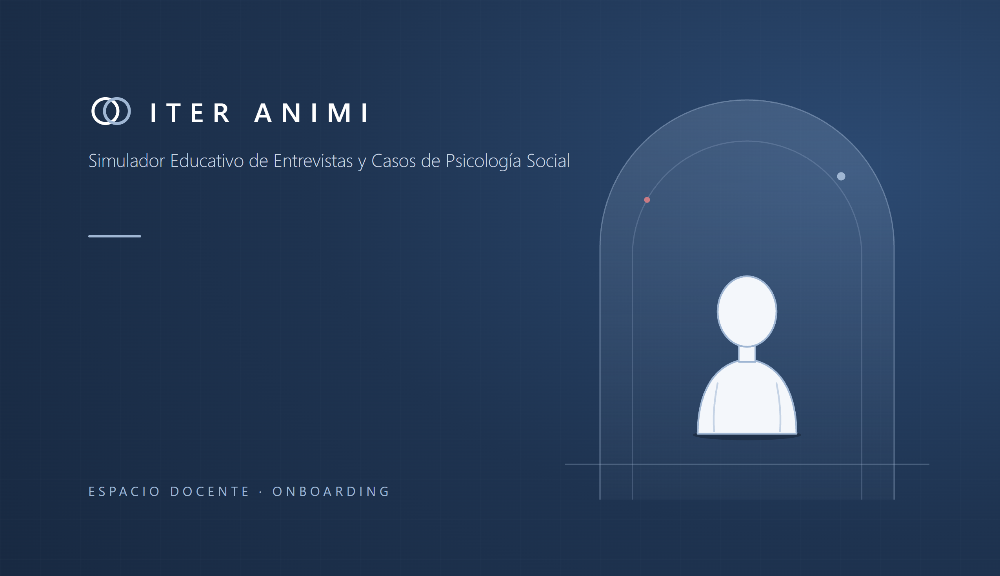

# ITER ANIMI

**Simulador Educativo de Entrevistas y Casos de Psicología Social**

## Guía de Onboarding para Docentes

| Código | Versión | Fecha de elaboración | Dirigido a |
|---|---|---|---|
| ITAN-ONB-DOC-01 | 1.0 | 20 de noviembre de 2026 | Docentes de Iter Animi |

<!-- Fuente editable de la guía. El Word se genera desde el mismo contenido; las imágenes están en evidencias/. -->

---

## Contenido

1. Bienvenido a Iter Animi
2. Antes de comenzar
3. Conoce tu espacio de trabajo
4. Gestión de casos psicológicos
5. Personalización del entrevistado virtual
6. Aulas y estudiantes
7. Programación de sesiones
8. Resultados y seguimiento académico
9. Evaluación y retroalimentación
10. Tu primera actividad en Iter Animi
11. Preguntas frecuentes
12. Recomendaciones finales

---

# 1. Bienvenido a Iter Animi

*Iter Animi es un simulador educativo en el que tus estudiantes recorren casos de psicología social escena a escena, frente a un entrevistado virtual, y toman decisiones que luego se evalúan con una rúbrica.*

La experiencia se inspira en las novelas visuales: cada escena presenta a un personaje sobre un escenario, una narración breve y una decisión con varias opciones. Lo que importa no es solo acertar, sino cómo razona el estudiante ante situaciones reales de interacción social.

## Tu papel como docente

Tú diseñas la experiencia y acompañas el aprendizaje. En Iter Animi el docente:

- **Prepara casos**: escribe las escenas, las decisiones, las opciones con su justificación y la rúbrica.
- **Da vida al entrevistado**: elige un personaje y define cómo reacciona a cada opción.
- **Programa sesiones** en un aula, con fecha, tiempo y lista de estudiantes convocados.
- **Acompaña la sesión**: abre el acceso, sigue el avance y resuelve incidencias.
- **Evalúa y retroalimenta**: registra las notas, revisa cada intento y deja comentarios.

## El recorrido de una actividad

**1. Preparar** (Caso y rúbrica) → **2. Ambientar** (Personaje y reacciones) → **3. Programar** (Sesión y convocados) → **4. Acompañar** (Abrir y seguir) → **5. Evaluar** (Notas y comentarios)

Esta guía sigue ese mismo orden. Puedes leerla de principio a fin o ir directamente a la tarea que necesitas.

## Vocabulario esencial

| Término | Qué significa en Iter Animi |
|---|---|
| **Aula** | Espacio académico (por ejemplo, «Psicología Social, grupo 1», periodo 2026-2). La crea la administración. |
| **Caso** | Situación de psicología social que el estudiante recorre. Contiene escenas, decisiones, opciones y una rúbrica. |
| **Escena** | Momento del caso con un título y una narración (contexto). |
| **Decisión** | Pregunta que el estudiante responde eligiendo una opción. |
| **Opción** | Respuesta posible. Se marca si es correcta y lleva una justificación. |
| **Rúbrica** | Criterios de evaluación con su peso y sus niveles. Define cómo se calcula la nota. |
| **Sesión** | Un caso programado en un aula, con ventana de fechas y tiempo máximo por intento. |
| **Convocado** | Estudiante invitado a una sesión. Recibe un código de acceso personal. |
| **Intento** | Cada vez que un estudiante inicia y resuelve el caso dentro de una sesión. |
| **Paquete visual** | Personaje, expresiones y reacciones de un caso, preparados en el editor visual. |

## Cómo leer esta guía

Cada tarea se presenta como un **procedimiento** con pasos numerados. Además, encontrarás estos avisos:

| Aviso | Uso |
|---|---|
| Consejo | Recomendaciones breves para trabajar mejor. |
| Atención | Acciones que no se pueden deshacer o limitaciones importantes. |
| Resultado esperado | Lo que debería mostrar Iter Animi al terminar un procedimiento. |
| Buena práctica docente | Sugerencias pedagógicas para tus actividades. |
| Nota | Contexto que conviene conocer. |

# 2. Antes de comenzar

*Revisa estos requisitos una sola vez. Te ahorrarán dudas en tu primera sesión.*

## Lo que necesitas

| Requisito | Detalle |
|---|---|
| **Cuenta docente** | Correo institucional y contraseña. La crea la administración del simulador. |
| **Navegador web actualizado** | Iter Animi funciona en el navegador, tanto en computador como en móvil. No requiere instalar nada. |
| **Dirección de acceso** | La que te indique tu institución. |
| **Permiso para crear casos** | Necesario para crear y editar casos. Si no lo tienes, puedes consultarlos, exportarlos y programarlos. Lo concede la administración. |
| **Al menos un aula activa** | Las aulas las crea la administración. Sin aula no se pueden programar sesiones. |
| **Cuentas de estudiante activas** | Para convocar a tus estudiantes por su correo. También las crea la administración. |

> **Nota · Los estudiantes no usan contraseña.** Cada estudiante entra con su correo y el **código de acceso** de la convocatoria. El mismo código le sirve después para consultar sus resultados.

### Procedimiento: Ingresar por primera vez

*Accede a tu espacio docente con tu cuenta institucional.*

**Paso 1.** Abre la dirección de Iter Animi en tu navegador. Verás la pantalla **Ingresar**.

**Paso 2.** Deja seleccionada la opción **Con contraseña**. La opción **Con código de acceso** es para estudiantes.

**Paso 3.** Escribe tu **Correo institucional** y tu **Contraseña**.

**Paso 4.** Pulsa **Ingresar**.

> **Resultado esperado.** Se abre el **Panel docente** con un saludo y el resumen de tus sesiones.

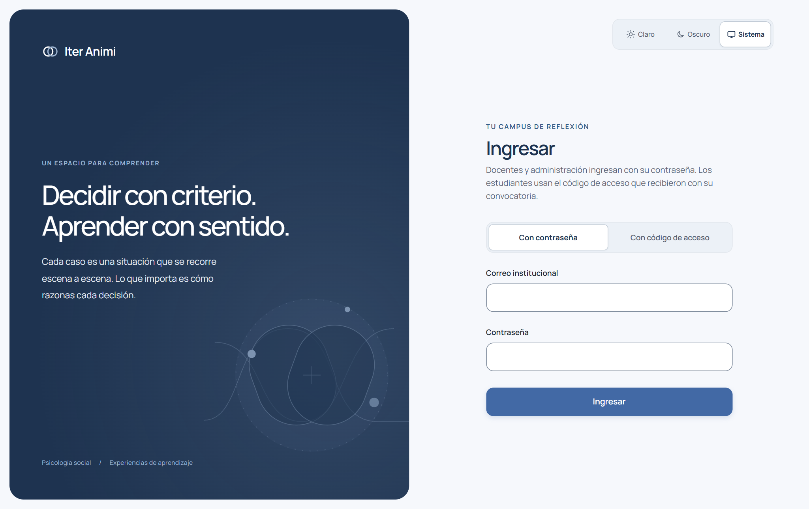

*Figura 1. Pantalla Ingresar. A la derecha, el selector de forma de ingreso y el formulario.*

> **Consejo.** Puedes elegir el tema **Claro**, **Oscuro** o **Sistema** desde la esquina superior derecha, incluso antes de ingresar.

## Si no puedes ingresar

Iter Animi revisa tus datos antes de enviarlos y te explica qué ocurrió. Estos son los mensajes más comunes:

| Mensaje | Qué hacer |
|---|---|
| «Escribe tu correo institucional.» / «Escribe tu contraseña.» | Completa el campo indicado. |
| «El correo no tiene un formato válido.» | Revisa que el correo tenga la forma nombre@institución. |
| «El correo o la contraseña no son correctos.» | Verifica mayúsculas y que estés en **Con contraseña**. |
| «Demasiados intentos fallidos. Vuelve a intentarlo en N minutos.» | Espera el tiempo indicado antes de intentarlo de nuevo. |
| Mensaje sobre cuenta desactivada | Contacta a la administración del simulador. |
| «No se pudo conectar con el servidor…» | Comprueba tu conexión a internet e inténtalo otra vez. |

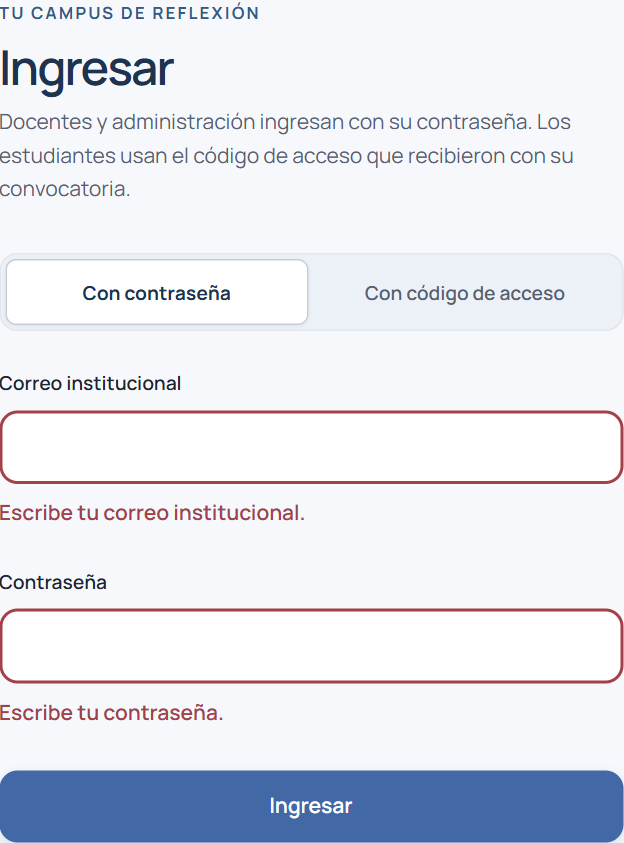

*Figura 2. Los campos vacíos se señalan antes de enviar el formulario.*

> **Atención · ¿Olvidaste tu contraseña?.** Iter Animi no tiene recuperación automática de contraseña. Solicita el restablecimiento a la administración del simulador.

## Cerrar sesión

Pulsa **Cerrar sesión** en la parte inferior del menú lateral. Por seguridad, la sesión también se cierra sola cuando vence; en ese caso verás el aviso «Tu sesión expiró. Vuelve a ingresar para continuar.».

# 3. Conoce tu espacio de trabajo

*El Panel docente te muestra lo que depende de ti hoy: qué sesiones abrir, cuáles están en curso y qué intentos esperan nota.*

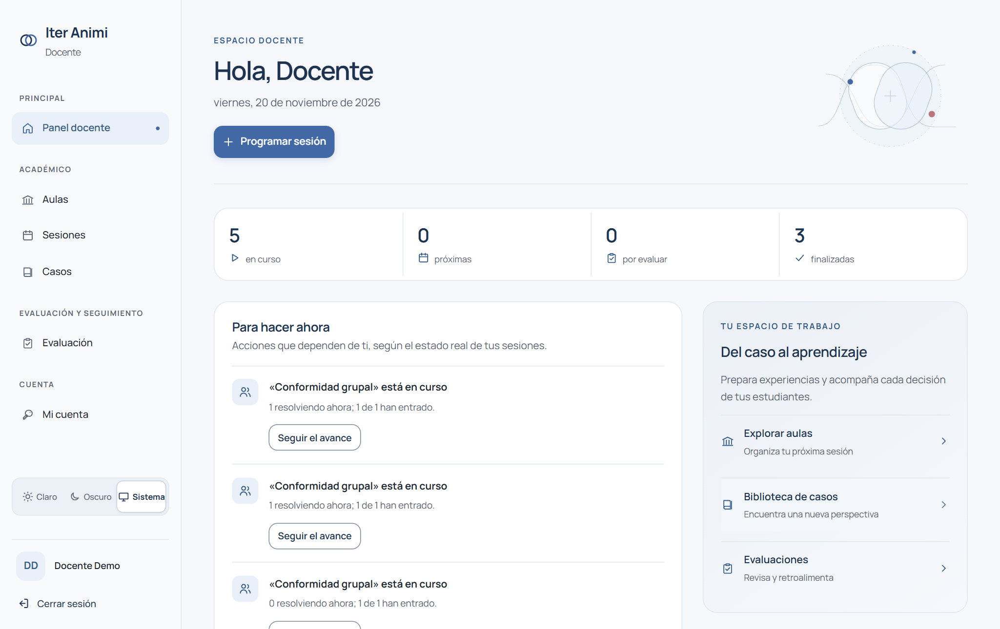

*Figura 3. Panel docente con el menú lateral, las cifras y la sección «Para hacer ahora».*

## Las zonas del panel

1. **Menú lateral.** Agrupa las secciones: Principal, Académico, Evaluación y seguimiento, y Cuenta.
2. **Saludo y Programar sesión.** El botón **Programar sesión** te lleva a tus aulas para crear una sesión.
3. **Cifras.** Cuántas sesiones tienes **en curso**, **próximas**, **por evaluar** y **finalizadas**.
4. **Para hacer ahora.** Tareas generadas con el estado real de tus sesiones: abrir una sesión que ya puede empezar, seguir una sesión en curso o evaluar intentos cerrados sin nota. Cada tarea tiene su botón de acceso directo.
5. **Tu espacio de trabajo.** Accesos rápidos a **Explorar aulas**, **Biblioteca de casos** y **Evaluaciones**.
6. **Agenda.** Más abajo encontrarás **Próximas sesiones** y **Finalizadas recientemente**, con la acción válida para cada una.
7. **Tema y perfil.** Selector **Claro / Oscuro / Sistema**, tu nombre y **Cerrar sesión**.

## El menú, de un vistazo

| Opción del menú | Para qué la usarás |
|---|---|
| **Panel docente** | Saber qué hacer ahora y ver tu agenda. |
| **Aulas** | Consultar tus aulas activas y programar sesiones en ellas. |
| **Sesiones** | Ver todas tus sesiones, filtrarlas por estado y gestionarlas. |
| **Casos** | Crear, editar, publicar y ambientar tus casos. |
| **Evaluación** | Encontrar las sesiones con intentos pendientes de nota. |
| **Mi cuenta** | Ver tus datos, elegir el tema y cambiar tu contraseña. |

> **Consejo · En el móvil.** El menú se abre con el botón de tres líneas de la barra superior y se cierra solo al elegir una sección.

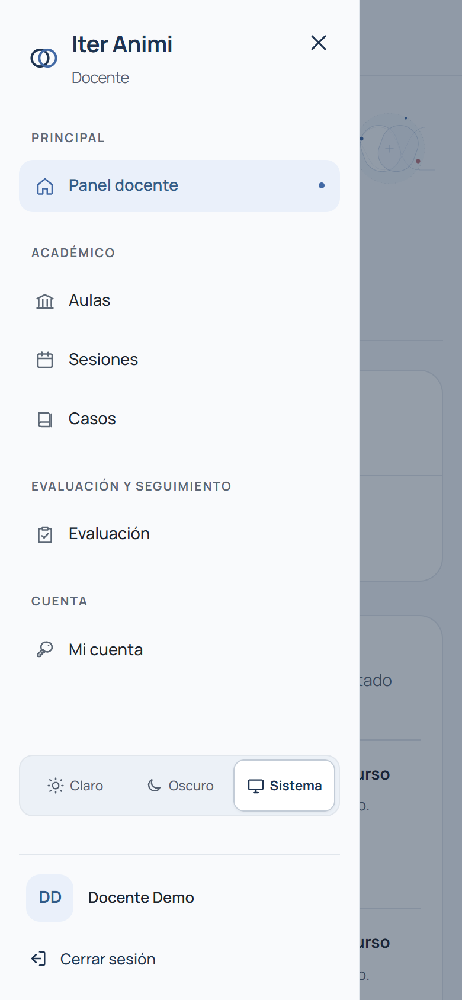

*Figura 4. Menú lateral en un teléfono.*

### Procedimiento: Personalizar tu cuenta

*Elige cómo se ve Iter Animi y mantén segura tu contraseña.*

**Paso 1.** En el menú, entra a **Mi cuenta**. Verás tu nombre, correo, rol y si puedes crear casos.

**Paso 2.** En **Apariencia**, elige **Claro**, **Oscuro** o **Sistema**. Se guarda solo en este navegador.

**Paso 3.** Para cambiar la contraseña, completa **Contraseña actual**, **Nueva contraseña** (entre 8 y 128 caracteres) y **Repite la nueva contraseña**.

**Paso 4.** Pulsa **Cambiar contraseña**.

> **Resultado esperado.** Por seguridad, se cierran todas tus sesiones abiertas, también en otros equipos. Vuelve a ingresar con la nueva contraseña.

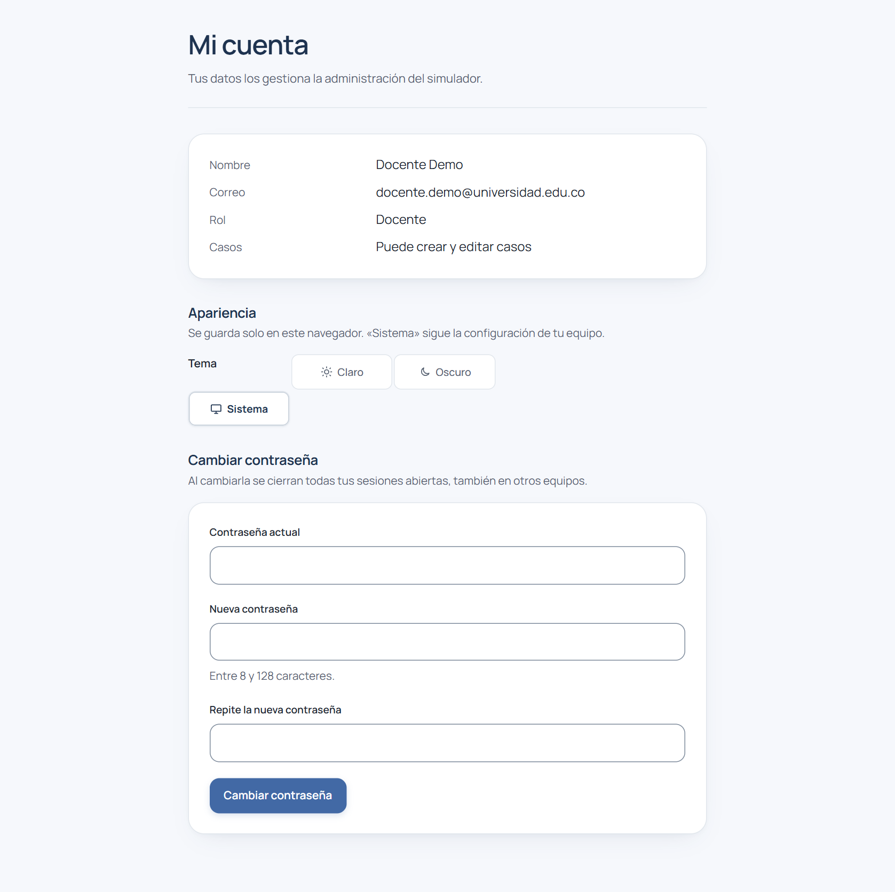

*Figura 5. Mi cuenta: datos del perfil, apariencia y cambio de contraseña.*

# 4. Gestión de casos psicológicos

*El caso es el corazón de cada actividad. Aquí aprenderás a construirlo pieza a pieza, validarlo y publicarlo.*

## Cómo se organiza un caso

1. **Información general.** Nombre, tiempo estimado, desarrollo situacional e historia. Es lo primero que lee el estudiante.
2. **Escenas.** Cada una con un título y una narración.
3. **Decisiones.** Preguntas dentro de cada escena, asociadas a un criterio de la rúbrica.
4. **Opciones.** Al menos dos por decisión, una correcta, cada una con su justificación.
5. **Rúbrica.** Escala de la nota y criterios con peso y niveles.

## Estados de un caso

| Estado | Qué puedes hacer |
|---|---|
| **Borrador** | Editar todo el contenido, validar, publicar o eliminar el borrador. |
| **Publicado** | Programarlo en sesiones. Ya no se edita. |
| **Archivado** | Consultarlo y exportarlo. No se puede programar en nuevas sesiones ni reactivar. |

> **Atención · Un caso publicado ya no se edita.** Revisa el contenido con calma antes de publicar. Si necesitas una versión distinta, exporta el caso en CaseDSL e impórtalo como un nuevo borrador.

## Un ejemplo para acompañarte

> **Ejemplo · Caso «Conformidad grupal»**
>
> - **Desarrollo situacional:** Un grupo de estudiantes debe decidir si reporta una irregularidad observada durante una práctica.
> - **Historia:** El caso se inspira en los experimentos clásicos de conformidad y presión social.
> - **Escena 1 · La reunión del grupo:** La mayoría del grupo opina que no vale la pena reportar lo ocurrido.
> - **Decisión 1:** ¿Qué fenómeno describe mejor la presión que siente el estudiante? Opción correcta: **Conformidad normativa** («Se ajusta para ser aceptado por el grupo.»). Otras opciones: Disonancia cognitiva, Efecto halo.
> - **Decisión 2:** ¿Qué acción favorece una decisión ética del grupo? Opción correcta: **Proponer una discusión abierta con evidencias** («Reduce la ignorancia pluralista.»).
> - **Rúbrica (escala 5,00):** «Identificación de conceptos de psicología social» (60 %) y «Aplicación de los conceptos a la situación» (40 %), con niveles Alto, Medio y Bajo.

### Procedimiento: Consultar tu biblioteca de casos

*Encuentra un caso por su estado o su nombre.*

**Paso 1.** En el menú, entra a **Casos**.

**Paso 2.** Usa las pestañas **Todos**, **Publicados**, **Borradores** y **Archivados** para filtrar.

**Paso 3.** Escribe en **Buscar por nombre** si tienes muchos casos.

**Paso 4.** Pulsa el nombre de un caso para abrirlo.

> **Resultado esperado.** La tabla muestra cada caso con su estado, tiempo estimado y fecha de actualización.

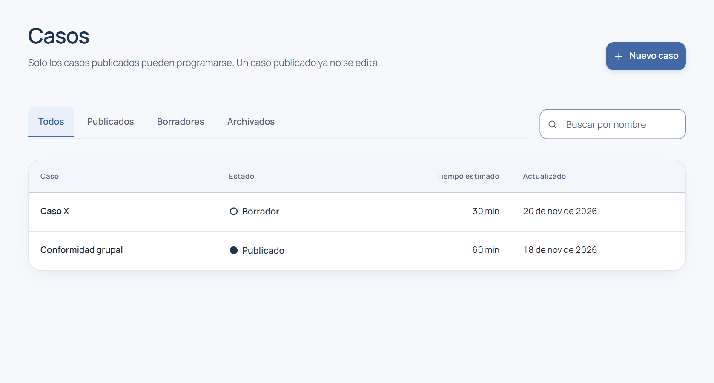

*Figura 6. Lista de casos con filtros por estado y buscador.*

### Procedimiento: Crear un borrador en blanco

*Empieza un caso nuevo y complétalo después pieza a pieza.*

**Antes de comenzar:**

- Tu cuenta debe tener permiso para crear casos (lo ves en **Mi cuenta**).

**Paso 1.** En **Casos**, pulsa **Nuevo caso**.

**Paso 2.** Deja seleccionada la pestaña **Empezar en blanco**.

**Paso 3.** Escribe el **Nombre del caso** (obligatorio).

**Paso 4.** Indica el **Tiempo estimado (minutos)**, entre 1 y 240. Es opcional en el borrador, pero obligatorio para publicar.

**Paso 5.** Redacta el **Desarrollo situacional** (la situación que el estudiante lee antes de empezar) y la **Historia**.

**Paso 6.** Pulsa **Crear borrador**.

> **Resultado esperado.** Se abre el caso en estado **Borrador** con el aviso «Borrador creado.».

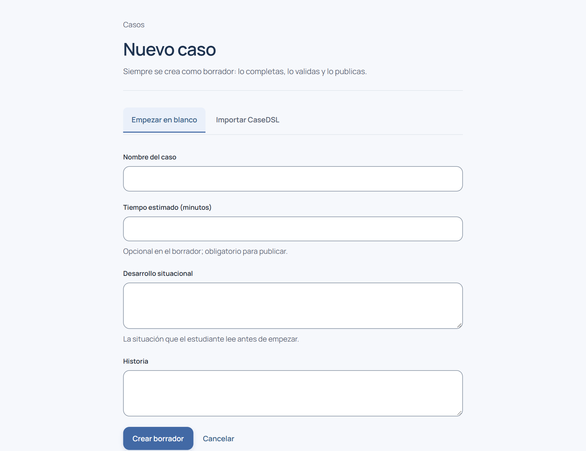

*Figura 7. Formulario Nuevo caso, pestaña «Empezar en blanco».*

> **Consejo.** Escribe el desarrollo situacional como lo leería tu estudiante: en segunda persona y con el contexto justo para entender la escena.

### Procedimiento: Importar un caso en formato CaseDSL

*Reutiliza un caso completo exportado desde Iter Animi u otro documento CaseDSL 1.0.*

**Paso 1.** En **Nuevo caso**, elige la pestaña **Importar CaseDSL**.

**Paso 2.** Carga el **Archivo .json** o pega su contenido en **Contenido CaseDSL**. Debe incluir "dslVersion": "1.0".

**Paso 3.** Pulsa **Importar como borrador**.

> **Resultado esperado.** El caso se crea siempre como **Borrador**, con escenas, decisiones, opciones y rúbrica. Si el texto no es un JSON válido verás «El contenido no es un JSON válido. Revisa comas, comillas y llaves.».

### Procedimiento: Redactar escenas, decisiones y opciones

*Construye el recorrido del estudiante dentro del caso.*

**Antes de comenzar:**

- El caso debe estar en **Borrador** y abierto en la pestaña **Contenido académico**.

**Paso 1.** Para ajustar el nombre, el tiempo o los textos iniciales, pulsa **Editar** en **Información general**.

**Paso 2.** Pulsa **Añadir escena**, escribe el **Título de la escena** y su **Contexto o narración**, y confirma con **Añadir escena**.

**Paso 3.** Dentro de la escena, pulsa **Añadir decisión**, escribe el **Enunciado de la decisión** y elige su **Criterio de la rúbrica**.

**Paso 4.** En cada decisión, pulsa **Añadir opción**. Escribe el texto, marca **Es una respuesta correcta** cuando corresponda y añade la **Justificación**.

**Paso 5.** Usa **Subir**, **Bajar**, **Editar** y **Eliminar** para ordenar y corregir escenas y decisiones.

> **Resultado esperado.** Cada cambio se guarda al confirmar y el caso se actualiza en pantalla. Las opciones sin justificación muestran la etiqueta **Sin justificación**.

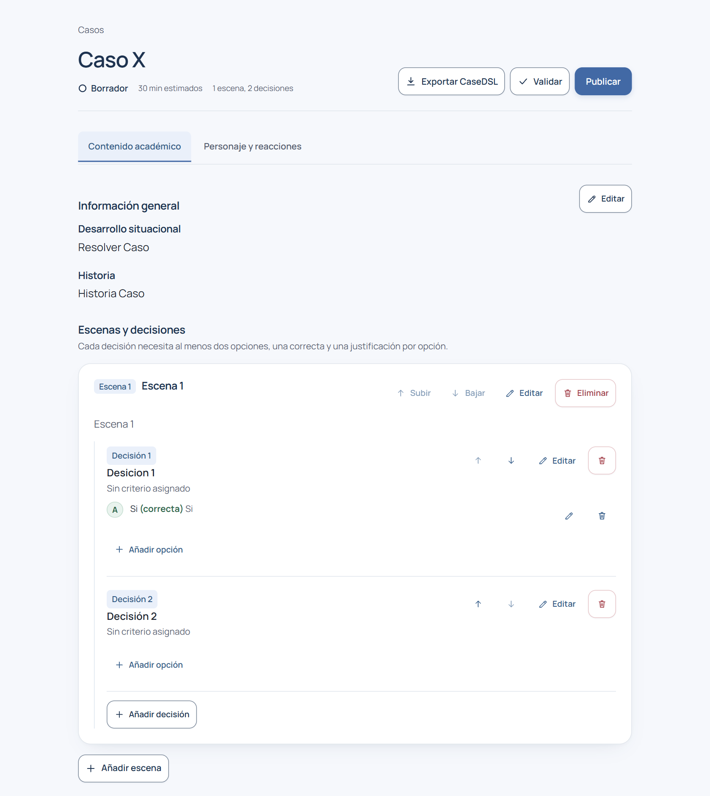

*Figura 8. Editor de contenido de un borrador: información general, escena, decisiones y opciones.*

> **Atención.** Eliminar una escena o una decisión pide confirmación, pero **eliminar una opción es inmediato**. Revisa antes de pulsar el icono de papelera.

> **Consejo.** La justificación es retroalimentación: el estudiante la verá en sus resultados. Explica el concepto, no solo si la opción es correcta.

### Procedimiento: Construir la rúbrica

*Define cómo se calcula la nota del estudiante.*

**Paso 1.** En la sección **Rúbrica**, indica la **Escala máxima de la nota** (por ejemplo, 5,00) y pulsa **Crear rúbrica**.

**Paso 2.** Pulsa **Añadir criterio**. Escribe la **Descripción del criterio** y su **Peso (%)**.

**Paso 3.** Completa los **Niveles**: nombre, valor y **Desde % aciertos**. Cada criterio necesita al menos dos niveles para publicar.

**Paso 4.** Pulsa **Añadir criterio** para guardarlo y repite con los demás criterios.

**Paso 5.** Vuelve a cada decisión y asígnale su criterio con **Editar**.

> **Resultado esperado.** El indicador **Suma de pesos** muestra si los pesos suman 100. La suma definitiva la comprueba el sistema al validar.

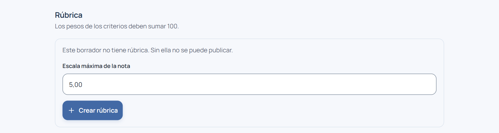

*Figura 9. Rúbrica de un borrador que aún no la tiene: primero se define la escala máxima.*

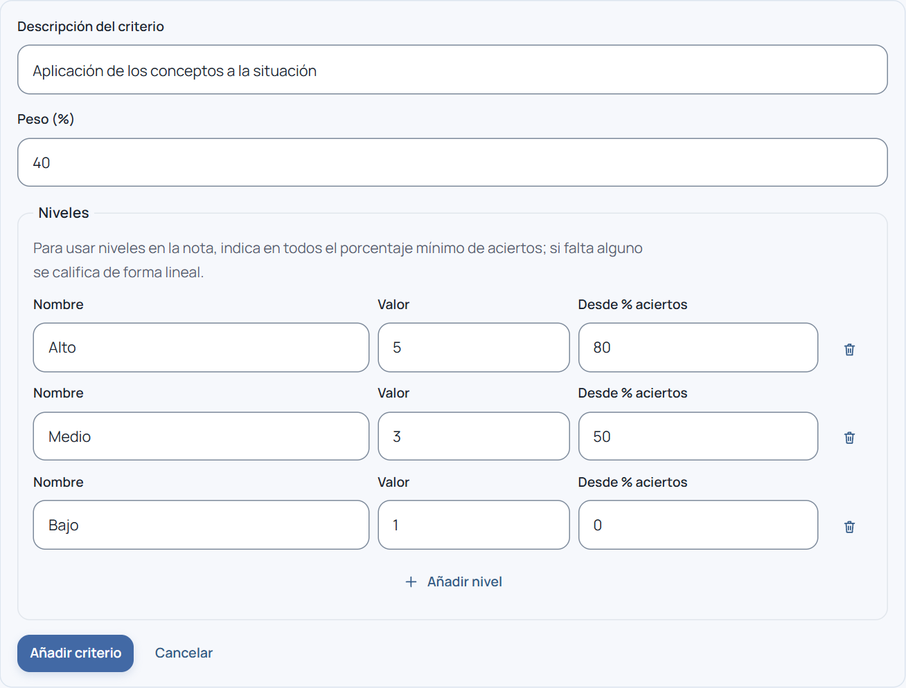

*Figura 10. Nuevo criterio con su peso y tres niveles (Alto, Medio y Bajo) antes de guardarlo.*

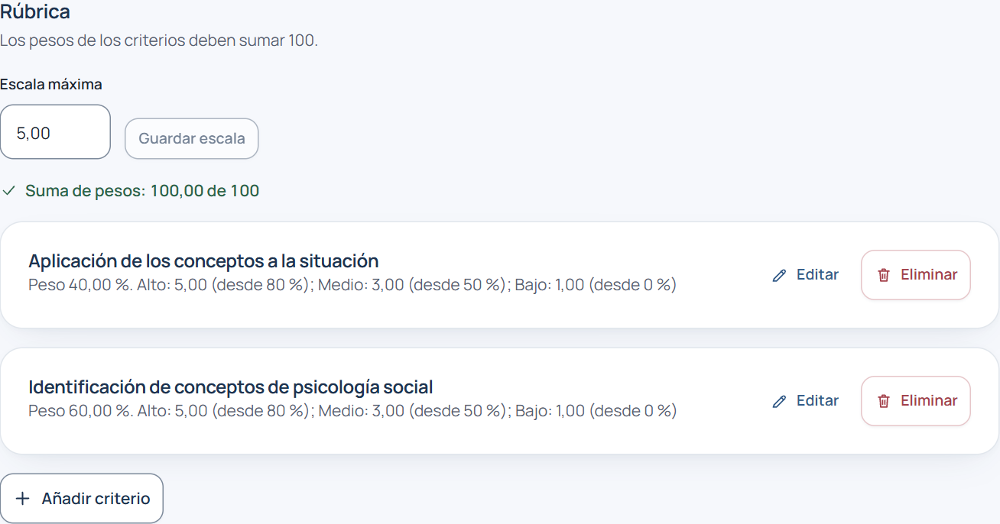

*Figura 11. Rúbrica con dos criterios. El indicador confirma «Suma de pesos: 100,00 de 100».*

> **Consejo.** Si indicas el porcentaje mínimo de aciertos en todos los niveles, la nota usa esos niveles; si falta alguno, se califica de forma lineal.

### Procedimiento: Validar y publicar

*Comprueba que el caso cumple las reglas y déjalo listo para programar.*

**Paso 1.** Pulsa **Validar** en la cabecera del caso.

**Paso 2.** Si aparece «El caso todavía no se puede publicar», corrige cada punto de la lista y vuelve a validar.

**Paso 3.** Cuando veas «El caso cumple todas las reglas y puede publicarse.», pulsa **Publicar**.

> **Resultado esperado.** El caso pasa a **Publicado** y ya aparece al programar sesiones.

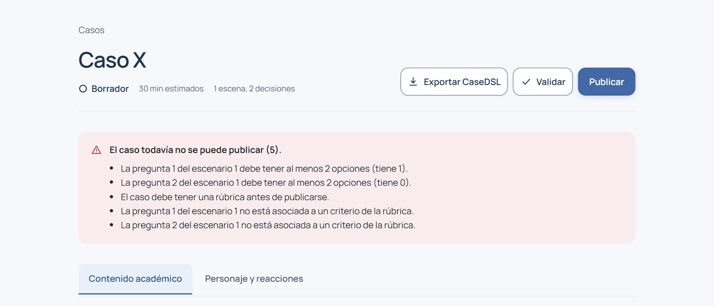

*Figura 12. Validación de un borrador incompleto: cada punto explica qué falta.*

## Otras acciones sobre un caso

| Acción | Cuándo y para qué |
|---|---|
| **Exportar CaseDSL** | En cualquier estado. Descarga el caso completo para guardarlo o reutilizarlo como nuevo borrador. |
| **Archivar** | En casos publicados. Deja de estar disponible para nuevas sesiones; las existentes no cambian. No se puede revertir. |
| **Eliminar borrador** | Solo en borradores. Borra el caso con todo su contenido. No se puede deshacer. |

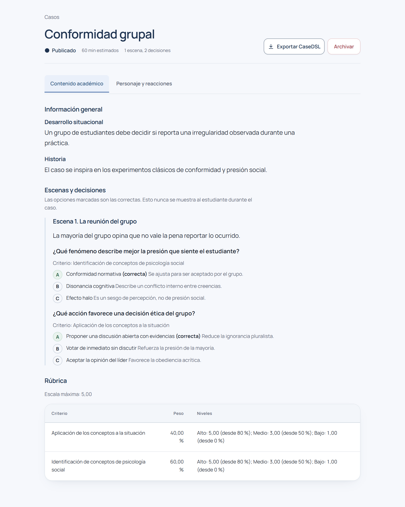

*Figura 13. Caso publicado en modo lectura. Las opciones correctas están marcadas; el estudiante nunca las ve durante el caso.*

> **Nota · Si tu cuenta no puede crear casos.** Verás el aviso «Tu cuenta no tiene permiso para modificar casos». Podrás consultar y exportar los casos, ambientarlos y programar los publicados. Para editarlos, solicita el permiso a la administración.

# 5. Personalización del entrevistado virtual

*En la pestaña Personaje y reacciones das rostro al caso: eliges al entrevistado, sus expresiones y cómo reacciona a cada decisión del estudiante.*

## Qué verá tu estudiante

En el simulador, el estudiante ve un escenario con el personaje y su nombre, la narración de la escena y la decisión con sus opciones. Cuando confirma una respuesta y el sistema la acepta, el personaje puede cambiar de expresión según la reacción que tú asignaste.

> **Nota · Cómo funciona realmente el personaje.** El personaje no tiene inteligencia artificial ni diálogo propio. Las palabras que lee el estudiante son la **narración de la escena** y el **enunciado de la decisión** que escribiste en Contenido académico. La expresión cambia solo por las reacciones que asignes, y nunca indica si una opción es correcta.

Tampoco hay globos de diálogo línea a línea, voz, música ni fondos distintos por escena: el escenario es el mismo para todo el caso y aparece un solo entrevistado.

### Procedimiento: Elegir un personaje del sistema

*Usa uno de los personajes ilustrados que incluye Iter Animi.*

**Paso 1.** Abre el caso y elige la pestaña **Personaje y reacciones**.

**Paso 2.** En **Personaje y sprites**, selecciona **Personajes del sistema**.

**Paso 3.** Pulsa una tarjeta para ver al personaje en grande y recorrer sus expresiones.

**Paso 4.** Pulsa **Usar a** seguido del nombre del personaje.

**Paso 5.** Elige su **Expresión por defecto** y, si quieres, cambia el **Nombre visible del entrevistado**.

> **Resultado esperado.** La tarjeta muestra la etiqueta **En uso**. Hay seis personajes (Samuel, Inés, Julián, Carmen, Ernesto y Rosa), cada uno con ocho expresiones: Neutral, Feliz, Triste, Enojado, Preocupado, Sorprendido, Incómodo y Reflexivo.

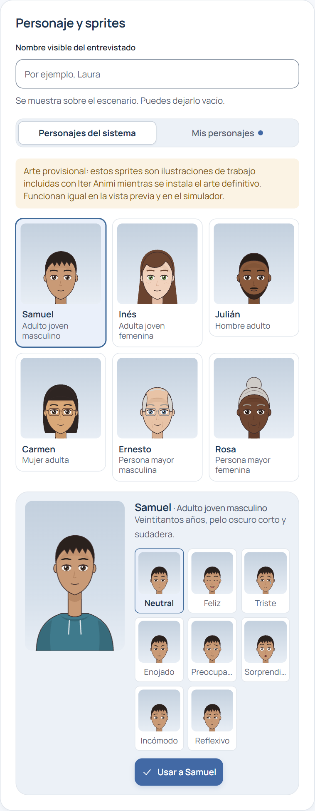

*Figura 14. Personajes del sistema. La nota indica que el arte es provisional.*

> **Consejo.** Elige un personaje coherente con el caso. En «Conformidad grupal», un adulto joven representa bien a un integrante del grupo de práctica.

### Procedimiento: Usar tus propios sprites

*Carga ilustraciones propias para cada expresión del personaje.*

**Paso 1.** En **Personaje y sprites**, selecciona **Mis personajes**.

**Paso 2.** Revisa las expresiones iniciales (Neutral, Inquieto, Incómodo, Reflexivo y Aliviado). Puedes renombrarlas o eliminar las que no uses.

**Paso 3.** Para añadir una expresión, escríbela en **Nueva expresión** y pulsa **Añadir** (máximo 12).

**Paso 4.** En cada expresión, pulsa **Cargar imagen** y elige un archivo PNG o WebP de hasta 2 MB.

**Paso 5.** Marca **Por defecto** en la expresión con la que empieza el personaje.

> **Resultado esperado.** Cada expresión muestra su miniatura. Las expresiones sin imagen usan la silueta blanca sin rostro.

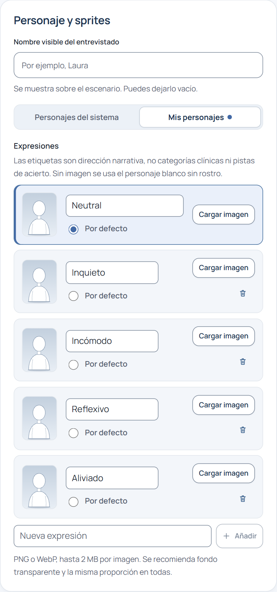

*Figura 15. Mis personajes: expresiones con su imagen, la expresión por defecto y el campo Nueva expresión.*

> **Consejo.** Usa fondo transparente y la misma proporción en todas las imágenes, para que el personaje no «salte» al cambiar de expresión.

> **Nota · Etiquetas narrativas, no diagnósticas.** Las etiquetas de expresión son dirección narrativa: no son categorías clínicas ni pistas de acierto.

### Procedimiento: Asignar expresiones y reacciones

*Decide cómo se ve el personaje al empezar cada escena y cómo responde a cada opción.*

**Paso 1.** En **Reacciones por decisión**, elige la **Expresión inicial** de cada escena.

**Paso 2.** Para cada opción, elige la expresión de la reacción o deja **Sin cambio**.

**Paso 3.** Elige el movimiento: **Fundido**, **Aparición suave**, **Respiración sutil** o **Sin animación**.

> **Resultado esperado.** Las reacciones quedan asociadas a cada opción del caso. Si después cambias el texto de una opción o el título de una escena, verás **Pendiente de revisión**: confírmala con **Confirmar**.

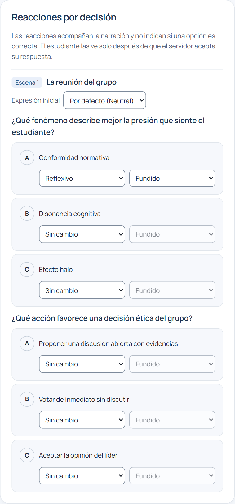

*Figura 16. Reacciones por decisión: expresión inicial de la escena y reacción de cada opción.*

> **Consejo.** En «Conformidad grupal», la opción «Aceptar la opinión del líder» podría mostrar al personaje **Incómodo**, y «Proponer una discusión abierta con evidencias», **Reflexivo**. Así la reacción acompaña la narración sin revelar la respuesta.

### Procedimiento: Probar en la vista previa

*Comprueba la experiencia tal como la verá el estudiante, sin afectar datos reales.*

**Paso 1.** En **Vista previa jugable**, elige la decisión que quieres probar.

**Paso 2.** Selecciona una opción y pulsa **Probar reacción**.

**Paso 3.** Pulsa **Siguiente decisión** para continuar, o **Volver al estado inicial** para empezar de nuevo.

**Paso 4.** Si lo necesitas, cambia el **Tema** de la vista previa a Claro u Oscuro.

> **Resultado esperado.** El personaje muestra la reacción asignada y la barra inferior indica su nombre (por ejemplo, «Reacción: Reflexivo»). La vista previa no crea intentos, no envía respuestas y no modifica notas.

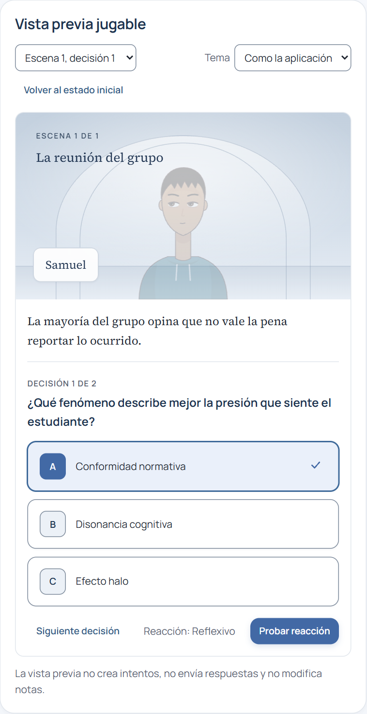

*Figura 17. Vista previa jugable tras probar una reacción.*

### Procedimiento: Guardar y compartir el paquete visual

*Conserva tu trabajo y prepáralo para que lo vean los estudiantes.*

**Paso 1.** Pulsa **Guardar borrador**. El estado cambia de «Cambios sin guardar» a «Guardado en este navegador».

**Paso 2.** Pulsa **Exportar paquete visual** para descargar el archivo .zip del caso.

**Paso 3.** Entrega el paquete al equipo técnico de Iter Animi para que lo instale en la plataforma.

> **Resultado esperado.** Una vez instalado, los estudiantes verán el personaje y sus reacciones en el simulador.

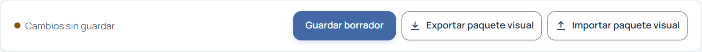

*Figura 18. Barra del editor visual: estado de guardado y acciones del paquete.*

> **Atención · Importante sobre el paquete visual.** «Guardar borrador» lo conserva **solo en este navegador y este equipo**. **Publicar el caso no publica su paquete visual**: hasta que el equipo técnico lo instale, los estudiantes verán la silueta sin rostro y el caso funcionará con normalidad. Con **Importar paquete visual** puedes recuperar en otro equipo un paquete que exportaste.

# 6. Aulas y estudiantes

*Las aulas organizan tus sesiones por grupo y periodo. Desde aquí empiezas a programar.*

La administración crea las aulas y las cuentas de los estudiantes. Tú ves las aulas activas y, dentro de cada una, solo las sesiones que programaste.

### Procedimiento: Explorar tus aulas

*Encuentra el aula en la que programarás una actividad.*

**Paso 1.** En el menú, entra a **Aulas**.

**Paso 2.** Revisa cada tarjeta: periodo, número de sesiones tuyas y sesiones en curso.

**Paso 3.** Pulsa el nombre del aula para ver su detalle, o **Programar** para crear una sesión.

> **Resultado esperado.** Si hay más de seis aulas, aparece un buscador por nombre o periodo.

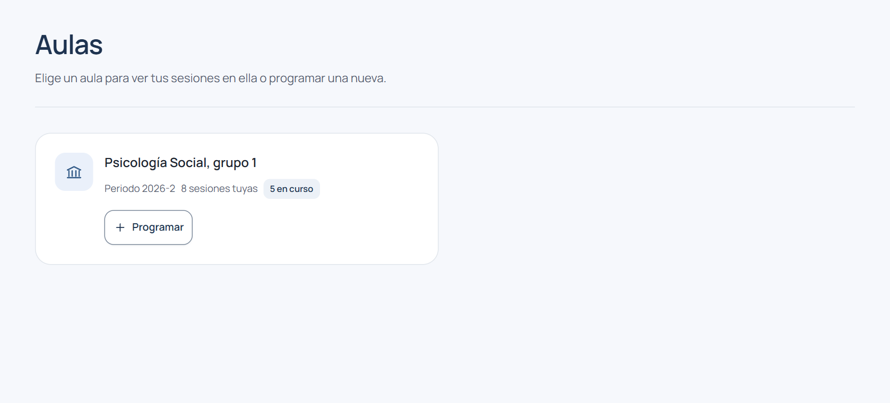

*Figura 19. Aulas activas con el acceso directo Programar.*

### Procedimiento: Consultar el detalle de un aula

*Revisa la actividad de un grupo en un solo lugar.*

**Paso 1.** Abre un aula desde **Aulas**.

**Paso 2.** Revisa las cifras: sesiones, intentos registrados, evaluaciones registradas y promedio sobre la escala.

**Paso 3.** Consulta **En curso y próximas**, **Finalizadas** y **Casos usados en esta aula**.

**Paso 4.** Si lo necesitas, pulsa **CSV** para descargar el reporte del aula.

> **Resultado esperado.** Ves solo las sesiones que tú programaste en esa aula, con la acción válida para cada una.

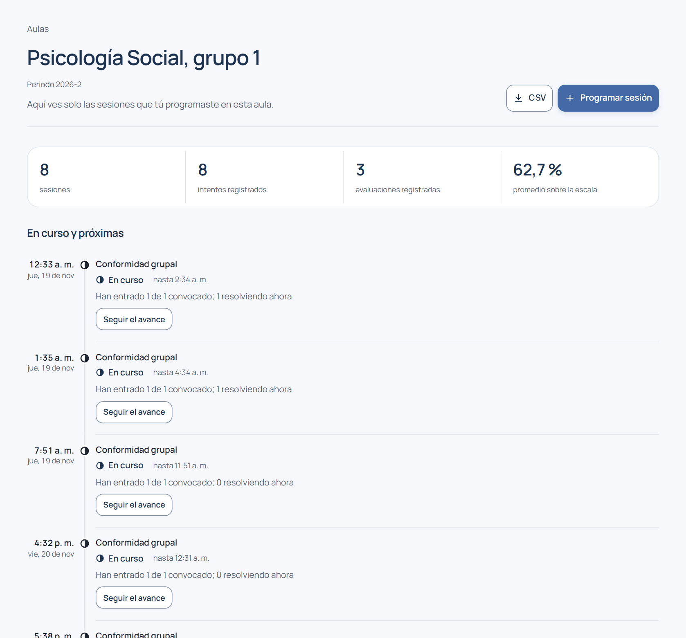

*Figura 20. Detalle de un aula: cifras, agenda de sesiones y casos usados.*

## Tus estudiantes en Iter Animi

- No hay listas permanentes de estudiantes por aula: los estudiantes se vinculan a cada sesión cuando los **convocas** por su correo institucional.
- Cada convocado recibe un **código de acceso** personal de 12 caracteres para esa sesión.
- Para convocar a alguien, su cuenta de estudiante debe existir y estar activa. Si no la encuentras, pide a la administración que la cree.

# 7. Programación de sesiones

*Una sesión pone un caso publicado a disposición de tus estudiantes, en un aula y una ventana de tiempo.*

## Estados de una sesión

| Estado | Qué puedes hacer |
|---|---|
| **Sin iniciar** | Editar la programación, convocar estudiantes y **Abrir sesión** desde la hora de inicio. |
| **En curso** | Seguir el avance, gestionar convocados, editar lugar y mensaje, y **Finalizar sesión**. |
| **Finalizada** | Evaluar, retroalimentar y consultar el seguimiento. Los estudiantes ya pueden ver sus resultados. |

> **Atención · La sesión no se abre sola.** Debes pulsar **Abrir sesión** a partir de la hora de inicio. Mientras no la abras, los estudiantes no pueden entrar.

### Procedimiento: Programar una sesión

*Crea la actividad y convoca a tus estudiantes.*

**Antes de comenzar:**

- Un caso **Publicado** y un aula activa.

**Paso 1.** Desde **Aulas**, pulsa **Programar** en el aula elegida (o **Programar sesión** dentro de su detalle).

**Paso 2.** En **Caso**, elige un caso publicado. Si tiene tiempo estimado, se propone como tiempo máximo.

**Paso 3.** Revisa **Inicio** y **Finalización**. Por defecto empieza ahora y dura dos horas, en la hora local de tu equipo.

**Paso 4.** Indica el **Tiempo máximo por intento (minutos)**. No puede superar el tiempo estimado del caso ni 240 minutos.

**Paso 5.** Opcionalmente, añade **Lugar o modalidad** y un **Mensaje para los estudiantes**.

**Paso 6.** En **Estudiantes convocados**, escribe los correos institucionales, uno por línea o separados por comas. También puedes convocar después.

**Paso 7.** Pulsa **Crear sesión**.

> **Resultado esperado.** Se abre la sesión en la pestaña **Convocados** con el aviso «Sesión creada.».

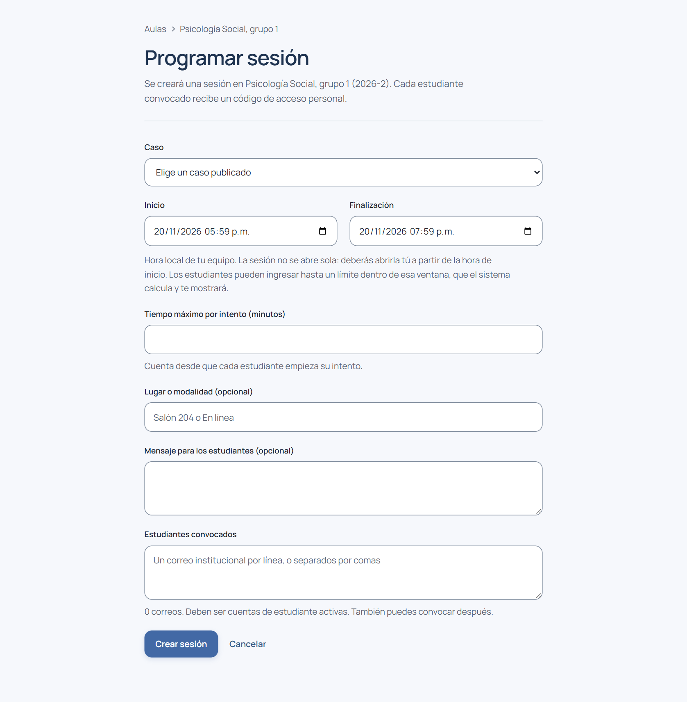

*Figura 21. Formulario Programar sesión.*

> **Consejo.** Usa el mensaje para enmarcar la actividad: por ejemplo, «Lee el caso con atención y justifica mentalmente cada decisión antes de confirmarla».

Si falta un dato, el formulario lo señala antes de crear la sesión: por ejemplo, «Elige el caso que resolverán los estudiantes.», «La finalización debe ser posterior al inicio.» o «Revisa estos correos: …». Si no tienes casos publicados, verás el aviso «No tienes casos publicados.» con un enlace a Casos.

### Procedimiento: Entregar los códigos de acceso

*Asegura que cada estudiante pueda entrar a la sesión.*

**Paso 1.** En la sesión, abre la pestaña **Convocados**.

**Paso 2.** Pulsa **Ver código** junto al estudiante.

**Paso 3.** Pulsa **Copiar código** y entrégaselo solo a ese estudiante.

> **Resultado esperado.** El estudiante entra con su correo y ese código en **Con código de acceso**.

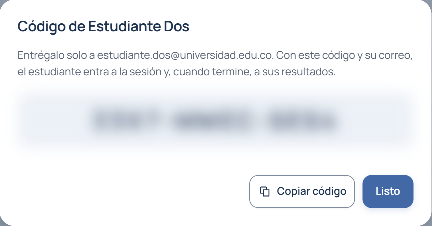

*Figura 22. Diálogo Ver código. En esta guía el código aparece difuminado.*

> **Consejo.** Si el servidor tiene activo el envío por correo, los estudiantes reciben el código automáticamente. Si no, usa **Ver código**.

### Procedimiento: Abrir la sesión

*Habilita el ingreso de los estudiantes.*

**Paso 1.** Abre la sesión desde el **Panel docente** («Abrir…» en **Para hacer ahora**), desde la agenda o desde **Sesiones**.

**Paso 2.** Pulsa **Abrir sesión**. El botón solo está activo desde la hora de inicio y hasta la finalización.

> **Resultado esperado.** La sesión pasa a **En curso** y un aviso indica hasta cuándo pueden ingresar los estudiantes con su código.

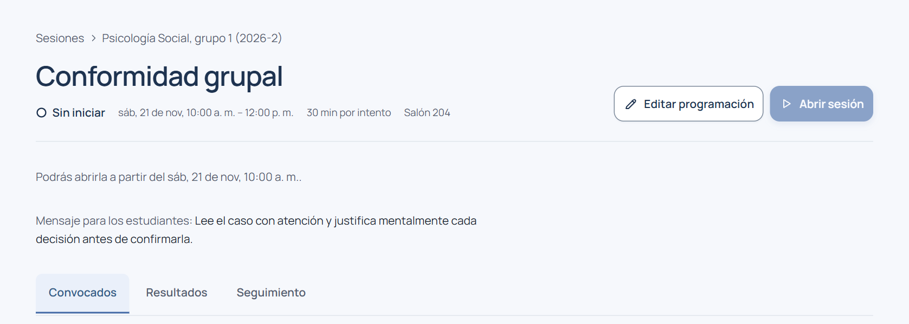

*Figura 23. Sesión Sin iniciar. Antes de la hora de inicio, Abrir sesión está desactivado y se indica desde cuándo podrás abrirla.*

### Procedimiento: Seguir el avance de la sesión

*Observa quién ha entrado y quién está resolviendo.*

**Paso 1.** Abre la sesión en curso (por ejemplo, con **Seguir el avance** desde el panel).

**Paso 2.** En **Convocados**, revisa la condición de cada estudiante: **Resolviendo ahora**, **Participó**, **Pendiente**, **Ausente** o **Retirado**, y sus intentos usados.

> **Resultado esperado.** La cabecera muestra el estado, el horario, el tiempo por intento y el lugar.

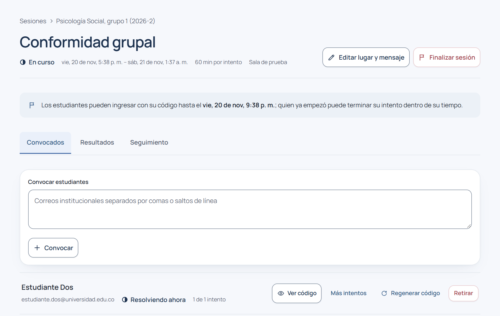

*Figura 24. Sesión en curso, pestaña Convocados.*

> **Consejo.** La información no se actualiza sola. Recarga la página o cambia de pestaña para ver el avance más reciente.

## Gestionar a los convocados

Mientras la sesión no esté finalizada, cada estudiante tiene estas acciones:

| Acción | Efecto |
|---|---|
| **Convocar** | Añade estudiantes escribiendo sus correos en **Convocar estudiantes**. |
| **Más intentos** | Aumenta el total de intentos autorizados (solo se puede aumentar). Pide un motivo de al menos 5 caracteres. |
| **Regenerar código** | Crea un código nuevo; el anterior deja de funcionar de inmediato, también si el estudiante ya entró con él. Pide un motivo. |
| **Retirar** | El estudiante pierde el acceso; si estaba resolviendo, su intento se cierra con lo guardado. Su historial se conserva y puedes volver a convocarle. |

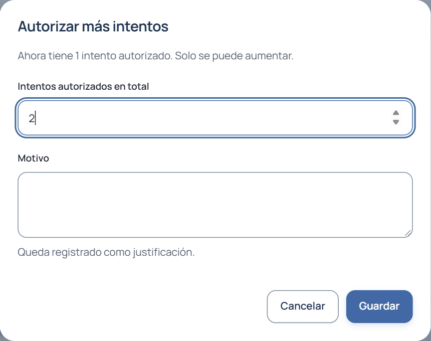

*Figura 25. Autorizar más intentos: nuevo total y motivo.*

### Procedimiento: Editar la programación

*Ajusta fechas, tiempo, lugar o mensaje.*

**Paso 1.** En la cabecera de la sesión, pulsa **Editar programación** (sesión sin iniciar) o **Editar lugar y mensaje** (sesión en curso).

**Paso 2.** Cambia los datos y pulsa **Guardar cambios**.

> **Resultado esperado.** La cabecera muestra los nuevos datos. Con la sesión en curso solo se pueden cambiar el lugar y el mensaje.

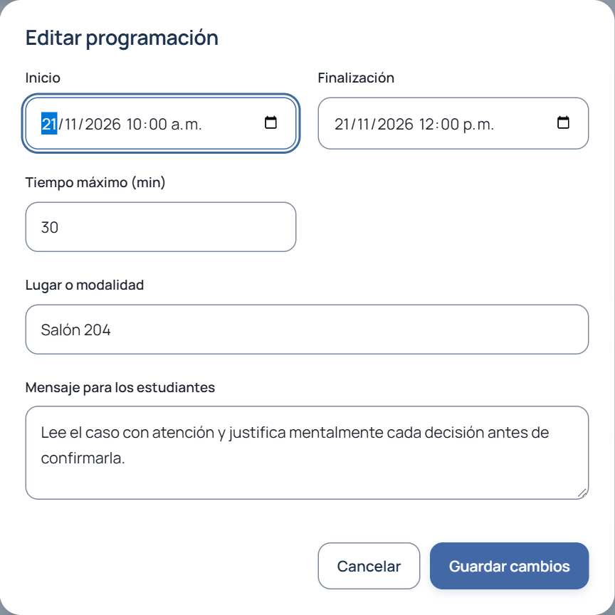

*Figura 26. Editar programación de una sesión sin iniciar: inicio, finalización, tiempo, lugar y mensaje.*

### Procedimiento: Finalizar la sesión

*Cierra la actividad para evaluar y publicar los resultados.*

**Paso 1.** En la cabecera de la sesión en curso, pulsa **Finalizar sesión**.

**Paso 2.** Lee el aviso y confirma con **Finalizar sesión**.

> **Resultado esperado.** Nadie puede ingresar ni seguir respondiendo; los intentos en curso se cierran con las respuestas guardadas. Los estudiantes podrán consultar sus resultados.

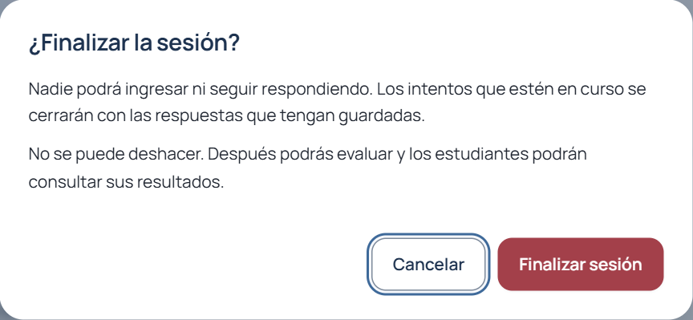

*Figura 27. Confirmación para finalizar una sesión.*

> **Atención.** Finalizar una sesión no se puede deshacer.

> **Nota · Plazo de ingreso y cierre automático.** Los estudiantes pueden empezar un intento hasta el plazo de ingreso que muestra la sesión. Cuando vence, verás una advertencia: conviene finalizar la sesión. Si no lo haces, el cierre automático la finalizará 24 horas después de su hora de fin.

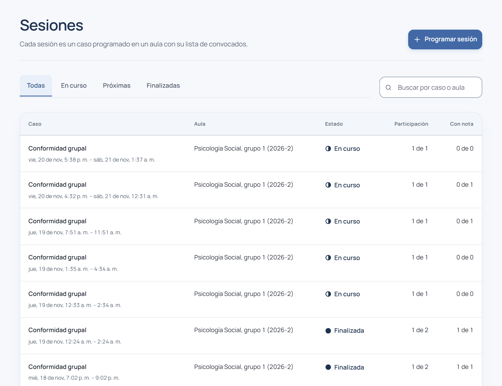

*Figura 28. Sesiones: todas tus sesiones con filtros por estado, participación y notas registradas.*

# 8. Resultados y seguimiento académico

*Cada sesión reúne sus resultados en dos pestañas: Resultados, para revisar intento por intento, y Seguimiento, para mirar al grupo completo.*

### Procedimiento: Revisar los resultados de una sesión

*Conoce el estado de cada intento y quién no participó.*

**Paso 1.** Abre la sesión y elige la pestaña **Resultados**.

**Paso 2.** Revisa las cifras: **completados**, **cerrados sin finalizar**, **en curso**, **evaluados** y **por evaluar**.

**Paso 3.** En la tabla, consulta el estudiante, el intento, el estado, la calificación y la nota.

**Paso 4.** Pulsa **Ver detalle** para abrir un intento cerrado.

> **Resultado esperado.** Al final aparecen las **Ausencias**: convocados que no iniciaron ningún intento. Una ausencia no equivale a una nota de cero.

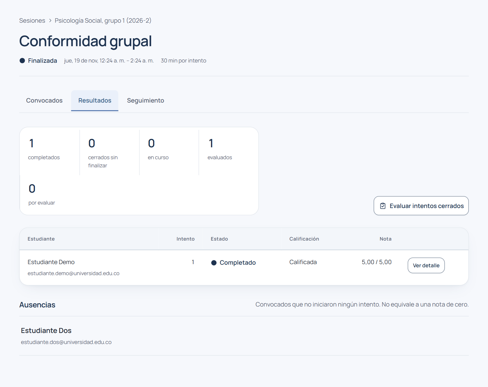

*Figura 29. Pestaña Resultados de una sesión finalizada.*

## La pestaña Seguimiento

Muestra los indicadores del grupo tal como los calcula el sistema. Cada porcentaje va acompañado de su fracción (por ejemplo, «1 de 2»), para que sepas sobre cuántos estudiantes o intentos se calculó.

| Bloque | Qué te muestra |
|---|---|
| **Participación** | Estudiantes que participaron, intentos completados, intentos cerrados sin finalizar e intentos cerrados con nota. |
| **Notas** | Promedio, mediana, mínima y máxima de los intentos evaluados, y una tabla de distribución por rangos. Cada intento cuenta por separado. |
| **Desempeño por criterio** | Aciertos, porcentaje y puntaje medio de cada criterio de la rúbrica. |
| **Desempeño por decisión** | Aciertos, respuestas no acertadas, sin responder y porcentaje de aciertos de cada pregunta. |
| **Descargar en CSV** | Archivos Resumen, Estudiantes, Intentos, Criterios y Preguntas para analizarlos en una hoja de cálculo. |

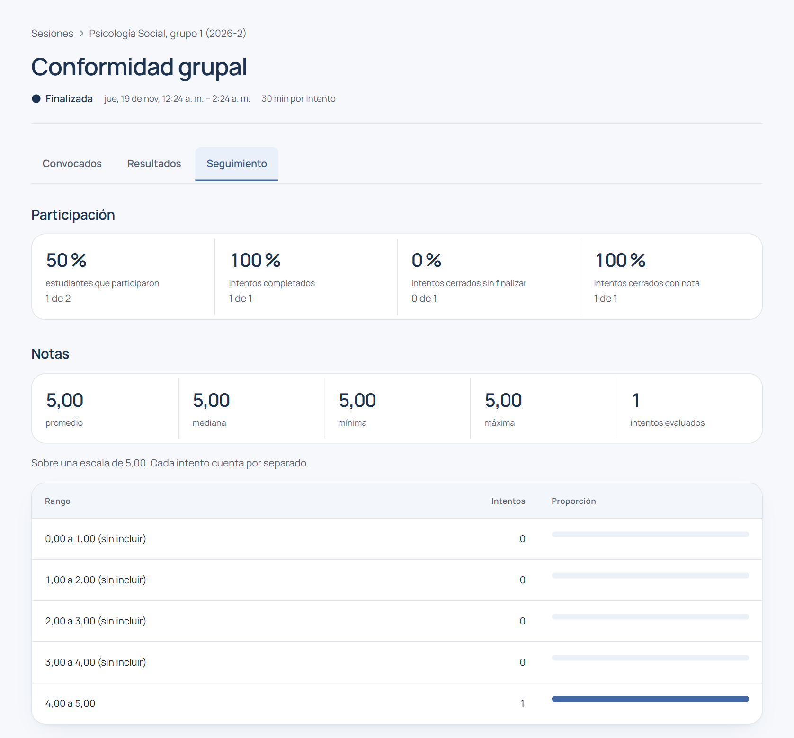

*Figura 30. Seguimiento: participación y notas del grupo.*

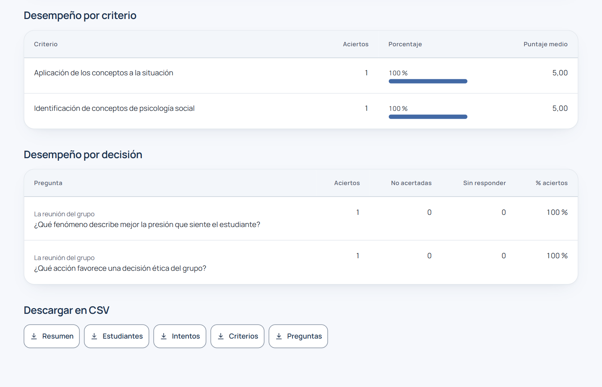

*Figura 31. Seguimiento: desempeño por criterio, por decisión y descargas CSV.*

> **Buena práctica docente · Buena práctica docente.** Revisa **Desempeño por decisión** antes de la clase siguiente: una pregunta con pocos aciertos suele señalar un concepto que conviene retomar con el grupo.

# 9. Evaluación y retroalimentación

*Iter Animi calcula la nota con la rúbrica del caso. Tu tarea es registrarla, revisar cada intento y acompañarla con un comentario.*

## Cómo se califica

- La nota la calcula el sistema a partir de las respuestas y la rúbrica. No se escribe a mano.
- Pulsar **Evaluar intentos cerrados** registra las notas de los intentos que ya terminaron.
- Los estudiantes ven su nota y tus comentarios cuando la sesión está **finalizada** y la evaluación quedó registrada.
- Un intento **Sin calificar** no tuvo evidencia suficiente para calificarse: no equivale a un cero.

### Procedimiento: Registrar las notas de la sesión

*Procesa en un solo paso todos los intentos cerrados.*

**Paso 1.** Abre la sesión en la pestaña **Resultados**.

**Paso 2.** Pulsa **Evaluar intentos cerrados**.

> **Resultado esperado.** Aparece «Evaluación procesada.» con el número de intentos revisados, notas nuevas, actualizadas, sin cambios y sin calificar. Los intentos en curso no se evalúan.

> **Consejo.** Puedes evaluar antes de finalizar la sesión: los estudiantes solo verán su resultado cuando la finalices.

### Procedimiento: Revisar el intento de un estudiante

*Comprende cómo razonó el estudiante en cada decisión.*

**Paso 1.** En **Resultados**, pulsa **Ver detalle** en el intento.

**Paso 2.** Revisa la nota, la condición, la calificación, el motivo de cierre y el resumen de respuestas.

**Paso 3.** Consulta **Desempeño por criterio** (aciertos, nivel, puntaje y peso).

**Paso 4.** Recorre **Retroalimentación por decisión**: la opción elegida, su justificación y, si no acertó, la opción esperada.

**Paso 5.** Lee el **Resumen del sistema** generado automáticamente.

> **Resultado esperado.** Tienes una visión completa del intento antes de escribir tu comentario.

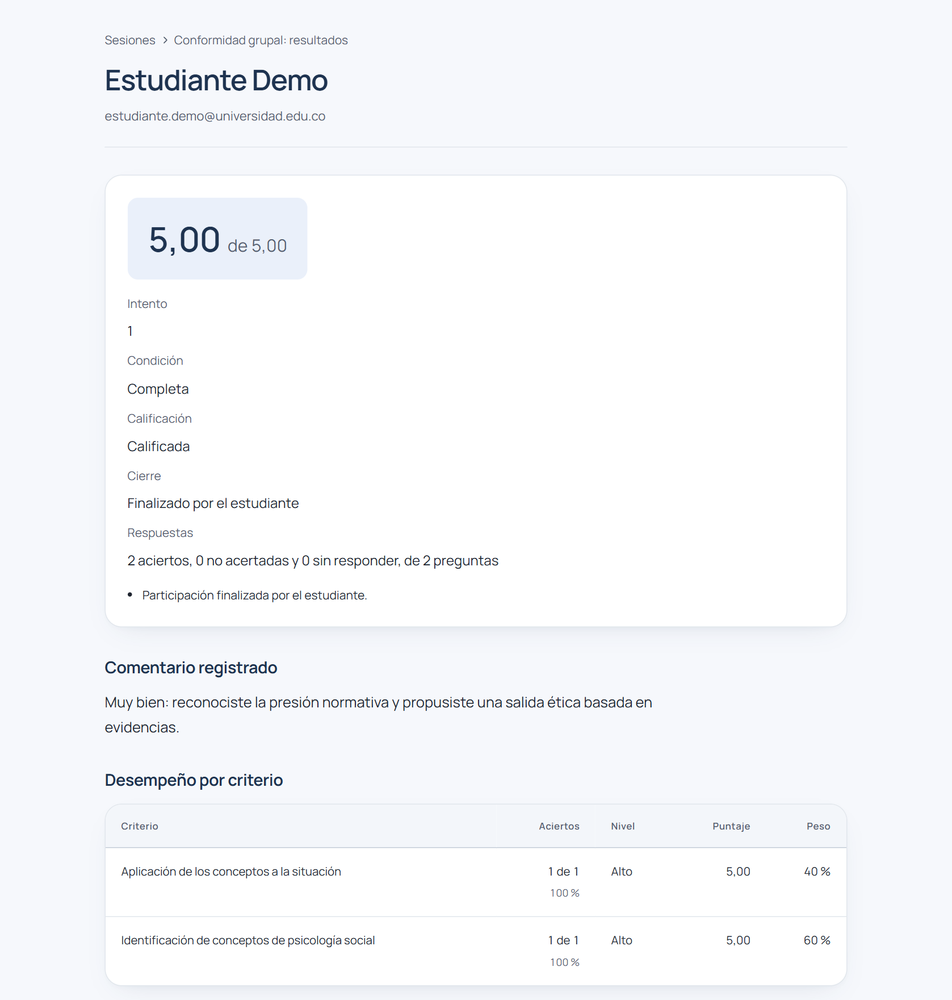

*Figura 32. Evaluación de un intento: nota, condición, comentario registrado y desempeño por criterio.*

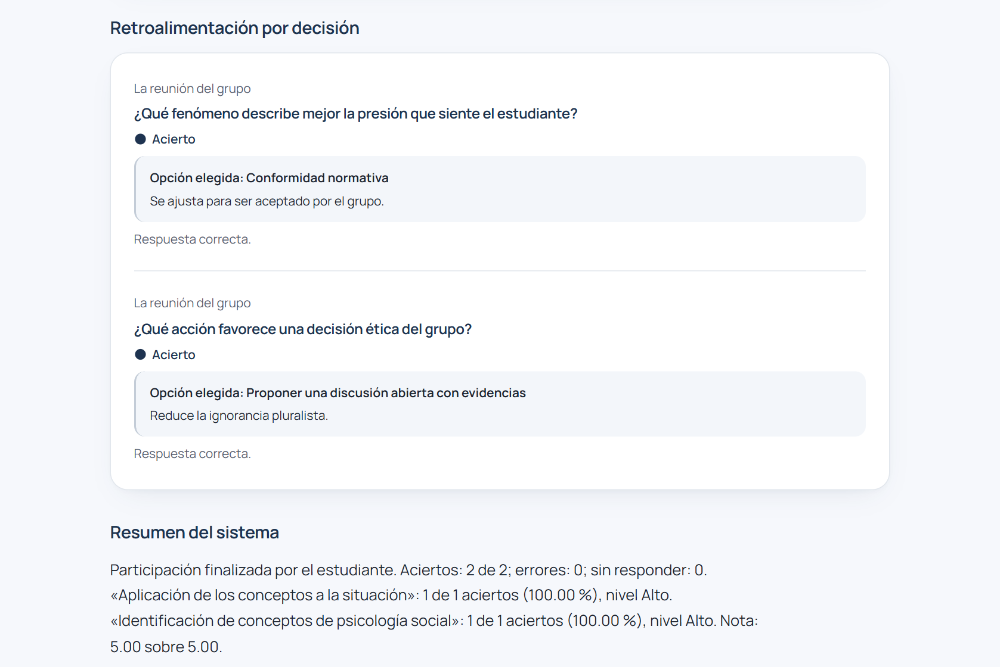

*Figura 33. Retroalimentación por decisión y resumen del sistema.*

### Procedimiento: Escribir un comentario para el estudiante

*Acompaña la nota con una retroalimentación personal.*

**Paso 1.** Al final del detalle del intento, escribe en **Tu comentario para el estudiante** (hasta 5000 caracteres).

**Paso 2.** Pulsa **Guardar comentario**.

> **Resultado esperado.** Aparece «Comentario guardado». El comentario no cambia la nota. Para quitarlo, déjalo vacío y guarda.

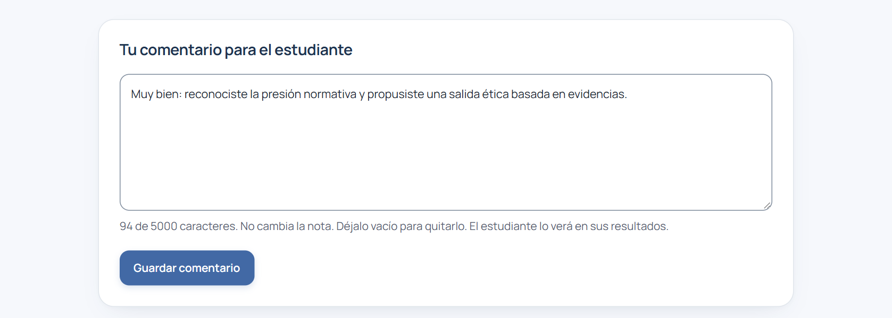

*Figura 34. Comentario del docente con el contador de caracteres.*

> **Consejo.** Un buen comentario nombra el concepto, reconoce lo logrado y propone un siguiente paso. Por ejemplo: «Reconociste la presión normativa; la próxima vez, argumenta por qué la discusión con evidencias reduce la ignorancia pluralista».

### Procedimiento: Registrar la nota calculada

*Actualiza la nota de un intento cuando no coincide con la calculada.*

**Paso 1.** Si en el detalle del intento aparece «La nota registrada no coincide con la calculada» o «Este intento aún no tiene nota registrada», revisa los dos valores.

**Paso 2.** Pulsa **Registrar nota calculada**.

> **Resultado esperado.** La nota registrada pasa a ser la calculada con la política vigente. En la tabla de resultados, la etiqueta **Nota desactualizada** señala estos casos.

### Procedimiento: Encontrar lo que falta por evaluar

*Mantén tus evaluaciones al día.*

**Paso 1.** En el menú, entra a **Evaluación**.

**Paso 2.** En **Por evaluar**, pulsa **Evaluar** en cada sesión con intentos sin nota.

> **Resultado esperado.** Las sesiones con todas sus notas aparecen en **Al día**, con acceso a su **Seguimiento**.

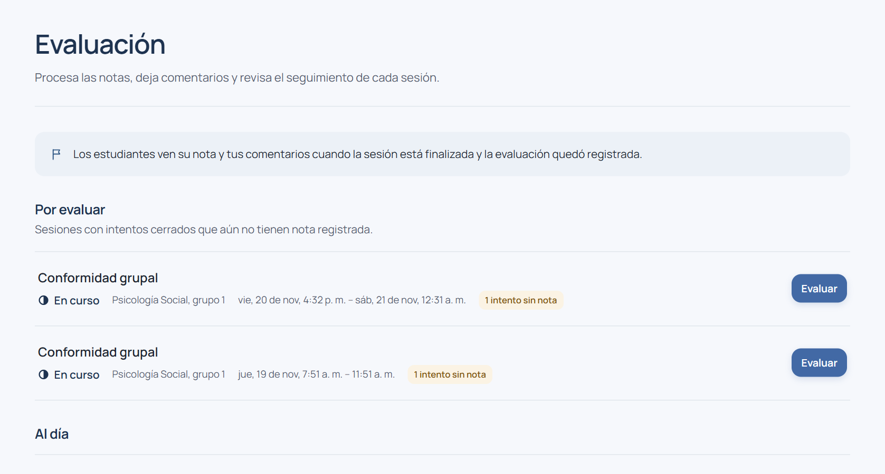

*Figura 35. Evaluación: sesiones por evaluar y al día.*

# 10. Tu primera actividad en Iter Animi

*Pongamos todo junto. Este recorrido prepara el taller «Conformidad grupal» para el aula «Psicología Social, grupo 1».*

### Fase 1 · Preparar el caso *(Capítulo 4)*

- [ ] Casos › **Nuevo caso** › **Empezar en blanco**: nombre «Conformidad grupal», 60 minutos estimados, desarrollo situacional e historia.
- [ ] **Añadir escena** «La reunión del grupo» con su narración.
- [ ] Crear la rúbrica con escala 5,00 y dos criterios (60 % y 40 %) con niveles Alto, Medio y Bajo.
- [ ] Añadir las dos decisiones, cada una con su criterio y tres opciones justificadas.
- [ ] **Validar**, corregir lo señalado y **Publicar**.

### Fase 2 · Ambientar al entrevistado *(Capítulo 5)*

- [ ] Pestaña **Personaje y reacciones** › **Personajes del sistema** › **Usar a** un personaje.
- [ ] Asignar la expresión inicial de la escena y las reacciones de cada opción.
- [ ] Probar en la **Vista previa jugable**, **Guardar borrador** y **Exportar paquete visual** para el equipo técnico.

### Fase 3 · Programar y convocar *(Capítulos 6 y 7)*

- [ ] Aulas › **Programar** en «Psicología Social, grupo 1».
- [ ] Elegir el caso, la ventana, 60 minutos por intento, el lugar y un mensaje para el grupo.
- [ ] Convocar a los estudiantes por correo y **Crear sesión**.
- [ ] Entregar los códigos con **Ver código** si el envío por correo no está activo.

### Fase 4 · Acompañar la sesión *(Capítulo 7)*

- [ ] A la hora de inicio, **Abrir sesión**.
- [ ] Seguir el avance en **Convocados** y resolver incidencias (más intentos, regenerar código).
- [ ] Al terminar, **Finalizar sesión**.

### Fase 5 · Evaluar y analizar *(Capítulos 8 y 9)*

- [ ] **Resultados** › **Evaluar intentos cerrados**.
- [ ] **Ver detalle** de cada intento y **Guardar comentario**.
- [ ] Revisar **Seguimiento** y descargar los CSV que necesites.

> **Resultado esperado · Al terminar el recorrido.** Tus estudiantes resuelven el caso frente al entrevistado virtual y, al finalizar la sesión, consultan con su mismo código la nota, la retroalimentación por decisión y tu comentario.

> **Nota · Alcance del recorrido.** Todas las fases se realizan desde la interfaz, salvo la instalación del paquete visual, que hace el equipo técnico. Sin ese paso, la actividad funciona igual con la silueta sin rostro.

# 11. Preguntas frecuentes

**P. ¿Puedo crear un aula o inscribir estudiantes?**

R. No. La administración del simulador crea las aulas y las cuentas de estudiante. Tú convocas a los estudiantes por correo en cada sesión.

**P. No veo el botón Nuevo caso.**

R. Tu cuenta no tiene permiso para crear casos. Puedes consultarlo en **Mi cuenta**; solicítalo a la administración.

**P. Mi caso no aparece al programar una sesión.**

R. Solo se programan casos **Publicados**. Abre el caso, pulsa **Validar**, corrige lo señalado y **Publicar**.

**P. ¿Puedo modificar un caso que ya publiqué?**

R. No. Exporta el caso con **Exportar CaseDSL**, impórtalo como nuevo borrador, edítalo y publícalo.

**P. Programé la sesión, pero los estudiantes no pueden entrar.**

R. Comprueba que pulsaste **Abrir sesión** y que no ha vencido el plazo de ingreso. La sesión no se abre sola.

**P. Un estudiante perdió su código.**

R. En **Convocados**, pulsa **Ver código** y entrégaselo. Si crees que alguien más lo conoce, usa **Regenerar código**.

**P. Un estudiante necesita repetir el caso.**

R. Pulsa **Más intentos** y aumenta el total de intentos autorizados indicando el motivo.

**P. No veo el avance más reciente de mis estudiantes.**

R. La información no se actualiza automáticamente. Recarga la página o cambia de pestaña.

**P. Mis estudiantes no ven su nota.**

R. Las notas se muestran cuando la sesión está **finalizada** y la evaluación está registrada. Finaliza la sesión y pulsa **Evaluar intentos cerrados**.

**P. ¿Puedo cambiar la nota de un estudiante a mano?**

R. No. La nota se calcula con la rúbrica. Puedes registrar la nota calculada cuando no coincide y dejar un comentario, que no cambia la nota.

**P. Configuré el personaje, pero los estudiantes ven una silueta sin rostro.**

R. El paquete visual aún no está instalado. Exporta el paquete y entrégalo al equipo técnico; publicar el caso no lo publica.

**P. Abrí el editor visual en otro computador y no está mi personaje.**

R. El borrador visual se guarda solo en el navegador donde trabajaste. Exporta el paquete allí y usa **Importar paquete visual** en el otro equipo.

**P. Cambié mi contraseña y se cerró mi sesión.**

R. Es intencional: al cambiarla se cierran todas tus sesiones. Ingresa con la nueva contraseña.

# 12. Recomendaciones finales

## Buenas prácticas pedagógicas

- **Empieza por el objetivo.** Define qué concepto de psicología social quieres que el estudiante reconozca o aplique, y construye las decisiones a partir de él.
- **Escribe opciones plausibles.** Las opciones incorrectas funcionan mejor cuando representan errores frecuentes, como confundir conformidad normativa con disonancia cognitiva.
- **Justifica todas las opciones.** La justificación es la retroalimentación que el estudiante leerá después.
- **Alinea decisiones y rúbrica.** Asocia cada decisión al criterio que evalúa y revisa que los pesos reflejen tus prioridades.
- **Usa las reacciones con mesura.** Deben acompañar la narración, nunca sugerir la respuesta correcta.
- **Prueba antes de programar.** Recorre la vista previa como si fueras el estudiante y comprueba el tiempo estimado.
- **Anticipa la logística.** Revisa que los estudiantes tengan cuenta activa y entrega los códigos con tiempo.
- **Cierra el ciclo.** Finaliza la sesión, registra las notas, comenta los intentos y retoma en clase las decisiones con menos aciertos.

## Para terminar

Iter Animi convierte un caso de psicología social en una experiencia que el estudiante recorre y sobre la que reflexiona. Con lo que aprendiste en esta guía puedes preparar un caso, darle rostro, ponerlo a disposición de tu grupo y acompañar el aprendizaje con evaluación y retroalimentación.

Si encuentras una dificultad que esta guía no resuelve, comunícate con la administración del simulador.

---

*Decidir con criterio. Aprender con sentido.*
