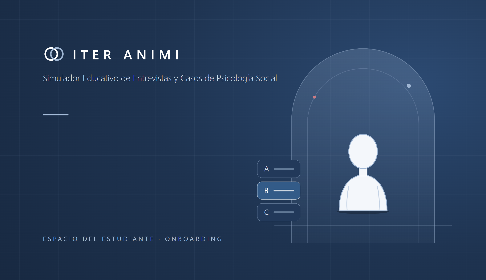

# ITER ANIMI

**Simulador Educativo de Entrevistas y Casos de Psicología Social**

## Guía de Onboarding para Estudiantes

| Código | Versión | Fecha de elaboración | Dirigido a |
|---|---|---|---|
| ITAN-ONB-EST-01 | 1.0 | 22 de noviembre de 2026 | Estudiantes de Iter Animi |

<!-- Fuente editable de la guía. El Word se genera desde el mismo contenido; las imágenes están en evidencias/. -->

---

## Contenido

1. Bienvenido a Iter Animi
2. Antes de comenzar
3. Tu primer ingreso
4. Conociendo tu espacio
5. Comprendiendo los casos
6. Tu primera simulación
7. Interactuando con los personajes
8. Tiempo, intentos y finalización
9. Consultando tus resultados
10. Comprendiendo tu retroalimentación
11. Tu primera experiencia completa
12. Preguntas frecuentes
13. Recomendaciones finales

---

# 1. Bienvenido a Iter Animi

*Iter Animi te sitúa frente a un caso de psicología social. Lees lo que ocurre, interpretas la situación y decides. Después, revisas tus decisiones y aprendes de ellas.*

La experiencia se parece a una novela visual: un relato que avanza por escenas, con un personaje en pantalla, un texto que cuenta lo que pasa y momentos en los que tú eliges cómo continuar.

## Tu papel

Tu docente prepara el caso y te convoca a una sesión. Tú lo recorres a tu ritmo, dentro del tiempo disponible:

- **Observas** el contexto, la escena y al personaje.
- **Analizas** qué concepto de psicología social explica la situación.
- **Decides** y confirmas una opción en cada pregunta.
- **Revisas** tu nota, la justificación de cada opción y el comentario de tu docente.

## El recorrido completo

**1. Ingresar** (Correo y código) → **2. Leer** (El caso y la escena) → **3. Decidir** (Elegir y confirmar) → **4. Entregar** (Cerrar tu intento) → **5. Aprender** (Nota y comentarios)

> **Nota · Entre «Entregar» y «Aprender» hay una espera.** Tus resultados no aparecen al terminar. Se abren cuando tu docente finaliza la sesión y registra la evaluación.

## Palabras que encontrarás

| Término | Qué significa para ti |
|---|---|
| **Sesión** | La actividad que programó tu docente: un caso, un aula y un horario. |
| **Convocatoria** | Tu invitación personal a esa sesión. |
| **Código de acceso** | Doce caracteres que te identifican en esa convocatoria. |
| **Caso** | La situación de psicología social que vas a recorrer. |
| **Escena** | Un momento del caso, con su título y su narración. |
| **Decisión** | Una pregunta de la escena. La respondes eligiendo una opción. |
| **Intento** | Cada vez que inicias el caso. Tiene su propio tiempo y su propio resultado. |
| **Criterio** | Aspecto que se evalúa, por ejemplo «Aplicación de los conceptos a la situación». |

## Cómo leer esta guía

Cada tarea se presenta como un **procedimiento** con pasos numerados. Además, encontrarás estos avisos:

| Aviso | Uso |
|---|---|
| Consejo | Recomendaciones breves para trabajar mejor. |
| Atención | Acciones que no se pueden deshacer o limitaciones importantes. |
| Resultado esperado | Lo que debería mostrar Iter Animi al terminar un procedimiento. |
| Para tu aprendizaje | Ejercicios breves para pensar mejor cada decisión. |
| Nota | Contexto que conviene conocer. |

# 2. Antes de comenzar

*Cinco minutos de preparación evitan la mayoría de las dificultades.*

## Lo que necesitas

| Necesitas | De dónde sale |
|---|---|
| **Correo institucional** | El que usó tu docente para convocarte. Tu cuenta de estudiante la crea la administración: no tienes que registrarte. |
| **Código de acceso** | Llega por correo si tu institución tiene activo ese envío. Si no, te lo entrega tu docente. |
| **Dirección de Iter Animi** | La que te indique tu institución o tu docente. |
| **Navegador y conexión** | Iter Animi se usa desde el navegador, en computador o en teléfono. No se instala nada. |

## Qué preguntar a tu docente

- La hora de **inicio** y hasta cuándo puedes **empezar** el caso. No son lo mismo (ver el capítulo 8).
- Cuántos **minutos** tendrás y cuántos **intentos** están autorizados.
- Si la actividad es presencial o en línea.

> **Atención · Tu código es personal.** Quien tenga tu correo y tu código puede entrar en tu lugar y ver tus resultados. No lo compartas ni lo publiques. Si crees que alguien lo conoce, pide a tu docente que lo **regenere**. Cada código abre una sola sesión: consérvalo, porque también abrirá tus resultados.

## Prepara tu espacio

- [ ] Actualiza el navegador y comprueba tu conexión.
- [ ] Conecta el cargador: el tiempo no se detiene si se apaga el equipo.
- [ ] Reserva el tiempo completo del intento y ten a mano tu correo y tu código.

# 3. Tu primer ingreso

*No hay contraseña ni registro: entras con tu correo institucional y tu código de acceso.*

### Procedimiento: Ingresar con tu código

*Entra a la sesión a la que te convocaron.*

**Antes de comenzar:**

- Tu docente debe haber **abierto** la sesión.
- Debes estar dentro del plazo para ingresar.

**Paso 1.** Abre la dirección de Iter Animi. Verás la pantalla **Ingresar**.

**Paso 2.** Elige **Con código de acceso**. La pantalla se abre en **Con contraseña**, que es para docentes y administración.

**Paso 3.** Escribe tu **Correo institucional** y tu **Código de acceso**.

**Paso 4.** Pulsa **Ingresar**.

> **Resultado esperado.** Se abre **Inicio** con el nombre del caso, su estado y la acción que puedes realizar.

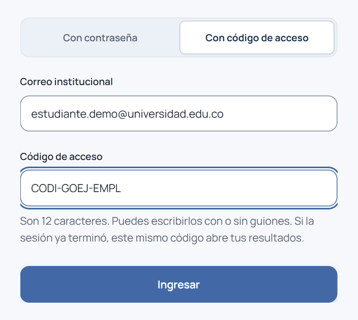

*Figura 1. Formulario con la opción «Con código de acceso» seleccionada. El código de la imagen es un ejemplo y no funciona.*

> **Consejo.** El código tiene 12 caracteres. Puedes escribirlo con o sin guiones, en mayúsculas o minúsculas.

## Si no puedes ingresar

El mensaje te dice qué ocurre. Estos son los que puedes encontrar:

| Mensaje | Qué hacer |
|---|---|
| «Escribe tu correo institucional.» / «Escribe el código de acceso de tu convocatoria.» | Completa el campo señalado. |
| «El correo no tiene un formato válido.» | Revisa que esté completo, con @ y el dominio de tu institución. |
| «El correo o el código de acceso no son correctos.» | Revisa ambos datos. Si tu docente regeneró el código, el anterior ya no sirve: pide el nuevo. |
| «La sesión aún no ha sido iniciada por el docente.» | Tus datos son correctos. Espera a que tu docente abra la sesión. |
| «El plazo de ingreso a la sesión terminó (mitad de la ventana programada).» | Ya no es posible empezar. Habla con tu docente. |
| «La ventana programada de la sesión terminó; no admite nuevos ingresos.» | Terminó el horario. Si ya entregaste, espera a que tu docente finalice la sesión. |
| «La convocatoria fue revocada por el docente.» | Te retiraron de la sesión. Consulta con tu docente. |
| «La cuenta del estudiante está desactivada.» | Comunícate con la administración. |
| «Demasiados intentos fallidos. Vuelve a intentarlo en N minutos.» | Espera ese tiempo. Seguir intentando no ayuda, ni siquiera con el código correcto. |
| «No se pudo conectar con el servidor…» | Comprueba tu conexión e inténtalo otra vez. |

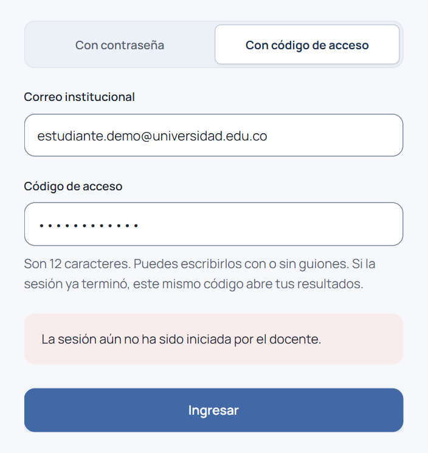

*Figura 2. Tus datos son correctos, pero la sesión todavía no está abierta. Código oculto.*

## Salir y volver a entrar

Para salir, pulsa **Cerrar sesión** en la parte inferior del menú. Tu acceso también se cierra solo después de un tiempo, o si tu docente finaliza la sesión, regenera tu código o te retira. En esos casos vuelves a **Ingresar** con el aviso «Tu sesión expiró. Vuelve a ingresar para continuar.».

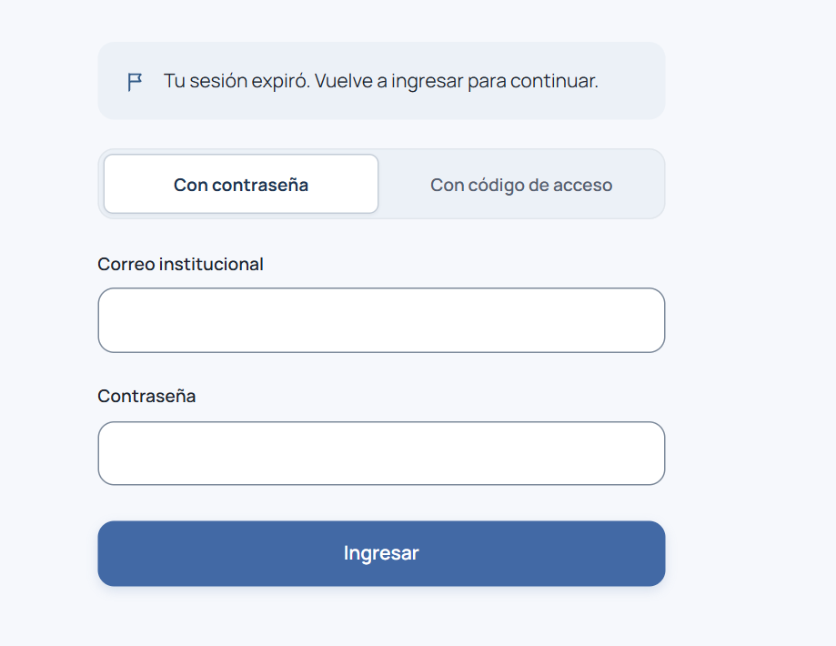

*Figura 3. Aviso de sesión vencida. La pantalla vuelve a «Con contraseña»: cambia a «Con código de acceso».*

# 4. Conociendo tu espacio

*Usarás dos espacios: el portal, donde consultas tu sesión, y el simulador, donde recorres el caso.*

## El portal: Inicio

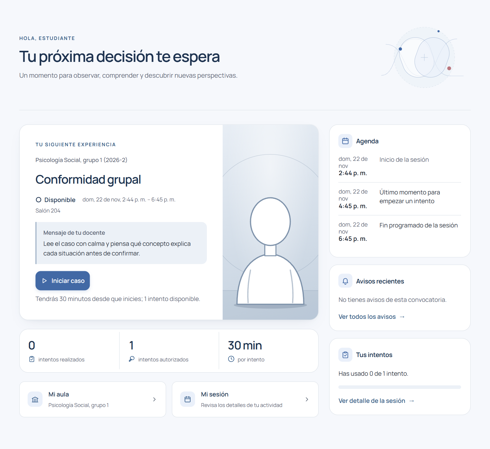

*Figura 4. Inicio con una sesión disponible.*

1. **Tarjeta de la sesión.** Aula, caso, estado, horario, lugar y el **Mensaje de tu docente**.
2. **Acción principal.** Cambia según el estado: **Iniciar caso**, **Continuar caso** o **Ver mis resultados**.
3. **Cifras.** Intentos realizados, intentos autorizados y minutos por intento.
4. **Agenda.** Inicio, **Último momento para empezar un intento** y fin programado.
5. **Avisos recientes** y **Tus intentos.** Novedades de tu convocatoria e intentos usados.

## El menú

| Opción | Para qué te sirve |
|---|---|
| **Inicio** | Ver qué puedes hacer ahora. |
| **Mi aula** | Ver el aula de esta sesión. No es una matrícula: solo muestra la convocatoria con la que entraste. |
| **Mi sesión** | Consultar horario, plazo, tiempo, intentos y tu historial de intentos. |
| **Resultados** | Ver tus notas cuando estén disponibles. |
| **Retroalimentación** | Leer los comentarios de tu docente. |
| **Avisos** | Revisar las novedades de tu convocatoria. |

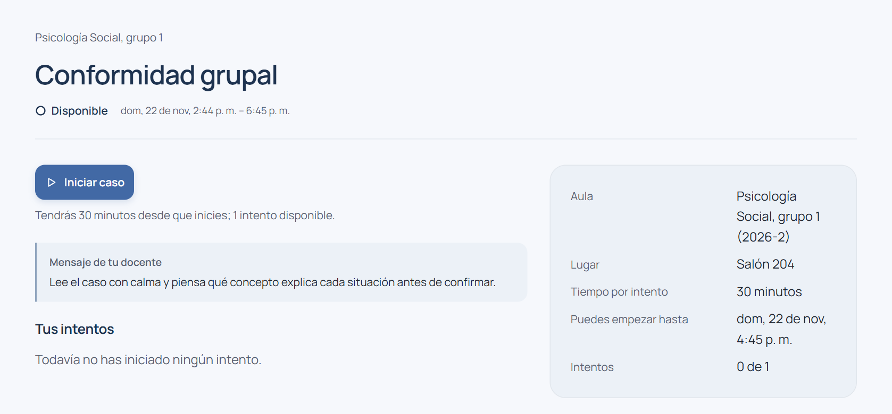

*Figura 5. Mi sesión. A la derecha, «Puedes empezar hasta» indica el plazo para iniciar.*

## Los estados de tu sesión

| Estado | Qué significa |
|---|---|
| **Disponible** | Puedes iniciar un intento. |
| **En curso** | Tienes un intento abierto y su tiempo corre. Puedes continuarlo. |
| **Completado** | No te quedan acciones. Falta que tu docente finalice la sesión. |
| **Plazo de ingreso cerrado** | No iniciaste a tiempo y ya no es posible hacerlo. |
| **Sesión finalizada** | Puedes consultar tus resultados. |

> **Consejo · Tema claro u oscuro.** Elige el tema con los iconos de sol, luna y pantalla, en el menú o en la pantalla **Ingresar**. Se recuerda en ese navegador y también se aplica al simulador.

## El simulador

Al iniciar, el menú desaparece para que te concentres en el caso.

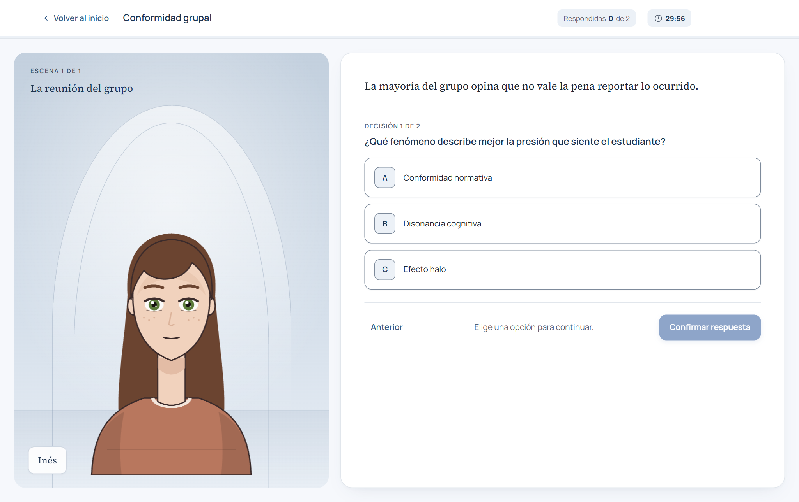

*Figura 6. El simulador en una decisión del caso «Conformidad grupal».*

| Elemento | Qué te muestra |
|---|---|
| **Volver al inicio** | Arriba a la izquierda. Sales del simulador, pero **el tiempo sigue corriendo**. |
| **Respondidas** | Cuántas decisiones tienes guardadas. La línea azul superior muestra el avance. |
| **Reloj** | Tiempo que te queda. Se resalta en los últimos cinco minutos. |
| **Escenario** | A la izquierda: número y título de la escena, el personaje y su nombre. |
| **Narración** | A la derecha, arriba: lo que ocurre en la escena. |
| **Decisión y opciones** | La pregunta y sus opciones, señaladas con letras (A, B, C…). |
| **Barra de acciones** | **Anterior**, una ayuda breve y el botón **Confirmar respuesta** o **Continuar**. |

## En tu teléfono

Todo funciona también en pantalla pequeña. El menú se abre con el botón de tres líneas, y en el simulador el escenario se reduce para dejar espacio al texto.

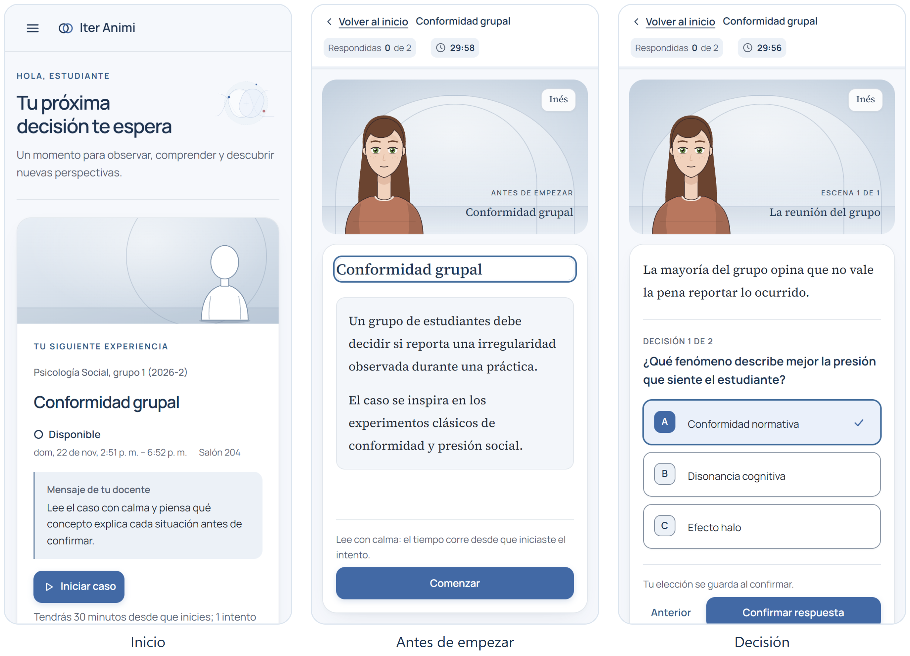

*Figura 7. Inicio, presentación del caso y una decisión en un teléfono.*

# 5. Comprendiendo los casos

*Un caso es una situación social en la que tienes que mirar con criterio. No se trata de adivinar, sino de reconocer qué está pasando y por qué.*

## Cómo se organiza

1. **Presentación.** La situación general y su historia. La lees antes de la primera escena, si tu docente la incluyó.
2. **Escena.** Un momento concreto, con título y narración.
3. **Decisión.** Una pregunta sobre esa escena. Puede haber varias en la misma escena.
4. **Opciones.** Las respuestas posibles. Eliges una.
5. **Reacción.** El personaje puede cambiar de expresión después de que confirmas.

Conviene distinguir tres voces: la **narración** cuenta la situación, la **decisión** te pregunta a ti y la **expresión** del personaje acompaña el relato. El personaje no habla ni escribe mensajes.

## Un ejemplo: «Conformidad grupal»

> **Ejemplo · Así se lee un caso**
>
> - **Presentación.** Un grupo de estudiantes debe decidir si reporta una irregularidad observada durante una práctica.
> - **Escena · La reunión del grupo.** La mayoría del grupo opina que no vale la pena reportar lo ocurrido.
> - **Decisión.** ¿Qué fenómeno describe mejor la presión que siente el estudiante?
> - **Opciones.** A. Conformidad normativa · B. Disonancia cognitiva · C. Efecto halo.

## Cómo pensar antes de elegir

1. **Describe** lo que pasa sin interpretarlo: hay una mayoría y alguien que duda.
2. **Identifica** la fuerza social: ¿la presión viene del grupo, de una creencia propia o de una primera impresión?
3. **Contrasta** cada opción con esa descripción: ¿qué concepto habla de presión, cuál de conflicto interno y cuál de percepción?
4. **Decide** cuando puedas explicar por qué las otras opciones encajan peor.

> **Para tu aprendizaje.** Haz el ejercicio de completar esta frase antes de confirmar: «Elijo esta opción porque en la escena ocurre…». Si no puedes terminarla, vuelve a leer la narración.

# 6. Tu primera simulación

*Este es el corazón de la guía. Sigue el caso «Conformidad grupal» desde que lo inicias hasta que lo entregas.*

### Procedimiento: Iniciar el caso

*Abre tu intento cuando estés en condiciones de terminarlo.*

**Antes de comenzar:**

- Tu sesión debe mostrar el estado **Disponible**.

**Paso 1.** En **Inicio** o en **Mi sesión**, lee el mensaje de tu docente y pulsa **Iniciar caso**.

**Paso 2.** Lee el aviso «¿Iniciar el caso ahora?».

**Paso 3.** Pulsa **Iniciar** si estás listo, o **Cancelar** para volver.

> **Resultado esperado.** Se abre el simulador y el reloj empieza a contar.

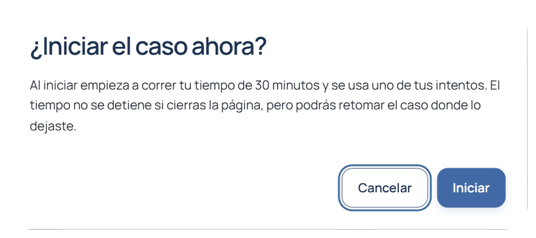

*Figura 8. Confirmación antes de iniciar.*

> **Atención.** Al pulsar **Iniciar** se usa uno de tus intentos y el tiempo ya no se detiene, aunque cierres la página.

### Procedimiento: Leer la presentación

*Comprende la situación antes de decidir.*

**Paso 1.** Lee la situación y su historia con calma.

**Paso 2.** Pulsa **Comenzar**.

> **Resultado esperado.** Aparece la primera escena con su primera decisión.

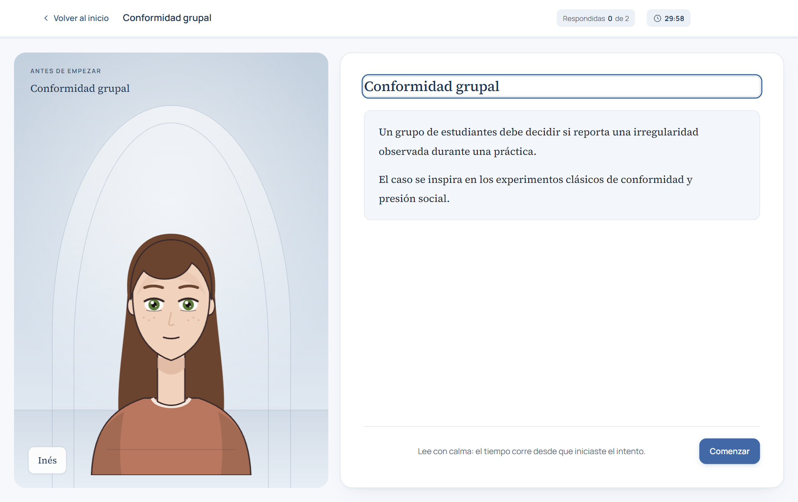

*Figura 9. Presentación del caso, con el título «Antes de empezar» en el escenario.*

> **Consejo.** Desde la primera decisión puedes volver a esta presentación con **Anterior**.

### Procedimiento: Analizar la escena y elegir

*Interpreta lo que ocurre y selecciona una opción.*

**Paso 1.** Mira el título de la escena y lee la narración.

**Paso 2.** Lee la pregunta. Encima verás su posición, por ejemplo **Decisión 1 de 2**.

**Paso 3.** Lee **todas** las opciones y pulsa la que elijas.

> **Resultado esperado.** La opción queda resaltada y se activa **Confirmar respuesta**. Puedes cambiarla cuantas veces quieras.

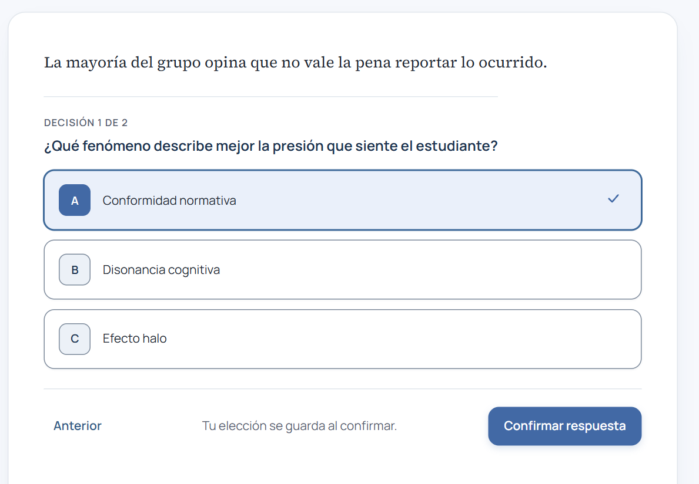

*Figura 10. Opción elegida. Todavía no está guardada: la ayuda dice «Tu elección se guarda al confirmar.».*

### Procedimiento: Confirmar y observar la reacción

*Guarda tu respuesta y continúa el relato.*

**Paso 1.** Pulsa **Confirmar respuesta**. El botón muestra **Guardando…** un momento.

**Paso 2.** Observa al personaje: puede cambiar de expresión.

**Paso 3.** Continúa con la siguiente decisión, que aparece de inmediato.

> **Resultado esperado.** Aumenta el contador **Respondidas** y pasas a la siguiente decisión pendiente.

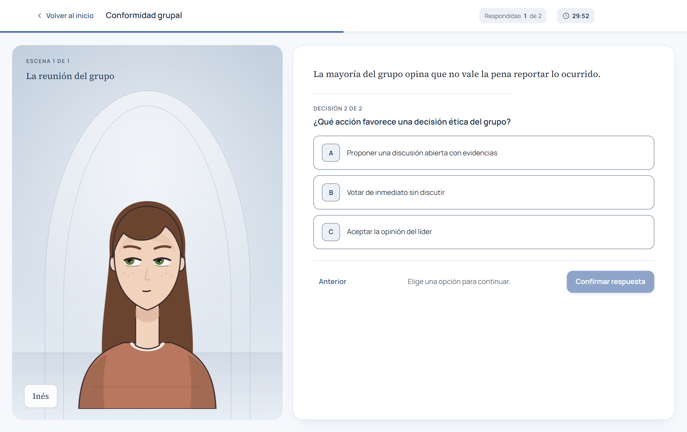

*Figura 11. Respuesta guardada: el contador pasa a «Respondidas 1 de 2», el personaje reacciona y aparece la decisión 2.*

> **Atención.** Solo se guarda lo que confirmas. Una opción elegida sin confirmar se pierde si sales o si se acaba el tiempo.

## La barra de acciones te orienta

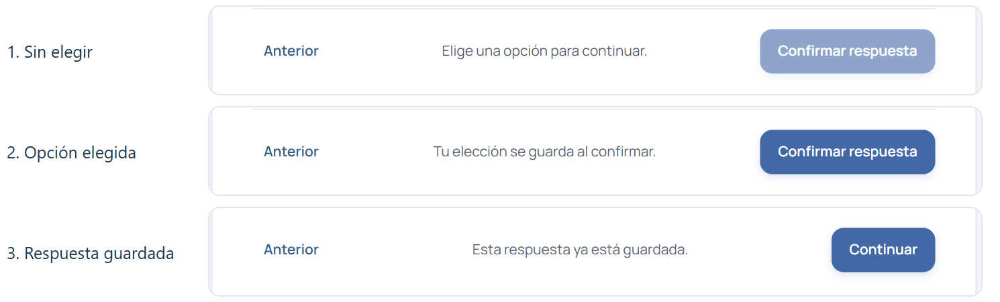

*Figura 12. Los tres momentos de la barra de acciones (composición de capturas).*

## Pasar de una escena a otra

Cuando respondes la última decisión de una escena, el caso avanza solo a la siguiente: cambian el título, la narración y el número, por ejemplo de **Escena 1 de 2** a **Escena 2 de 2**.

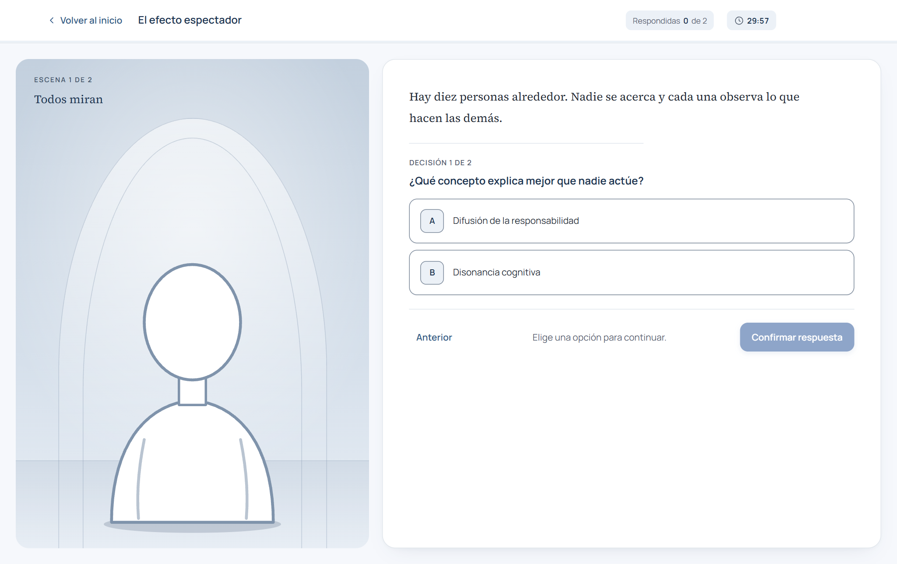

*Figura 13. Escena 1 de 2 de un caso de ejemplo. Este caso no tiene personaje ilustrado y muestra la silueta.*

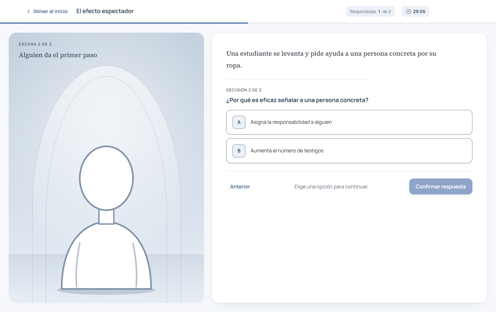

*Figura 14. Escena 2 de 2: nuevo título, nueva narración y nueva decisión.*

> **Nota · No se puede saltar una decisión.** Para avanzar debes confirmar la decisión actual. Si dudas, elige la opción que mejor puedas justificar: podrás volver a ella antes de entregar.

### Procedimiento: Revisar o cambiar una respuesta

*Corrige una decisión antes de entregar.*

**Paso 1.** Pulsa **Anterior** para retroceder, o **Revisar mis respuestas** al final del caso.

**Paso 2.** La opción guardada muestra la etiqueta **Respuesta guardada**.

**Paso 3.** Si quieres mantenerla, pulsa **Continuar**. Si quieres cambiarla, elige otra y pulsa **Confirmar respuesta**.

> **Resultado esperado.** La nueva respuesta reemplaza a la anterior. Solo cuenta la última que confirmaste.

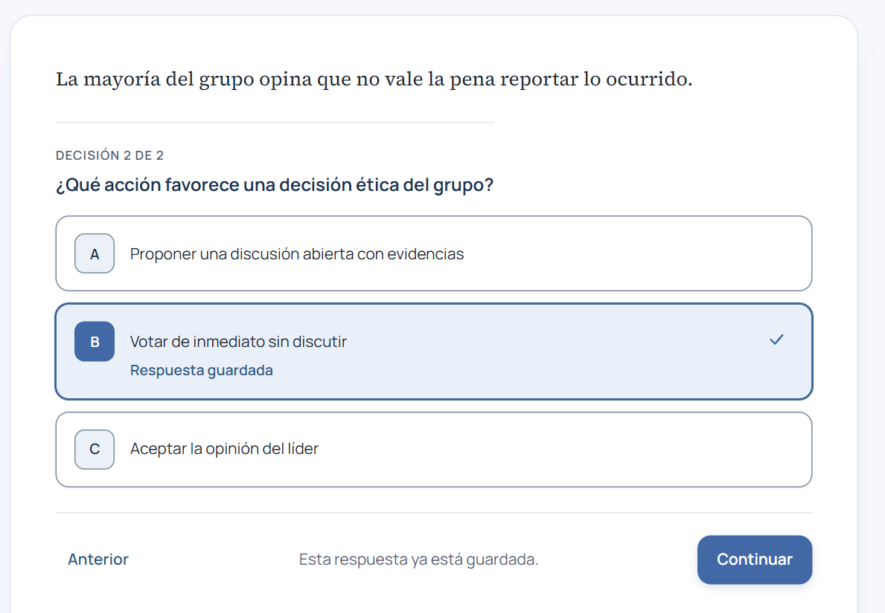

*Figura 15. Una respuesta ya guardada. Si no la cambias, el botón es «Continuar».*

### Procedimiento: Entregar el caso

*Cierra tu intento de forma voluntaria.*

**Antes de comenzar:**

- Debes haber confirmado todas las decisiones.

**Paso 1.** Al terminar llegas a **Revisión final**. Comprueba cuántas decisiones has respondido.

**Paso 2.** Si quieres repasarlas, pulsa **Revisar mis respuestas**.

**Paso 3.** Pulsa **Entregar caso**.

**Paso 4.** Lee el aviso «¿Entregar el caso?» y pulsa **Entregar**.

> **Resultado esperado.** Aparece **Entregaste el caso**, con las decisiones respondidas, la hora y el motivo de cierre.

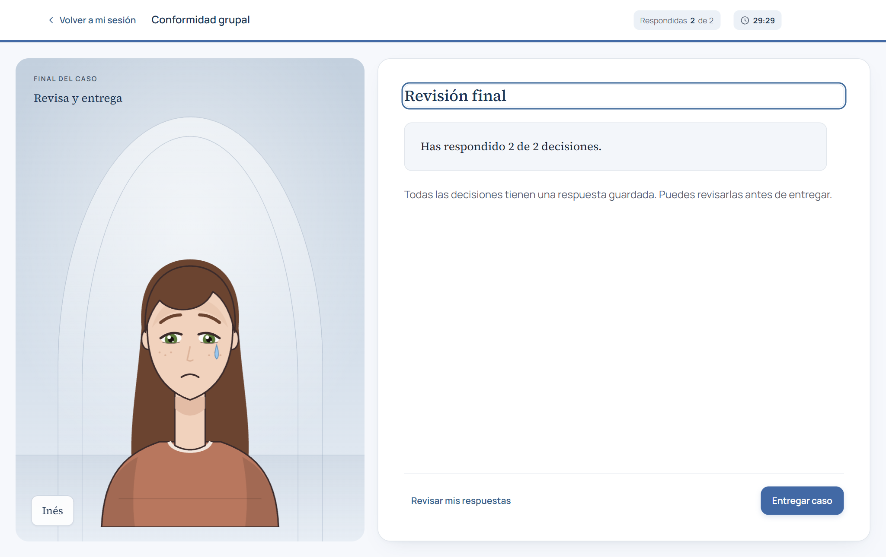

*Figura 16. Revisión final con todas las decisiones guardadas.*

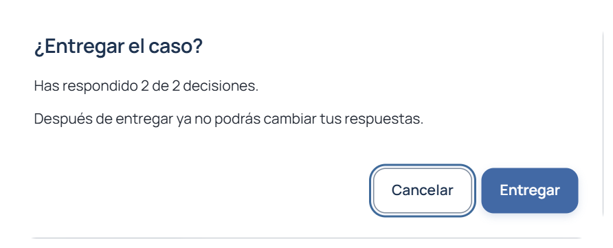

*Figura 17. Última confirmación antes de entregar.*

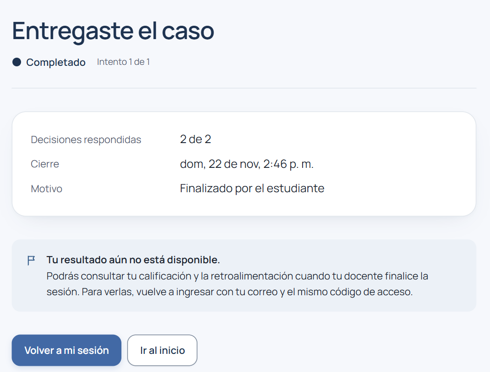

*Figura 18. Así sabes que tu entrega quedó registrada.*

> **Atención.** Después de entregar ya no puedes cambiar tus respuestas. Responder todo **no** entrega el caso: debes pulsar **Entregar caso**.

# 7. Interactuando con los personajes

*El personaje da rostro al caso. Su expresión acompaña el relato y te invita a pensar en la otra persona.*

## Cuándo cambia la expresión

Al entrar en una escena, el personaje muestra la expresión inicial que definió tu docente. **Elegir** una opción no la cambia. La reacción llega después de **confirmar**, cuando tu respuesta queda guardada.

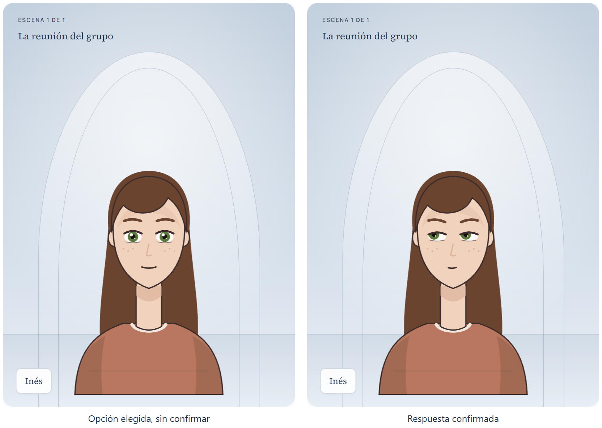

*Figura 19. La expresión no cambia al elegir, sino al confirmar (composición de capturas).*

| Situación | Qué verás |
|---|---|
| Confirmas una opción con reacción | El personaje cambia de expresión con una transición suave. |
| Confirmas una opción sin reacción | La expresión se mantiene. |
| Tu respuesta lleva a otra escena | La reacción dura un instante y luego aparece la expresión inicial de la nueva escena. |
| Sales y vuelves a entrar | Se muestra la expresión inicial de la escena, no la última reacción. |
| Hay un error al guardar | La expresión no cambia. |

## Las expresiones

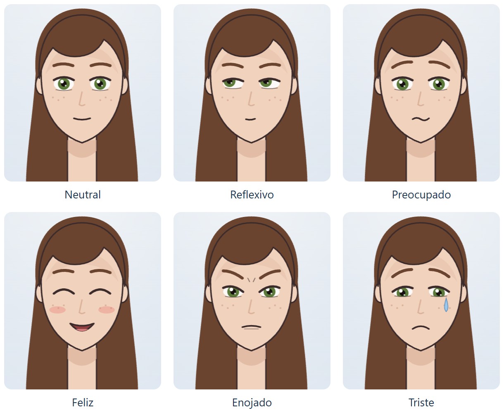

*Figura 20. Expresiones de Inés, el personaje del caso «Conformidad grupal» (composición de capturas).*

> **Atención · Una expresión no es una calificación.** La reacción es un recurso narrativo elegido por tu docente. No te dice si acertaste, no es un diagnóstico y no influye en tu nota.

## Qué puedes esperar del personaje

| Sí hace | No hace |
|---|---|
| Muestra expresiones preparadas por tu docente. | No conversa contigo ni responde preguntas. |
| Reacciona a las opciones que confirmas. | No usa inteligencia artificial ni improvisa. |
| Aparece con su nombre, si tu docente lo definió. | No habla, no tiene voz ni música. |

Algunos casos muestran una **silueta blanca sin rostro**. Es normal: ese caso no tiene un personaje ilustrado y se responde exactamente igual.

> **Para tu aprendizaje.** Cuando veas una reacción, pregúntate: «¿qué pudo sentir esta persona ante mi decisión?». Tomar la perspectiva del otro también es parte del análisis.

# 8. Tiempo, intentos y finalización

*Hay tres relojes distintos. Entenderlos te evitará sorpresas.*

1. **Horario de la sesión.** Desde el inicio hasta el fin programado por tu docente.
2. **Plazo para empezar.** Termina a la mitad de ese horario. Después nadie puede iniciar un intento.
3. **Tiempo de tu intento.** Los minutos que tienes desde que pulsas «Iniciar».

> **Ejemplo · Una sesión de 2:00 a 4:00 p. m. con 30 minutos por intento**
>
> - **3:00 p. m.** es el último momento para empezar.
> - Si inicias a las **2:50**, tu tiempo termina a las **3:20**.
> - Si llegas a las **3:05**, ya no puedes iniciar, aunque la sesión siga abierta.

En **Inicio** y en **Mi sesión** siempre verás la hora límite real de tu sesión. La hora que cuenta es la del sistema, no la de tu equipo.

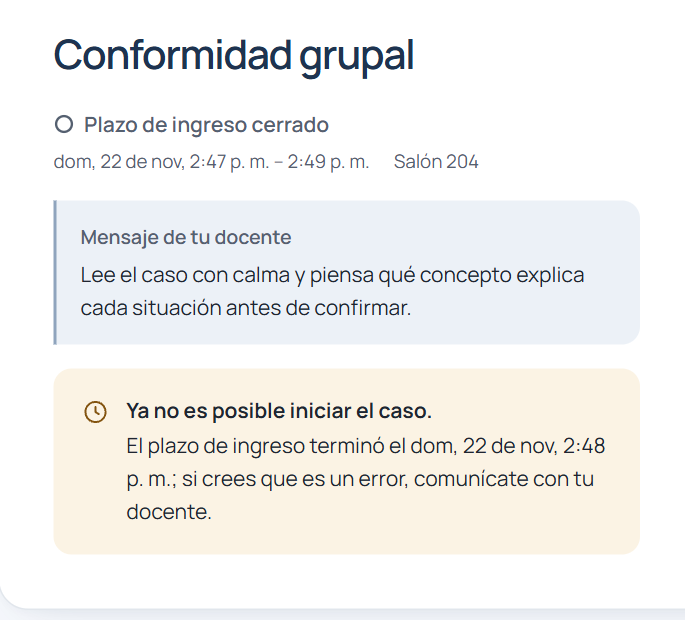

*Figura 21. Plazo de ingreso cerrado: ya no es posible iniciar el caso.*

## Si el tiempo se acaba

Tu intento se cierra solo y verás **Tu intento se cerró**. Se conservan las respuestas que confirmaste y con ellas se calcula tu resultado; las decisiones sin responder cuentan como no acertadas.

*Figura 22. Intento cerrado por tiempo con una de dos decisiones respondidas.*

## Cuántos intentos tienes

- Cada convocatoria empieza con **un intento**. Tu docente puede autorizar más.
- Si te queda alguno y sigues dentro del plazo, verás **Iniciar otro intento**.
- Cada intento se responde desde cero, tiene su propio tiempo y su propio resultado.
- Si necesitas otro, pídeselo a tu docente **antes** de que termine el plazo para empezar.

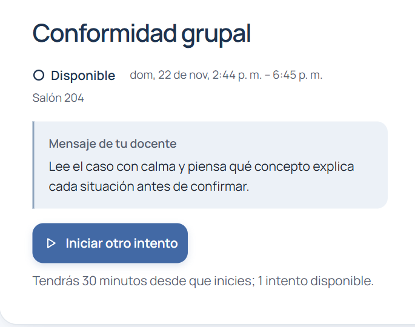

*Figura 23. Con un segundo intento autorizado aparece «Iniciar otro intento».*

### Procedimiento: Retomar un intento interrumpido

*Vuelve al caso si cerraste la página, se apagó el equipo o venció tu acceso.*

**Antes de comenzar:**

- Tu intento debe seguir abierto y con tiempo.

**Paso 1.** Abre Iter Animi. Si te lo pide, ingresa con el mismo correo y código.

**Paso 2.** En **Inicio** o en **Mi sesión**, pulsa **Continuar caso**.

> **Resultado esperado.** El simulador se abre en la primera decisión sin responder. Retomar no gasta otro intento ni reinicia el reloj.

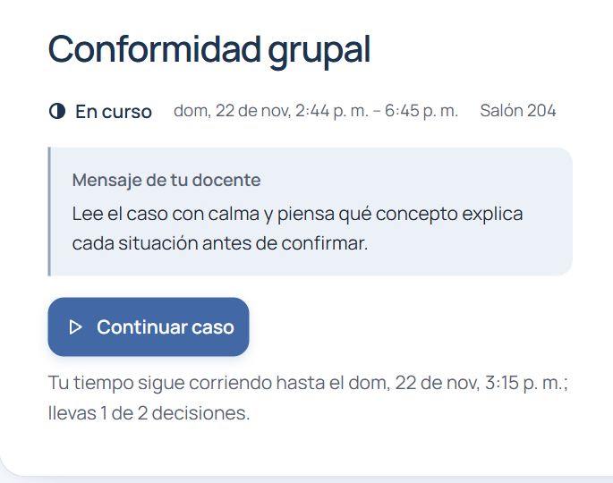

*Figura 24. Intento en curso: hora límite y decisiones respondidas.*

> **Consejo.** Mientras tu intento siga abierto puedes volver a ingresar, incluso si ya venció el plazo para empezar.

## Si algo interrumpe tu actividad

| Qué ocurre | Qué pasa con tu intento |
|---|---|
| **Te quedas sin internet** | El botón puede permanecer en **Guardando…**. Al recuperar la conexión, el envío continúa solo. No cierres la página. |
| **Falla el envío** | Verás un mensaje y «Tu selección se conservó: puedes volver a confirmarla.». Pulsa otra vez **Confirmar respuesta**. |
| **Cierras la página** | Se conserva lo confirmado. El tiempo sigue corriendo. |
| **Tu docente finaliza la sesión** | Tu intento se cierra con lo que tengas guardado y vuelves a **Ingresar**. |
| **Tu docente te retira** | Pierdes el acceso y tu intento se cierra con lo guardado. |
| **Regeneran tu código** | Vuelves a **Ingresar**. Si tu intento sigue abierto, continúa con el código nuevo. |

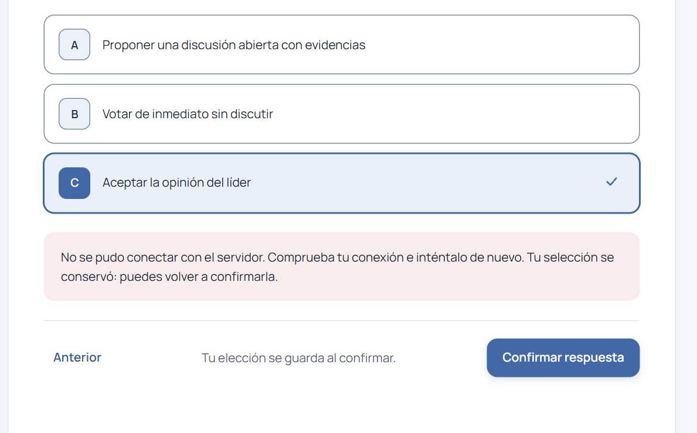

*Figura 25. Si falla el envío, tu opción sigue elegida y puedes confirmarla de nuevo.*

# 9. Consultando tus resultados

*Los resultados se abren en dos pasos que dependen de tu docente. Cuando estén listos, entras con el mismo código.*

## Cuándo estarán disponibles

**1. Entregas** (Tu intento se cierra) → **2. Finaliza** (Tu docente cierra la sesión) → **3. Evalúa** (Se registra la nota) → **4. Consultas** (Con tu mismo código)

Mientras la sesión siga en curso, **Resultados** y **Retroalimentación** te lo recordarán. No es un error.

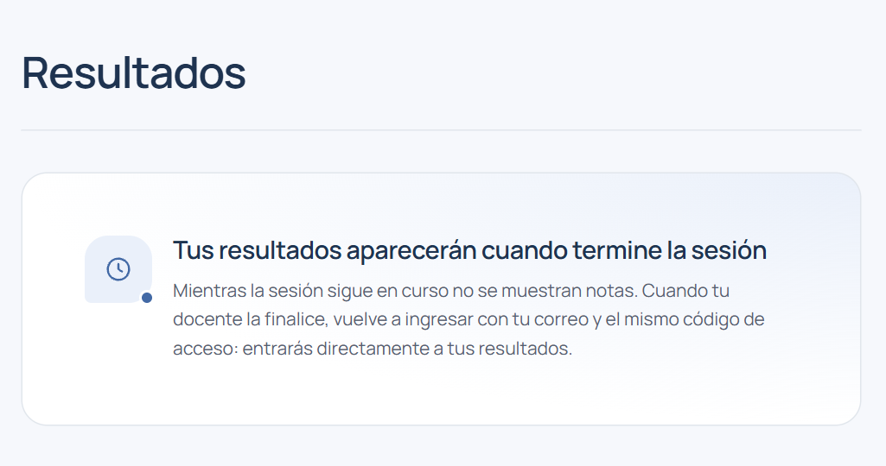

*Figura 26. Resultados antes de que finalice la sesión.*

### Procedimiento: Ver tu resultado

*Consulta tu nota y el detalle de cada decisión.*

**Antes de comenzar:**

- Tu docente finalizó la sesión.

**Paso 1.** Abre **Ingresar** y elige **Con código de acceso**.

**Paso 2.** Escribe tu correo y el **mismo código** con el que hiciste el caso.

**Paso 3.** En **Inicio**, pulsa **Ver mis resultados**.

**Paso 4.** En **Evaluados**, pulsa **Ver resultado** en el intento que quieras.

> **Resultado esperado.** Se abre el detalle del intento. Cada intento aparece por separado, con su propia nota.

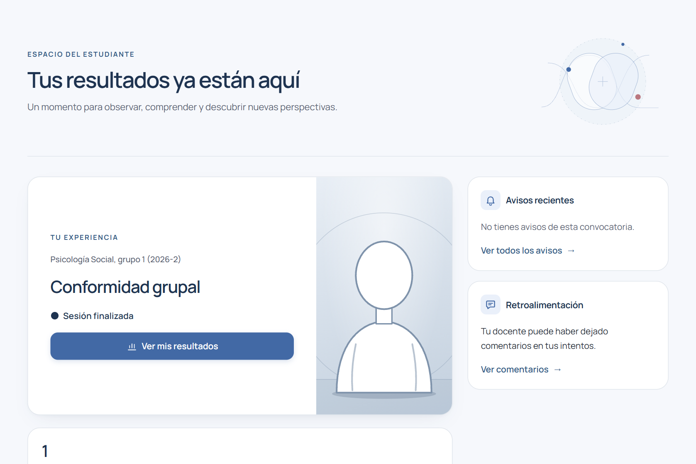

*Figura 27. Inicio cuando la sesión ya finalizó.*

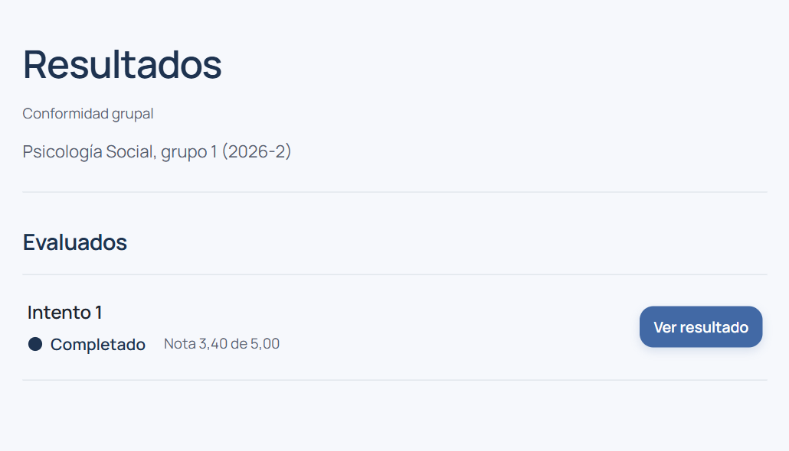

*Figura 28. Lista de intentos evaluados con su nota.*

## Qué puede aparecer en Resultados

| Verás | Qué significa |
|---|---|
| **Evaluados** | La evaluación está registrada. Puedes abrir el detalle. |
| **En revisión** / Pendiente de revisión | La sesión terminó, pero tu docente aún no registra la evaluación. Vuelve más tarde. |
| **Sin calificar** | Tu docente finalizó la sesión antes de que confirmaras alguna respuesta, así que no hay nada que evaluar. **No equivale a un cero.** |
| **No registraste intentos en esta sesión** | No iniciaste el caso, así que no hay nota ni retroalimentación. |

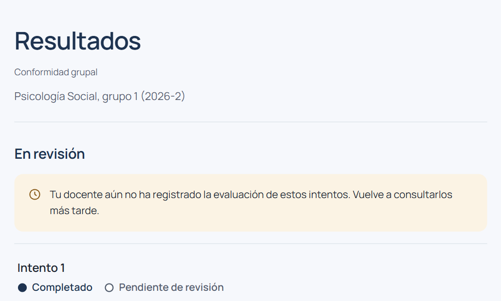

*Figura 29. Intento en revisión: falta que tu docente registre la evaluación.*

## Los avisos

Si tu institución los tiene activos, en **Avisos** verás novedades como «Resultados disponibles» o «Retroalimentación del docente». Los nuevos llevan la etiqueta **Nuevo**; al pulsar **Marcar como leído**, desaparece.

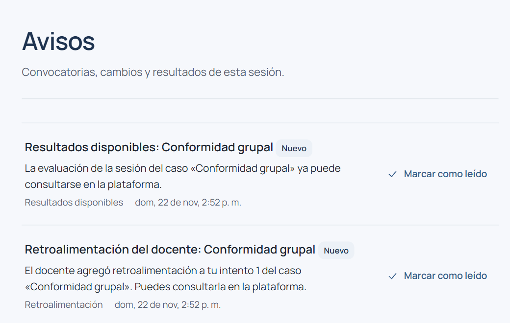

*Figura 30. Avisos de resultados y de retroalimentación.*

> **Nota · Que no haya avisos no significa que no haya resultados.** Los avisos dependen de la configuración de tu institución. Si tu docente ya finalizó la sesión, ingresa y compruébalo.

# 10. Comprendiendo tu retroalimentación

*La nota te dice cómo te fue. La retroalimentación te dice por qué, y eso es lo que te ayuda a mejorar.*

## Primero, el panorama

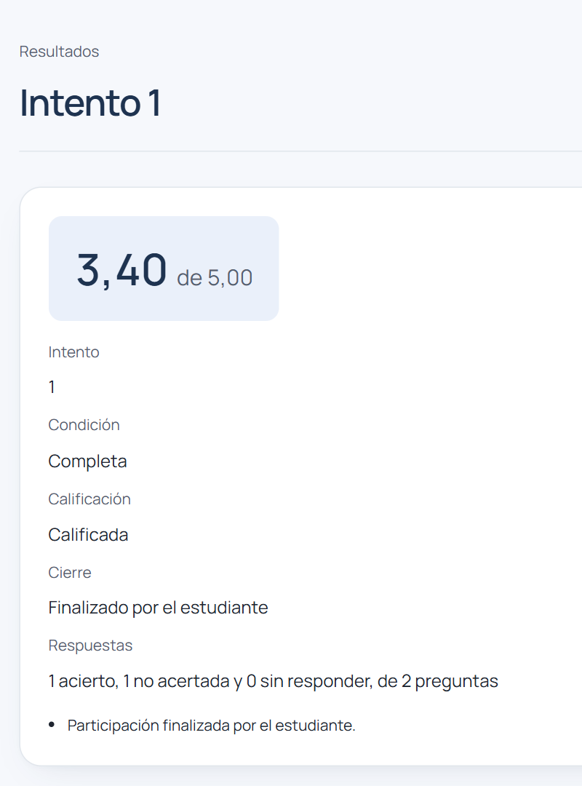

*Figura 31. Nota, condición, cierre y resumen de respuestas de un intento.*

| Dato | Cómo leerlo |
|---|---|
| **Nota** | La calcula el sistema con tus respuestas y la rúbrica del caso. La escala la define tu docente; aquí es sobre 5,00. |
| **Condición** | **Completa** si entregaste tú; **Incompleta** si el intento se cerró antes. |
| **Calificación** | **Calificada** o **Sin calificar**. |
| **Cierre** | Por qué terminó el intento. |
| **Respuestas** | Aciertos, no acertadas y sin responder. |

## Después, el desempeño por criterio

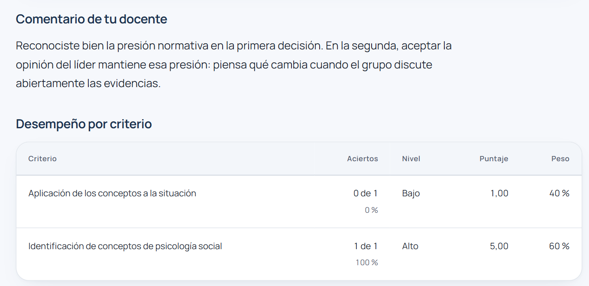

*Figura 32. Comentario del docente y desempeño por criterio.*

Cada criterio reúne una o varias decisiones. El **nivel** y el **puntaje** dependen de tu porcentaje de aciertos y de la rúbrica. El **peso** indica cuánto aporta a la nota. Si un criterio no usa niveles, verás un guion en esa columna.

> **Ejemplo · De dónde sale el 3,40**
>
> - **Identificación de conceptos:** 5,00 con un peso de 60 % → 5,00 × 0,60 = **3,00**.
> - **Aplicación de los conceptos:** 1,00 con un peso de 40 % → 1,00 × 0,40 = **0,40**.
> - **Nota:** 3,00 + 0,40 = **3,40** de 5,00.
> - **Lectura:** reconoces los conceptos, pero necesitas practicar cómo aplicarlos a una situación.

## Luego, decisión por decisión

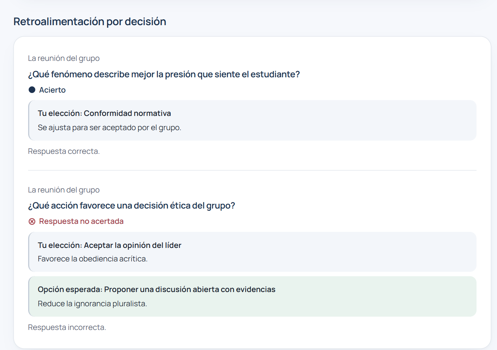

*Figura 33. Retroalimentación por decisión: un acierto y una respuesta no acertada.*

| Parte | Para qué te sirve |
|---|---|
| **Acierto** / **Respuesta no acertada** / **Sin responder** | El resultado de esa decisión. |
| **Tu elección** | La opción que confirmaste y la explicación que preparó tu docente. |
| **Opción esperada** | Aparece si no acertaste, con su justificación. |

En el ejemplo, «Aceptar la opinión del líder» **favorece la obediencia acrítica**, mientras que la discusión abierta **reduce la ignorancia pluralista**. La diferencia entre ambas justificaciones es justo el concepto que conviene reforzar.

### Procedimiento: Leer el comentario de tu docente

*Encuentra las observaciones personales sobre tu intento.*

**Antes de comenzar:**

- La evaluación de tu intento está registrada.

**Paso 1.** En el menú, entra a **Retroalimentación**.

**Paso 2.** Lee el **Comentario del docente** de cada intento.

**Paso 3.** Pulsa **Ver el resumen automático del sistema** para compararlo con las cifras.

**Paso 4.** Pulsa **Ver el resultado completo** para volver al detalle.

> **Resultado esperado.** Distingues lo que escribió tu docente de lo que genera el sistema. Si aún no hay comentarios, verás «Tu docente aún no ha dejado comentarios».

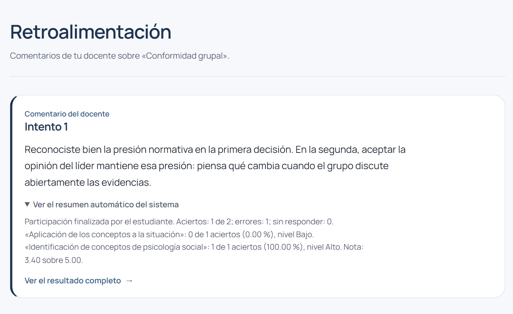

*Figura 34. Retroalimentación con el resumen automático desplegado.*

## Convierte la retroalimentación en aprendizaje

| Pregúntate | Ejemplo con «Conformidad grupal» |
|---|---|
| ¿Qué concepto estaba en juego? | Presión de la mayoría e ignorancia pluralista. |
| ¿Qué razoné yo? | Pensé que seguir al líder ordenaba al grupo. |
| ¿Qué no vi? | Que nadie expresó su duda y todos supusieron que los demás estaban de acuerdo. |
| ¿Qué haré distinto? | Buscar qué opción permite que las dudas se digan en voz alta. |

> **Para tu aprendizaje.** Empieza por el criterio con menor puntaje y mayor peso: ahí está tu mejor oportunidad de mejora. Lleva a clase una pregunta concreta sobre él.

# 11. Tu primera experiencia completa

*Repasa todo el recorrido con el caso «Conformidad grupal». Marca cada paso a medida que lo completes.*

### Fase 1 · Prepararte *(Capítulo 2)*

- [ ] Tengo mi correo institucional y mi código.
- [ ] Sé hasta qué hora puedo empezar y cuántos minutos tendré.
- [ ] Mi equipo y mi conexión están listos.

### Fase 2 · Ingresar *(Capítulo 3)*

- [ ] Elegí **Con código de acceso** y pulsé **Ingresar**.
- [ ] Leí el **Mensaje de tu docente** y revisé el estado de la sesión.

### Fase 3 · Leer el caso *(Capítulos 5 y 6)*

- [ ] Pulsé **Iniciar caso** y confirmé con **Iniciar**.
- [ ] Leí la presentación completa y pulsé **Comenzar**.

### Fase 4 · Decidir *(Capítulos 6 y 7)*

- [ ] Leí la narración y todas las opciones.
- [ ] Pulsé **Confirmar respuesta** en cada decisión.
- [ ] Observé la reacción sin tomarla como una calificación.

### Fase 5 · Entregar *(Capítulo 6)*

- [ ] Comprobé mis respuestas en **Revisión final**.
- [ ] Pulsé **Entregar caso** y después **Entregar**.
- [ ] Vi el mensaje **Entregaste el caso**.

### Fase 6 · Consultar *(Capítulo 9)*

- [ ] Esperé a que mi docente finalizara la sesión.
- [ ] Volví a ingresar con el mismo código y pulsé **Ver mis resultados**.

### Fase 7 · Aprender *(Capítulo 10)*

- [ ] Revisé mis criterios y la justificación de cada decisión.
- [ ] Leí el **Comentario del docente**.
- [ ] Anoté un concepto para reforzar.

# 12. Preguntas frecuentes

## Acceso

**P. ¿Cómo ingreso a Iter Animi?**

R. Con tu correo institucional y tu código, en la opción **Con código de acceso**. No necesitas contraseña.

**P. ¿Dónde consigo mi código?**

R. En el correo de tu convocatoria, si tu institución tiene activo ese envío. Si no lo recibiste, pídelo a tu docente.

**P. ¿Qué hago si mi código no funciona?**

R. Lee el mensaje: puede ser un error al escribirlo, un código regenerado o una sesión que todavía no está abierta. En el capítulo 3 está cada caso.

**P. ¿Puedo ver todas mis sesiones juntas?**

R. No. Cada código abre una sola convocatoria.

## Durante el caso

**P. ¿Por qué no puedo comenzar la simulación?**

R. Puede que tu docente no haya abierto la sesión, que haya vencido el plazo para empezar o que ya usaras tus intentos. El estado en **Inicio** te lo indica.

**P. ¿Puedo pausar el tiempo?**

R. No. Puedes salir y volver, pero el reloj sigue corriendo.

**P. ¿Se guarda solo?**

R. Se guarda cada respuesta que **confirmas**. Una opción elegida sin confirmar no se guarda.

**P. ¿Puedo cambiar una respuesta?**

R. Sí, mientras no hayas entregado y te quede tiempo. Usa **Anterior** o **Revisar mis respuestas**.

**P. ¿Puedo dejar una decisión en blanco?**

R. No puedes saltarla para avanzar. Quedará sin responder si el intento se cierra antes de que la confirmes.

**P. ¿Qué ocurre si se termina el tiempo?**

R. Tu intento se cierra y se evalúa con las respuestas que confirmaste.

**P. ¿Qué hago si pierdo la conexión?**

R. No cierres la página. Cuando vuelva, el envío pendiente continúa o podrás confirmar de nuevo. Si la cerraste, ingresa y pulsa **Continuar caso**.

**P. ¿Puedo repetir una actividad?**

R. Solo si tienes otro intento autorizado y sigues dentro del plazo para empezar.

## Resultados

**P. ¿Cuándo podré ver mi nota?**

R. Cuando tu docente finalice la sesión y registre la evaluación. Ingresa entonces con el mismo código.

**P. Perdí mi código y quiero ver mis resultados.**

R. Contacta a tu docente. Con la sesión finalizada el código ya no se puede regenerar y su pantalla deja de mostrarlo, así que consérvalo hasta el final.

**P. ¿Dónde encuentro los comentarios de mi docente?**

R. En **Retroalimentación** y también en el detalle de cada resultado.

**P. ¿Puedo reclamar o responder un comentario desde aquí?**

R. No existe esa función. Habla con tu docente por los canales de tu curso.

# 13. Recomendaciones finales

## Para aprovechar cada simulación

- **Lee dos veces.** La primera para entender; la segunda para encontrar los detalles que orientan la decisión.
- **Mira el contexto.** En psicología social, la situación suele explicar más que la personalidad.
- **Compara todas las opciones.** Las más tentadoras a veces nombran un concepto cercano, pero distinto.
- **Justifica en silencio.** Antes de confirmar, explica tu elección con un concepto.
- **Administra el tiempo.** Reserva unos minutos para la revisión final.
- **Vuelve a tus resultados.** Relee las justificaciones unos días después y comprueba qué recuerdas.
- **Aprende del error.** Una respuesta no acertada, bien comprendida, enseña más que un acierto por azar.

## Para terminar

Ya sabes ingresar, recorrer un caso, entregar y leer tu retroalimentación. Lo demás es práctica: cada caso es una oportunidad para comprender mejor a las personas y a los grupos.

---

*Decidir con criterio. Aprender con sentido.*
